<p align="center">
  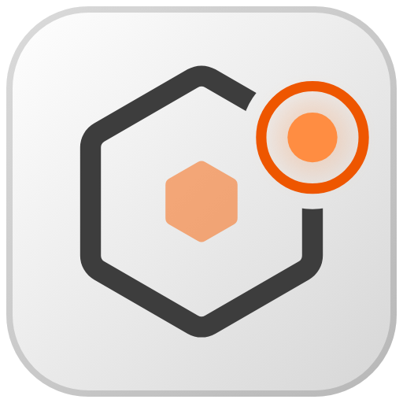
  &nbsp;&nbsp;&nbsp;&nbsp;
  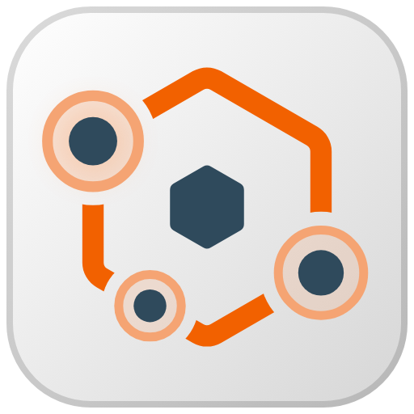
</p>

<h1 align="center">foundry</h1>

<p align="center">
  <b>forge and Gaia: a factory floor for Claude Code agents, and the window over it.</b><br>
  forge runs agents through a ticket board in one repository and lands their work on main once code has checked it.
  Gaia shows every forge on your Mac in one window: what waits on you, every agent at work, every forge's controls.
</p>

<div align="center">
<table>
  <tr>
    <td align="center"><sub>APPS</sub><br><b>2</b><br><sub>forge · Gaia</sub></td>
    <td align="center"><sub>SHARED PACKAGES</sub><br><b>2</b><br><sub>contracts · versions</sub></td>
    <td align="center"><sub>RUNTIME</sub><br><b>Bun 1.4.2</b><br><sub>+ TypeScript, React 19</sub></td>
    <td align="center"><sub>BUILD</sub><br><b>Turborepo</b><br><sub>one cache</sub></td>
    <td align="center"><sub>BUILT BY</sub><br><b>forge</b><br><sub>one board per app</sub></td>
  </tr>
</table>
</div>

<br>

<p align="center">
  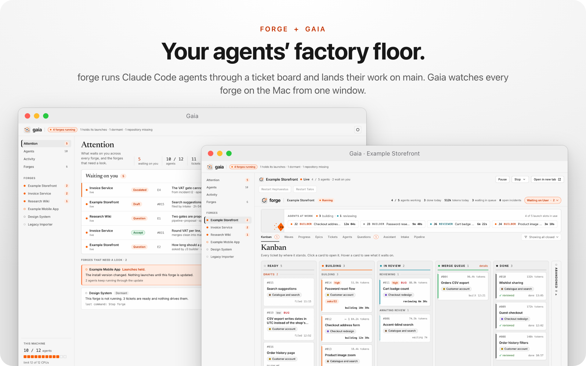
</p>

## Apps

<table>
  <tr>
    <td width="50%" valign="top">
      
      <b><a href="apps/forge/">forge</a></b><br>
      <sub>Developer tools · CLI and local API</sub><br>
      Agents report and code decides. A ticket is done when the Airlock has merged it, not when an agent says so.
    </td>
    <td width="50%" valign="top">
      
      <b><a href="apps/gaia/">Gaia</a></b><br>
      <sub>Developer tools · macOS app</sub><br>
      One window over every forge on the machine. It runs no agent, and a forge works the same without it.
    </td>
  </tr>
</table>

## forge

<p align="center">
  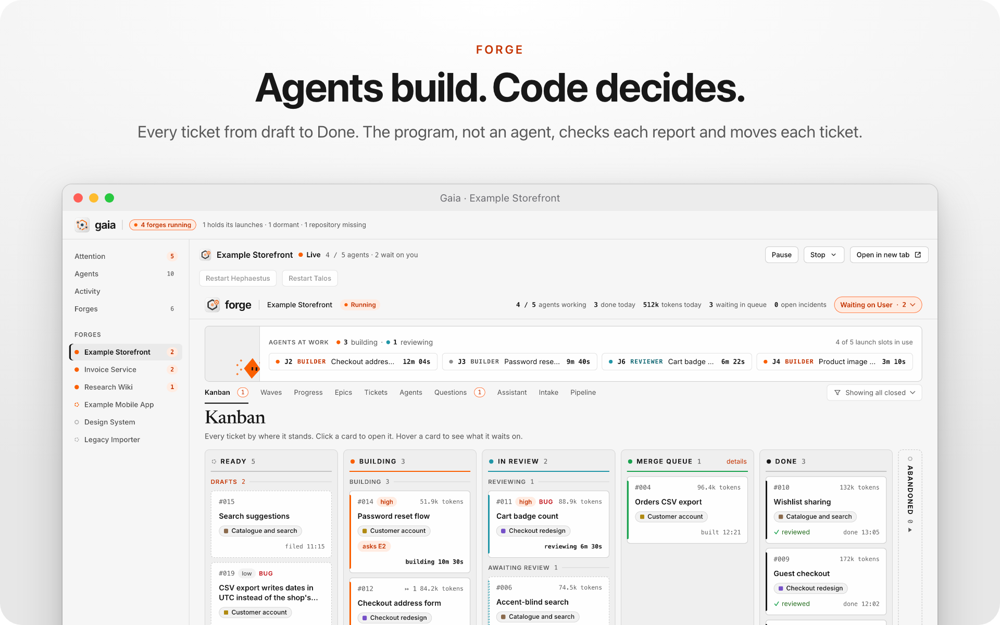
</p>

<table>
  <tr>
    <td width="50%" valign="top">
      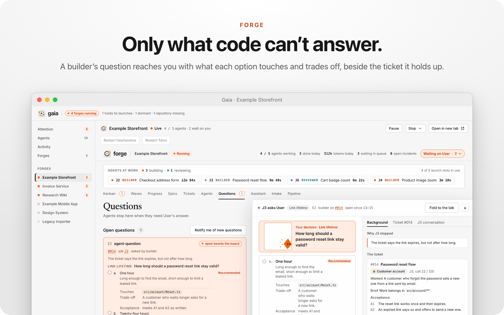
    </td>
    <td width="50%" valign="top">
      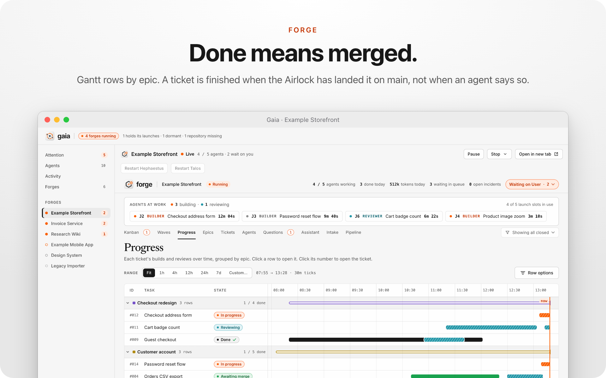
    </td>
  </tr>
</table>

<p align="center">
  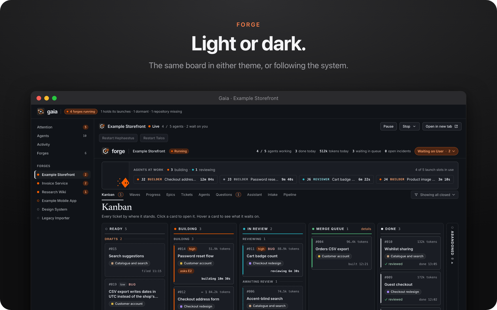
</p>

**Agents report and code decides.** A report is a claim until Customs and the board's gates have checked it on the final commit.
A fresh reviewer follows when the board's pipeline sets one.

**Done means merged.** The Airlock lands tickets on main one at a time, from the merge queue. A red result goes back to the same builder.

**A Hephaestus can die or be updated while agents keep running.** Each agent session lives under the detached Talos, not under
Hephaestus, and on macOS every gate and session runs confined.

**You answer only what code cannot.** A builder's question, a proposed gate or an escalated incident reaches the Questions view as a
decision, with what each option touches. Everything else, Hephaestus drives.

**No page of its own.** Hephaestus serves the whole board through an API on `127.0.0.1`. Gaia is the client that shows it, and
takes your moves.

[forge's README](apps/forge/README.md) shows one ticket from start to merge, what `forge init` adds to a repository, and the
quickstart.

## Gaia

<p align="center">
  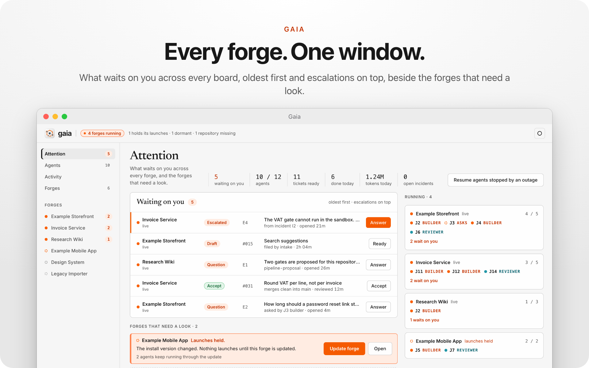
</p>

<table>
  <tr>
    <td width="50%" valign="top">
      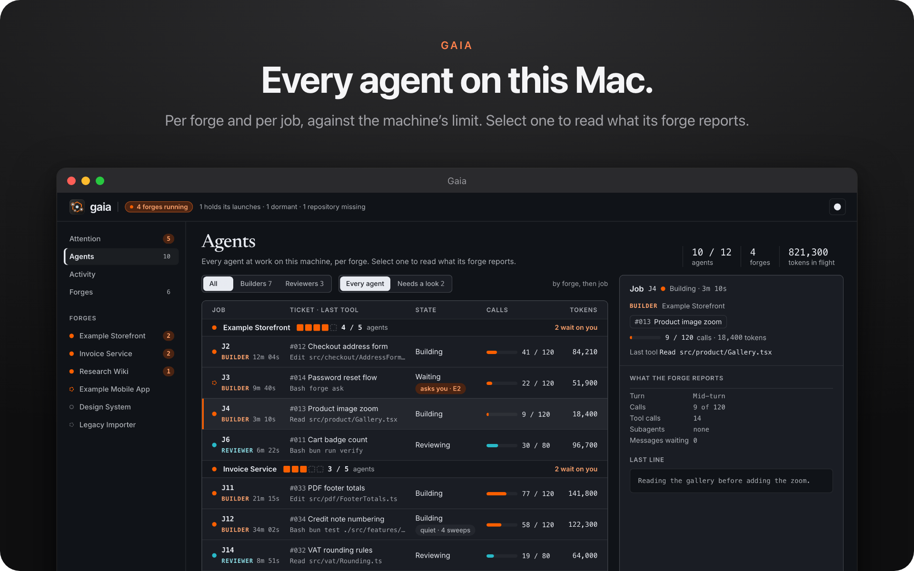
    </td>
    <td width="50%" valign="top">
      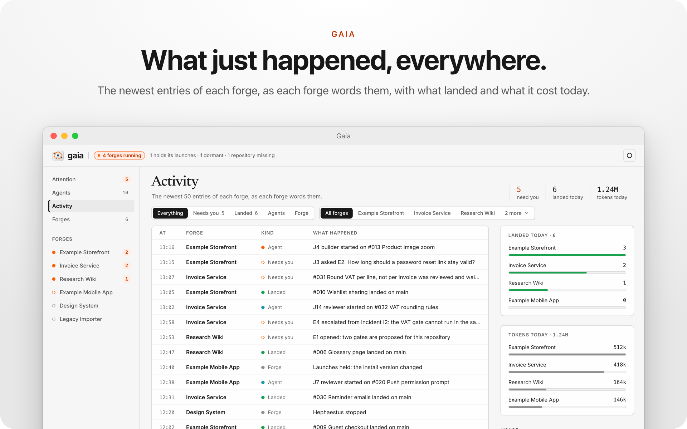
    </td>
  </tr>
  <tr>
    <td width="50%" valign="top">
      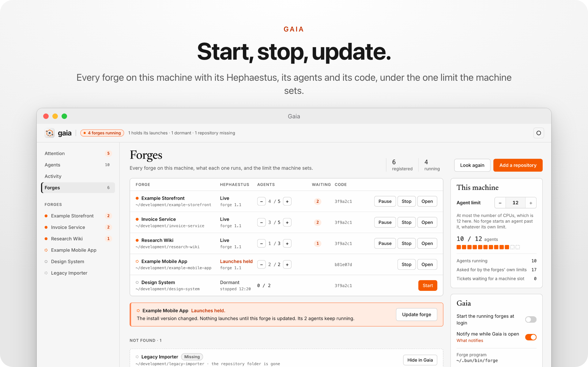
    </td>
    <td width="50%" valign="top">
      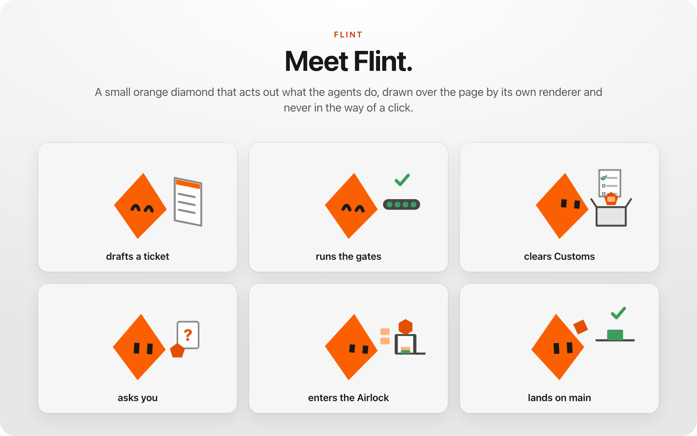
    </td>
  </tr>
</table>

**What waits on you, across every board.** Questions, escalations and tickets to accept from every forge, oldest first and escalations on
top, each one click from its place on its own forge's board.

**Each board in place.** A forge's board opens under Gaia's bar as Gaia's own views, so its Kanban, its Questions and its Progress
are one click from the fleet.

**Shows, never drives.** Gaia reads what each forge reports and sends its commands through that forge. Flint's brain is each forge's own;
Gaia shows it and makes no model call.

[Gaia's README](apps/gaia/README.md) says how to run it from this checkout and install `Gaia.app`.

## In the box

| Folder | What it is |
| --- | --- |
| [`apps/forge/`](apps/forge/) | forge: the tracker, Hephaestus and its API, Talos and the CLI |
| [`apps/gaia/`](apps/gaia/) | Gaia: one window over every forge on the machine, and the views of each forge's board |
| [`apps/gaia/page/lib/design-system/`](apps/gaia/page/lib/design-system/) | a library of Gaia's page: React components with their own light and dark theme |
| [`apps/gaia/page/lib/flint/`](apps/gaia/page/lib/flint/) | a library of Gaia's page: Flint, the orange diamond that acts out what the agents do, drawn over its host page |
| [`apps/gaia/page/lib/brand/`](apps/gaia/page/lib/brand/) | a library of Gaia's page: forge's mark as a React component, with its colour tokens |
| [`packages/forge-contracts/`](packages/forge-contracts/) | what a forge serves and reads, as TypeScript types, with its system versions |
| [`packages/system-versions/`](packages/system-versions/) | the version model a server and its clients share, and its compatibility logic |
| [`docs/monorepo/`](docs/monorepo/) | the monorepo's design and its migration checklist, and the designs of Hephaestus and Talos, the context pipeline and the move to one forge with entities |
| [`scripts/`](scripts/) | the root's own scripts (`gate:<app>`, `cache:audit`), a workspace member so turbo checks them |

Each app is built on its own forge board, one tracker in `apps/forge/` and one in `apps/gaia/`. Each app's `CLAUDE.md` holds its rules,
and the root [`CLAUDE.md`](CLAUDE.md) names each tracker's reach and gate and whose rules each package follows.

## Get started

### Install forge

```sh
git clone https://github.com/AlexDM0/foundry.git && cd foundry
apps/forge/setup.sh
```

Then, in the repository to adopt:

```sh
forge init --project "Example Storefront"
forge start
forge unpause
```

A new board starts paused; `unpause` lets it build. No forge command opens the board: Gaia shows it.
[Getting started](apps/forge/docs/operations/getting-started.md) runs a first board end to end.

### Open Gaia

```sh
cd apps/gaia
bun src/Main.ts install-app
```

installs `Gaia.app` into `~/Applications`, which opens Gaia's window from the Finder, Launchpad or Spotlight.
`bun src/Main.ts launch` opens the same window without installing it.

## Develop

```sh
bun install --frozen-lockfile
```

installs every workspace into one hoisted `node_modules` at this root. Every package is a workspace member that its consumers declare
at `workspace:^`; nothing is linked by hand.

```sh
bun run verify
```

runs every workspace's `typecheck`, `lint`, `test`, `test:dom` and `check` through Turborepo, each in its own folder, replaying a task
whose inputs have not changed from the cache in `.turbo/cache`. `bun run typecheck` and `bun run lint` run those tasks alone;
`bun run verify:forge` and `bun run verify:gaia` run one app and the packages it depends on. Never run `bun test` at the root: each
workspace's test preload applies only in its own folder.

| Script | Runs |
| --- | --- |
| `lint:fix` | every workspace's `lint:fix`: eslint with its fixes applied, never cached; the pre-commit hook names it when `lint` fails |
| `gate:forge`, `gate:gaia` | a tracker's gate: every workspace's `typecheck`, `lint`, `test` and `test:dom`, then that app's `check` alone; where forge hands a path in `FORGE_GATE_REPORT`, it writes the gate's cache report there: `hit` when turbo replayed every task with a script, `partial` some, `miss` none |
| `cache:audit [<target reference>]` | the merge gate's audit: re-runs past the cache the tasks of what changed since the target, `main` when none is named (forge hands a gate none), and removes a failing task's entry; it writes a `miss` report, as it runs past the cache |

## Privacy

<table>
  <tr>
    <td width="33%" valign="top"><b>On your machine</b><br><sub>forge keeps its state in plain files in the repository and serves its API on <code>127.0.0.1</code>. Gaia reads the forges on this machine and serves its page on <code>127.0.0.1</code> too.</sub></td>
    <td width="33%" valign="top"><b>No telemetry</b><br><sub>Neither app reports anywhere, and every root script runs Turborepo with its telemetry off.</sub></td>
    <td width="33%" valign="top"><b>Your own agents</b><br><sub>The agents are your own Claude Code sessions. What leaves the machine is what they send to Anthropic and the network domains a ticket or gate allows.</sub></td>
  </tr>
</table>

## Information

<table>
  <tr>
    <td width="190"><b>Requires</b></td>
    <td>Bun 1.4.2, git, a logged-in Claude Code (<code>claude</code>); Google Chrome or Microsoft Edge for Gaia's window</td>
  </tr>
  <tr>
    <td width="190"><b>Runs on</b></td>
    <td>macOS on Apple silicon, where both apps have run. forge has Linux and Windows adapters proved only over fakes;
      <a href="apps/forge/docs/development/platform-status.md">the platform status</a> lists what never ran</td>
  </tr>
  <tr>
    <td width="190"><b>Confinement</b></td>
    <td>on macOS, forge's gates run under Seatbelt and its sessions in Claude Code's sandbox</td>
  </tr>
  <tr>
    <td width="190"><b>Languages</b></td>
    <td>TypeScript on Bun; React 19 for Gaia's page and its libraries</td>
  </tr>
  <tr>
    <td width="190"><b>Versions</b></td>
    <td>forge and Gaia are released apart and meet only through system versions, which forge serves and Gaia checks</td>
  </tr>
  <tr>
    <td width="190"><b>Source</b></td>
    <td><a href="https://github.com/AlexDM0/foundry">github.com/AlexDM0/foundry</a></td>
  </tr>
</table>

## Further reading

- **[forge's documentation index](apps/forge/docs/README.md)**: the overview, getting started, the glossary and the CLI reference.
- **[Gaia's architecture](apps/gaia/docs/architecture.md)** and **[contracts](apps/gaia/docs/contracts.md)**: how the launcher, the
  server, the page and the forges fit together, and every versioned contract between them.
- **[The monorepo's design](docs/monorepo/design.md)**: the two trackers, their gates and the one turbo cache.
