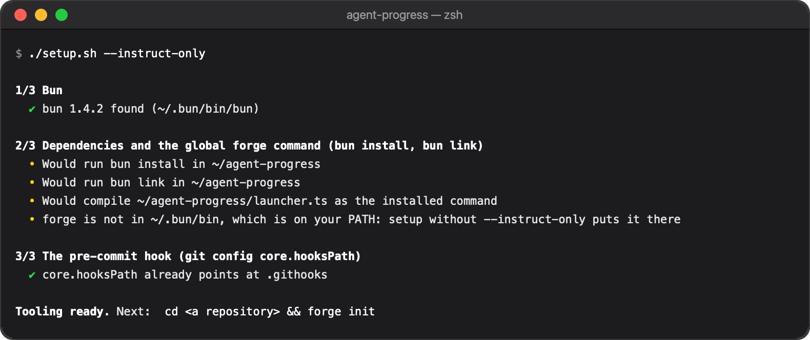

<p align="center">
  
</p>

# forge

> **Question:** What is this, what does it look like, what will it do to my repository, and where do I go next?
> **Time:** 5 minutes.
> **Read first:** nothing.
> **Next:** [index](docs/README.md), [overview](docs/concepts/overview.md),
> [getting started](docs/operations/getting-started.md).

## In one screen

forge runs Claude Code [agents](docs/glossary.md#agent) through a [ticket](docs/glossary.md#ticket) board in one
repository. Agents do the work and report it, and the program, not an agent, checks each report and moves each
ticket. forge has no page of its own: [Hephaestus](docs/glossary.md#hephaestus) serves the whole
[board](docs/glossary.md#board) through an API on `127.0.0.1`, and a client of that API shows it and takes the moves of
User, the person running the board.

forge grew out of `agent-progress` and is now a project of its own. It installs side by side with the released
`agent-progress`, sharing none of its files.

The promise, in three lines:

- **Agents report and code decides.** A report is a claim until [Customs](docs/glossary.md#customs) and the
  [gates](docs/glossary.md#gate) have checked it.
- **Done means merged.** A ticket is finished when the [Airlock](docs/glossary.md#airlock) has landed it, not when an
  agent says so.
- **A [Hephaestus](docs/glossary.md#hephaestus) can die or be updated while agents keep running.** Each agent session
  lives under the board's detached [Talos](docs/glossary.md#talos), not under Hephaestus.
  [Two lifetimes](docs/concepts/overview.md#two-lifetimes) shows it over time.


*Notice that nothing inside the dashed box is a child of Hephaestus, and that agents touch neither the board nor
main.*

## One ticket, start to merge

User describes the work and readies the [draft ticket](docs/glossary.md#draft-ticket) a product owner files.
Hephaestus drives every step after that. User steps in only for what code cannot answer, which reaches the Questions
view as a [decision](docs/glossary.md#decision).

<p align="center">
  
</p>

*Notice that review is optional, set by the board's [pipeline](docs/glossary.md#pipeline).*

[The ticket lifecycle](docs/concepts/ticket-lifecycle.md) walks this path, with what happens when a step fails.

## What it does to a repository

`forge init` only adds the files below. Once running, Hephaestus creates ticket branches and lands
finished tickets on the [main line](docs/glossary.md#main-line).

| What | Where | In git |
| --- | --- | --- |
| The [tracker](docs/glossary.md#tracker): state, log, tickets and installed guidance, shared by every worktree | `.forge/` | ignored |
| Ignore entries for the folders in this table | `.gitignore` | commit it |
| A `SessionStart` hook that tells each session how the board works | `.claude/settings.local.json` | untracked: do not commit |
| The two skills, for this repository only | `.claude/skills/forge-po/`, `.claude/skills/forge-pipeline/` | ignored |
| One [worktree](docs/glossary.md#worktree) per ticket, plus group and session folders, created as work starts | `.forge-worktrees/` | ignored |

> **As built.** A landed ticket's worktree stays in that folder. See
> the known gap.

`init` adds nothing to `CLAUDE.md`, and it [refuses](docs/reference/refusals.md) a repository the released program
already tracks.

Outside the repository, the setup script links the program with `bun link` and points the forge checkout's git hooks at
`.githooks/`, and each tracker registers in `~/.forge-monitor/`.
The on-disk atlas maps every path.

## Quickstart

forge lives at github.com/AlexDM0/foundry. It needs Bun, git and a logged-in `claude`, and has been run on macOS;
[getting started](docs/operations/getting-started.md) says what differs elsewhere.

| Platform | x64 | arm64 | Also needs | Confinement in force |
| --- | --- | --- | --- | --- |
| macOS | never run | run | nothing more: `sandbox-exec` ships with macOS | gates under Seatbelt; sessions in Claude Code's sandbox |
| Linux | never run | never run | `bwrap` able to create user namespaces | gates under bubblewrap; sessions in Claude Code's sandbox |
| Windows (native) | never run | never run | an absolute `SystemRoot`; PowerShell for `setup.ps1` | none: gates and sessions run unconfined by design |

Linux and Windows have adapters for every OS-dependent part, proved only over fakes on a Mac.
[Platforms](docs/cli.md#platforms) says what each OS does and what Windows loses with no confinement, and
[the platform status](docs/development/platform-status.md) lists what has never run.

```sh
git clone https://github.com/AlexDM0/foundry.git && cd foundry
apps/forge/setup.sh
```

The clone is a Bun workspace: forge is the app in `apps/forge/`, and the packages it uses are in `packages/`. On
Windows, in PowerShell, run `apps\forge\setup.ps1` in place of `apps/forge/setup.sh`. It needs no administrator rights
and no bash:

```powershell
powershell -ExecutionPolicy Bypass -File .\apps\forge\setup.ps1
```

Both scripts only make sure Bun is installed, offering Bun's own installer, and then hand over to `setup.ts`, which runs
the same three steps on every system. With Bun already installed, `bun run setup` in `apps/forge/` starts `setup.ts`
directly. Setup refuses a Bun older than the version the clone's `.bun-version` pins, and offers `bun upgrade`. On Windows, step 2 offers to add
Bun's `bin` folder to your User `PATH` instead of editing a shell startup file.

<p align="center">
  
</p>

Then, in the repository to adopt:

```sh
cd ~/code/example-storefront
forge init --project "Example Storefront"
forge start
forge unpause
```

`start` starts Hephaestus in the background and prints its URL. No forge command opens the board: a client
of Hephaestus's API shows it.
Commit the `.gitignore` change `init` made.

<p align="center">
  
</p>

*Notice `unpause`: a new board starts paused, and no ticket builds and no pipeline agent starts until it runs.*

The Questions view asks for the repository's gates. A [pipeline agent](docs/glossary.md#pipeline-agent) proposes them, and
User accepts the proposal there. Then describe the work in the Intake view and ready the draft tickets the product
owner files.

After a `git pull` of this checkout, run `forge update` in each tracked repository; see
[Install version](docs/cli.md#install-version).

## Privacy

Everything is local: plain files in the repository, and an API bound to `127.0.0.1` with no telemetry. What leaves the
machine is what agent sessions send to Anthropic, the vendor of the `claude` CLI, and what reaches the `network` domains
a ticket or gate allows.

## Facts

The program is TypeScript on Bun, with no runtime dependency outside this workspace.

## Where next

1. **[The documentation index](docs/README.md)** first. It has the symptom shortcuts for when something is wrong now.
2. **[The overview](docs/concepts/overview.md)** explains the system with no code, and
   **[getting started](docs/operations/getting-started.md)** runs a first board. The
   **[glossary](docs/glossary.md)** defines each term.
3. **[The CLI reference](docs/cli.md)** holds every command, flag, exit code and stored format.
4. **[Contributing](docs/development/contributing.md)** gets a change past the checks.

## In the code

| Concept | Path | Symbol | Held by |
| --- | --- | --- | --- |
| The names on this build | `src/shared/constants/ProductNames.ts` | `PRODUCT_NAMES` | `architecture/ProductNames.spec.ts` |
| A new board starts paused | `src/domain/tracker-model/constants/HephaestusStates.ts` | `DEFAULT_HEPHAESTUS_STATE` | `cli/hephaestus/UnpauseCommand.spec.ts` |
| The machine setup | `setup.ts`, `cli/setup/Setup.ts`; bootstraps `setup.sh`, `setup.ps1` | `runSetup` | `cli/setup/Setup.spec.ts`, `cli/SetupScript.integration.spec.ts`, `cli/setup/BootstrapScripts.spec.ts` |
| The images on this page | `.readme-graphics/render-diagrams.py` | `DIAGRAMS` | read by hand |
