<p align="center">
  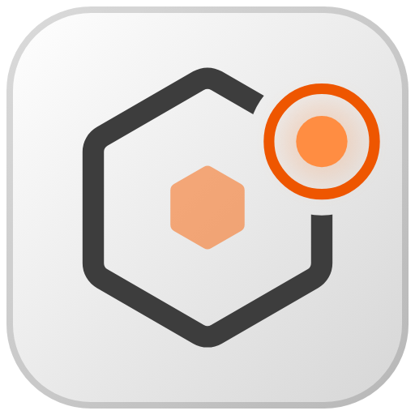
</p>

# forge

> **Question:** What is this, what does it look like, what will it do to my repository, and where do I go next?
> **Time:** 5 minutes.
> **Read first:** nothing.
> **Next:** [index](docs/README.md), [overview](docs/concepts/overview.md),
> [getting started](docs/operations/getting-started.md).

## In one screen

forge runs Claude Code [agents](docs/glossary.md#agent) through a [ticket](docs/glossary.md#ticket) board in one
repository. Agents do the work and report it, and the program, not an agent, checks each report and moves each
ticket. A live page, the [Bridge](docs/glossary.md#bridge), shows the whole [board](docs/glossary.md#board) and takes
the moves of User, the person running the board.

forge grew out of `agent-progress` and is now a project of its own. It installs side by side with the released
`agent-progress`, sharing none of its files.

The promise, in three lines:

- **Agents report and code decides.** A report is a claim until [Customs](docs/glossary.md#customs) and the
  [gates](docs/glossary.md#gate) have checked it.
- **Done means merged.** A ticket is finished when the [Airlock](docs/glossary.md#airlock) has landed it, not when an
  agent says so.
- **An [Overseer](docs/glossary.md#overseer) can die or be updated while agents keep running.** Each agent session
  lives under a detached [Watcher](docs/glossary.md#watcher), not under the Overseer.
  [Two lifetimes](docs/concepts/overview.md#two-lifetimes) shows it over time.


*Notice that nothing inside the dashed box is a child of the Overseer, and that agents touch neither the board nor
main.*

## What it looks like

The Bridge is a live React app the Overseer serves on `127.0.0.1`. Every image below is one of its views of the
Example Storefront demo board, taken with the Overseer running scripted fake agents.

<p align="center">
  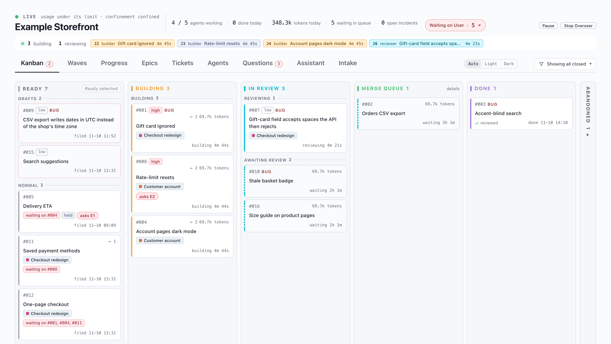
  <br><strong>Kanban.</strong> Every ticket by lane, from draft ticket to Done.
</p>

<p align="center">
  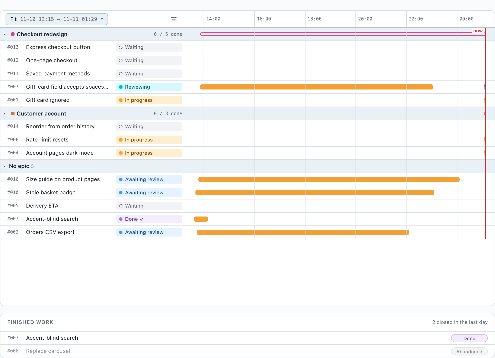
  <br><strong>Progress.</strong> Gantt rows by epic, then the finished work.
</p>

<p align="center">
  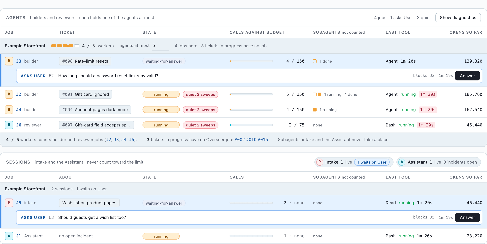
  <br><strong>Agents.</strong> Every <a href="docs/glossary.md#job">job</a> with its state, calls and subagents.
</p>

<p align="center">
  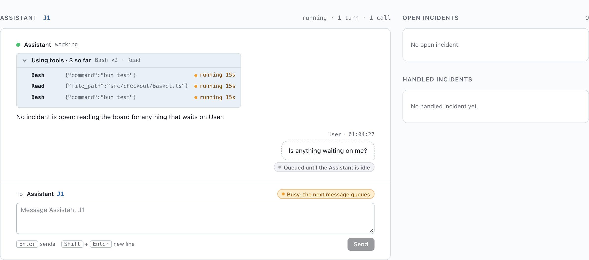
  <br><strong>Assistant.</strong> The <a href="docs/glossary.md#assistant">session</a> that settles incidents, and a
  chat with it.
</p>

<p align="center">
  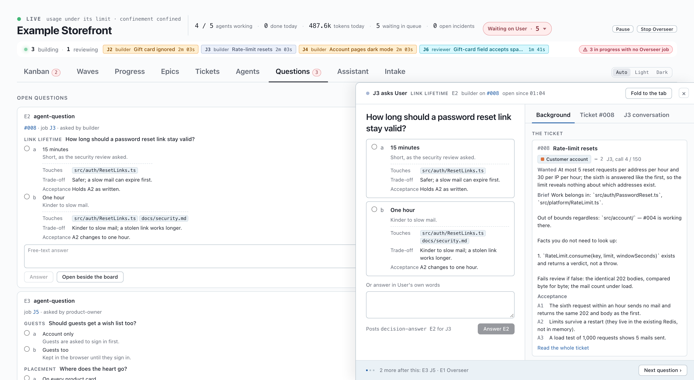
  <br><strong>Questions.</strong> What only User can answer, beside the board.
</p>

<p align="center">
  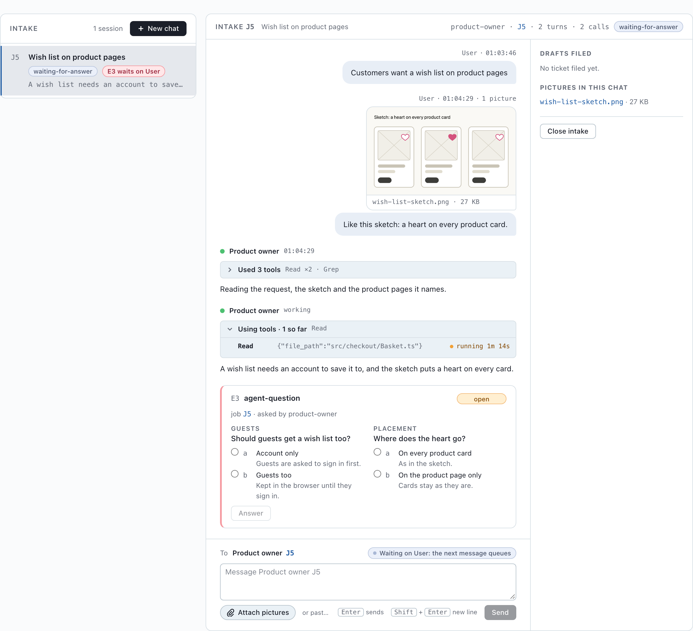
  <br><strong>Intake.</strong> A request, a picture, and the
  <a href="docs/glossary.md#product-owner">product owner</a> working on it.
</p>

<table>
  <tr>
    <td width="50%" valign="top">
      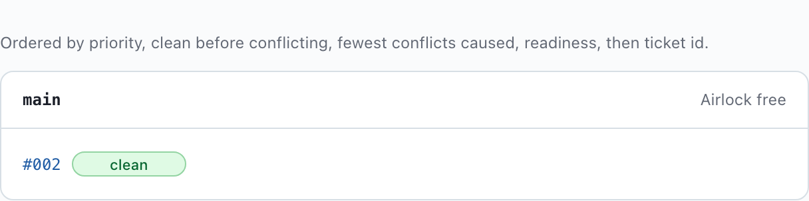
      <br><strong>Merge queue.</strong> What the Airlock holds and what waits behind it.
    </td>
    <td width="50%" valign="top">
      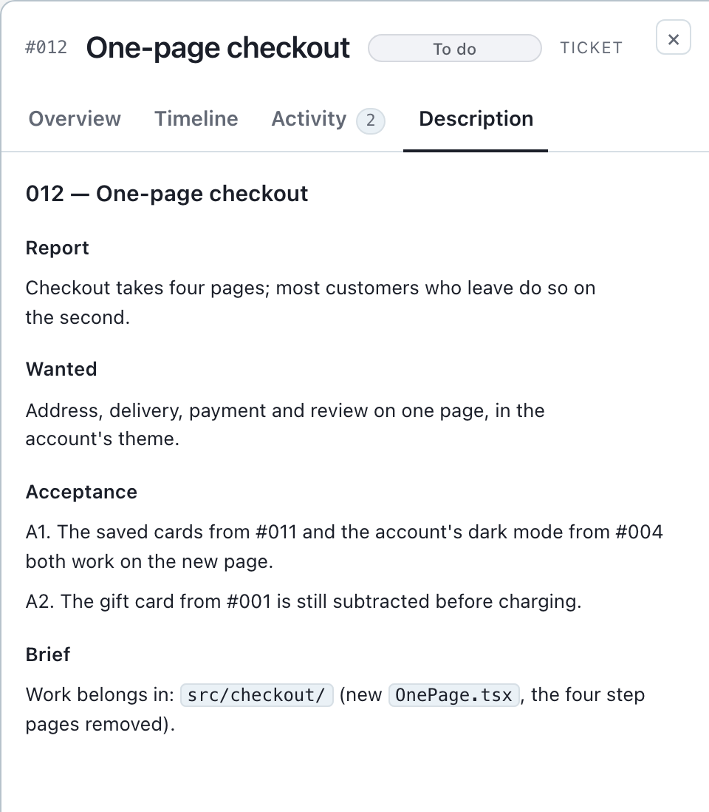
      <br><strong>Tickets.</strong> One ticket's overview, timeline, activity and description.
    </td>
  </tr>
  <tr>
    <td colspan="2" align="center">
      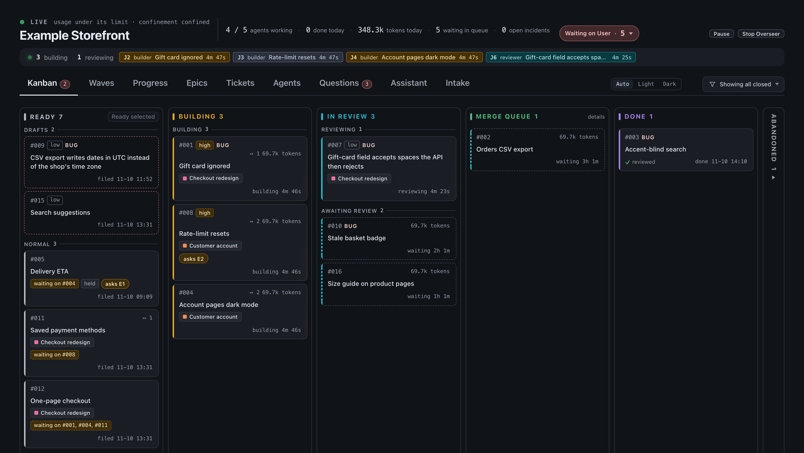
      <br><strong>Dark theme.</strong> The same Kanban.
    </td>
  </tr>
</table>

## One ticket, start to merge

User describes the work and readies the [draft ticket](docs/glossary.md#draft-ticket) a product owner files. The
Overseer drives every step after that. User steps in only for what code cannot answer, which reaches the Questions
view as a [decision](docs/glossary.md#decision).

<p align="center">
  
</p>

*Notice that review is optional, set by the board's [pipeline](docs/glossary.md#pipeline).*

[The ticket lifecycle](docs/concepts/ticket-lifecycle.md) walks this path, with what happens when a step fails.

## What it does to a repository

`forge init` only adds the files below. Once running, the Overseer creates ticket branches and lands
finished tickets on the [main line](docs/glossary.md#main-line).

| What | Where | In git |
| --- | --- | --- |
| The [tracker](docs/glossary.md#tracker): state, log, tickets and installed guidance, shared by every worktree | `.forge/` | ignored |
| Ignore entries for the folders in this table | `.gitignore` | commit it |
| A `SessionStart` hook that tells each session how the board works | `.claude/settings.local.json` | untracked: do not commit |
| The two skills, for this repository only | `.claude/skills/forge-po/`, `.claude/skills/forge-orchestrate/` | ignored |
| One [worktree](docs/glossary.md#worktree) per ticket, plus group and session folders, created as work starts | `.forge-worktrees/` | ignored |

> **As built.** A landed ticket's worktree stays in that folder. See
> the known gap.

`init` adds nothing to `CLAUDE.md`, and it [refuses](docs/reference/refusals.md) a repository the released program
already tracks.

Outside the repository, the setup script links the program with `bun link` and points the forge checkout's git hooks at
`.githooks/`, and each tracker registers in `~/.forge-monitor/`.
The on-disk atlas maps every path.

## Quickstart

forge lives at github.com/AlexDM0/forge. It needs Bun, git and a logged-in `claude`, and has been run on macOS;
[getting started](docs/operations/getting-started.md) says what differs elsewhere.

| Platform | x64 | arm64 | Also needs | Confinement in force |
| --- | --- | --- | --- | --- |
| macOS | never run | run | nothing more: `sandbox-exec` ships with macOS | gates under Seatbelt; sessions in Claude Code's sandbox |
| Linux | never run | never run | `bwrap` able to create user namespaces; `systemctl --user` for the login item | gates under bubblewrap; sessions in Claude Code's sandbox |
| Windows (native) | never run | never run | an absolute `SystemRoot`; PowerShell for `setup.ps1` | none: gates and sessions run unconfined by design |

Linux and Windows have adapters for every OS-dependent part, proved only over fakes on a Mac.
[Platforms](docs/cli.md#platforms) says what each OS does and what Windows loses with no confinement, and
[the platform status](docs/development/platform-status.md) lists what has never run.

```sh
git clone https://github.com/AlexDM0/forge.git && cd forge
apps/forge/setup.sh
```

The clone is a Bun workspace: forge is the app in `apps/forge/`, and the packages it uses are in `packages/`. On
Windows, in PowerShell, run `apps\forge\setup.ps1` in place of `apps/forge/setup.sh`. It needs no administrator rights
and no bash:

```powershell
powershell -ExecutionPolicy Bypass -File .\apps\forge\setup.ps1
```

Both scripts only make sure Bun is installed, offering Bun's own installer, and then hand over to `setup.ts`, which runs
the same four steps on every system. With Bun already installed, `bun run setup` in `apps/forge/` starts `setup.ts`
directly. Setup refuses a Bun older than the version the clone's `.bun-version` pins, and offers `bun upgrade`. On Windows, step 2 offers to add
Bun's `bin` folder to your User `PATH` instead of editing a shell startup file.

<p align="center">
  
</p>

Then, in the repository to adopt:

```sh
cd ~/code/example-storefront
forge init --project "Example Storefront"
forge oversee --detach
forge oversee resume
forge open
```

`oversee --detach` starts the Overseer in the background and prints its URL, and `open` opens the Bridge in a browser.
Commit the `.gitignore` change `init` made.

<p align="center">
  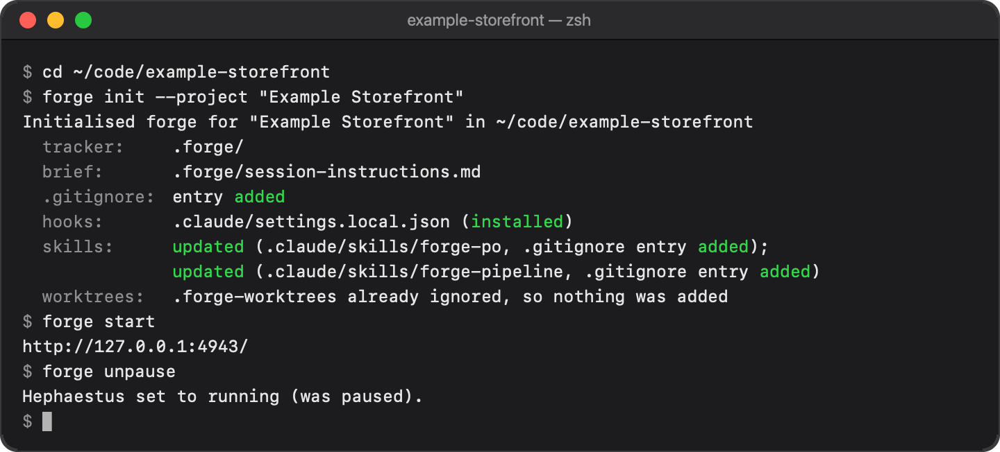
</p>

*Notice `oversee resume`: a new board starts paused, and no ticket builds and no pipeline agent starts until it runs.*

The Questions view asks for the repository's gates. A [pipeline agent](docs/glossary.md#pipeline-agent) proposes them, and
User accepts the proposal there. Then describe the work in the Intake view and ready the draft tickets the product
owner files.

After a `git pull` of this checkout, run `forge update` in each tracked repository; see
[Install version](docs/cli.md#install-version).

## Privacy

Everything is local: plain files in the repository, and a Bridge bound to `127.0.0.1` with no telemetry. What leaves the
machine is what agent sessions send to Anthropic, the vendor of the `claude` CLI, and what reaches the `network` domains
a ticket or gate allows.

## Facts

The program is TypeScript on Bun, with three runtime dependencies: `marked`, `react` and `react-dom`.

## Where next

1. **[The documentation index](docs/README.md)** first. It has the symptom shortcuts for when something is wrong now.
2. **[The overview](docs/concepts/overview.md)** explains the system with no code, and
   **[getting started](docs/operations/getting-started.md)** runs a first board. The
   **[glossary](docs/glossary.md)** defines each term.
3. **[The CLI reference](docs/cli.md)** holds every command, flag, exit code and stored format.
4. **[Contributing](docs/development/contributing.md)** gets a change past the checks.

## In the code

| Concept | Path | Symbol | Held by |
| --- | --- | --- | --- |
| The names on this build | `src/shared/constants/ProductNames.ts` | `PRODUCT_NAMES` | `src/ProductNames.spec.ts` |
| A new board starts paused | `src/lib/tracker-model/constants/OverseerStates.ts` | `DEFAULT_OVERSEER_STATE` | `cli/overseer/OverseerCommand.spec.ts` |
| The machine setup | `setup.ts`, `cli/setup/Setup.ts`; bootstraps `setup.sh`, `setup.ps1` | `runSetup` | `cli/setup/Setup.spec.ts`, `cli/SetupScript.integration.spec.ts`, `cli/setup/BootstrapScripts.spec.ts` |
| The images on this page | `.readme-graphics/regenerate.sh`, `.readme-graphics/render-diagrams.py` | `DIAGRAMS` | read by hand |
