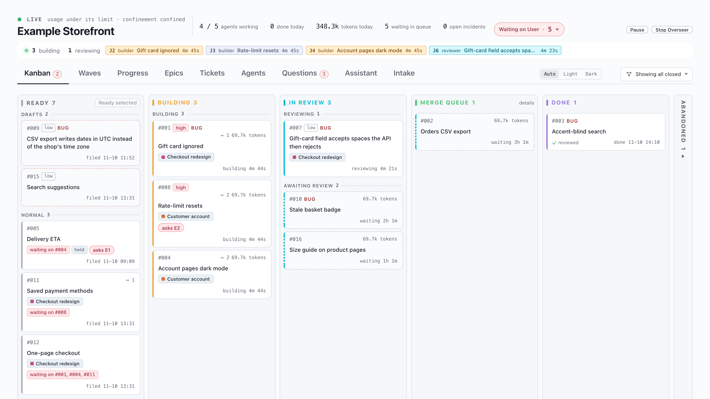
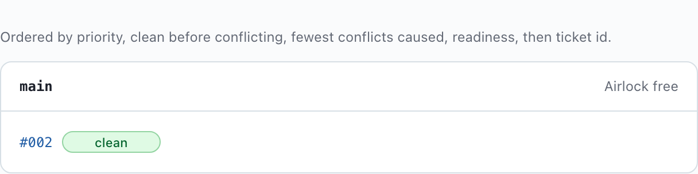
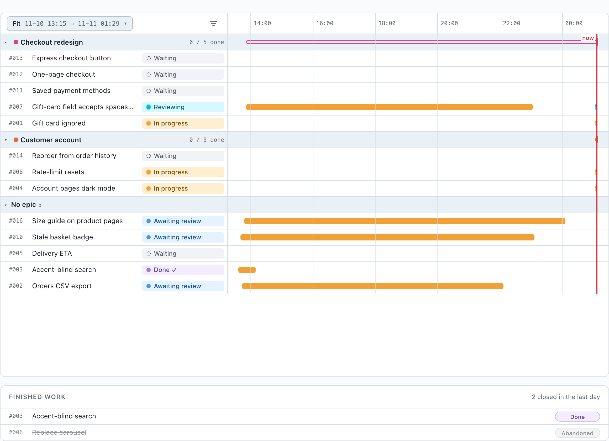
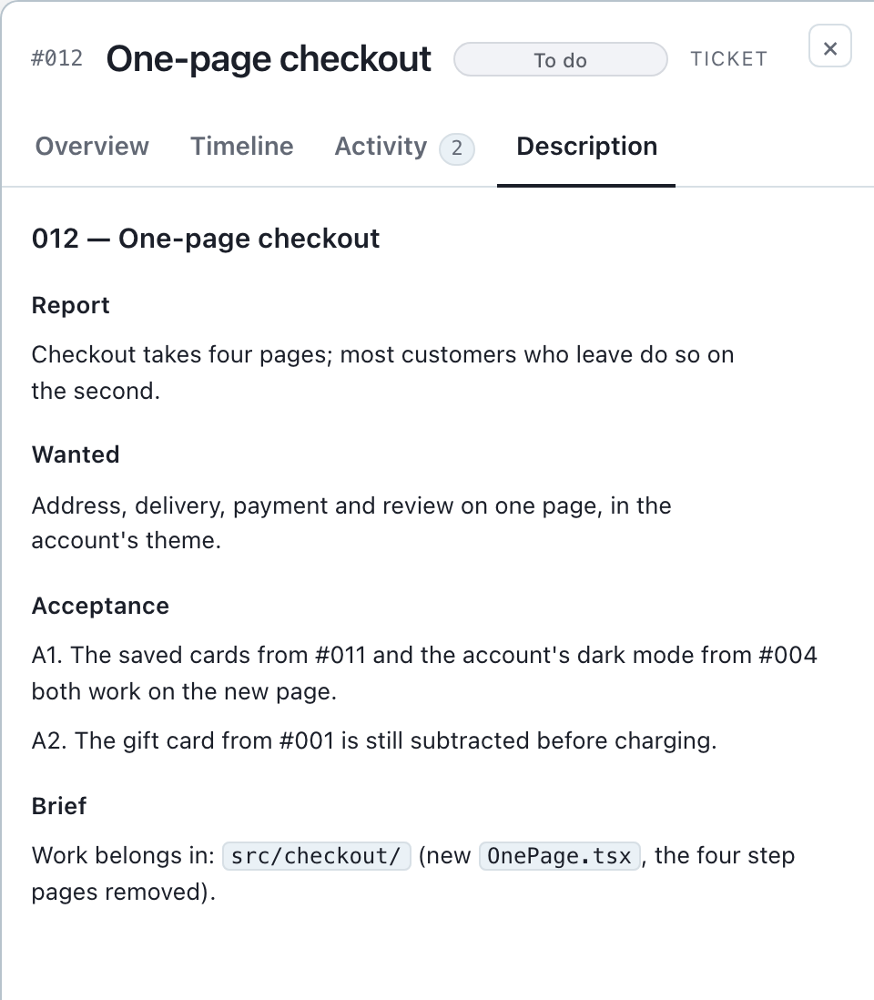
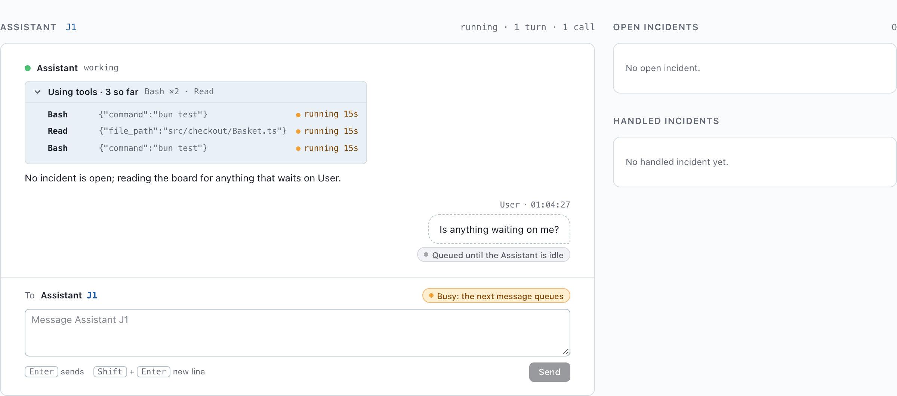
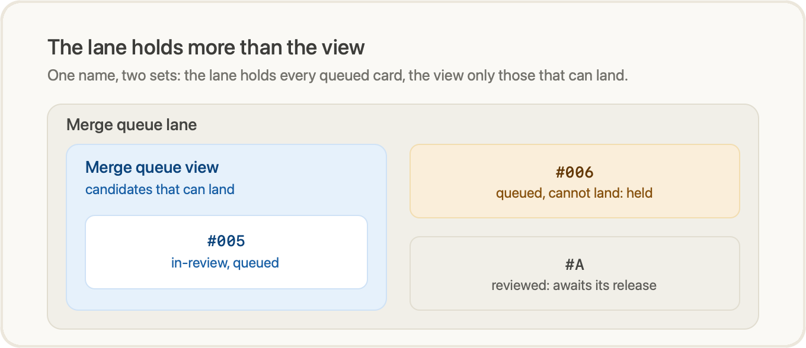

# Running a board from the Bridge

> **Question:** What am I looking at, and what do I do here day to day?
> **Time:** 25 minutes.
> **Read first:** [Getting started](getting-started.md), [Glossary](../glossary.md).
> **Next:** [Runbook](runbook.md).

## In one screen

The [Bridge](../glossary.md#bridge) is the one page of a [board](../glossary.md#board): a live page the
[Overseer](../glossary.md#overseer) serves on 127.0.0.1. `forge open` opens it, and starts the
Overseer first when none runs. Close the page and the board carries on: the page stores no work, and you lose
only half-typed text and view filters.

You do four things here. You file work on Intake, ready it on Kanban, answer [decisions](../glossary.md#decision) on
Questions, and watch the header. The Overseer does the rest: it launches AI [agent](../glossary.md#agent)
[sessions](../glossary.md#session) that build and review each [ticket](../glossary.md#ticket), then merges the result,
without being asked.

*Notice the blue middle: once a ticket is Ready, you act only if a question appears.*

Nearly every control records a request, and the Overseer acts on it or refuses it. The screenshots here come from the
demo board Example Storefront, and the detail panel shows demo ticket #012.

## The tabs

The Bridge has up to ten tabs: Kanban, Waves, Progress, Epics and Tickets, then Agents, Questions, Assistant, Intake
and Pipeline. Waves shows only when a ticket depends on another, and Epics only on a board
with epics. Pipeline shows once the Overseer reports a readable `pipeline.json`. A board with no readable
`pipeline.json` shows Pipeline alone, whatever tab you last chose, and the header is in setup: the board name, an amber
`setup` chip, the theme switch and the five setup steps (Billing, Research, Constitution, Pipeline design, Apply). A
finished step, or one that needs a recheck, links back to its page. Each tab has its own URL, so you can link to it, and
the link survives an Overseer restart. A fragment that names no tab opens the tab you last chose, or else the first tab
shown. Until the first board update arrives the panel says it is waiting for the Overseer.

With no setup open, Pipeline opens on the setup landing: it counts the committed tickets that wait for a pipeline, asks who
pays for the agents (the subscription, or the API key with an optional cap per launch) and shows the pipeline agent's
model and effort. **Set up the pipeline** sends `pipeline-setup-start` with that billing and opens the research step; an
unreadable `pipeline.json` is named in a banner, and the start then says that Apply replaces it. With a setup open, the
bare `#pipeline` shows the resume summary instead: each step with its status and summary (Open on a finished step),
the open questions and the pipeline agent's job on the current step, a note when main moved since the research,
**Resume <step>** (`pipeline-setup-resume`) and **Start over**, which asks first (`pipeline-setup-start-over`). The
billing step reopened from the stepper saves a change with `pipeline-setup-billing` and offers **Back to <step>** in
place of a second start, or **Continue to research** while the record still stands at billing. The decision
`checks-not-set` never opens the question panel over the setup by itself while no pipeline can be read; it waits in
Questions, and Apply withdraws it.

The research step (`#pipeline/setup/research`) shows what the pipeline agent finds as it finds it: the stack, the
conventions and the scripts, each with the files it came from. A script that needs a network or a service is marked
with an amber dot; nothing on the page runs a script. The agent's research questions sit under the findings
(**Answer** sends `pipeline-setup-answer`), with its chat and a line saying what it does while a turn runs; the box
under them sends `job-message`, which is how you correct a finding. **Continue to constitution** (`pipeline-setup-step`)
is offered the whole time, and lights up once the agent says the research is done; **Stop the pipeline agent** stops
its job and returns to the resume summary.

The constitution step (`#pipeline/setup/constitution`) shows the pipeline agent's draft of `CONSTITUTION.md` as one
markdown document. In Edit you type into it directly; a line carries a small source tag (`CONTRIBUTING.md`, `research`
or `default`) only where the agent named a source for it, and editing that line drops its tag. Leaving the editor, or
Cmd/Ctrl+S, saves the whole text (`pipeline-constitution-edit`); if the agent redrafted it meanwhile, the refusal shows
and your text stays until you save again or discard it. Preview shows the rendered document. The aside lists who reads
it, the sources the agent drafts from (ticking one sends `pipeline-constitution-edit` too), and the agent's questions
and chat; the footer counts the sections and rules, with **Back to research** and **Continue to pipeline design**. While
you edit an applied pipeline, the same page at `#pipeline/edit/constitution` edits main's `CONSTITUTION.md`, with only
**Back to the flow** in its footer.

The pipeline design step (`#pipeline/setup/design`) draws the agent's proposal in the phase layout described below, with
no step or gate marked as changed. The aside has two tabs: **Conversation**, with the agent's questions, its chat, its
newest change (**Show <step> on the flow** opens that step's phase and selects it, and **Undo this change** sends
`pipeline-draft-undo`) and the message box; and **Changes**, one card per change against the smallest pipeline, each
with **Undo** where an edit made it. A step the agent asks about carries a question pill on its card and on its phase's
tab, and opening it shows the question instead of its settings until you answer. The strip above the message box says
the agent is designing, waits for your answer while a question is open, and says "Proposal ready" once the agent says
so. The footer counts the proposed prepare steps and gates. **Discard proposal** (`pipeline-draft-discard`) drops the
proposal and keeps the agent; **Apply pipeline** stays disabled while any question is open. Nothing profiles a gate
until you press its time chip.

**Apply pipeline** asks first: "Resume the board" (on by default) says how many committed tickets start building and
how many at a time. Apply commits `CONSTITUTION.md` to main first, so the dialog stays open while the commit waits for
the merge train, and shows why when main holds it (for example uncommitted changes to `CONSTITUTION.md`) or git refused
it. **Cancel apply** drops the pending request; after a signing failure, **View CONSTITUTION.md** shows the exact text
to commit by hand, signed, before you press Apply again. On a running board, **Apply changes** lists each change with
where it is and its kind, the version it makes, and the tickets in flight, which take the new version at their next
gate run; it never resumes a paused board.

Once a pipeline is applied, or while you edit one, the Pipeline tab draws it in four phases: Ticket, Build, Review and
Merge. Under the page title, the phase stepper shows one tab per phase with its step and gate count and a pill for what
waits there (an open question, the tickets on a live board, the changes of an edit); a press opens that phase, and Build
opens first. The open phase says what it is for and when a ticket leaves it, with a **Next** button to the next phase
(Merge ends on main instead), then its steps as cards from left to right, then its gates table; the Ticket phase lists
what makes a draft ready instead. Double-click a step card, or focus it and press Enter, to open its settings; the merge
of main before review has none, since the builder's settings drive it. An agent step's dialog sets its model, effort and
instruction files, read top to bottom; the review step's also sets the re-review after its fixes, and a merge step's the
re-review after a conflict merge. A gate's dialog sets its command, fix command, folder, phases and network, and its
Profile box runs the gate once when you press it. Nothing changes until you press Save, and on a live board the first
Save opens an edit. The two switches, Human ticket review and Human code review, change the pipeline at once; on a live
board the first change opens an edit. An add card sits where a step is missing and offers what fits there.

On a live board, each step card says its state and carries a chip for every ticket on it, and for a filing draft being
written on Ticket creation; a chip opens that ticket's or draft's panel. The Merge phase's head names the ticket the
Airlock is letting onto main and the tickets queued for the merge train. The aside's **On the flow** tab lists the same
items under "Now", each with its step, its model and effort when an agent runs it, and how long it has been there, then
the newest pipeline records under "Earlier". **Ask the pipeline agent** starts an advise session, which opens as an edit
with the agent's tab first. The footer names the applied version, when you applied it, the pipeline's content hash and
the commit the newest Apply made of `CONSTITUTION.md`; **View stored pipeline** shows the stored pipeline, and **Update
pipeline** opens an edit. After an Apply from this page, a toast says the pipeline is applied, and "Board resumed" only
when the Apply resumed the board.

While you edit an applied pipeline, each phase's tab counts the changes not yet applied in that phase, and changed, new
and removed steps and gates carry their mark on their card and in the gates table; a removed step or gate stays drawn,
struck through, until Apply. The aside beside the flow opens on **Changes**: one card per change, with Undo, a gate's
command before and after, and for a new gate **Benchmark in the <phase> phase**, which profiles it once in that phase
when you press it. Under the cards, the tickets in flight take the new version at their next gate run. The **Pipeline
agent** tab holds its chat, and **Ask the pipeline agent to check** (`pipeline-check`) asks it to run the touched gates.
The footer counts the changes and the version they make; the board keeps running on its version until you press **Apply
N changes**, and **Discard** drops the edit and returns to the live flow. The smallest pipeline keeps its "About this
pipeline" note beside the phases instead, and its footer names the steps you removed.

Under the steps of the Build, Review and Merge phases, the phase's gates table lists its prepare steps and gates with
their command, the other phases they run in, their network and their time. Drag a row by its grip, or focus the grip and
use Space and the arrow keys, to change the order the gates run in; prepare steps stay before the gates. Focus a row and
press Delete to take a gate out of that phase, or to remove a prepare step. Double-click a row to open its settings. The
time chip of a gate profiles it once in that phase and shows its time; nothing profiles a gate until you press it. **Add
gate**, and **Add prepare step** in the Build phase, are there while you set up or edit a pipeline; on a live board the
table's head names the tickets in that phase's gates instead.

The detail panel opens in place over Kanban, Waves, Progress, Epics and Tickets, so opening a ticket never changes tab.
A ticket opens on its Overview; the tabs under its head switch to Timeline, Activity and Description, each with a link of
its own. Esc, Close or a second click on the open item closes it. The filter line at the right of the tab row, `Hiding closed >
1 day`, sets which finished work those tabs show.

### Kanban

*A card holds no controls but its links, its epic chips and waiting-on ids, and its asks pill. Press the card to open
its ticket form, where Ready, Hold, Unhold and Priority are. A card never grows on hover or keyboard focus.*

Kanban shows every ticket in one of six lanes: Ready, Building, In review, [Merge queue](../glossary.md#merge-queue),
Done and Abandoned. What waits on User leads its lane: the tickets ready for review, then the drafts, each under its own
head at the top of Ready, and the tickets waiting for User's merge accept at the top of the Merge queue.
[Reading lanes and pills](#reading-lanes-and-pills) says how a ticket gets its lane. Each lane head is its name and
count in the lane's colour, and a card's left edge is its row's bar, absent while the ticket has no row.

| You see | It means |
| --- | --- |
| `HIGH 2`, `BUILDING 1` | a group in its lane: Ready and Merge queue split by priority when they hold more than one, Building and In review into the work in progress and the work waiting |
| `↦ N` | N open tickets wait on this one, directly or further down the chain |
| `waiting on #N` | an unsettled dependency; press the id to bring that card into view |
| `held` | the ticket carries a [ticket hold](../glossary.md#ticket-hold); hover for its reason |
| `no row yet` | a Ready ticket with no row on the Progress chart until it is started |
| the stamp at the foot | the time at work (`building 2h 36m 00s`, ticking while the stream is live), how long it waited (`paused 1h 51m`, `waiting 16m`), or its newest milestone (`filed`, `built`, `done`) |
| `reviewed 09-24 13:28`, `✓ reviewed` | when an awaiting-merge ticket was reviewed; a Done ticket that was reviewed before it was done |
| a pulsing card | an agent works on it, while the stream is live |
| arrows and `needed first`, on hover | arrows come from the cards the hovered card directly depends on, and those cards read `needed first` |
| a marked card | it is new, or its state moved, on the latest board update; the mark lasts a moment |
| an outlined lane | the header figure you followed points at it; the outline lasts a moment |
| a dashed card | a ticket waiting: paused or awaiting review; in the draft colours, a [draft ticket](../glossary.md#draft-ticket), a [filing draft](../glossary.md#filing-draft) or a ticket ready for review |
| `web`, on a card | on a forge with entities, the entity the ticket belongs to |
| five small bars and `Package review in example-ui, stage 3 of 5` | a ticket that crosses into a package: its stages, done filled, the current one in the accent colour, the package's stages dashed |
| `web 2` under a lane head | on a forge with entities, a swimlane: the lane's tickets of that entity; `No entity yet` holds the tickets the product owner has not given one |

| You can | How |
| --- | --- |
| Open a ticket | press its card, or Enter on it: the detail panel opens in place on the ticket's Overview; a filing draft opens read-only |
| Ready a draft ticket | open its card; Ready leads the ticket form's Overview for a draft or a ticket ready for review |
| Hold or lift a hold | open its card; Hold… is under Other moves, and Unhold leads for a held ticket |
| Change a priority | open a committed ticket's card; Priority… under Other moves opens the other priorities |
| Filter by [epic](../glossary.md#epic) | tick its row under Epic in the filter line's menu; the filter line names it, and the choice is kept in the browser |
| See the Ready order by [wave](../glossary.md#wave) | filed or by wave under Order Ready in the same menu, offered once any ticket has a dependency; by wave wins over the swimlanes in the Ready lane |
| Filter by entity | on a forge with entities, press an entity in the rail beside the lanes; a package also shows the crossing tickets whose package stage runs in it, and All entities shows every ticket again |
| Turn the swimlanes off | none under Swimlanes in the filter line's menu, offered on a forge with entities |
| Clear the filters | Reset filters in that menu: every epic row, the Ready order, the entity, the swimlanes and the finished-work window go back |
| Page the closed lanes | Show more on Done and Abandoned; Abandoned starts folded to a strip |
| Show older closed work | Done and Abandoned follow the filter line; show all under a lane widens it |

Ready starts with the Board's ready list: unblocked tickets by priority, then readiness, then id, held ones included.
Tickets waiting on a dependency follow. Merge queue lists its tickets by priority, then id, and the merge queue view
gives the order they land in. Done and Abandoned run newest first.

> **As built.** The ready list can omit a group ticket the Overseer launches.

**The merge queue view.** The details link in the Merge queue lane's head opens `#kanban/merge-queue`. It answers what lands next
on each [target](../glossary.md#target), and why a [landing](../glossary.md#landing) waits. It has no controls: a
merge move belongs to the [incident](../glossary.md#incident) or decision it answers. The Kanban tab stays highlighted;
press it to go back.

*#002 waits clean for a free Airlock. A ticket holding the Airlock has a job and no line; its card stays in the lane.*

*Read the candidates from the top: that is the order they land in, which the Kanban lane does not show. With merge
approval on, the order line reads "Ordered by User's Merge presses, earliest first, then ticket id." instead of the five
keys.*

The queue holds the tickets cleared to land, and an [Airlock](../glossary.md#airlock) lets one of them land on a target
at a time. The view lists only candidates that can land. A queued ticket that is held, waits on a `waiver` or
`landing-refused` decision, has a job on it, or is a release ticket whose bundle has not landed stays in the lane
without a line. So a target can show an empty list. With nothing queued the view shows the order rule and
`Nothing is queued to merge.`

### Progress

*The chart answers what happened and when; the Waves tab answers what must finish before what. The demo's queued
tickets were seeded without a review, so they read Awaiting review.*

Progress answers how the work went.

| Part | Shows | You can |
| --- | --- | --- |
| The chart | one [row](../glossary.md#row) per readied ticket (a low-priority ticket's once it starts), a bar per phase, a now line, rows grouped under epics | press a ticket label to open its row, fold an epic, pick a range, use Row options |
| The finished list | the delivered and abandoned tickets the filter line's span lets through | open a ticket |

The filter line at the right of the tab row says how many finished tickets and epics are hidden. Its menu chooses 1h,
1d, 3d, all or a since date; the default is 1d.

The **Waves** tab shows a Done column, then one column per wave, once any ticket has a dependency. Drafts and committed
low-priority tickets enter no wave, yet the tickets waiting on them still wait. Point at a ticket to light everything it
depends on and everything waiting on it; click it to open its row in place. The **Epics** tab shows one
card per shown epic: its summary, roll-up bar and facts, what it waits on outside itself, its tickets in the waves, the
epics it frees, and its tickets. A ticket on a card opens in place; an epic's name anywhere links to its card.

Each wave's head shows a forecast while the board is not paused. Your browser computes it, and nothing decides on it.

Reading the wave board

*Look at the red box first: a wave of one ticket holds everything behind it.*

The red path walks back from the last wave, taking the ticket with the most waiting at each step.

The chart's range and row lookups

| Lookup | Values |
| --- | --- |
| Range button | the presets Fit, 1h, 4h, 12h, 24h and 7d, and Custom |
| Custom | timestamps, or `start`, `now` and `-2h` |
| Fit's default | stored by `forge range` |
| Row options | "Review passes as rows" and "Wide titles" |
| A chart pill reading `Waiting` | a `committed` row with an unsettled dependency |
| A ✓ on a Done pill | the row was reviewed |

### Tickets

*The panel opens above the table, and Close returns to the table.*

Tickets is the one place to read a whole ticket. The table has a search box, Type, Epic and Status chips, and columns
that sort. Chips are OR inside a group and AND across groups and the search. A query of digits, with or without `#`,
looks for an id alone. On a board with epics, Group by epic groups the rows under each epic's roll-up. While nothing
narrows it, the table leaves out the tickets the filter line hides; a search or a pressed chip looks through all of them.

A table line opens the **detail panel** at the right edge, `#tickets/ticket-row/<id>`, in its row form: head, controls,
the row's Task facts, the Phases its row went through, the Ticket with its facts and description, and the Log lines
claimed for either. A Kanban card opens the tabbed ticket form instead. Its Overview leads with a state card (the job at
work, its calls and last tool call, or why nothing works on the ticket) and the one likely action: Watch the job's
transcript on Agents, or Ready, Accept or Unhold. Next lists the steps the Overseer forecasts up to the landing, and
which tickets the landing lets start; Other moves lists the rest of the controls, each with its effect; Facts closes it.
The Timeline tab holds the mini Gantt of its build and reviews, Activity the log lines about the ticket or its row, and
Description the ticket's text. A stamp from today shows only its clock, an older one gains its date, and hover gives it
in full.

Status names below are stored values: `draft` shows in the Drafts group at the top of Ready and `committed` below it. See
[Reading lanes and pills](#reading-lanes-and-pills).

| Control | Offered while | What it does |
| --- | --- | --- |
| Ready | `draft` or `ready-for-review` | moves it to Ready, if it passes the [readiness check](#file-work) |
| Hold, with an optional Reason | `draft`, `ready-for-review` or `committed`, unheld | keeps the ticket from its next launch |
| Priority, high, normal or low | `committed` | changes where the ticket waits in Ready; the row offers the two priorities it does not have |
| Unhold | any open ticket with a hold | lifts the hold |
| Park, with the same Reason box | any open ticket | holds it and opens a `parked` decision |
| Set network | `draft`, `ready-for-review` or `committed` | sets the public domains this ticket's agents may reach |

On the ticket form Hold… and Park… ask for the reason only after you choose them, Set network… opens its domains
field the same way, and Priority… opens a row of the other priorities, which closes once one applies; Cancel closes the
field with nothing sent. Each move states its effect beside its button.

While a job works on the ticket, the ticket form also holds that job's controls under Watch, the same ones the Agents
tab offers: a message box with Send message, and More, a menu of Wind down, Stop and Fresh agent. No item there acts on
one click. Each opens a confirmation in its place that says what it ends, that the branch and its worktree stay, and
which hold it leaves on the ticket (`stopped by User (J4)`, `wound down by User (J4)`, or none for Fresh agent); only the
confirm sends it, and Cancel puts the item back. A job the Overseer only watches offers Stop alone, and a job that is
stopping shows `Stopping.`. A line under the state card names the newest open incident on the ticket and its default.

Use Hold to keep a ticket from its next launch. Use [Park](../glossary.md#park) when you want the question on your
Questions list: it holds the ticket and opens a `parked` decision. A reason typed for one ticket never carries to the
next. [A parked ticket](runbook.md#a-parked-ticket) says what each way back starts.

### Agents

*Press a job id to open its controls and transcript below the two cards. The workers figure counts the live build and
review jobs, so the Sessions card's jobs and the subagents add nothing to it.*

Agents shows the [jobs](../glossary.md#job) on the board in two cards, ticking each second. The Agents card holds the
builders and reviewers, and the merge, refresh and constitution commit jobs, under a project row: the launch-slot meter,
its figure ("3 / 5 workers") and "agents at most", the [concurrency limit](../glossary.md#concurrency-limit); see
[Adjust concurrency](#adjust-concurrency). A job there that holds no launch slot, such as a merge, is tagged "not
counted". The card's foot says which jobs the figure counts and names the tickets in progress that no job works on. The
Sessions card holds the intake, Assistant and pipeline agent jobs, which never count toward the limit; its head tallies
the live sessions of each kind and how many wait on User, and links to the Intake and Assistant tabs.

A job that asks User comes first in its card, its row tinted, with an Asks User strip under it: the decision, its first
question, the job it blocks, how long it has been open, and Answer, which opens the Questions tab. Each row leads with
its role as an icon in the role's colours, the role's word beside it: a hammer for a builder, a magnifier for a
reviewer, an inbox for intake, a lifebuoy for the Assistant and a flow for the pipeline agent; a merge or refresh job
draws its kind, a constitution commit job a document, and any other job a dot. The Sessions tallies lead with the same
icons. Each row then shows the job's state (with a "quiet" tag while its event log stands still), its calls against its
budget as a bar that turns to its warning colour from 80% of the budget, its subagents as squares (filled while one
runs, outlined once it ended; hover one for what it does), its last tool call and its tokens. Show diagnostics adds
Phase, Tool calls and Silent sweeps to both cards. Silent sweeps counts the [sweeps](../glossary.md#sweep) a job's
[event log](../glossary.md#event-log) stood still, and the last tool's elapsed time turns to its warning colour only
while that count is above zero. A long tool call alone is no sign of trouble.

`#agents/<job>` adds that job's transcript and these controls. Each is offered in the states the job allows.

| Control | What it records |
| --- | --- |
| Send message | a chat turn for the session |
| Send answer | an answer to the job's open question, shown only with one open |
| Wind down | a stop that asks the session to wrap up first; the ticket is held `wound down by User (J<n>)` |
| Stop | a stop; the ticket is held `stopped by User (J<n>)` |
| Fresh agent | a stop, so the next [attempt](../glossary.md#attempt) starts on the same [worktree](../glossary.md#worktree); `build` and `review` only |

A job that ended leaves its card, and its `#agents/<job>` link then shows no panel; use `forge job show <J>`.

### Questions

*Three sections; only Open questions needs you.*

Questions holds what waits on you. Agent questions come first, then the decisions the Overseer opened. An escalated one
says so. The Questions tab's count and the header's Waiting on User pill show the same open decisions.

- **Open questions.** Pick options, or type free text on a one-question decision, then press Answer.
- **Answered.** Settled decisions, read back from the [log](../glossary.md#log).
- **Notices.** Open [notices](../glossary.md#notice), each with its kind, the id it is about and the sentence the header
  words it in. They take no answer. The Bridge shows them too: warnings and notices as banners above the header,
  `new-code` in its state line.

*One press settles it: the first answer wins, whoever sends it.*

> **As built.** Some answers only close the card. Answering a `parked` decision leaves the ticket held, so Unhold it as
> well.

Notify me of new questions asks for browser notifications from your click, never on load. The open-question count leads
the browser tab's title on every tab of the Bridge.

#### The question panel

When a decision opens, the question panel slides in at the right edge of every tab, so you can answer it where you are.
Its head names who asks (`J4 asks User`, or the Overseer for a decision it opened), the decision id, the ticket and how
long it has been open. The left column holds the question, its options as cards with what each one touches, trades off
and does to the ticket's Acceptance when the agent noted it, a box for your own words on a one-question decision, and
Answer, which posts the same `decision-answer` as the inbox card. The right column has reading tabs: Background (why the
agent stopped, the ticket's Wanted, Brief and Acceptance, the agent's last tool calls and the earlier answers on that
ticket), the whole ticket, and the agent's conversation. The foot shows how many questions wait and Next question.

- **Fold to the tab** or **×** puts the panel away until another decision opens; a reload keeps it folded. The Questions
  tab keeps its count.
- A Kanban card that a decision names carries an **asks** pill, and each open card in Questions has **Open beside the
  board**: both open the panel at that decision.
- The detail panel and the question panel never show together. While a detail is open the question panel waits behind
  it, and Esc closes the detail first, then the question panel.

### Assistant

*You read this tab more than you use it: the Assistant settles incidents without you. The transcript is synthetic demo
data.*

Assistant shows the live [Assistant](../glossary.md#assistant) session as a chat, with a rail of its incidents beside it
(under it on a narrow window). The head names the session's state, its turns and its calls; the Assistant has no call
budget. In the thread, the Overseer's chats are system lines between two rules: the boot line, a delivery naming the
incidents it carried, and any other chat, each with Show prompt for the text it sent. A standing reply Talos sent is a
system line too. Each Assistant turn folds its tool calls into one line, which names the tools and how many failed; the
turn under way keeps its fold open, a running call ticking, and says `working` until the turn ends. Your messages are
bubbles on the right.

The composer under the thread names its recipient and says whether a message sends now (`Idle: a message sends now`) or
waits behind the turn under way (`Busy: the next message queues`). Enter sends, Shift + Enter starts a new line. A
message the session has not taken yet shows as a dashed bubble, "Queued until the Assistant is idle", read from the
board, so it outlasts a reload.

The rail lists the open incidents, and the handled ones with the moves made under them. An incident nobody settled ends
with its default move and appears in the warning state; read the move it took in its log line. While no session is up
the thread says a fresh one is booting; the Assistant has no off switch.

### Intake

*Each request gets its own session, and several may run at once. The transcript is synthetic demo data.*

The tab lists every [product owner](../glossary.md#product-owner) session on the left and shows one of them on the
right. Sessions waiting on your answer come first, then the running ones and the ended ones, each newest first. A row
shows the session's title (the product owner names it; until then, the first line of your request), its state, an
`E5 waits on User` tag for each open decision, the draft tickets it filed and its last line. Select a row to open its
chat; the address becomes `#intake/<J>`.

The chat reads like the Assistant's: your request first, then the product owner's turns, each with its tool calls
folded, and each open decision docked where it was asked, with Answer in place. Beside the chat are the draft tickets
the session filed, each linking to its card, the pictures sent in it, and Close intake. Close intake submits the complete draft
tickets the session filed: with ticket review on, the default, they wait in Ready for review at the top of the Ready
lane until you press Ready on each. A closed session keeps its chat, and a message resumes it. A session that was stopped
or failed stays in the list with that outcome as its state: its chat is read only, with no text box, and New chat starts a
fresh session.

New chat opens an empty composer (`#intake/new`). Its first message starts the session, and the tab moves to the new
session once the Overseer has started it, or shows it read only with its outcome if it ended before it ever ran.

To send pictures with a request or a message, choose Attach pictures, paste them into the text box, or drop them on the
chat. The Bridge takes the types and sizes the Overseer serves as its limits (by default PNG, JPEG, WebP or GIF, at most four
per message and 3,932,160 bytes each, since the vendor's 5 MB limit counts the base64 a session is sent); it refuses any other picture before it uploads it, and shows the Overseer's own refusal on a picture the Overseer turns down. Each picture uploads at
once, and Send waits until every upload has finished. A picture alone is a message. Only the Intake tab takes pictures:
the Assistant's composer and the `intake` and `job message` commands do not. With an agent that cannot take pictures, no
Attach pictures shows.

## The header

A missing control does not apply in the Overseer's current state. A greyed control cannot be sent at this moment, for
one of the [four causes](#what-a-disabled-control-means). A live control sends a request the Overseer may still refuse.

![The Bridge header unfolded, with thirteen numbered callouts. Above it sit the banners, one banner per warning or notice, and the incident line. The title row holds the state with usage and the new-code line over the board name, Pause or Resume, Restart and Stop Overseer, then the statistics and the Waiting on User pill. Below it come the activity strip, one chip per job in a launch slot, and the tabs with their counts and the theme. Pause, Resume and Stop are offered unless the Overseer is handing over or down, Restart only with the new-code line.](../figures/running-a-board/header-tour.png)

*Dashed items come and go. Read a missing control as a statement about the Overseer's state.*

| Figure | Item | Reads or does |
| --- | --- | --- |
| 1 | Banners | see [Banners, warnings and notices](#banners-warnings-and-notices) |
| 2 | Warnings and notices | a banner each, above the header; see [Banners, warnings and notices](#banners-warnings-and-notices) |
| 3 | Incident line | the incident defaults applied and the incidents open; see [Banners, warnings and notices](#banners-warnings-and-notices) |
| 4 | State | above the board name: `Live`, `Paused`, `Held` for an install change, `Handing over`, `Connecting` or `Down` |
| 5 | Usage | each usage window observed, such as `5-hour window 14%` or `week 18%`, then the window and reset time after a limit was hit; nothing before the first observation |
| 6 | `new code is on disk: restart the Overseer to run it` | the `new-code` notice, shown in the state line; see [Banners, warnings and notices](#banners-warnings-and-notices). Press Restart, or run `forge update`, whose last step makes the same hand-over |
| 7 | Pause, Resume | stores the pause; [Pause safely](#pause-safely) says what it stops |
| 8 | Restart | a [Baton pass](../glossary.md#baton-pass) to the code on disk; offered only with the `new-code` line |
| 9 | Stop Overseer | after a confirmation, stops the Overseer; see [Stop for the day](#stop-for-the-day) |
| 10 | agents working | build and review jobs holding a [launch slot](../glossary.md#launch-slot) against the limit; the Assistant and product-owner jobs do not count, as its hover text says. The [concurrency limit](../glossary.md#concurrency-limit) itself is set on the Agents tab, see [Adjust concurrency](#adjust-concurrency) |
| 10 | done today, tokens today | tickets delivered today, and tokens of rows running or ended today, by your browser's date |
| 10 | waiting in queue | every `committed` ticket, held and blocked ones included |
| 10 | open incidents | incidents the Assistant has not settled |
| 11 | Waiting on User | a pill counting everything that waits on you: open decisions (escalated ones apart), draft tickets, filing drafts waiting on an answer, tickets ready for review and tickets waiting for your merge accept. Rose while anything waits, neutral `· 0` when nothing does, with a red dot while a decision is escalated. A click opens its inbox: the escalated items first, then the rest oldest first, each with its age and one action (Answer, Ready, Review or Accept) that opens its place; the foot links to Questions and to the drafts on the Kanban. The browser tab's title still counts the open decisions alone |
| 12 | Activity strip | one line under the title row: building and reviewing counts, one chip per job holding a launch slot (job id, role, ticket title, time since it launched) that opens the job on the Agents tab, and at its end a warning flag counting the tickets in progress with no Overseer job, which opens the Agents tab |
| 13 | Tabs, theme | the tabs, then the theme switch (auto, light or dark, kept in the browser) at the tab bar's right, before the filter line. A tab counts what waits there: Questions its open decisions, red with a dot while one is escalated, else rose; Kanban its draft tickets, waiting filing drafts and tickets for review or merge accept, rose; Assistant its open incidents, grey. A tab with nothing to count shows no badge, and Intake never does |

The title row holds the state and the board name, the five figures and the Waiting on User pill on one line, and Pause
or Resume, Restart and Stop Overseer at its right end. "agents working" counts the live build and review jobs, the count the Overseer launches by;
a session, a merge and a row with no job count nothing. The activity strip shows the same jobs, one chip each, so the
figure and the chips agree; when more run than the line holds, the chips shrink and the line clips.

### Banners, warnings and notices

Banners sit above the header. A red one says the Overseer is unreachable and how old the board is. Another says the
[install version](../glossary.md#install-version) changed: the installed files no longer match the program, so the
Overseer holds launches until `update` runs. The `new-code` line is the milder case: the code changed, the installed
files still match, nothing is held. It cannot appear while launches are held for an install change.

Under those banners one red line counts the [incident](../glossary.md#incident) defaults applied since the Overseer
started, and the incidents open, and names the newest default: its incident, its move, its ticket and when. However many
defaults there are, it stays one line. Show incidents opens the incident drawer over the header: the open incidents,
then the defaults applied, newest first, each row unfolding its trail (opened, delivered, notes, the default applied).
Esc or a click outside closes it. Mark defaults seen hides the line in this browser until the next default; open
incidents alone raise no line, as they are the Assistant's work, counted in the header's open incidents figure.

Warnings and notices are banners too, one each, above that line: a warning in red, a notice in amber. Warnings cover a
failed Baton pass and an Assistant that cannot come up.

### What a disabled control means

A greyed control has one of four causes.

| Cause | What you see | What to do |
| --- | --- | --- |
| Event stream down | red banner; every control disabled, the board stays | wait, or start the Overseer; the page reconnects |
| Launches held for an [install change](#banners-warnings-and-notices) | banner; every control disabled but Stop Overseer and the job controls Stop and Wind down; no Restart is offered | run `forge update`: its last step hands the Overseer to the code on disk, which lifts the hold. If it reports otherwise, follow Updating in the [Runbook](runbook.md) |
| A send in flight | that one control | wait |
| A form not complete | that one control | finish the choice or the text |

A command that cannot reach the Overseer shows nothing, and the button comes back. Check the banner.

> **As built.** The job controls Stop and Wind down, on the Agents tab and in the ticket form's More menu, stay enabled
> while launches are held for an install change, and a click only raises the banner again. Controls can flicker on
> between reconnects.

### A refusal is an answer

Rules live in the Overseer, so a button can offer what the Overseer then declines.

*Notice the two returns: a refusal comes straight back, and success arrives later, as a board update.*

The refusal appears beside the control, word for word, for example `Ticket #003 is already held. Nothing was written.`
It is normal, it changed nothing, and it clears on your next send. [Refusals](../reference/refusals.md) lists them all.

## Reading lanes and pills

A pill is the coloured status word on a chart row, a Tickets table line and the detail panel. A lane is the Kanban
column. Both are computed each time from stored facts, nothing stores which lane a ticket is in, and the two can differ
on purpose.

*Follow the fifth row: the mark moves the card to Merge queue while its stored status stays `in-review`.*

The merge-queue mark is the `mergeQueued` flag on the ticket's row, set when a review passes, or when the gates settle
on a board with no review phase. A repeat review's pill reads `Reviewing (round N)`. Wave cards use their own chips:
Ready, Held, or the state while a ticket is built or reviewed.

Three readings trip people up.

- **A queued ticket still reads as in review.** A passing review queues the ticket and leaves its status `in-review`,
  with its [review bar](../glossary.md#review-bar) open until it lands. So Kanban says Merge queue while Tickets and
  Progress say Reviewing, or Awaiting review on a board with no review phase. The demo board's queued tickets were
  seeded without a review, so they read Awaiting review.
- **The Merge queue lane holds more than its view.** `reviewed` means landed on a [group](../glossary.md#group) branch
  and waiting for its release. Those cards are in the lane but not in the merge queue view, because no Airlock is
  waiting for them, and neither is a queued card that [cannot land](#kanban).
- **A ticket merged to a group branch is not Done.** Done means merged to the [main line](../glossary.md#main-line). The
  word table is in the [Glossary](../glossary.md#status-words).

*One name, two sets: a card missing from the view can still sit in the lane.*

A Kanban card carries no pill: its colour comes from the same state. Paused, Waiting and a hold change no lane. A held
ticket stays where its status puts it, and only the `held` mark and the fact in its panel show it.

## Flint

Flint is the small orange diamond with eyes that lives on the Bridge. It shows what the agents do; it never changes the
board and sends no request. Its home is a corner at the bottom right of the page, where it sleeps. Each screen with a
Flint box (Setup, the pipeline steps, the Kanban's Agents at work strip, a ticket's state card, a job's panel on
Agents, the Assistant, the question panel and intake) is where Flint goes when the screen opens, and there it shows
what that screen's agent does: it waves on Setup, researches on Research, thinks on Constitution, types for a builder,
reviews for a reviewer, holds up a question card while an answer waits on you, and is happy when a proposal is ready.
Click or type in another part of the screen, such as a chat or the Agents view, and Flint goes there instead and
plays along: in a chat it thinks, types, fastens a bolt for a tool call, looks doubtful at a question and is happy
when the turn is done; on Agents it waves to a new agent, copies the work of a running one below the job column, and
goes to sleep when every agent is idle.

Click Flint and it plays with the pointer for a moment. Drag it onto a chat, a view or a Flint box and it lives there;
drop it outside all of them and it goes back. The Bridge remembers, per board, where Flint lives. Flint takes no click away from the
page: only its own body takes the pointer.

## Daily routines

A normal day is a loop: file and ready work, answer Questions, glance at notices. The other routines are occasional.

### File work

Three doors lead to the same draft ticket, and nothing builds until you ready it.

*The gate is the check, not the button: Ready can come back refused.*

| Door | Use it when |
| --- | --- |
| Intake tab, or `forge intake -- <text>` | you want a product owner to shape the request |
| A Claude Code session, asked to file a ticket | you are at a terminal; the `forge-po` skill runs the filing |
| `forge ticket add "<title>" --type ticket` | you already know what to write |

Open the ticket from Kanban and press Ready on its form: a ticket without what [`ticket ready`](../cli.md#tickets)
requires is refused, and the refusal beside the button says what is missing. A filer's submit, `ticket submit` or
`intake close`, moves only complete draft tickets to Ready for review and leaves the rest in Drafts.

### Answer questions

Keep an eye on the count in the browser tab, or allow notifications. An agent waiting on your answer keeps its
[launch slot](../glossary.md#launch-slot), so a late answer also slows the tickets behind it.

### Watch notices

Check the warning and notice banners above the header. Some notices stop landings or launches until you act, such as
`dirty-main-checkout`. The [Runbook](runbook.md) has the recipes.

### Adjust concurrency

On the Agents tab, type a number at "agents at most", in the project row of the Agents card, and press Set; or run
`forge concurrency <n>`. Set appears once the number differs from the limit. The control takes a whole number up to
`CONCURRENCY_LIMIT_CEILING_AGENTS` (10), and a higher one is refused. A limit below the agents running stops nothing: it
only leaves no free launch slot until some end.

### Hold or reprioritise

*Start at the top and take the first branch that covers it: each one to the right stops more.*

[Hold](../glossary.md#ticket-hold) a ticket you want left alone; it stops the ticket's next launch, never a running
agent. Use the Reason box in the detail panel when others read it. Change priority on a Ready card, or use
`forge ticket priority` once a card has left Ready. Lowering to low is refused once a ticket has left Ready;
raising works at any status. Priority orders the candidates; it never bars a ticket from starting.

> **As built.** Help text says otherwise for low tickets.

### Pause safely

Pause stops new build and review launches, new merge queuing and new Airlock slots. Running agents and a merge in
progress carry on, and so do the Assistant, intakes and resumes of interrupted jobs. The pause is stored, so it survives
a stop and a start. A fresh board starts paused, which is why no ticket starts until the first Resume.

To clear the deck, run `forge job stop --all --wind-down`. It pauses, then winds down every build, review
and product-owner job. Each stopped job's ticket is held `wound down by User (J<n>)` and stays held after Resume; Unhold
each ticket to continue it.

### Stop for the day

To end a day, Pause, then Stop Overseer: agents finish their work and no ticket starts at the next start until you
Resume. An unpaused board launches on the next Overseer's first Pass. To have no ticket agent running overnight, run
`forge job stop --all --wind-down` and wait until Agents shows them gone before Stop Overseer. The
Assistant session stays up.

| You run | Launches | Running agents | Bridge |
| --- | --- | --- | --- |
| Pause, or `forge oversee pause` | no new ticket work | keep running | up |
| `forge job stop --all --wind-down` | no new ticket work | wrap up and end; tickets held | up |
| Stop Overseer, or `forge oversee stop` | none, no [Pass](../glossary.md#pass) runs | keep running under Talos, until its lease ends a minute later; then they stop at the end of their turn and wait for your resume | gone |
| `forge oversee stop --now` | none, no Pass runs | as for `oversee stop`; Talos also stops every install, [gate](../glossary.md#gate) and merge line | gone |

Use `--now` when a running install or gate process must end too, such as one that hangs. The Bridge has no `--now`.

*The fork at the bottom is the choice you make the evening before.*

Start the Overseer again with `forge oversee --detach`. It settles jobs that ended while it was down.

## Groups and release tickets

A group lands tickets on a shared branch and reaches the main line in one release. Only the release ticket and the group
tickets it depends on move to Done; any other ticket that landed on the group stays in Merge queue even though the
release carried its code.

File group tickets with `--group <name>`, mark one with `forge ticket release-of <id>`, and give that ticket
a dependency on every group ticket it must deliver (`forge ticket depends`). The [release
bundle](../glossary.md#release-bundle) is the [release ticket](../glossary.md#release-ticket) and the group tickets it
reaches through dependencies.

*Watch the last frame: one landing delivers the whole release bundle, and only that.*

A group ticket that has landed is stored `reviewed`, reads Awaiting merge, and lets tickets that depend on it start. The
release ticket's target in the merge queue view is the main line, while the others show `group-<name>`. It becomes a
candidate once the rest of its bundle has landed on the group. The detail panel names a ticket's group, and the Tickets
search covers it. A release carries the group's whole tip, which is how a ticket outside the bundle reaches the main
line.

A `cleanup-declined` notice means git kept the group's worktree or branch after the release.

## The same from a terminal

Most views have a verb. Each is `forge <verb>`, and [the CLI reference](../cli.md) has the flags. Reads and
recorded moves also work with the Overseer down; a recorded move takes effect at the next start.

| In the Bridge | In a terminal |
| --- | --- |
| Header and Kanban | `status`, `oversee status`, `oversee pause`, `oversee resume`, `concurrency <n>` |
| Progress | `status` for the open rows, `range` for the chart's default span |
| Tickets | `ticket list`, `ticket show <id>` |
| Card and detail panel controls | `ticket ready <id>`, `ticket hold <id>`, `ticket unhold <id>`, `ticket park <id> -- <reason>`, `ticket priority <id> <level>`, `ticket network <id> <domain>` |
| Agents | `jobs`, `job show <J>`, `job attach <J>` to replay and follow a transcript |
| Job controls | `job message <J> -- <text>`, `job wind-down <J>`, `job stop <J>`, `job fresh <J>` |
| Questions | `decisions`, `decide <decision> <letters>`, `decide <decision> -- <text>` |
| Assistant | `incidents`, `incident note <I> -- <text>`, `incident escalate <I>` |
| Intake | `intake -- <text>` |
| Merge queue | `merges` |
| Waiting for a question | `await`, which returns when a decision opens or an incident is escalated |

`<J>` is a job id such as J5, `<I>` an incident id. Incidents are the Assistant's, so reading them is routine and moving
one is rare.

### The optional wrapper session

Run a Claude Code session with the `forge-orchestrate` skill when you prefer talking to clicking. It reads
the board's state, starts the Overseer on your go, turns what you say into verbs, files through `forge-po`, and puts
each open question to you. It never drives a ticket, moves an incident or writes code. Close it any time: the board does
not depend on it.

## What is lost on a tab change

A view unmounts when you leave its tab, so what you typed goes with it. Board updates alone leave it in place, unless
the job or decision it belongs to leaves the board. A changed limit also resets a number typed at agents at most on the
Agents tab.

| Kept across tabs and reloads, in the browser | Lost on a tab change |
| --- | --- |
| Last tab, theme | Tickets search, chips and sort |
| Kanban epic and entity filter, Ready order, swimlanes, closed-lane pages, Abandoned fold | Half-picked answers, half-typed messages and reasons |
| Chart range, folds, row options, finished-work span | Agents' open transcripts, replayed from history when reopened |
| Tickets grouping | |

A page reload loses everything in the Lost column too, and the Bridge reloads itself after a reconnect to an Overseer on
other code. Send a long answer before you wander off.

## Several repositories

Each repository has its own [tracker](../glossary.md#tracker), Overseer, port and Bridge tab, and preferences are kept
per board. Three things are shared across the machine.

*So one busy board can make another's gates wait, and one usage limit stops launches on all of them.*

All boards on a machine share one gate limit: `GATE_RUNS_AT_ONCE` (2) gate runs at a time, each holding a
[gate slot](../glossary.md#gate-slot) recorded in the shared [`<monitor>`](../glossary.md#reading-names) folder. Its
[usage marker](../glossary.md#usage-marker) allows no launch or resume on any board before its reset.

A monitor is a separate tool that shows several boards together. It finds them in `projects.json`, the monitor
registry, and may frame a Bridge with `?embedded=frame`, which hides the header's title row ([The embed
contract](../reference/overseer-api.md#the-embed-contract)).

## Several boards in one repository

A repository may hold several trackers, each in a project folder of its own, such as `apps/web` and `apps/api` of a
monorepo ([Trackers in a repository](../cli.md#trackers-in-a-repository)). Each is a board as above, with its own
Overseer, port and Bridge, and its own branch namespace, so its ticket branches read `forge/<namespace>/ticket-<id>`.
Its agents start at the root of their worktree, so that they can commit, and are told the project's folder; they may
change that folder and the paths its pipeline's reach names; Customs refuses any other path.

The boards share the main line. When a sibling lands first, a merge waiting on the same main line takes the new tip and
gates again, with no decision: the sibling wrote its landing in the repository's landing journal. Only a move that no
board wrote, such as a person's push, still opens `target-moved`. A landing holds the repository's landing lock for a
moment; a board that finds it held keeps its slot and lands on a later sweep.

A gate may write a small cache report, and the Pipeline view then marks a gate run that a build cache replayed. In a
monorepo whose gates run a whole-repository build through a shared cache, a sibling's landing usually costs a replay of
the untouched apps.

## Invariants

1. The Bridge stores no board state. Closing or reloading it loses only what
   [What is lost on a tab change](#what-is-lost-on-a-tab-change) lists.
2. Every Bridge control that changes the board posts a control command, and the Overseer alone applies or refuses it;
   Stop Overseer and Restart go to the running Overseer and record nothing.
3. A refusal is shown word for word, and nothing was written.
4. A ticket's lane is computed from its stored status and merge-queue mark on every board update.
5. The detail panel opens in place over Kanban, Waves, Progress, Epics and Tickets, and never changes the tab.
6. Stopping an Overseer never stops an agent session.

## In the code

| Concept | Path | Symbol | Held by |
| --- | --- | --- | --- |
| Control availability | `bridge/shell/ControlAvailability.ts` | `availabilityOf`, `controlIsEnabled` | `bridge/shell/BridgeApp.dom.tsx` |
| The posting control | `bridge/shell/CommandButton.tsx`, `bridge/shell/ControlCommandSender.ts` | `CommandButton`, `useControlCommand` | `bridge/shell/Header.dom.tsx`, `bridge/shell/ControlCommandSender.dom.tsx` |
| Display state | `src/lib/tracker-model/DisplayQueries.ts` | `ticketDisplayStateOf` | `src/lib/tracker-model/Board.displayQueries.spec.ts` |
| Decision card | `bridge/conversation/DecisionCard.tsx` | `DecisionCard` | `bridge/views/questions/QuestionsView.dom.tsx` |
| Job controls | `bridge/views/agents/JobControls.tsx` | `JobControls` | `bridge/views/agents/AgentsView.dom.tsx` |
| Command route | `cli/overseer/routes/CommandRoute.ts` | `answerControlCommand` | `cli/overseer/OverseerApi.integration.spec.ts` |
| Stop with agents running | `cli/overseer/OverseerForeground.ts` | `BoardChildren.stopLiveLines` | `cli/overseer/OverseerCommand.integration.spec.ts` |
| Terminal views | `cli/jobs/JobsCommand.ts`, `cli/jobs/JobCommand.ts` | `jobsCommand` | `cli/jobs/JobCommand.spec.ts` |
| Flint's host | `bridge/flint/BridgeFlint.tsx` | `BridgeFlint` | `bridge/flint/BridgeFlint.dom.tsx` |
