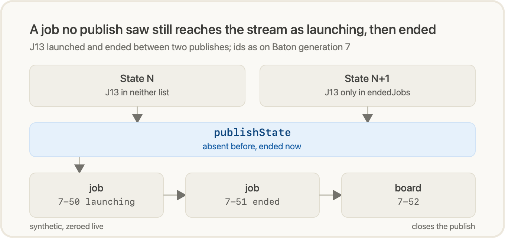

# The Hephaestus API

> **Question:** What does Hephaestus serve, to whom, and how does a client stay in step?
> **Time:** 15 minutes, or look one route up.
> **Read first:** [Overview](../concepts/overview.md), [Glossary](../glossary.md).

## In one screen

Each [board](../glossary.md#board) has one [Hephaestus](../glossary.md#hephaestus), and it serves one HTTP API on
`127.0.0.1`. Its clients are the CLI and monitors: separate programs that list
boards, read them and send User's commands. forge serves no page. The port is derived from the [tracker](../glossary.md#tracker) id. A client
reads `GET /api/versions` first, and calls each endpoint at the version path its forge version is served.

The User works in a client, which posts commands to the Hephaestus server and receives server-sent events. Most CLI
verbs write the board files themselves and then nudge the server; a few post a command or read the state. A monitor
reads with GET. The server answers by reading board files, job event logs and agent transcripts, and every read path
takes no lock.

The API has one write route, `POST /api/commands`, behind a bearer token, and one upload route, `POST /api/pictures`,
which stores a picture a later command names; most CLI verbs write the tracker themselves and only nudge. A client follows the board on `GET /api/events`, whose `board` event closes
every change and carries the whole internal `BoardState`, and reads the contract's document at `GET /api/board`.

A reconnect either replays what it missed or starts from a fresh `board`, so a client never applies events on top of
an older generation's state. The [generation](../glossary.md#generation) in an event id decides that. The
[code version](../glossary.md#code-version) tells, separately, whether Hephaestus runs other code.

Request guards stop a browser page of another origin. They are not what holds an agent
[session](../glossary.md#session): that is confinement.

## Routes

Every route passes the shared [request guards](#request-guards), so every route can also answer 403
`{refusal: 'forbidden', text}`. **Own guard** is what a route asks beyond them, and **Other statuses** lists only what
the route adds. An answer is JSON unless the row says otherwise. A refusal is `{refusal: <text>}`, a fixed word. A
401, a 403 and the 500 `read-failed` are `{refusal, text}`: the fixed word, and beside it the
sentence a client shows unedited, worded in `cli/hephaestus/routes/HephaestusRoutes.ts`; such a sentence names no command
line or flag, no page and no session: it names what is wrong. From
forge 1.21 a refusal of a command or a picture is forge's refusal document, `ForgeRefusalDocument` in
`packages/forge-contracts`: `{refusal: <code>, fields, text}`, the reason code, the facts the refusal names, and the
sentence the command line prints, which may name a command. A bare verb such as `status` is
`forge status`.

| Route | Own guard | Answer | Other statuses | Called by |
| --- | --- | --- | --- | --- |
| `GET /api/versions` | none | `{current, minimumSupported}`, see [System versions](#system-versions); never versioned and never removed | none, also while Hephaestus starts | every client, first |
| `GET /api/identity` | none | `HephaestusIdentity`: `identityVersion`, `application`, `trackerId`, `project`, `codeVersion`, `installVersion`, `talosProtocolVersion`, `processId`, `contracts`, see [Contracts](#contracts) | 503 `starting` until the folder watch has started | `start`, `status`, a monitor |
| `GET /api/state` | bearer token | `BoardState`, read fresh for this request; internal, at no versioned path | 401 `unauthorized`; 500 `read-failed` when the read throws | `status` |
| `GET /api/board` | bearer token | `ForgeBoardDocument`, read fresh for this request, see [The board document](#the-board-document) | 401 `unauthorized`; 500 `read-failed` when the read throws | a monitor |
| `GET /api/summary` | none | `BoardSummary`, see [The summary contract](#the-summary-contract) | 500 `read-failed` when the read throws | a monitor |
| `GET /api/monitor` | bearer token | `MonitorSnapshot`, read fresh for this request, see [The monitor contract](#the-monitor-contract) | 401 `unauthorized`; 500 `read-failed` when the read throws; 503 `starting` before Hephaestus took its generation | a monitor |
| `GET /api/presence` | bearer token | `ForgePresenceDocument`, read fresh for this request, see [The presence contract](#the-presence-contract) | 401 `unauthorized`; 500 `read-failed` when the read throws; 503 `starting` until this generation's presence record holds its start's classification | a monitor |
| `GET /api/crash-log?number=<n>` | bearer token | `ForgeCrashLogDocument` of crash log `<n>`, the newest without the query, see [The presence contract](#the-presence-contract) | 401 `unauthorized`; 404 `{refusal: 'no-crash-log', fields: {number}, text}`, the refusal's code, its fields and the command line's sentence, for a number with no log, a query that is no whole number from 1, or no log at all; 500 `read-failed` for a log that cannot be read | a monitor |
| `GET /api/monitor/events` | bearer token | Server-sent events, a `handshake` and then one `monitor` event per changed snapshot, see [The monitor stream](#the-monitor-stream) | 401 `unauthorized`; 404 `not-ready` until the first snapshot was published | a monitor |
| `GET /api/events` | bearer token | Server-sent events, see [The event stream](#the-event-stream) | 401 `unauthorized`; 404 `not-ready` until the [event broker](#the-event-stream) exists | a monitor, `cli/testing/CutoverSmoke.ts` |
| `POST /api/commands` | bearer token | `{controlVersion, outcome, result}`, see [Commands](#commands) | 400, 401, 409, 413, 423, 500 | a monitor, `stop`, `restart`, `update` |
| `GET /api/tickets/<ticket>/documents` | bearer token | `ForgeTicketDocumentsDocument` of the ticket, read fresh for this request, from forge 4.2, see [A ticket's documents](#a-tickets-documents) | 401 `unauthorized`; 404 `{refusal, fields, text}`, the refusal document of `no-readable-ticket` for a reference that names no ticket, of `ticket-has-no-documents` for a ticket with no documents record, or of `unreadable-file-in-the-way` for a ticket whose documents record cannot be read; 500 `read-failed` when the read throws | a monitor |
| `POST /api/pictures` | bearer token; a raw body, the picture's bytes | `{pictureId, bytes, mediaType}`: the picture stored owner-only as `<data>/pictures/<pictureId>.<extension>`, its id the sha256 of its bytes and its type read from its first bytes, never from `Content-Type` | 400 `malformed-body` for an empty body; 401 `unauthorized`; 413 `{refusal: 'picture-too-large', fields, text}` over `PICTURE_SIZE_LIMIT_BYTES`, the largest picture whose base64 fits the vendor's `PICTURE_ENCODED_SIZE_LIMIT_BYTES`, refused unread on a `Content-Length` over it and read no further than past it otherwise; 415 `{refusal: 'picture-type-unsupported', fields, text}` for a type outside `ACCEPTED_PICTURE_MEDIA_TYPES` | a monitor |
| `GET /api/pictures/<id>` | bearer token; `<id>` 64 hex digits | The picture's bytes with its stored type, `X-Content-Type-Options: nosniff`, `Content-Security-Policy: sandbox` and `Cache-Control: no-store` | 401 `unauthorized`; 404 `not-found` | a monitor |
| `POST /api/nudge` | none | `{outcome: 'done'}`; schedules a [Pass](../glossary.md#pass), any body ignored | none | every CLI verb that wrote the tracker |
| `GET /api/jobs/<J>/stream` | bearer token | Server-sent events, see [The transcript stream](#the-transcript-stream) | 401 `unauthorized`; 404 `not-found` | a monitor |
| `GET /api/profiles/
/stream` | bearer token | Server-sent events, see [The gate profile stream](#the-gate-profile-stream) | 401 `unauthorized`; 404 `not-found` for a run `gate-profiles.json` does not hold, or a cursor that is no line number | a monitor, for a gate profile's log |
| `GET /api/jobs/<J>/files/<name>` | bearer token; `<name>` in `SERVED_JOB_FILE_NAMES` | The file as `text/plain; charset=utf-8` under `Content-Security-Policy: sandbox` | 401 `unauthorized`; 404 `not-found` | no caller in this repository |
| `/api/v<n>/<endpoint>` | the unversioned route's | The unversioned route's answer, for each endpoint the registry serves at `v<n>`, see [Versioned paths](#versioned-paths) | 404 `not-found` for a version or an endpoint the registry does not serve | a monitor |
| Anything else, every path outside `/api/` included | none | 404 `not-found` | | |

`SERVED_JOB_FILE_NAMES` is exactly `report.json` and `gate.log`, so a [child record](../glossary.md#child-record) or an
event log, which [Talos](../glossary.md#talos) writes, is never served as a file. The file route answers 404 for any
other name before it looks at the job.

A [job](../glossary.md#job) route needs a job id matching `/^J\d+$/` and an existing job folder. A path segment holding
a percent escape matches no route and gets 404, because neither job ids nor served names need decoding.

> **Careful.** A read route that throws, `GET /api/state`, `GET /api/summary` or `GET /api/monitor` on a malformed
> `progress.json` for one, answers 500 `{refusal: 'read-failed', text}`. `POST /api/commands` has no handler above it
> for any throw other than `OperationRefusal` or `TypeError`, so Bun answers a plain-text 500 `Something went wrong!`,
> with no JSON body and no CSP. The event stream behaves differently, see [BoardState](#boardstate).

## Request guards

Three guards run before routing, in this order: Host, Origin and no preflight. The first failure answers 403
`{refusal: 'forbidden'}`. One more sits inside its routes: the bearer token, the only credential. Two CSPs mark the
answers, and the bind is set at the socket. No route trusts a request header a local program can forge, such as
`Sec-Fetch-Site`, as proof of who is asking.

| Guard | Where | Rule | Failure | Attack it stops |
| --- | --- | --- | --- | --- |
| Bind | Socket | `Bun.serve` on `127.0.0.1`, `reusePort: false` | No connection | A request from another machine; a second process sharing the port |
| Host | Before routing | Exactly `127.0.0.1:<port>` or `localhost:<port>` | 403 `forbidden` | DNS rebinding: a foreign name resolved to loopback carries its own name as Host |
| Origin | Before routing | Absent, or `http://127.0.0.1:<port>`, or `http://localhost:<port>`. The text `null` is refused. | 403 `forbidden` | A page elsewhere reading or writing the API, a monitor's page included |
| No preflight | Before routing | `OPTIONS` is always refused | 403 `forbidden` | A cross-origin write that needs permission. No answer anywhere carries a CORS header, so permission cannot be given. |
| Bearer token | In every route but `/api/versions`, `/api/identity`, `/api/summary` and `/api/nudge` | Compared with `timingSafeEqual`, lengths first; a cookie counts for nothing | 401 `unauthorized` | Another user of the machine, or an unconfined process, reading the board over the shared loopback port; a write with no token; guessing a token by timing |
| API CSP | On the answer | `API_CONTENT_SECURITY_POLICY`, `default-src 'none'; frame-ancestors 'none'; base-uri 'none'; form-action 'none'`, on every answer that sets no CSP of its own, a guard's 403 included | None, it is a header | An answer opened in a browser loading or posting anything; any page framing an answer |
| File CSP | On the answer | `sandbox` on a served job file and a served picture, which is also `nosniff` | None, it is a header | Agent text or a picture opened in a browser running as the API's origin |

The loopback port is shared by every user of the machine, so the data routes ask who reads: a reader shows the bearer
token from the file the Hephaestus lock names, as `status` and a monitor's server do.
`GET /api/versions`, `GET /api/identity`, `GET /api/summary` and `POST /api/nudge` stay open: the versions, identity and
the summary carry no ticket text, a monitor's server reads them with no token, and a nudge carries no data and only
schedules a Pass.

No route hands out the token, and no answer is readable across origins, so the token never reaches a page. Every
Hephaestus start writes a fresh token to the file the [Hephaestus lock](../glossary.md#hephaestus-lock) names, so a
client that reads 401 reads the file again.

> **Careful.** A process of the same user can read the token file. A session cannot, because its profile denies the
> file and limits its network.

## Commands

`POST /api/commands` takes one `ControlCommand` as JSON, `{kind, ...}`. `CONTROL_COMMAND_KINDS` holds 76 kinds. Three
of them are a client's controls for verbs that once needed a terminal: `chart-range-set` (`range`), `tracker-clear`
(`clear`) and `ticket-deliver-by-hand` (`ticket deliver --by-hand`). They are [board commands](#board-commands) of the
contract from forge 1.21.

The pipeline kinds each name the CLI verb that sends the same command, and the [CLI reference](../cli.md) says what
each does:

| Kinds | CLI verbs |
| --- | --- |
| `pipeline-setup-start`, `pipeline-update-start`, `pipeline-setup-billing`, `pipeline-setup-step`, `pipeline-setup-answer`, `pipeline-constitution-edit`, `pipeline-draft-edit`, `pipeline-draft-undo`, `pipeline-draft-discard`, `pipeline-check`, `pipeline-setup-start-over`, `pipeline-setup-resume`, `pipeline-apply`, `pipeline-apply-cancel` | The `pipeline` verbs of [Pipeline setup](../cli.md#pipeline-setup) |
| `gate-profile-start`, `gate-profile-stop` | `pipeline profile`, `pipeline profile-stop` ([Gate profiles](../cli.md#gate-profiles)) |
| `pipeline-agent-advise` | `advise` |
| `interrupted-work-resume` | `resume` ([Jobs and sessions](../cli.md#resume)) |
| `pipeline-prepare-step-set`, `pipeline-gate-add`, `pipeline-gate-order`, `pipeline-gates-none`, `pipeline-gate-remove`, `pipeline-approval-set` | The `gate` writes of [Concurrency and gates](../cli.md#concurrency-and-gates) |
| `pipeline-finding-record`, `pipeline-question-ask`, `pipeline-constitution-draft`, `pipeline-draft-propose`, `pipeline-step-ready` | The [pipeline agent's verbs](../cli.md#the-pipeline-agents-verbs), relayed through its job's Hatch |

The route reads a board command whole (see [Board commands](#board-commands)); for every other kind it checks only
`kind`. Each setup, profile and pipeline agent applier reads its own fields and refuses a missing or misshapen one
`malformed-setup-command`, naming the field. A pipeline agent's job may relay only its five verbs and
`question options`; `gate-profile-start` and `pipeline-check` come only from User.

*Notice that a runtime command answers 200 before anything has happened.*

| Status | Body | Meaning |
| --- | --- | --- |
| 200 | `{controlVersion, outcome, result}` | Applied in a [lock hold](../glossary.md#lock-hold) of its own, and a Pass was woken. `result` is what the control function returned. |
| 400 | `{controlVersion, refusal: 'malformed-body', fields: {}, text}` | Not JSON, not an object, an unknown `kind`, a `now` that is not a boolean, a `limit` of `machine-agent-limit-set` or `concurrency-set` that is not a number, a `mode` of `job-stop-all` that is not `stop` or `wind-down`, a `target` of `interrupted-work-resume` that is neither `all`, `network-outage`, `{jobId}` nor `{ticketReference}` with text, a board command that does not read as its `ForgeBoardCommand`, or a control function reading a field the body lacks. Nothing was written. |
| 401 | `{refusal: 'unauthorized', text}` | No token, a wrong one, or no token written yet. |
| 413 | `{controlVersion, refusal: 'body-too-large', fields: {bytes, boundBytes}, text}` | From forge 4.2, a body larger than `COMMAND_BODY_BOUND_BYTES` (1 MiB), which a ticket document's save of a whole document stays within. The body is read no further and nothing was written. |
| 409 | `{controlVersion, refusal: <code>, fields, text: <sentence>}` | The write was refused. The code is the refusal's reason code, such as `machine-agent-limit-above-cpus`; `fields` are the facts its detail names, without the field the code already says (a board refusal's `reason`, another detail's `kind`); from forge 1.21 the sentence is the one the command line prints (`OperationRefusalWordingUtil.messageOf`), which may name a command, and a client shows it verbatim. [Refusals](refusals.md) lists each sentence. |
| 423 | `{controlVersion, refusal: 'launches-held-by-install-change', fields: {}, text}` | The install hold: the [install version](../glossary.md#install-version) changed, so every command but `hephaestus-stop`, `hephaestus-restart`, `talos-restart` and `machine-agent-limit-set` is refused, a job stop included. A restart lifts the 423 while it runs. |
| 500 | Plain text | Any other throw, as under [Routes](#routes). |

`outcome` is `done`, or `nothing-to-do` when the control function reports `changed: false`, as for an edit to the same
text. It is never a failure: a refusal has its own status.

A command carries no idempotency key, so a resend is applied again. A client that gets a 200 whose body it cannot
read should say that Hephaestus may have applied the command and that its answer was lost, never that Hephaestus could not
be reached, and keep the text it sent, so User checks the board before sending it again.

`hephaestus-stop` and `hephaestus-restart` are the two runtime commands, `{kind, now}`. `now` is the `--now` flag of
`stop` and `restart`. They write nothing to the board and go to the running Hephaestus, so they are taken during the
install hold. `hephaestus-stop` answers 200 `{outcome: 'done', result: {kind}}` before the work happens: a 200 here
means received, and `stop` then waits on the [Hephaestus lock](../glossary.md#hephaestus-lock) files for the result.
`hephaestus-restart` answers once the code on disk reported its preflight ([restart](../glossary.md#restart)): 200
when the preflight passed and the old Hephaestus is about to let go, or 409 `restart-failed`, with the fields
`successorCodeVersion`, `step`, `error` and `url`, when it failed, the old Hephaestus still driving. `restart` and `update`
then wait on the Hephaestus lock files for the successor to serve.

> **As built.** The `now` of a restart goes nowhere, and a stop arriving once a restart let go of the board is answered and dropped; one arriving during the preflight is taken.
> The install hold refuses a job stop too.

`talos-restart` `{kind}`, from forge 1.23, is the third runtime command: the clean restart of the board's
[Talos](../glossary.md#talos), the command of `talos-restart`. The running Hephaestus sends Talos its quit frame
with reason `restart`, and answers 200 `{outcome: 'done', result: {kind}}` once Talos took it, or `nothing-to-do` when
no Talos took it: none is connected, it is quitting already, it did not answer, or a restart runs. Talos then asks
each agent to stop at the end of its turn, for at most 10 seconds, and quits; Hephaestus's next pass starts the right
Talos, and each agent Talos recorded as paused resumes by itself under it, never counted as a crash. It writes nothing
to the board, so it is taken during the install hold, and it is never relayed from a job.

`machine-agent-limit-set` `{kind, limit}` sets the machine agent limit in `<monitor>/machine-limits.json`, the one
`machine limit <n>` sets: it changes no board, so it is applied in no lock hold and is taken during the install hold. A
limit above the CPU count answers 409 `machine-agent-limit-above-cpus` and writes nothing.

### Control contract 3

The control contract is what a monitor may send and what it gets back. It names ten kinds, `CONTROL_CONTRACT_KINDS` in
`src/shared/constants/HephaestusApiContracts.ts`: `hephaestus-pause`, `hephaestus-unpause`, `hephaestus-stop {now}`,
`hephaestus-restart {now}`, `concurrency-set {limit}`, `job-stop-all {mode}`, `machine-agent-limit-set {limit}`, from
forge 1.20, `interrupted-work-resume {target}`, from forge 1.23, `talos-restart`, and, from forge 4.1,
`machine-agent-program-set {vendor, programPath}`: this machine's program of an agent vendor, which every forge that
follows the machine starts, run once with its version arguments before it is stored in `<monitor>/config.json` and
refused 409 `agent-program-does-not-run` when it does not run, as `machine agent <path>` does, in no hold. Each answer carries
`controlVersion` 3. A 200 answers `outcome` `done` or `nothing-to-do`, and `result`, the control function's own record, which is outside the contract; a 400, a 409
and a 423 answer `refusal`, a code, `fields`, its facts (`{}` on a 400 and a 423), and `text`, from forge 1.21 the sentence the
command line prints; a 401 answers `unauthorized`. A `concurrency-set` `limit`
outside 1 to 10 answers 409 `concurrency-limit-out-of-range` and writes nothing.

`interrupted-work-resume` is User's resume of interrupted work, the command of `resume`. Its `target` is `{jobId}`,
`{ticketReference}`, `'all'` (every job that waits for an instruction, and every `interrupted:` hold lifted) or
`'network-outage'` (every job that ended on a network outage). It records an instruction the next Pass carries out under
every hold a resume obeys, and lifts an `interrupted:` hold with `ticket-interrupted-hold-lifted`, never `ticket-unheld`.
A job that is not interrupted answers 409 `job-not-interrupted`, a ticket with no interrupted job and no `interrupted:`
hold 409 `ticket-not-interrupted`, and an unknown ticket 409 as every ticket lookup does. `'all'` and `'network-outage'`
with nothing waiting answer `nothing-to-do`, so a monitor may send them to every forge. `hephaestus-unpause` undoes a pause.
`cli/hephaestus/routes/CommandRoute.controlContract.spec.ts` pins each kind's body and answer. A change to one of them
raises the system version in the same change, its minor when the change only adds; the other kinds may change and keep it.

`contracts.control` on the identity and `controlVersion` are 3 from forge 3.0, which named the four lifecycle kinds
for Hephaestus. They stay 3 while a minor adds kinds: a client compares the number
for equality, so a raise would cut it off every control under a minor. The system version is what announces a kind; a
client sends it only to a forge that new or newer.

### Board commands

From forge 1.21 the contract also names the board's commands, the kinds a view sends: `ForgeBoardCommand` in
`forge-contracts/BoardCommand`, listed as `BOARD_COMMAND_CONTRACT_KINDS` in `src/shared/constants/HephaestusApiContracts.ts`.
They are part of the contract under `controlVersion` 3, with the answers of control contract 3. The 39 kinds are
`agent-look-again` (from forge 4.1: the forge runs its agent's program once again, so the views read whether it runs,
and launches every job that stood not launched, the `gate look-again` verb), `chart-range-set`, `decision-answer`, `gate-profile-start`, `gate-profile-stop`, `intake-close`, `intake-start`,
`job-fresh`, `job-message`, `job-stop`, `merge-accept`, `merge-update`, `pipeline-agent-advise`, `pipeline-agent-set`
(from forge 4.1, `{ agent }`, the forge's agent, the `gate agent` verb), `pipeline-apply`,
`pipeline-apply-cancel`, `pipeline-assistant-set` (the Assistant's switch, `{ on }`, the `gate assistant` verb),
`pipeline-check`, `pipeline-constitution-edit`, `pipeline-draft-discard`,
`pipeline-draft-edit`, `pipeline-draft-undo`, `pipeline-setup-agent` (from forge 4.1, `{ setupId, agent }`, the
`pipeline agent` verb), `pipeline-setup-answer`, `pipeline-setup-billing`, `pipeline-setup-resume`,
`pipeline-setup-start` (`{ agent, billing?, replacesUnreadablePipeline }`: the agent from forge 4.1, required and the
billing optional from forge 4.3), `pipeline-setup-start-over`, `pipeline-setup-step`,
`pipeline-tools-set` (from forge 4.1, `{ tools }`, each `{ name, path? }` or `null`, the `gate tools` verb),
`pipeline-update-start`, `ticket-deliver-by-hand`, `ticket-hold`, `ticket-network`, `ticket-park`, `ticket-priority`,
`ticket-ready`, `ticket-unhold` and `tracker-clear`. A kind in neither list may change without raising the system
version.

From forge 4.2 the list also holds User's nine moves on a ticket's documents, `ForgeTicketDocumentCommand` in
`forge-contracts/BoardCommand`, each naming `ticketReference` and `document` (`spec` or `plan`):
`ticket-document-save` `{baseVersion, markdown}` (`baseVersion` the version the text was made on, `null` for the first),
`ticket-document-comment` `{anchor, text}` (`anchor` a `CommentAnchorDocument`, or `null` for a message on no lines),
`ticket-document-comment-withdraw` `{messageId}`, `ticket-document-proposal-apply` `{proposalId, replacementLines?}`
(one list of lines per edit, when User changed them first), `ticket-document-proposal-discard` `{proposalId}`,
`ticket-document-mode-set` `{mode}` (`ask-first` or `auto-apply`), `ticket-document-approve` `{version}`,
`ticket-document-effect-read` `{version}` and `ticket-document-turn-stop`. No ticket's `offers` names them: a client
reads where a ticket's documents stand from its `documents` summary and the documents endpoint. A key a comment's anchor,
its ranges or its diagram do not name makes the body malformed, and so do a range that ends before it starts and a line
number below 1.

The route reads a body of a board kind field by field into its `ForgeBoardCommand`
(`src/adapters/board-commands/utils/BoardCommandReadingUtil.ts`) and maps it into forge's own command
(`BoardCommandMappingUtil.controlCommandOf`). A missing or misshapen field answers 400 `malformed-body`; a key the kind
does not name is left behind.

An `agent`, `{ vendor, program }`, names its program as `{ follows: 'machine' }` or `{ pinned: <absolute path> }`. A
command that carries one (`pipeline-agent-set`, `pipeline-setup-agent`, `pipeline-setup-start`) runs that program once
with the vendor's version arguments before the hold, bounded by 10 seconds, and answers 409
`agent-program-does-not-run`, writing nothing, when it is not there, cannot run, fails, outlives the bound or answers as
another program. That run searches what a launch searches: the folders of the forge's approved tools, the program's own
folder and the system's; a run that fails names the first line it printed. A tool sent by its name alone, in
`pipeline-tools-set` or a draft's `tools` edit, is found in the places installers put programs before the hold, and one
found nowhere answers 409 `tool-not-found`. One sent with its path that is no program there, or that lies inside a
registered forge's repository or this forge's worktrees, answers 409 `tool-refused`.

`pipeline-draft-edit` carries typed edits, `PipelineDraftEditDocument`, each addressed by its `target`: `gate`
`{name, value}`, `phase-order` `{phase, names}`, `prepare` `{name, value}`, `prepare-order` `{names}`, `review`,
`constitution`, `airlock` and, from forge 4.1, `tools` `{value}`, `role` `{role, value}`, `approval` `{approval, value}`, `entity`
`{entityKey, value}` (an entity's kind, homes and summary) and `within-entity` `{entityKey, edit}`, whose `edit` is a
steps edit, `role` of an entity's own role, `whitelist`, `reach`, `depends-on` or `concurrency` `{value}`. A `null`
value removes what the edit names. An edit written as a field string, `{field, value}`, is no typed edit: the route
answers 400. Only the pipeline agent's `pipeline-draft-propose` names fields.
`cli/hephaestus/routes/CommandRoute.boardContract.spec.ts` pins the list against the package's union.

### A client and the token

A Hephaestus start rotates the token. A client that reads a 401 reads the token file again and posts once more.

`job-message` and `intake-start` take `pictures: [{pictureId, name}]`, at most `PICTURES_PER_MESSAGE_LIMIT` (4), each
uploaded to `POST /api/pictures` first. The control service refuses `too-many-pictures` and `picture-unknown`, a picture
the store does not hold, before the Board; the Board refuses `pictures-not-taken` for any job but a product owner, and
`intake-empty` for a blank request with no picture. The CLI verbs take no picture. A picture is sent to the session as
an image block of the chat line, read from the store when the line is written: a message's from its `job-messaged`
record, a reopening's from its `job-reopened` record, and a product owner's request with the first message of each of
its sessions, a fresh one after a replacement included.

## The event stream

Each state change becomes an ordered run of events, and `board` closes it. A client that replaces its state on each
`board` and ignores every other event is complete.

*Notice the middle row: a decision that left the board has no event of its own.*

The event broker, `EventBroker`, is created once Hephaestus holds the Hephaestus lock and lives as long as that
generation, so a successor starts with a new broker. A publish happens after every
Pass, at every [sweep](../glossary.md#sweep), and once at start. Each reads the board without a lock into a
`BoardState` and hands it to `EventBroker.publishState`, which compares it with the last one.

| Event | `data` | Sent when |
| --- | --- | --- |
| `job` | A `BoardState` job, or an `endedJobs` entry with `state: 'ended'` | That job's JSON changed |
| `decision` | The open [decision](../glossary.md#decision) | It appeared or changed |
| `incident` | The open [incident](../glossary.md#incident) | It appeared or changed |
| `hephaestus` | `BoardState.hephaestus` | It changed |
| `usage` | `BoardState.usage` | It changed |
| `profile` | One `profileRuns` entry | That gate profile run appeared or changed |
| `pipeline` | `{pipeline, pipelineSetup, pipelineFlow}` of the `BoardState` | The stored pipeline, the setup record, its draft or the flow changed; always directly before `board`, so the flow can animate its marks |
| `documents` | `{ticketId}` | From forge 4.2: what the ticket's documents serve changed, its record or, beside it, the ticket's status, a document's review switch or its live agent, so a client that shows them reads [the ticket's documents](#a-tickets-documents) again; a publish that changed only a record sends it and then `board`. Its effect reading changed: sent at once, between publishes, with no `board` |
| `board` | The whole `BoardState` | Anything changed; always last |

On connect, before any other event, the stream sends one `handshake` event, `data: {"systemVersion": …}`, the `current`
of [System versions](#system-versions), from forge 1.22. It carries no `id:` line, so it never moves a client's
`Last-Event-ID` and a reconnect still replays from the last real event. The transcript stream and the gate profile
stream open with the same handshake; the package type is `BoardStreamHandshake`.

The rules of one publish:

- An event id is `<generation>-<n>`, `n` counting from 1 within one broker.
- Slices go in the table's order: jobs, ended jobs, decisions, incidents, `hephaestus`, `usage`, `profile`, `pipeline`, `documents`,
  then `board`. A profile run's output lines are never events: they go only on [its own
  stream](#the-gate-profile-stream).
- The first state of a broker sends only `board`, so a job already past `launching` in it gets no `launching` event.
- A state differing only in `page.payload.generatedAtEpochMilliseconds` sends nothing and spends no id.
- A record that left a list sends no slice event. Only the `board` of that publish removes it.
- After a broker's first state, a job a publish first shows past `launching` is sent as `launching` first, by a
  synthetic event. A client that connects fresh gets a `board` with each job as it stands.
- `endedJobs` lets a job launched and ended between two publishes reach the stream. `launchingJobOf` makes its
  `launching` event. A job that ended outside the `ENDED_JOBS_SHOWN` window of both states gets no event.

*Notice that the first event is synthetic: its `live` counts are zero whatever the job did.*

The stream also carries `: ping` every `SSE_HEARTBEAT_SECONDS` (5), and Bun's idle timeout is switched off for every
streaming route: this one, the transcript stream and the gate profile stream. On stop the server closes every open
stream, then stops gracefully, so the answer to a `hephaestus-stop` still arrives.

> **As built.** Each `board` carries every [ticket](../glossary.md#ticket) body and the whole question history.

## Reconnecting

Two signals travel apart: the generation settles which events a client gets, the code version whether Hephaestus
runs other code than before.

On reconnect the server replays the events after the `Last-Event-ID` when the id is of this generation and still
buffered, and otherwise sends a fresh board. Independently, once the stream is live after being down, a client may read
the identity to learn whether the code version moved. So a restart on the same code gives a fresh board and the same
code version.

The server side is `EventBroker.replayAfter`. The replay buffer holds the last `REPLAY_BUFFER_EVENTS` (256) events and
lives as long as the broker, so a restart empties it. An answer is one of:

| `Last-Event-ID` | Answer |
| --- | --- |
| Absent | Fresh: the newest state as `board`, carrying the newest id. Before the broker's first state a connect stays open and silent, and the first `board` arrives on the subscription. |
| Another generation | Fresh |
| This generation, scrolled out of the buffer | Fresh |
| This generation, buffered | Every event after it; nothing if it was the newest |

Replay or snapshot and the subscription happen in one synchronous step, so no event falls between them.

On the client side, a reconnect that sends `Last-Event-ID` gets the replay, and one without an id starts from a fresh
`board`. A client may drop a malformed event, since the next `board` repairs it. The port survives a restart, so the
URL stays valid.

The code signal is the identity's `codeVersion`: a client that reads `/api/identity` after a reconnect learns whether
Hephaestus runs other code than before. A 503 `starting` means ask again.

## BoardState

`BoardState` is the `status --json --full` document with the live parts laid over it, all from one reading of the board.
`GET /api/state` and the `board` event carry the same shape, and they read it on two roads. It is internal: the
command line reads it at `GET /api/state`, at no versioned path, and no registry entry
names `state`. The contract's document is [the board document](#the-board-document).

*Notice that the same malformed file gives a 500 on one road and a skipped publish on the other.*

`boardStateOf` in `src/services/hephaestus/BoardState.ts` assembles the document and `readBoardState` in
`cli/hephaestus/routes/BoardStateReader.ts` feeds it.

*Notice how much one reading mixes: that mix is the cost of a state read.*

| Key | Produced by | Holds |
| --- | --- | --- |
| Status keys | `fullDocumentOf` | Stored progress fields, `tasks`, the worded `log`, `tickets`, `epics`, `drafts`, `concurrency`, `readyTickets`, `reviewWaitingTickets`, `pausedBuilds`, `ticketRows`, `tokensByOwner`, `ticketCountByStatus`. Their meaning is in the [CLI reference](../cli.md). |
| `concurrency` | `ConcurrencyUtil.concurrencyOf`, a status key | `{limit, agentsInFlight, freeSlots}`. `agentsInFlight` counts the live build and review jobs (`LaunchSlotUtil`), the count Hephaestus's launch gate reads; shown against `limit`. |
| `page` | `assemblePagePayload` | `{payload, tickets}`: the rendered ticket bodies and the `boardFacts` the views read |
| `jobs` | `Board.jobs`, `JobLiveFactsReader` | Every stored job plus `launchedAt`, the stamp of its newest `job-launched` record (`null` when the log lost it), `live`, and `lostLine`, `{line, cause}` of its newest `job-line-lost` record while that line waits for a resume, else `null`. A stored job carries `pendingOptionNotes` only while its notes wait for their question. Replaces the status document's `jobs`. |
| `decisions`, `incidents` | The Board | The open ones. Replaces the status document's. An option of an `agent-question` decision carries `touches`, `tradeOff` and `acceptanceEffect` only where the asking agent noted them with `question options`. |
| `notices` | The Pass's own state | The current [notices](../glossary.md#notice), held in memory |
| `mergeQueue` | `mergeQueueOf` | `queuedTicketIds`, `slots`, `targets`, below |
| `hephaestus` | `HephaestusForeground`, the Board | `state`, `url`, `generation`, `codeVersion`, `installVersion`, `restartWarning`, and `paused` from the Board. |
| `usage` | The [usage marker](../glossary.md#usage-marker) and `<monitor>/usage-windows.json` | `{resetsAt, window, windows}`: `resetsAt` and `window` both `null` when no limit was hit; `windows` the newest observation of each window seen (`{window, lengthHours, utilization, resetsAt}`, `utilization` a whole percent), empty before the first observation and under API billing |
| `questionHistory` | `questionHistoryOf` | Every log record naming a decision or incident, every record of an [Assistant](../glossary.md#assistant), [product owner](../glossary.md#product-owner) or pipeline agent job. Unbounded. |
| `endedJobs` | `endedJobsOf` | The newest `ENDED_JOBS_SHOWN` (32) that left, oldest first. A reopened job keeps only its latest ending. |
| `ticketForecasts` | `Board.ticketForecastsOf` | One per `committed`, `in-progress` or `in-review` ticket, none while no pipeline is set: its `steps` to the landing, its `currentStepIndex` and its `dependents`, below. Not in `status --json`. |
| `launchSlots` | `Board.launchSlots` | `{limit, slotJobIds, inProgressTicketIdsWithoutJob}`: the jobs holding a launch slot in launch order, counted through `LaunchSlotUtil` as `concurrency.agentsInFlight` is, so there are always as many; and, in board order, the `in-progress` tickets that no live job names. A view joins on these ids and copies no rule. Not in `status --json`. |
| `pipeline` | `pipelineFactsOf` | The stored pipeline as read: `readingVerdict` `absent`, `older` or `malformed` (with its `reason`), each but `absent` with `fileText`; or `readable` with the `pipeline`, its `contentHash`, its `fileText` and `application`, the newest `pipeline-applied` record (`appliedRevision` counting the Applies from 1, `appliedAt`, `appliedBy`, `constitutionCommit`), `null` for a pipeline only the `gate` verbs wrote. Not in `status --json`. |
| `pipelineSetup` | `pipelineFactsOf` | `null` with no readable setup record; else the `record` and what a client reads off it, below. Not in `status --json`. |
| `pipelineFlow` | `pipelineFactsOf`, `pipelineFlowGraphOf` | The flow the Pipeline view draws: of the record's draft (`toolbarStage` `proposal` in a first setup, `editing` in an update or advise), or of the stored pipeline with no record (`live`); `null` when there is nothing to draw. Below. Not in `status --json`. |
| `profileRuns` | `pipelineFactsOf` | The newest [gate profile](../cli.md#gate-profiles) run of each gate and phase, of each entity on a forge over entities: `profileRunId`, `gateName`, `phase`, `state`, `elapsedMilliseconds`, `cacheReport` (`hit`, `partial`, `miss` or `null`, the gate's [report](../cli.md#gate-reports)), and `entity` only on a run of an entity's gate. Empty when `gate-profiles.json` holds none or cannot be read. Not in `status --json`. |
| `gateCacheMarks` | `pipelineFactsOf` | `{gateName, phase, cacheReport}`, with `entity` only on a mark of an entity's gate, of each gate in each phase, of each entity on a forge over entities, whose newest run, a job's `gate-ran` or a profile run, by log order, reported `hit`, `partial` or `miss`; the gates step's pills mark it. Not in `status --json`. |
| `stepRunTimes` | `pipelineFactsOf` | `{stepKind, stepName, runMilliseconds, ending, at}`, with `phase` only on a step of a gate run and `entity` only on a step of an entity's pipeline: the newest `pipeline-step-ran` record of each step, kept by entity, step kind, step name and phase, in the order each was first recorded, for the pipeline overview. Recorded and shown only. Not in `status --json`. |
| `pipelineHistory` | `pipelineFactsOf` | The newest `PIPELINE_HISTORY_RECORDS_SHOWN` (32) records that change the pipeline or pause and resume the board, newest first, for the live flow's "Earlier" list. A setup's own steps, findings and questions stay out. Not in `status --json`. |
| `pipelineChoices` | `pipelineFactsOf` | `{models, efforts}`: every model and effort in their order, so a client keeps no copy of the vocabulary. Not in `status --json`. |
| `pipelineAgentDefaults` | `pipelineFactsOf`, from `LaunchSettings.defaultAgentPairOf` | `{model, effort}`: the pair a pipeline agent launches on where the pipeline names none, which the setup steps show until the draft names one, so a client keeps no copy. Not in `status --json`. |
| `entityAssignment` | `pipelineFactsOf` | Only once the first Apply over entities started a product owner for the committed tickets without an entity: `{jobId, jobState, tickets}`, `jobState` the job's state while it is on the board, else `null`; each ticket `{ticketId, title, entity, reason, assignedBy}` in the order the job's `job-launched` record names them, `entity`, `reason` and `assignedBy` from the ticket's newest `entity-assigned` record since that launch, all `null` while it waits, `title` `null` for a ticket the board no longer holds. Read-only: no control assigns an entity. Not in `status --json`. |
| `pictureLimits` | `boardStateOf`, from `HephaestusLimits.ts` | `{perMessage, sizeLimitBytes, mediaTypes}`, the bounds a picture is refused by, so a client refuses one before its upload and keeps no copy; `null` when the agent adapter's `capabilities.pictures` is false. Not in `status --json`. |

`questionHistory` exists because a settled record leaves the board, and the views still show it.

<code>page.tickets[]</code> field by field

Each entry is the ticket's frontmatter plus the fields below. None is HTML: forge renders no Markdown. `bodyMarkdown` and the
excerpts are source text an agent wrote, so a reader renders the body with its raw HTML escaped and shows an excerpt
escaped.

| Field | Holds |
| --- | --- |
| `filePath` | The ticket file |
| `bodyMarkdown` | The whole body as stored Markdown, with a blank line put before each `A<n>.` item of `## Acceptance` that follows text, so a Markdown reader shows each item as its own paragraph |
| `sections[]` | Every `##` section in written order: `heading` (the text after `## `) and `markdown` (its source lines, blank lines around them dropped). A heading inside a code fence is a line, not a section. |
| `acceptanceItems[]` | The numbered items of the first `## Acceptance`: `label` (`A1`), `text` (continuation lines joined by a space) and `waived` (the Acceptance marks it `Waived:`). Empty when there is none. |

<code>mergeQueue</code> field by field

| Field | Holds |
| --- | --- |
| `queuedTicketIds` | In-review tickets queued for a merge, in board order |
| `slots[]` | One per job holding an [Airlock](../glossary.md#airlock) slot: `jobId`, `target`, `phase` |
| `targets[]` | Every [target](../glossary.md#target) with an Airlock slot holder or a queued ticket, sorted. Empty when the reading has no forecasting. |
| `targets[].target` | The branch |
| `targets[].holder` | `{jobId, ticketIds, phase}`, or `null` |
| `targets[].order[]` | Waiting candidates in merge order: `ticketId`, `priority`, `againstTarget`, `conflictedFiles`, `conflictsCaused` |
| `order[].againstTarget` | `clean`, `conflicting` or `prediction-failed` |
| `order[].conflictedFiles` | Empty when clean, the files git named when conflicting, `null` when the prediction failed |
| `targets[].pairwiseConflicts` | Pairs, each holding at least one candidate clean against the target, whose mutual merge is not predicted clean: a conflict or a failed prediction |
| `targets[].targetMovedDecisionIds` | Open `target-moved` decisions of this target's tickets; always empty as built |

Forecasts are git work done during a read. `createMergeForecastCache` keeps a target's forecasts while its tip and every
candidate's tip stay put, and never keeps a failed prediction.

> **As built.** No `target-moved` decision opens, and one that did would name no ticket, so `targetMovedDecisionIds`
> matches nothing.

<code>pipelineSetup</code> and <code>pipelineFlow</code> field by field

`pipelineFactsOf` in `src/services/render/PipelineFactsAssembly.ts` builds them. It runs no git: Hephaestus reads the
main line and passes the texts in.

| Field | Holds |
| --- | --- |
| `pipelineSetup.summary` | Counts for the resume summary: `stackItemCount`, `scriptCount`, `answeredResearchQuestionCount` (research questions only), `prepareStepCount`, `gateCountByPhase`, and `userEditsKeptCount`, User's edits that are not undone |
| `pipelineSetup.openQuestionCount` | The questions with no answer |
| `pipelineSetup.agentJobState` | The state of the record's agent job, `null` when no such job is on the board |
| `pipelineSetup.mainMovedByCommits` | Main's commits past the record's `snapshotCommit`, read from git and never stored |
| `pipelineSetup.constitutionMarkdown` | The constitution's Markdown as stored, `null` with no constitution |
| `pipelineSetup.constitutionOutline` | `{sectionCount, ruleCount}`: the `##` lines and the top-level `-` items |
| `pipelineSetup.annotations[]` | Each annotation with `lineIndex`, the zero-based index of the line it anchors to; one that anchors nowhere is left out |
| `pipelineSetup.readByRoles` | The roles whose instruction lists, of the draft or else the stored pipeline, hold the constitution |
| `pipelineSetup.entities` | Absent on a forge without entities. Each entity of the draft, else of the stored pipeline, then of the record, by its key: its `summary` (without `userEditsKeptCount`), `openQuestionCount`, `agentJobState`, `constitutionMarkdown`, `constitutionOutline`, `annotations` and `readByRoles`, read from the entity's part of the record and its pipeline |
| `pipelineSetup.applyState` | `null` with no Apply waiting; else the record's `applyRequest` plus `blockingFiles`, from the newest `pipeline-apply-held` record while `held`, and `ticketIdHoldingMain`, the ticket whose Airlock job holds the main line |
| `pipelineFlow.nodes[]` | From `pipelineFlowGraphOf`, each instruction entry with its file name and its text on main cut at `INSTRUCTION_PREVIEW_LIMIT_CHARACTERS` (4000), and `questionIds`: the questions whose subject is the node (by id or kind) or, on a gates node, one of its gates |
| `pipelineFlow.occupants[]` | Live only: `{occupantKind, occupantId, nodeId, jobId, since}`, below |
| `pipelineFlow.changeList[]` | `{field, changeKind, editId}`: each field the draft changes against the stored pipeline, or the minimal one, `editId` the newest edit of that field that is not undone; a constitution whose text main does not hold is a `constitution` row. Empty live. |
| `pipelineFlow.entityFlows` | Absent on a forge without entities. The flow of each entity the drawn pipeline holds, by its key: `{nodes, edges, insertSlots, gateRows}`, drawn as the flow of a single pipeline is. The flow above is the forge's, and the tickets stand on it |
| `pipelineFlow.ticketIdsInFlight` | The `in-progress`, `in-review` and `reviewed` tickets, which take a new pipeline at their next gate run |

Where an occupant stands, on the first of its nodes the flow draws:

| Job or ticket | Node |
| --- | --- |
| A build job | `gates-build` while `gating`, else `builder` |
| A review job | `merge-before-review` while `preparing`, when it catches up with main (Q5); `gates-review` while `gating`; `re-review` as a `re-reviewer`; else `review` |
| A build or review job in `merging-main` | `re-review-before-human-code-review` while a conflict re-reviewer judges it, else `merge-before-human-code-review` |
| A merge job in the Airlock | `re-review-in-airlock` (`re-reviewing`), `gates-merge` (`gating`), `fast-forward-main` (`landing`), else `merge-in-airlock` |
| A claimed filing draft, and a draft ticket a live product owner filed | `ticket-creation`, as `draft` and `ticket` occupants |
| A ticket queued for a merge that no job holds | `human-code-review` with merge approval on, else `ready-for-airlock` |

A refresh, a merge agent (its parent job stands for it), a session and the constitution commit job are no occupant: the
constitution commit shows as `pipelineSetup.applyState`. `since` is the job's newest launch, the draft's claim or the
ticket's newest `merge-queued` record; it is only shown.

**Cost of a state read.** The tracked instruction texts and main's `CONSTITUTION.md` (one `git show` each) and
`mainMovedByCommits` (a commit count) are git work. `MainLineReads` in `src/services/hephaestus/` keeps the texts by
(main tip, path) and the count by (`snapshotCommit`, main tip) across reads, so a read whose main tip has not moved
runs only the `rev-parse` of the tip. A data-folder file is read from disk.

<code>ticketForecasts</code> field by field

A forecast reads the facts the [Playbook](../glossary.md#playbook) reads and takes its attempt and round from it; it
decides nothing. `src/lib/tracker-model/Playbook.forecast.spec.ts` holds its first step to the step the Playbook takes.

| Field | Holds |
| --- | --- |
| `ticketId` | The ticket |
| `steps[]` | From the step under way, or the next one, to the landing, each with a `kind` below |
| `currentStepIndex` | `0` while a live build, review or merge job works on the ticket; `null` while nothing runs on it |
| `dependents[]` | Each `committed`, `in-progress` or `in-review` ticket whose unsettled dependencies name this one: `ticketId`, and `stillWaitingOnTicketIds`, its other unsettled dependencies |

| Step `kind` | Fields | When |
| --- | --- | --- |
| `build` | `attempt`, `jobId` | A build, its attempt as the Playbook's `launch-build` carries it; `jobId` `null` until a builder takes it |
| `customs-and-gates` | `gateNames`, `jobId` | Customs checks the handoff and runs the build gates of the ticket's pipeline, its entity's on a pipeline with `entities`; `jobId` names the build job while it is `in-customs` or `gating` |
| `review` | `round`, `jobId` | Only with a review phase set; skipped for a ticket queued to land |
| `merge-approval` | `target` | Only with merge approval on, until User accepted the ticket |
| `land` | `target` | A ticket of no group, or a group's release ticket, onto the main line |
| `integrate` | `target`, `group` | Any other ticket of a group, onto its group's branch |

Every `target` is `null` when the reading carries no merge forecasting.

## Job live facts

`jobs[].live` says what a running job has done so far, read fresh on every state read. Its
[event logs](../glossary.md#event-log) are read through the agent adapter's mapper, and a lost subagent through the
adapter's `sessionSubagentsOf`. A malformed log adds nothing and does not fail the state.

| Field | Meaning | Read from |
| --- | --- | --- |
| `jobId` | The job | The job |
| `calls` | Distinct `messageId`s of the job's own assistant turns, across every [child instance](../glossary.md#child-instance). Cumulative, and shown only. | Event logs |
| `callBudget` | The [role](../glossary.md#role)'s [call budget](../glossary.md#call-budget) from `JobLaunch.callBudgetOf`; `null` unless the job kind is `build` or `review` | The job |
| `tokens` | Input, output and both cache figures, counted once per `messageId`, the job's own and its subagents' | Event logs, transcripts |
| `toolCalls` | The job's own `tool-call` events | Event logs |
| `lastToolCall` | `{toolName, startedAt, running}` of the job's newest call; `running` holds until a result names its id | Event logs |
| `subagents[]` | `{parentToolUseId, toolCalls, lastToolCall, tokens, state, description}`, one per parent call. `state` is `running` while the event log holds the parent call with no result, else `ended`, so a rebuilt subagent whose parent call the log lost reads `ended`. `description` is the parent call's `description` input, or for a rebuilt subagent the one its `.meta.json` names; `null` without one. | Event logs, transcripts |
| `toolCallsWithSubagents` | `toolCalls` plus every subagent's | Both |
| `turn` | `mid-turn` while the newest child instance took more chat lines than its session printed results, else `between-turns`: whether a message sent now waits behind a turn. An answer line starts no turn. The Assistant's is its idle rule (`AssistantSession.assistantIsIdle`), the one its deliveries wait on, so a chat decided on the board makes it `mid-turn` before its line is written. `null` for a merge or refresh job and before the first child logged a line. | Event logs, the Assistant's chats |
| `messagesWaiting` | The job's `job-messaged` records its session has not taken yet: those without the `message-<n>` marker `JobControlDelivery` writes once Talos took the line; for the Assistant, those whose chat is not written or not taken (`AssistantSession.unsentMessageCountOf`) | The log, delivery markers |
| `lastLine` | For an Assistant, product-owner or pipeline agent job: `{role, text, at}` of the newest entry with text that the session itself wrote (`assistant`, no subagent's) or that User sent as a chat (`user`), read as [the transcript stream](#the-transcript-stream) reads it. Hephaestus's lines never count. `null` for every other job, and before the session said anything. | Event logs, the log |
| `usageWindow` | `{window, lengthHours, resetsAt, reportedAt}` of the newest `usage-window` event the session printed, of any child instance, whether or not the vendor refused requests in it. `window` is the vendor's name, such as `five_hour`; `lengthHours` its length as the agent adapter knows it, `null` for a window it does not know; `resetsAt` is `null` when the vendor named no usable reset; `reportedAt` is the log entry's stamp, `null` for an entry written before stamps. `null` before the session reported one. | Event logs |
| `silentSweeps` | Quiet sweeps counted by the running Pass, 0 while none runs | Pass memory |

*Notice that a rebuilt subagent reaches the totals and never `calls`.*

The count Hephaestus compares with a budget is not `live.calls`. It comes from `JobLaunch.sessionReadingOf` and
restarts after a [red handoff](../glossary.md#red-handoff), when the session has `RED_HANDOFF_RESUME_CALL_BUDGET`. So
during a red-handoff resume neither `live.calls` nor `live.callBudget` is the pair compared.

Subagents are grouped by `parentToolUseId`. An event log can lose one after a crash or reboot, so
the adapter rebuilds it from the agent's own transcripts (`src/lib/claude-code/ClaudeSessionSubagents.ts`), see
[The Claude probe](../development/hephaestus-claude-probe.md). A subagent whose `.meta.json` names a parent call the log
already tallied is skipped unread.

The stamps, `startedAt`, `lastLine.at`, `usageWindow.reportedAt`, a job's `launchedAt` and the transcript entry stamp
`at`, are only recorded and shown: no Hephaestus decision reads them. `usageWindow.reportedAt` only picks which job's
report the monitor's `usage` shows.

> **As built.** A subagent with no `.meta.json` cannot be matched, so if the log also holds it, it counts twice in
> `tokens`, `subagents` and `toolCallsWithSubagents`.

> **As built.** A worker profile's `subagents` field is a separate thing, always empty.

## The transcript stream

`GET /api/jobs/<J>/stream` follows one job as entries read from `events-<instance>.ndjson`. Entries are vendor-neutral:
the adapter reads each line, the lines written to the session among them. It reads a finished job and a job whose
child is gone the same way. A client gets the `handshake` of [the event stream](#the-event-stream), with no id, then one
`history` event holding a list of every entry after its [cursor](../glossary.md#cursor), then a `message` event per
later entry, each with the cursor as its id.

*Notice that the history event crosses from one log into the next.*

- A cursor is `<instance>.<sequence>`, because each child instance numbers its log from 1.
- `Last-Event-ID` beats `?after=`. Neither, or empty text, starts at the beginning.
- A cursor of any other form is 404, even when `?after=` is valid and the header is not.
- Later entries are read on every broker event and every heartbeat, so the delay is at most `SSE_HEARTBEAT_SECONDS`.
- Each read looks for the newest `events-<instance>.ndjson`, so a resumed job's next instance is followed. A malformed
  log is skipped.
- One log line can give several entries, which share its cursor. `entryKey`, `<instance>.<sequence>.<part>`, tells them
  apart: a client drops an entry whose key it already holds.

<code>TranscriptEntry</code> fields and roles

| `TranscriptEntry` field | Holds |
| --- | --- |
| `cursor` | The log line's `<instance>.<sequence>` |
| `entryKey` | `<cursor>.<part>`, `part` the entry's index within its log line, from 0 |
| `role` | See below |
| `text` | The role's text |
| `at` | The log entry's stamp, Talos's UTC time; `null` when the entry has none |
| `toolName` | On `tool-call` |
| `toolUseId` | On `tool-call` and `tool-result`: pairs a call with its result |
| `parentToolUseId` | Set inside a subagent |
| `model`, `tokens` | On `assistant`; `tokens` is the output figure only |
| `clientAct` | On a client line: `chat`, `answer`, `interrupt`, `close-input` or `stop` |
| `sentBy` | On a client line: `user`, `hephaestus`, or `assistant` for an answer the Assistant gave under an incident |
| `chatSequence`, `incidentIds` | On the Assistant's chats from Hephaestus: the chat's number, from 1, and the incidents a delivery carried. Chat 1, the first message, carries no `incidentIds`. |
| `pictures` | On a chat that carried pictures only: `pictureId` (the sha256 of the picture's bytes, served at `GET /api/pictures/<pictureId>`), `name` (from the job's `job-launched`, `job-messaged` or `job-reopened` record, `null` when none names it), `mediaType` and `bytes`. The entry never carries the picture's bytes. |

| Role | Comes from | `text` |
| --- | --- | --- |
| `assistant` | An `assistant-turn` event | The turn's text |
| `tool-call` | A `tool-call` event | The input summary |
| `tool-result` | A `tool-result` event | `error`, or empty |
| `turn-end` | A `result` event: the session's turn is over | `error`, or empty |
| `user` | A client line User sent: a `job message` chat, or an answer to an `agent-question` decision | The chat's text, or the answers joined by line breaks |
| `hephaestus` | Every other client line: a first message, a wind-down, a resume line, an answer sent as a chat, an incident delivery, the Assistant's answer under an incident, an interrupt, a closed input, a stop | The chat's text, the answers joined, or empty |
| `talos` | A log line of origin `talos` | The line |

Every other agent event is dropped, and so is a client line the adapter does not read back.

Who sent a client line is derived from records the board already keeps, never stored on the line. For the Assistant,
its k-th chat is chat k, and its `assistant-chats.json` says whether chat k carried User's message or delivered
incidents. For every other job, a chat equal to the job's next unmatched `job-messaged` or `job-reopened` text is User's,
since those are sent verbatim and in log order; any other chat is Hephaestus's. A record marked `byHephaestus`,
Hephaestus's wording of User's setup move for the pipeline agent, is never matched, so its chat is Hephaestus's. An answer is the Assistant's when its
request was answered by `incident-answered`, and User's otherwise. A follower that starts after a cursor counts the client
lines before it first.

Each open transcript holds one connection, so a client opens one only for a transcript it shows and reads every other
session's last line from the board document.

## Contracts

### System versions

`GET /api/versions` answers `{current, minimumSupported}`, each `{major, minor}`: forge's system version, and the oldest
forge version a client may have been built for and still be served. Both are `FORGE_SYSTEM_VERSIONS` in
`packages/forge-contracts`. The path is never versioned and never removed, it needs no token, and it answers at every
moment the server answers, while Hephaestus starts too. This forge answers `4.3` and `4.0`.

Forge 2.0 is the headless forge: it serves an API and no page. Against forge 1 it has no page, no browser
session and no one-time code for one, no contract for a framed page and no record of framing origins; the monitor and
the commands hold no brain for Flint, and the monitor names what an entry opens by a typed `target`; the board document carries Markdown (`bodyMarkdown`,
`descriptionMarkdown`, `constitutionMarkdown`) where it carried rendered HTML; the Assistant is a switch of the board
(the `pipeline-assistant-set` command, the pipeline's `assistant` key, the incident default cause `assistant-off`); and
a pipeline has one format, whose gate key is `forgeOnly`.

Forge 3.0 names its serving process Hephaestus. Against forge 2, the summary, the monitor and the board document carry
the process's facts under the key `hephaestus`, the board's own switch is `hephaestusState` and its log kind
`hephaestus-set`, and the four lifecycle commands are `hephaestus-pause`, `hephaestus-unpause`, `hephaestus-stop` and
`hephaestus-restart`.

Forge 4.0 restarts Hephaestus after a preflight of the code on disk, with no handshake through a file. Against forge 3,
the process's state while it restarts is `restarting` in the summary, the monitor and the board document, the warning
of a failed restart is `restart-failed`, and the board document carries that failure as `restartWarning`. The minimum is
4.0 too: no client built for forge 3 is served, and the registry keeps nothing for one.

Forge 4.1 adds each forge's agent, only adding: the board document's `agent` (the vendors, the forge's choice, this
machine's program, the places its installers use, whether the program runs and the tools), a job's `notLaunched`, the
pipeline's `agent` and `tools`, the setup step `agent` and the record's `agent` and `tools`, the draft field `tools`,
the board commands `pipeline-setup-agent`, `pipeline-agent-set`, `pipeline-tools-set` and `agent-look-again`, and the
control command `machine-agent-program-set`. No endpoint changes its version. The vendors list the agent forge runs,
which can be chosen, then each vendor forge names before it can run it (Codex, GitHub Copilot), with `supported` false,
for a view to show as coming later; the names come from forge, so a client names no vendor of its own.

Forge 4.2 only adds, for a board whose pipeline writes a ticket as a spec, then a plan: the endpoint of [a ticket's
documents](#a-tickets-documents), User's nine commands on them, the `documents` event, a ticket's `documents` summary on
the board document, the 413 of a command body over its bound, and the new members of the board's unions (job kinds and
roles, the pipeline's route and documents, the readiness gaps). Most new members reach a client only once a board sets
the route; the board's `limits.defaultInstructionsOfRole` names the defaults of the two new roles, `specAgent` and
`planAgent`, on every board, an added key a client that reads the record by its known keys passes over. The monitor and the summary leave the two new job kinds out, `document-agent` and `effect-reading`, so `monitor`
stays 6 and `summary` 3.

Forge 4.3 puts the agent step before billing, since the agent's vendor decides how it can bill: the setup steps are
`agent`, `billing`, `research`, (`entities`), `constitution`, `design` and `apply`. `pipeline-setup-start` carries the
agent, which starts the setup, and optionally a billing: with the agent alone the record opens at the billing step,
whose Continue launches the pipeline agent. The record's `billing` is `null` until chosen, and again once a change of
agent to a vendor that does not bill that way cleared it. Each of the board document's `agent.vendors` names its
`billingOptions`, `{ mode, keyVariableName, capsEachLaunch }`, its default first and none for a vendor forge cannot run,
so a client draws the billing of the chosen agent without naming a vendor. A billing a vendor does not bill by is
refused `billing-not-offered`, and a job launched under one stands not launched `billing-not-offered`. The owner
decided this is a minor; no endpoint changes its version.

The system version is set by interoperability, never by a package's version:

- A change that only adds, such as a key, a route, a command kind, a message kind or an event, raises the minor. Every
  client built for that major keeps working.
- Any other change to a route, a document, a command or a message raises the major: a key removed, renamed or retyped, a
  value that now means something else, a route removed. A breaking change to an endpoint is served at its next version,
  beside the old one while a supported client still needs that, each with a registry entry.
- Forge alone decides the minimum supported version, whoever calls. It is raised only to retire what the compatibility
  registry keeps; `bun run versions:raise-minimum <major.minor>` in `packages/forge-contracts` is the dry run that lists
  what a raise makes removable, and `ForgeCompatibilityRegistry.spec.ts` fails after a raise until each listed entry, and
  the code it keeps, is gone.

The test setting `FORGE_VERSIONS_ANSWER` replaces the answer and the system version the monitor stream names, so a
client can record a forge ahead of it or of another major ([the CLI reference](../cli.md)).

### Versioned paths

Every endpoint of `FORGE_COMPATIBILITY_REGISTRY` (`packages/forge-contracts`) answers at `/api/v<n>/<endpoint>`, at each
version an entry serves to a client the server still supports. An endpoint segment `{<name>}` is a template: it matches
one non-empty path segment of `[A-Za-z0-9_.-]`, so `jobs/{jobId}/stream` serves `/api/v1/jobs/J12/stream`, and a
percent escape, an empty segment or an extra one matches nothing. The server turns the path into the unversioned one and
answers it through that route, so the token, the CSP, a stream's held connection and the route's own
id check are the same. An answer carries no endpoint version. A version or an endpoint no entry serves is 404
`not-found`, `/api/v1/versions` and `/api/v1/jobs/<J>/files/<name>` among them.

| Endpoint | Versioned path |
| --- | --- |
| identity | `GET /api/v1/identity` |
| summary | `GET /api/v3/summary`, from 4.0 |
| monitor | `GET /api/v5/monitor`, from 4.0 |
| monitor events | `GET /api/v5/monitor/events`, from 4.0 |
| commands | `POST /api/v3/commands`, from 3.0 |
| presence | `GET /api/v1/presence`, from 1.20 |
| crash log | `GET /api/v1/crash-log?number=<n>`, from 1.20 |
| board | `GET /api/v4/board`, from 4.0 |
| events | `GET /api/v4/events`, from 4.0 |
| jobs/{jobId}/stream | `GET /api/v1/jobs/<J>/stream?after=<cursor>`, from 1.22 |
| profiles/{profileRunId}/stream | `GET /api/v1/profiles/
/stream?after=<line>`, from 1.22 |
| pictures | `POST /api/v1/pictures`, from 1.22 |
| pictures/{pictureId} | `GET /api/v1/pictures/<id>`, from 1.22 |
| tickets/{ticketId}/documents | `GET /api/v1/tickets/<ticket>/documents`, from 4.2 |

Forge 4.0 serves the summary, the monitor, its stream, the board and the board's event stream, whose `board` event
carries the board's state, at their next version and the older one no more: `/api/v2/summary`, `/api/v4/monitor`,
`/api/v3/board` and `/api/v3/events` are 404. The unversioned paths are no compatibility path: they are the routes
themselves, which a versioned path is turned into, and forge's own command line reaches its Hephaestus through them
(`cli/hephaestus/HephaestusRemote.ts`, and the nudge after a write). `GET /api/state` is the command line's own reading and
has no versioned path.

### Contract versions

`GET /api/identity` answers `identityVersion`, the version of its own shape, now 1, and `contracts`, an object of whole
numbers: the version of each contract this program serves. A contract it does not serve has no key. A forge's system
version, not these numbers, says whether a client can talk to it. The numbers are the current contract all the same,
not a compatibility path: a reader checks a document's own key before it maps the document, and reads a version it does
not know as unreadable.

| Contract | Version | What it covers |
| --- | --- | --- |
| `summary` | 3 | `GET /api/summary`, the `BoardSummary` of [the summary contract](#the-summary-contract), which carries the same number as `summaryVersion` |
| `monitor` | 6 | `GET /api/monitor` and `GET /api/monitor/events`, the `MonitorSnapshot` of [the monitor contract](#the-monitor-contract), which carries the same number as `monitorVersion` |
| `control` | 3 | `POST /api/commands` for the nine kinds of [the control contract](#control-contract-3) and the board's kinds, each answer carrying the same number as `controlVersion` |

A change of shape in a contract raises its number in the same change, and the system version with it: a key added,
removed or renamed, a value that changes type or meaning, or a union that gains or loses a value. The numbers are
`HEPHAESTUS_CONTRACT_VERSIONS` in `packages/forge-contracts`, served through `SERVED_CONTRACT_VERSIONS` in
`src/shared/constants/HephaestusApiContracts.ts`; `control` keeps its number while a minor adds commands under the system
version. Forge 4.0 raised `summary` to 3 and `monitor` to 6. Each document forge sends extends the
package's type of it. A client reads a contract only at a number it knows.

## The monitor contract

`GET /api/monitor` answers one `MonitorSnapshot`: what a monitor outside the board needs, and nothing else. It holds no
ticket body, no transcript and no draft text. Every sentence in it is worded by the forge and shown unedited, and none
names a command line: the new-code notice asks to restart Hephaestus, the install notice to update the board.
`monitorVersion` is the version of the shape, `contracts.monitor` on the identity. The snapshot is read fresh for each
request, from the same reading as `BoardState`.

Version 2 renamed the job value `onboarder` to `pipeline-agent`, in `jobs[].kind` and `jobs[].role`; the keys are
those of version 1. Version 3 gave each warning its kind and added the current usage window to `usage`. Version 4,
forge 2.0's, names what an entry opens by a typed `target` where version 3 carried a page `route`, and has no
key for a brain of Flint and no `kind` or `tokens` on an activity entry. Version 5, forge 3.0's, carries the process's
facts under `hephaestus`. Version 6, forge 4.0's, names the state of a restarting Hephaestus `restarting` and the
warning of a failed restart `restart-failed`. `src/services/hephaestus/testing/fixtures/monitor-v1.json`, `monitor-v2.json` and
`monitor-v6.json` hold versions 1, 2 and 6, frozen.

<code>MonitorSnapshot</code> keys

| Key | Holds |
| --- | --- |
| `monitorVersion` | 6 |
| `trackerId`, `project`, `root` | The tracker's id, the project name and the repository's root folder |
| `hephaestus` | `{state, paused, url, processId, startedAt, generation, codeVersion, codeVersionOnDisk, installVersion}`. `state` is `serving`, `held-by-install-change` or `restarting`. `codeVersionOnDisk` is the code version the program on disk answered last, the one in memory until it answered. |
| `concurrency` | `{limit, agentsInFlight, machineLimit, machineAgentsInFlight, ticketsWaitingForMachineSlot}`. `limit` and `agentsInFlight` are the board's, as `status --json` counts them. `machineLimit` is the machine agent limit, `machineAgentsInFlight` the live slot files in `<monitor>/agent-slots/` of every board, and `ticketsWaitingForMachineSlot` the tickets this board's last Pass would have launched but for the machine limit. These three completed version 1 as `FORGE_REQUIREMENTS.md` F2 defined it. |
| `ticketCountByStatus` | Every status counted |
| `readyTicketIds` | The ready tickets' ids, in dispatch order |
| `openIncidents` | A count |
| `attention[]` | What waits on User, the board document's Waiting on User list entry for entry: escalated questions first, then every other entry oldest first, a tie in key order. Each is `{key, kind, idText, ticketIds, subject, jobId, askedBy, decisionKind, escalatedFromIncidentId, metaText, stamp, stampWord, actionLabel, target}`; `kind` is `escalated-question`, `question`, `draft-ticket`, `filing-draft`, `review` or `merge-accept`; `stamp` is empty when the board does not hold it; `target` is the thing the entry opens, `{subject, id}` with the subject `decision`, `ticket`, `draft`, `job` or `incident`, such as `{subject: 'decision', id: 'E3'}`; a reader routes it to its own place for that subject. |
| `jobs[]` | Each job on the board but a ticket document's agent and an effect reading, which version 6 has no kind for: `{id, kind, role, state, ticketIds, ticketTitle, attempt, startedAt, calls, callBudget, tokens, toolCalls, lastToolCall, runningSubagents, silentSweeps, quiet, turn, messagesWaiting, lastLine, waitingOnDecisionId, target}`. `startedAt` is the newest launch's stamp, empty when the log lost it; `lastToolCall` is the tool's name; `quiet` is true while a `quiet-job` incident is open for the job; `turn` is `between-turns`, `mid-turn` or `null`, as in [Job live facts](#job-live-facts); `lastLine` is an Assistant's or a product owner's newest line; `interruption` is why an `interrupted` job stands interrupted, one of `MONITOR_INTERRUPTION_CAUSES` (`child-lost`, `agent-crashed`, `reboot`, `answer-delivery`, `usage-limit`, `handoff-red`, `forced-stop-refused`, `authentication-failed`, `talos-paused`, `lease-ended`, `network-outage`, `forge-stopped`, `forge-crashed`; the stored `talos-lost` is served as `child-lost`), `null` otherwise, and absent from a forge before 1.19; `lease-ended`, `network-outage`, `forge-stopped` and `forge-crashed` wait for User's resume; `target` is `{subject: 'job', id: <J>}`. On a forge with entities, a job of an entity adds `entity`, the entity whose stage it runs, and, when it runs a stage, `stage`, the stage's name: `build`, `package-build`, `package-review`, `adapt` or `review`. |
| `notices[]` | Each open notice as `{kind, text}`, the sentence the board document carries for it, an incident default included |
| `warnings[]` | Each of the header's warnings as `{kind, text}`, the sentence the board document carries for it: `kind` is `restart-failed` for a failed restart, or `assistant-down` for an Assistant that cannot come up. Versions 1 and 2 held the sentences alone, as strings. |
| `today` | `{deliveredTickets, tokens}`: the tickets delivered on Hephaestus's local date, and the tokens of the rows running or ended on it |
| `usage` | `{resetsAt, window, currentWindow, currentWindowResetsAt}`. `resetsAt` and `window` are the [usage marker](../glossary.md#usage-marker)'s limit, both `null` when no limit was hit. `currentWindow` and `currentWindowResetsAt` are the newest `usageWindow` across the board's `jobs[].live`, as in [Job live facts](#job-live-facts): the window a session is in, also under the limit. The newest is the one whose `reportedAt` names the latest instant; a report with no stamp or an unreadable one counts as the oldest. Both are `null` when no job on the board reported one, so the window of a job that left the board is no longer shown. The reset is passed on as reported, also once it is past. |
| `activity[]` | The newest 50 log entries a person cares about, oldest first: `{logPosition, at, category, text, target}`. `logPosition` is the record's index in the log, from 0; `category` is `needs-user`, `landed`, `agent` or `forge`; `text` is the sentence the board document carries for the entry; `target` is the record's subject, the first of its decision, job, ticket, draft or incident, or `null` for the board's own. |
| `entities` | Only on a forge with entities: each entity in the pipeline's order, `{key, kind, home}`; `kind` is `app`, `package` or `root`, `home` its repository folders. Absent on a forge without entities. |
| `openTickets` | Only on a forge with entities: each ticket not delivered or abandoned, in board order, `{id, entity, stage}`; `entity` is `null` until the product owner assigns one, `stage` is `{name, entity}` once the ticket crosses into a package, else `null`. Absent on a forge without entities. |

The board document's Waiting on User list, its notices, its warnings and its today figures come from the same functions
under `src/shared/monitor/`, so the snapshot and the board document agree.

## The monitor stream

`GET /api/monitor/events` is server-sent events, with the same reader guard and the same `: ping` heartbeat as
`GET /api/events`. On connect it sends one `handshake` event, `{systemVersion}`, the `current` of
[System versions](#system-versions). Then it sends one `monitor` event with the whole newest `MonitorSnapshot`, then one
more after each publish that changed the snapshot. A publish that changes no key sends nothing. Every `monitor` event
carries the whole snapshot with its `monitorVersion`, and `systemVersion` beside its keys, so a client never needs the
identity to read one, and learns the version of a Hephaestus that a restart brought. The package types are
`MonitorStreamHandshake` and `MonitorEventDocument`.

The stream has no event ids and no replay: a client that reconnects starts from the next whole snapshot. Hephaestus's
stop and a restart close every open stream, and the successor's stream starts with a
whole snapshot of its own.

## The gate profile stream

`GET /api/profiles/
/stream` follows one [gate profile](../cli.md#gate-profiles) run's output, as the run appends it
to `<data>/gate-profile-runs/
.ndjson`. Each piece of output is one line of that file, numbered from 1. A client gets
the `handshake` of [the event stream](#the-event-stream), with no id, then a `line` event per line after its cursor,
`data: {"text": …}` and the line number as its id, then a `line` event per line appended later.

- The run must be one that `gate-profiles.json` holds now: an unknown id, a run that a newer run of the same gate and
  phase replaced, and an unreadable file are 404. A queued run with no output yet streams nothing until its first line.
- The cursor is a line number. `Last-Event-ID` beats `?after=`. Neither, or empty text, starts at line 1. Any other
  text is 404.
- The file is read again every `PROFILE_OUTPUT_FOLLOW_MILLISECONDS` (250), from where the last read stopped. An
  unterminated last line waits for its line feed. A line that is not a `{"text": …}` record keeps its number and is not
  sent.
- The stream does not end when the run ends: the run's state is in `gate-profiles.json`, and a client reads it from
  `profileRuns` and the `profile` event, not from this stream. It sends `: ping` every heartbeat, and Bun's idle
  timeout is off for it.
- The output is never on [the event stream](#the-event-stream): Hephaestus publishes no event for an output line, and
  this stream sends no board event.

## The presence contract

`GET /api/presence` answers one `ForgePresenceDocument` (`packages/forge-contracts`), mapped from the board's files by
`src/services/hephaestus/PresenceDocumentAssembly.ts`. It carries no version key: the path carries it.

| Key | Holds |
| --- | --- |
| `generation`, `processId`, `codeVersion`, `startedAt`, `startOrigin` | The serving generation's presence record |
| `lastStart` | `{kind, previousGeneration, crashSuspected, crashLogNumber}`: how this generation's start was classified, and the crash log it wrote or found, `null` after no crash |
| `heartbeat` | `{sequence, at}` of this generation's newest beat, or `null` |
| `supervision` | Talos's lease standing: `supervising`, `stopped` (the lease ended, so Talos stopped the agents), `checking-after-a-gap`, `not-yet-renewed`, or `no-talos` with no live Talos |
| `abandonedPasses` | `{inARow, lastReason, lastAt}` |
| `interruptedWork[]` | `{jobId, kind, ticketIds, cause, waitsFor, crashResumes, automaticRestartsLeft}` for each interrupted job and each job whose lost line waits; `cause` is the monitor's cause union, `waitsFor` is `instruction`, `answer`, `decision`, `nothing` (it resumes by itself) or `never`, and `automaticRestartsLeft` is `null` for a cause that is never counted |
| `heldMerges[]` | `{ticketId, hold}` for each ticket an `interrupted:` hold keeps |
| `crashLogs[]` | `{number, generation, component, recordedAt, suspected}`, oldest first; a log that cannot be read is left out |
| `talos` | From forge 1.23, `{protocolVersion, codeVersion, startNumber}` of the Talos that runs: its protocol version, the code version of the program it started from, and its start number; `null` with no live Talos |

`GET /api/crash-log?number=<n>` answers one `ForgeCrashLogDocument`: `number`, the crashed Hephaestus lock
`generation` (`null` when nothing names it), `component` (`hephaestus`, `talos` or `unknown`), `suspected`, `recordedAt`, `startKind`
(`null` when the crash path wrote the log), `error`, `activeJobs` and `logTail`, each of the last two `null` when it
could not be read at the crash. A crash log's number is its own, never a Hephaestus lock generation.

## The board document

`GET /api/board` answers one `ForgeBoardDocument` (`packages/forge-contracts`, `ForgeBoardDocument` and the part
documents beside it), which is the one description of its fields. It carries no version key: the path carries it.
`BoardDocumentAssembly.boardDocumentOf` in `src/services/hephaestus/BoardDocumentAssembly.ts` builds it from the same
reading as `BoardState`, through the mappers in `src/adapters/board-document/utils/`, which name every field: a field
the model gains reaches no client until a mapper names it. A status reads as the model names it, and a job's
`interruption` and lost line use the monitor's cause names.

The document serves as finished facts what a view would otherwise recompute with forge's rules
(`BoardReadingDocuments`, mapped by `BoardReadingMappingUtil`):

| Fact | Where | Worded by |
| --- | --- | --- |
| What waits on User, each entry with its `target` (`decision`, `ticket`, `draft`, `job` or `incident` and an id), no route | `attention` | forge: `metaText`, `stampWord`, `actionLabel` |
| The open notices, each with its `kind`, its `facts` and its `sentence`; an incident default also its `causeSentence` | `notices` | forge |
| The header's warnings, as the monitor serves them, with the facts each names | `warnings` | forge |
| Today's delivered tickets and tokens, with the `calendarDate` the reading's clock counted them on | `today` | a reader |
| The open decisions in answering order, and the ones an Assistant escalated | `openDecisionIds`, `escalatedDecisionIds` | a reader |
| Each ticket's resolved priority, status classes and repeat-review round | `page.tickets[].facts` | a reader |
| The board command kinds each ticket accepts now, and the priorities it may move to | `page.tickets[].offers` | a reader |
| From forge 4.2, on a ticket with a documents record only: each document's standing, its head's number and its newest approved number, and `buildHeld` while they keep a committed ticket from its build | `page.tickets[].documents` | a reader |
| The hold each stop mode leaves, and the stop modes, fresh agent and message each job takes | `jobs[].stopHolds`, `jobs[].offers` | forge (the holds); a reader (the offers) |
| Each entity's pipeline as it runs; each draft entity's effective pipeline and its transitive dependents | `pipeline.entityPipelines`, `pipelineSetup.draftEntities` | a reader |
| The refusal an Apply of the current draft meets now, as `POST /api/v3/commands` would answer it | `pipelineSetup.applyRefusal` | forge |
| The forge's agent: the vendors with whether each can be chosen, the choice, this machine's program, the program a launch starts, where the installers put it (each found or not), whether it ran since Hephaestus started (`runs` with its version, or why not, worded), and the tools with where each was found, whether the forge's list holds it and which prepare step or gate runs it | `agent` | forge (the sentence of a program that does not run) |
| Why a job stands not launched: its cause, the program the forge named and the sentence | `jobs[].notLaunched` | forge |
| The design's tools: each program the draft runs, found now, the draft's own list where it keeps one | `pipelineSetup.record.tools` | a reader |
| Each refusal the draft's entities hold, with the entities it names, the row that shows it, a sentence of what is wrong and that Continue and Apply wait for its fix, and the one gesture that resolves it as typed draft edits | `pipelineSetup.entityRefusals` | forge |
| The concurrency bounds, the worker model and effort, the rework threshold, the default priority, the first repeat-review round, each role's default instructions and the re-review step | `limits` | a reader |
| A question option's recommendation, as the agent adapter stored it (`isRecommended` in the store) | `decisions[].questions[].options[].recommended` | a reader |

The offers come from the predicates the Board's moves check (`MoveOffers.ts`), so an offered command is one the Board
accepts in the ticket's or job's state, and a command not offered is one it refuses; a command's content (a body's
readiness, a domain list) is judged only when it comes. A reader words state names, counts and tokens itself.

## A ticket's documents

`GET /api/tickets/<ticket>/documents`, from forge 4.2 at `GET /api/v1/tickets/<ticket>/documents`, answers one
`ForgeTicketDocumentsDocument` (`packages/forge-contracts`, `TicketDocumentsDocument`) for a ticket whose pipeline
writes it as a spec, then a plan. `<ticket>` reads as a command's ticket reference without its `#`, which a URL keeps
as its fragment: `4` and `004` name one ticket. A ticket whose documents record cannot be read answers 404 with the
refusal document of `unreadable-file-in-the-way`, never `ticket-has-no-documents`.
`TicketDocumentsAssembly.ticketDocumentsOf` in `src/services/hephaestus/TicketDocumentsAssembly.ts` builds it from one
reading of the board, through `TicketDocumentsMappingUtil`, which names every field. It holds:

- `documents[]`: the spec, then the plan, a document the record does not hold yet as `unwritten`. Each has its
  `standing`, its `reviewer` (`person` while its review switch is on, else `pipeline`), `holdsAcceptance` (the spec),
  `editable` (User's review on, and the ticket `draft`, `ready-for-review` or `committed`), its `proposalMode`, its
  `head` and the head's `markdown`, its `versions` and `approvals`, its `messages` to the agent, the agent's
  `proposals`, the live agent's `agentJobId`, and `outOfDate`.
- A version or an approval names its `constitutionCommit` and `constitutionNumber`: how many commits changed the
  constitution the ticket's pipeline names, up to that commit (`git rev-list --count`), counted once per commit; `null`
  for the installed default constitution or a commit git cannot count.
- An open proposal's `headLines` are the lines its edits stand on at the head, moved by what changed since its base;
  an insert is the empty range just before where it goes. They are `null` once the head changed a line it edits, so it
  can no longer apply as it stands, and for a settled proposal.
- A plan approved on a spec version that is no longer the spec's approved head is `out-of-date`: `outOfDate` names the
  spec version it was approved on, the spec's head, and the spec's lines changed between the two.
- `effectReadings[]`: the newest effect reading of each document, held in memory only, so a restart forgets them.

The Markdown is agent-written: a reader renders it with raw HTML as text. The `documents` event says when to read again.

## The summary contract

**Finding a board.** Hephaestus adds `hephaestus: {url, processId, startedAt, tokenPath}` to its entry in
[`<monitor>`](../glossary.md#reading-names)`/projects.json` at start and removes that key at stop. The file's format is
in the [CLI reference](../cli.md).

**Reading.** `GET /api/summary` answers the JSON in the table below, with `summaryVersion` the literal 3 that versions
the shape. A monitor's server calls it, since a page of another origin gets 403 like any other Origin.

<code>BoardSummary</code> keys

| Key | Holds |
| --- | --- |
| `summaryVersion` | 3 |
| `project` | The project name |
| `hephaestus` | `{state, paused, url}` |
| `ticketCountByStatus` | Every status counted |
| `readyTicketIds` | The ready tickets' ids |
| `jobs[]` | `{id, kind, ticketIds, state, role, tokens}`, a ticket document's agent and an effect reading left out |
| `openDecisions`, `openIncidents` | Counts |
| `usage` | `{resetsAt, window}` |

## Invariants

1. Every answer from a route that returns carries a CSP.
2. No answer carries a CORS header, and no preflight is answered.
3. No route hands out the token, the bearer token is the only credential, and no route trusts a cookie or
   `Sec-Fetch-Site`.
4. Within a publish, `board` is the last event, and every publish that sends anything sends one. A `documents` event of
   an effect reading is sent outside any publish.
5. A record that left a list has no slice event.
6. A client replays or starts from a whole `board`, never from a partial state of another generation.
7. Within one broker, after its first state, a job a publish first shows past `launching` is sent as `launching` first.
8. A served job file is only a name in `SERVED_JOB_FILE_NAMES`.
9. A read route takes no lock.
10. A picture is known by the sha256 of its bytes and its type by its first bytes; no transcript entry carries its bytes.
11. A gate profile's output reaches a client only through its profile stream, never through the event stream.
12. A change of shape in a contract raises its number in `contracts`, and the system version, in the same change.
13. A `monitor` event is sent only when the snapshot changed, and every one carries the whole snapshot and the system
    version, after the stream's one `handshake`.
14. `GET /api/versions` answers whenever the server answers, and is never versioned or removed.
15. A versioned path answers exactly as its unversioned route, or 404 `not-found`.

## In the code

| Concept | Path | Symbol | Spec |
| --- | --- | --- | --- |
| Guards, routes, CSP | `src/services/hephaestus/HephaestusServer.ts` | `HephaestusServer.start`, `HephaestusServer.requestHandlerOf`, `routeOf`, `API_CONTENT_SECURITY_POLICY` | `src/services/hephaestus/HephaestusServer.integration.spec.ts`, `src/services/hephaestus/HephaestusServer.monitor.spec.ts` |
| Contract versions | `src/shared/constants/HephaestusApiContracts.ts`, `packages/forge-contracts/constants/HephaestusContractVersions.ts` | `IDENTITY_VERSION`, `SERVED_CONTRACT_VERSIONS`, `HEPHAESTUS_CONTRACT_VERSIONS` | `src/services/hephaestus/HephaestusServer.monitor.spec.ts`, `packages/forge-contracts/constants/HephaestusContractVersions.spec.ts` |
| System versions, versioned paths | `src/services/hephaestus/HephaestusServer.ts`, `packages/forge-contracts/constants/ForgeSystemVersions.ts`, `packages/forge-contracts/constants/ForgeCompatibilityRegistry.ts`, `packages/system-versions/utils/CompatibilityRegistryUtil.ts` | `requestAtUnversionedPath`, `FORGE_SYSTEM_VERSIONS`, `FORGE_COMPATIBILITY_REGISTRY`, `CompatibilityRegistryUtil.endpointEntryForPath` | `src/services/hephaestus/HephaestusServer.spec.ts`, `packages/forge-contracts/constants/ForgeCompatibilityRegistry.spec.ts` |
| The versions test setting | `src/shared/VersionsAnswerOverride.ts` | `versionsAnswerOverride` | `src/shared/VersionsAnswerOverride.integration.spec.ts` |
| Monitor snapshot | `src/services/hephaestus/MonitorSnapshotAssembly.ts` | `MonitorSnapshotAssembly` | `src/services/hephaestus/MonitorSnapshotAssembly.spec.ts` |
| Monitor stream | `src/services/hephaestus/MonitorStream.ts` | `MonitorStream.createMonitorStream` | `src/services/hephaestus/MonitorStream.spec.ts` |
| Waiting on User, notices, today | `src/shared/monitor/` | `attentionEntriesOf`, `NoticeWordingUtil`, `todayFiguresOf` | the `.spec.ts` beside each |
| Route wiring, refusal sentences | `cli/hephaestus/routes/HephaestusRoutes.ts` | `hephaestusRoutesOf`, `SERVER_REFUSAL_TEXT` | `cli/hephaestus/HephaestusApi.integration.spec.ts` |
| Commands | `cli/hephaestus/routes/CommandRoute.ts` | `answerControlCommand` | `cli/hephaestus/routes/CommandRoute.spec.ts` |
| Events and replay | `src/services/hephaestus/EventBroker.ts` | `EventBroker.createEventBroker`, `REPLAY_BUFFER_EVENTS` | `src/services/hephaestus/EventBroker.spec.ts` |
| Board state | `src/services/hephaestus/BoardState.ts` | `BoardStateAssembly` | `src/services/hephaestus/BoardState.spec.ts`, `src/services/hephaestus/BoardState.mergeQueue.spec.ts` |
| The board document | `src/services/hephaestus/BoardDocumentAssembly.ts` | `BoardDocumentAssembly.boardDocumentOf` | `src/services/hephaestus/BoardDocumentAssembly.spec.ts` |
| A ticket's documents | `src/services/hephaestus/TicketDocumentsAssembly.ts`, `src/adapters/board-document/utils/TicketDocumentsMappingUtil.ts` | `TicketDocumentsAssembly.ticketDocumentsOf`, `TicketDocumentsMappingUtil` | the `.spec.ts` beside each, `src/services/hephaestus/HephaestusServer.spec.ts` |
| The board document's mappers | `src/adapters/board-document/utils/` | `BoardPageMappingUtil`, `BoardJobMappingUtil`, `BoardConversationMappingUtil`, `BoardPipelineMappingUtil`, `BoardMergeQueueMappingUtil`, `BoardReadingMappingUtil`, `BoardEntityRefusalMappingUtil` | the `.spec.ts` beside each, `src/adapters/board-document/BoardVocabulary.parity.spec.ts` |
| Offered moves | `src/lib/tracker-model/MoveOffers.ts` | `Board.ticketOffersOf`, `Board.jobOffersOf` | `src/lib/tracker-model/Board.ticketMoves.spec.ts`, `src/services/hephaestus/BoardOffers.parity.spec.ts` |
| Board commands | `src/adapters/board-commands/utils/`, `src/shared/constants/HephaestusApiContracts.ts` | `BoardCommandReadingUtil`, `BoardCommandMappingUtil.controlCommandOf`, `BOARD_COMMAND_CONTRACT_KINDS` | the `.spec.ts` beside each, `cli/hephaestus/routes/CommandRoute.boardContract.spec.ts` |
| Every kind a client sends | `packages/forge-contracts/constants/ForgeControlCommandKinds.ts` | `FORGE_CONTROL_COMMAND_KINDS`, the control and the board kinds | `src/shared/constants/HephaestusApiContracts.parity.spec.ts`, `cli/hephaestus/routes/CommandRoute.clientKinds.spec.ts` |
| Refusal documents | `src/adapters/utils/RefusalDocumentUtil.ts` | `RefusalDocumentUtil.refusalDocumentOf` | `src/adapters/utils/RefusalDocumentUtil.spec.ts` |
| Pipeline facts | `src/services/render/PipelineFactsAssembly.ts`, `src/services/render/PipelineFlowGraph.ts` | `pipelineFactsOf`, `pipelineFlowGraphOf` | `src/services/render/PipelineFactsAssembly.spec.ts`, `src/services/render/PipelineFlowGraph.spec.ts` |
| Main line reads of a state read | `src/services/hephaestus/MainLineReads.ts` | `MainLineReads`, `BoardStateAssembly.mainLineTextsOf` | `src/services/hephaestus/MainLineReads.spec.ts`, `src/services/hephaestus/BoardState.spec.ts` |
| Ticket forecast | `src/lib/tracker-model/TicketForecasts.ts` | `TicketForecasts`, `Board.ticketForecastsOf` | `src/lib/tracker-model/TicketForecasts.spec.ts`, `src/lib/tracker-model/Playbook.forecast.spec.ts` |
| Reading the board | `cli/hephaestus/routes/BoardStateReader.ts` | `readBoardState`, `createMergeForecastCache` | `cli/hephaestus/routes/BoardStateReader.mergeForecasts.spec.ts` |
| Publishing | `cli/hephaestus/HephaestusForeground.ts` | `publishState` inside `startServing` | `cli/hephaestus/HephaestusApi.integration.spec.ts` |
| Live facts | `src/services/hephaestus/JobLiveFactsReader.ts` | `JobLiveFactsReader` | `src/services/hephaestus/JobLiveFactsReader.spec.ts` |
| The count against a budget | `src/services/hephaestus/JobLaunch.ts` | `sessionReadingOf` | |
| Lost subagents | `src/lib/claude-code/ClaudeSessionSubagents.ts` | `ClaudeSessionSubagents.subagentFactsOf` | `src/lib/claude-code/ClaudeSessionSubagents.spec.ts` |
| Transcript | `src/services/hephaestus/JobTranscript.ts` | `JobTranscript` | `src/services/hephaestus/HephaestusServer.integration.spec.ts` |
| Gate profile stream | `src/services/hephaestus/HephaestusServer.ts`, `src/services/hephaestus/GateProfiling.ts` | `profileOutputResponse`, `GateProfiling.outputFollowerOf` | `src/services/hephaestus/HephaestusServer.spec.ts`, `src/services/hephaestus/GateProfiling.outputFollower.spec.ts` |
| Transcript entry | `src/shared/@types/TranscriptEntry.ts` | `TranscriptEntry`, `TranscriptRole`, `TranscriptPicture` | |
| Picture store | `src/services/tracker/PictureStore.ts` | `PictureStore` | `src/services/tracker/PictureStore.spec.ts` |
| Registry key | `src/services/tracker/MonitorRegistration.ts` | `HEPHAESTUS_KEY` | `cli/RegisterWrittenTracker.integration.spec.ts` |
