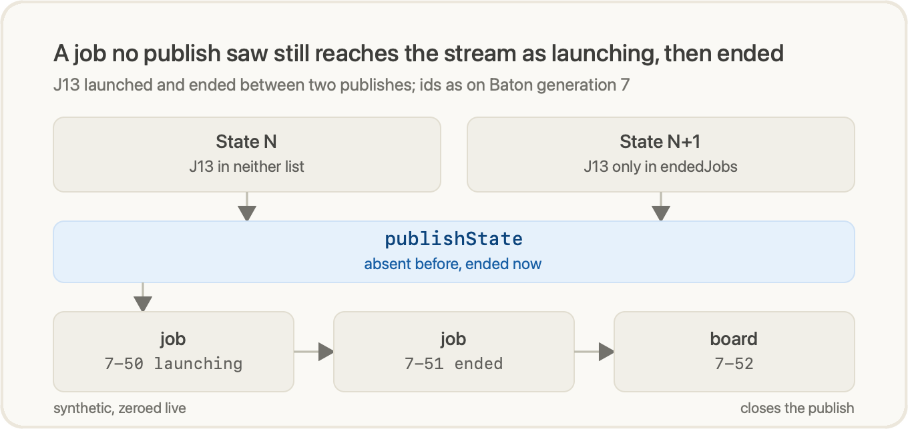

# The Overseer API

> **Question:** What does the Overseer serve, to whom, and how does a client stay in step?
> **Time:** 15 minutes, or look one route up.
> **Read first:** [Overview](../concepts/overview.md), [Glossary](../glossary.md).

## In one screen

Each [board](../glossary.md#board) has one [Overseer](../glossary.md#overseer), and it serves one HTTP API on
`127.0.0.1`. Its clients are the [Bridge](../glossary.md#bridge), the CLI, and monitors: separate programs that list
boards, read them and may frame the Bridge. The port is derived from the [tracker](../glossary.md#tracker) id. A client
reads `GET /api/versions` first, and calls each endpoint at the version path its forge version is served.


*Notice the dashed lines: every read path takes no lock.*

The API has one write route, `POST /api/commands`, behind a bearer token, and one upload route, `POST /api/pictures`,
which stores a picture a later command names; most CLI verbs write the tracker themselves and only nudge. A page's one source of board truth is `GET /api/events`, whose `board` event carries the whole
`BoardState` document. A client that receives every `board` has everything; the other event kinds are slices of it.

A reconnect either replays what it missed or starts from a fresh `board`, so a client never applies events on top of
an older generation's state. The [generation](../glossary.md#generation) in an event id decides that. The
[code version](../glossary.md#code-version) decides, separately, whether the page reloads.

Request guards stop a browser page of another origin. They are not what holds an agent
[session](../glossary.md#session): that is confinement.

## Routes

Every route passes the shared [request guards](#request-guards), so every route can also answer 403
`{refusal: 'forbidden', text}`. **Own guard** is what a route asks beyond them, and **Other statuses** lists only what
the route adds. An answer is JSON unless the row says otherwise. A refusal is `{refusal: <text>}`, a fixed word except
on 409, 413, 415 and 423, where it is a sentence. A 401, a 403 and the 500s `read-failed` and `page-build-failed` are
`{refusal, text}`: the fixed word, and beside it the sentence a client shows unedited, worded in
`cli/overseer/routes/OverseerRoutes.ts`. No sentence an answer carries names a command line or a flag: User runs no
command, so a sentence names what is wrong and the Bridge control or a neutral action, such as "open the board again".
A bare verb such as `oversee status` is `forge oversee status`.

| Route | Own guard | Answer | Other statuses | Called by |
| --- | --- | --- | --- | --- |
| `GET /api/versions` | none | `{current, minimumSupported}`, see [System versions](#system-versions); never versioned and never removed | none, also while the Overseer starts | every client, first |
| `GET /api/identity` | none | `OverseerIdentity`: `identityVersion`, `application`, `trackerId`, `project`, `codeVersion`, `installVersion`, `watcherProtocolVersion`, `processId`, `contracts`, see [Contracts](#contracts) | 503 `starting` until the folder watch has started | Bridge, `oversee --detach`, `oversee status`, a monitor |
| `POST /api/session-codes` | bearer token | `{code}`: a fresh one-time [session code](#browser-sessions) | 401 `unauthorized` | `open` |
| `POST /api/session` | the code in the JSON body `{code}`, never the URL | `{outcome: 'done'}` and `Set-Cookie: forge-session-<port>=<secret>; Path=/; HttpOnly; SameSite=Strict` | 401 `unauthorized` for a code never issued, already spent, or not in the body | Bridge |
| `GET /api/session-token` | session cookie or bearer token | `{token}` | 401 `unauthorized`, also before a token exists | Bridge |
| `GET /api/state` | session cookie or bearer token | `BoardState`, read fresh for this request | 401 `unauthorized`; 500 `read-failed` when the read throws | `oversee status`; never the Bridge |
| `GET /api/summary` | none | `BoardSummary`, see [The summary contract](#the-summary-contract) | 500 `read-failed` when the read throws | a monitor; never the Bridge |
| `GET /api/monitor` | session cookie or bearer token | `MonitorSnapshot`, read fresh for this request, see [The monitor contract](#the-monitor-contract) | 401 `unauthorized`; 500 `read-failed` when the read throws; 503 `starting` before the Overseer took its generation | a monitor |
| `GET /api/monitor/events` | session cookie or bearer token | Server-sent events, a `handshake` and then one `monitor` event per changed snapshot, see [The monitor stream](#the-monitor-stream) | 401 `unauthorized`; 404 `not-ready` until the first snapshot was published | a monitor |
| `GET /api/events` | session cookie or bearer token | Server-sent events, see [The event stream](#the-event-stream) | 401 `unauthorized`; 404 `not-ready` until the [event broker](#the-event-stream) exists | Bridge, `cli/testing/CutoverSmoke.ts` |
| `POST /api/commands` | bearer token | `{controlVersion, outcome, result}`, see [Commands](#commands) | 400, 401, 409, 423, 500 | Bridge, `oversee stop`, `oversee restart`, `update` |
| `POST /api/flint-brain/ask` | session cookie or bearer token; a JSON body of at most `FLINT_BRAIN_DIGEST_SIZE_LIMIT_BYTES` (32 KiB) | `{kind: 'answered', intent, emote}`, or `{kind: 'not-asked', reason}` when the rule director moves, see [Flint's brain](#flint-brain) | 400 `{refusal: 'malformed-body', text}` for no JSON or a digest of the wrong shape; 401 `unauthorized`; 413 `{refusal: 'too-large'}`, refused unread on a `Content-Length` over the limit | Bridge only; unversioned and in no registry entry |
| `POST /api/pictures` | bearer token; a raw body, the picture's bytes | `{pictureId, bytes, mediaType}`: the picture stored owner-only as `<data>/pictures/<pictureId>.<extension>`, its id the sha256 of its bytes and its type read from its first bytes, never from `Content-Type` | 400 `malformed-body` for an empty body; 401 `unauthorized`; 413 `{refusal: <sentence>}` over `PICTURE_SIZE_LIMIT_BYTES`, the largest picture whose base64 fits the vendor's `PICTURE_ENCODED_SIZE_LIMIT_BYTES`, refused unread on a `Content-Length` over it and read no further than past it otherwise; 415 `{refusal: <sentence>}` for a type outside `ACCEPTED_PICTURE_MEDIA_TYPES` | Bridge (`PictureUploadClient`) |
| `GET /api/pictures/<id>` | session cookie or bearer token; `<id>` 64 hex digits | The picture's bytes with its stored type, `X-Content-Type-Options: nosniff`, `Content-Security-Policy: sandbox` and `Cache-Control: no-store` | 401 `unauthorized`; 404 `not-found` | Bridge, as an image |
| `POST /api/nudge` | none | `{outcome: 'done'}`; schedules a [Pass](../glossary.md#pass), any body ignored | none | every CLI verb that wrote the tracker |
| `GET /api/jobs/<J>/stream` | session cookie or bearer token | Server-sent events, see [The transcript stream](#the-transcript-stream) | 401 `unauthorized`; 404 `not-found` | Bridge |
| `GET /api/profiles/<P>/stream` | session cookie or bearer token | Server-sent events, see [The gate profile stream](#the-gate-profile-stream) | 401 `unauthorized`; 404 `not-found` for a run `gate-profiles.json` does not hold, or a cursor that is no line number | `bridge/api/ProfileStreamClient.ts`, for the gate dialog's profile log |
| `GET /api/jobs/<J>/files/<name>` | session cookie or bearer token; `<name>` in `SERVED_JOB_FILE_NAMES` | The file as `text/plain; charset=utf-8` under `Content-Security-Policy: sandbox` | 401 `unauthorized`; 404 `not-found` | no caller in this repository |
| `/api/v<n>/<endpoint>` | the unversioned route's | The unversioned route's answer, for each endpoint the registry serves at `v<n>`, see [Versioned paths](#versioned-paths) | 404 `not-found` for a version or an endpoint the registry does not serve | a monitor |
| Any other `GET` outside `/api/` | none | A built Bridge file, `/` being the page | 404 `not-found`, 500 `page-build-failed` | browsers |
| Anything else | none | 404 `not-found` | | |

`SERVED_JOB_FILE_NAMES` is exactly `report.json` and `gate.log`, so `launch-<n>.json`, which says what a
[Watcher](../glossary.md#watcher) runs, is never served. The file route answers 404 for any other name before it
looks at the job.

A [job](../glossary.md#job) route needs a job id matching `/^J\d+$/` and an existing job folder. A path segment holding
a percent escape matches no route and gets 404, because neither job ids nor served names need decoding.

> **Careful.** A read route that throws, `GET /api/state`, `GET /api/summary` or `GET /api/monitor` on a malformed
> `progress.json` for one, answers 500 `{refusal: 'read-failed', text}`. `POST /api/commands` has no handler above it
> for any throw other than `OperationRefusal` or `TypeError`, so Bun answers a plain-text 500 `Something went wrong!`,
> with no JSON body and no CSP. The event stream behaves differently, see [BoardState](#boardstate).

## Request guards

Three guards run before routing, in this order: Host, Origin and no preflight. The first failure answers 403
`{refusal: 'forbidden'}`. Two more sit inside their routes: the reader check and the bearer token. Two CSPs mark the
answers, and the bind is set at the socket. No route trusts a request header a local program can forge, such as
`Sec-Fetch-Site`, as proof of who is asking.

![A request reaches the socket bound to 127.0.0.1, then the Host, Origin and not-OPTIONS checks, each failing with 403. The data routes (session-token, state, events, a job's stream, a gate profile's stream, a job's files and a stored picture) then require the session cookie or the bearer token or answer 401, the session-code, commands and picture upload routes require the bearer token or answer 401, the session route requires a one-time code or answers 401, and identity, summary, nudge and the page ask for no token. Every returned answer carries a content security policy, the 403s included. A session is held by its confinement instead.](../figures/overseer-api/request-guards.png)

*Notice the last box: a browser's headers can be trusted and a process's cannot, so a session is held another way.*

| Guard | Where | Rule | Failure | Attack it stops |
| --- | --- | --- | --- | --- |
| Bind | Socket | `Bun.serve` on `127.0.0.1`, `reusePort: false` | No connection | A request from another machine; a second process sharing the port |
| Host | Before routing | Exactly `127.0.0.1:<port>` or `localhost:<port>` | 403 `forbidden` | DNS rebinding: a foreign name resolved to loopback carries its own name as Host |
| Origin | Before routing | Absent, or `http://127.0.0.1:<port>`, or `http://localhost:<port>`. The text `null` is refused. | 403 `forbidden` | A page elsewhere reading or writing the API, a monitor's page included |
| No preflight | Before routing | `OPTIONS` is always refused | 403 `forbidden` | A cross-origin write that needs permission. No answer anywhere carries a CORS header, so permission cannot be given. |
| Reader | In the nine data routes: session token, state, events, monitor, monitor events, job stream, job files, pictures, profile stream | The session cookie names a live [browser session](#browser-sessions), or the bearer token matches | 401 `unauthorized` | Another user of the machine, or an unconfined process, reading the board or the token over the shared loopback port |
| Bearer token | In `/api/commands`, `/api/pictures` and `/api/session-codes` | Compared with `timingSafeEqual`, lengths first | 401 `unauthorized` | A write with no token, and guessing a token by timing |
| Page CSP | On the answer | Every answer that sets no CSP of its own, a guard's 403 included | None, it is a header | Injected script reaching out; a foreign page framing the Bridge's controls |
| File CSP | On the answer | `sandbox` on a served job file and a served picture, which is also `nosniff` | None, it is a header | Agent text or a picture opened in a browser running as the API's origin |


*Notice the gray cell: a foreign no-cors `GET` is answered, and the browser keeps the answer from the page.*

The loopback port is shared by every user of the machine, so the data routes ask who reads: the Bridge shows its
session cookie, and a CLI reader such as `oversee status` the bearer token from the file the Baton names.
`GET /api/versions`, `GET /api/identity`, `GET /api/summary` and `POST /api/nudge` stay open: the versions, identity and
the summary carry no ticket text, a monitor's server reads them with no token, and a nudge carries no data and only
schedules a Pass.

The token never reaches another origin's page: the only route that hands it out needs a session cookie, which only a
one-time code buys, and no answer is readable across origins. Every Overseer start writes a fresh token to the file the
[Baton](../glossary.md#baton) names.

### Browser sessions

`open` asks the live Overseer for a one-time code with the token (`POST /api/session-codes`) and opens, and prints, the
Overseer's URL with `#session=<code>` as its fragment. A browser never sends a fragment to a server, so the code
reaches no request line, query string or log. The browser opener gets only the path of an owner-only HTML file in the
token's folder that redirects to that URL, since any local user can read a process's arguments; `open` stays until the
code's 30-second life ends, or a stop signal comes, and then removes the file. Before anything else loads, the Bridge
clears the fragment from the address bar and its history, then posts the code in a JSON body to `POST /api/session`.
The Overseer spends the code and answers a session cookie: `HttpOnly`, so no script reads it, and `SameSite=Strict`, so
no other site's page sends it. Its name carries the port, because a cookie on `127.0.0.1` reaches every port. A second
exchange of the same code answers 401.

Codes and sessions live in the Overseer's memory, as digests. An Overseer start, a Baton pass included, forgets them,
so a Bridge open across a restart reads 401 until `open` is run again. A Bridge opened from the stub `progress.html`,
or by its plain URL, holds no cookie and reads nothing; `open` prints the URL with its code for a browser opened by
hand.


*Notice that a stale token costs the Bridge one 401 and nothing else.*

> **Careful.** A process of the same user can read the token file, and so can ask for a code. A session cannot, because
> its profile denies the file and limits its network. The figures
> above still show the older `Sec-Fetch-Site` guard on `/api/session-token` and token-free read routes.

## Serving the page

`GET /` is built on the first page request, not at start. `pageFilesOf` calls `Bun.build` on the Bridge's HTML import
once and remembers the promise, so later requests share one build. A failed build answers 500 and clears the memory, so
the next request tries again. The outputs stay in memory as blobs keyed by path, `index.html` at `/` and each chunk at
its own name.

> **Why.** Bun's own HTML route takes no headers. Every file of the page must carry `frame-ancestors`, which no meta tag
> can state, so the server builds the bundle itself and answers through `fetch`.

The page CSP is one policy with a dynamic end:

```text
default-src 'self'; script-src 'self'; style-src 'self'; connect-src 'self'; img-src 'self' data:; object-src 'none';
base-uri 'none'; form-action 'none'; frame-ancestors <origins, or 'none'>
```

`FrameOrigins.frameOriginsOf` reads the framing hosts' records for every response, each giving its `origin`
([The embed contract](#the-embed-contract)). A record that is absent or unreadable adds no origin; with no origin the
policy says `'none'`. `bridge/index.html` repeats the policy as
a meta tag, without `frame-ancestors`.

Changed Bridge code reaches the browser only through an Overseer on that code, since the memory lives as long as the
server.

> **As built.** A [Baton pass](../glossary.md#baton-pass) does not build the page, so a broken Bridge passes it and
> fails only on the next `GET /`.

## Commands

`POST /api/commands` takes one `ControlCommand` as JSON, `{kind, ...}`, or one of Flint's brain's two kinds
([Flint's brain](#flint-brain)). `CONTROL_COMMAND_KINDS` holds 75 kinds. Three of them are the Bridge's controls for
verbs that once needed a terminal: `chart-range-set` (`range`), `tracker-clear`
(`clear`) and `ticket-deliver-by-hand` (`ticket deliver --by-hand`). They are in no versioned control contract.

The pipeline kinds each name the CLI verb that sends the same command, and the [CLI reference](../cli.md) says what
each does:

| Kinds | CLI verbs |
| --- | --- |
| `pipeline-setup-start`, `pipeline-update-start`, `pipeline-setup-billing`, `pipeline-setup-step`, `pipeline-setup-answer`, `pipeline-constitution-edit`, `pipeline-draft-edit`, `pipeline-draft-undo`, `pipeline-draft-discard`, `pipeline-check`, `pipeline-setup-start-over`, `pipeline-setup-resume`, `pipeline-apply`, `pipeline-apply-cancel` | The `pipeline` verbs of [Pipeline setup](../cli.md#pipeline-setup) |
| `gate-profile-start`, `gate-profile-stop` | `pipeline profile`, `pipeline profile-stop` ([Gate profiles](../cli.md#gate-profiles)) |
| `pipeline-agent-advise` | `advise` |
| `pipeline-prepare-step-set`, `pipeline-gate-add`, `pipeline-gate-order`, `pipeline-gates-none`, `pipeline-gate-remove`, `pipeline-approval-set` | The `gate` writes of [Concurrency and gates](../cli.md#concurrency-and-gates) |
| `pipeline-finding-record`, `pipeline-question-ask`, `pipeline-constitution-draft`, `pipeline-draft-propose`, `pipeline-step-ready` | The [pipeline agent's verbs](../cli.md#the-pipeline-agents-verbs), relayed through its job's Hatch |

The route checks only `kind`; each setup, profile and pipeline agent applier reads its own fields and refuses a
missing or misshapen one `malformed-setup-command`, naming the field. A pipeline agent's job may relay only its five verbs and
`question options`; `gate-profile-start` and `pipeline-check` come only from User.


*Notice that a runtime command answers 200 before anything has happened.*

| Status | Body | Meaning |
| --- | --- | --- |
| 200 | `{controlVersion, outcome, result}` | Applied in a [lock hold](../glossary.md#lock-hold) of its own, and a Pass was woken. `result` is what the control function returned. |
| 400 | `{controlVersion, refusal: 'malformed-body', text}` | Not JSON, not an object, an unknown `kind`, a `now` that is not a boolean, a `limit` of `machine-agent-limit-set` or `concurrency-set` that is not a number, a `mode` of `job-stop-all` that is not `stop` or `wind-down`, a `range` of `chart-range-set` that is neither `{kind: 'automatic'}` nor a `window` of text `from` and `to` and a `tickMinutes` that is a number or null, a `scope` of `tracker-clear` that is not `tasks-and-log` or `everything`, a `ticket-deliver-by-hand` whose `ticketReference` is not text or whose `branch` or `commit` is given and not text, or a control function reading a field the body lacks. Nothing was written. |
| 401 | `{refusal: 'unauthorized', text}` | No token, a wrong one, or no token written yet. |
| 409 | `{controlVersion, refusal: <code>, text: <sentence>}` | The write was refused. The code is the refusal's reason code, such as `machine-agent-limit-above-cpus`; the sentence is the API sentence of `OperationRefusalWordingUtil` (`apiMessageOf`), and the Bridge shows it verbatim. [Refusals](refusals.md) lists each sentence. |
| 423 | `{controlVersion, refusal: 'launches-held-by-install-change', text}` | The install hold: the [install version](../glossary.md#install-version) changed, so every command but `overseer-stop`, `overseer-restart`, `machine-agent-limit-set` and Flint's brain's two is refused, a job stop included. A Baton pass lifts the 423 while it runs. |
| 500 | Plain text | Any other throw, as under [Routes](#routes). |

`outcome` is `done`, or `nothing-to-do` when the control function reports `changed: false`, as for an edit to the same
text. It is never a failure: a refusal has its own status.

A command carries no idempotency key, so a resend is applied again. A Bridge control that gets a 200 whose body it cannot
read says that the Overseer may have applied the command and that its answer was lost, never that the Overseer could not
be reached, and keeps the text it sent, so User checks the board before sending it again.

`overseer-stop` and `overseer-restart` are the two runtime commands, `{kind, now}`. `now` is the `--now` flag of
`oversee stop` and `oversee restart`. They write nothing to the
board and go to the running Overseer, so they are taken during the install hold, and they answer 200
`{outcome: 'done', result: {kind}}` before the work happens. A 200 here means received. `oversee stop` and
`oversee restart` then wait on the Baton files for the result.

> **As built.** The `now` of a restart goes nowhere, and a stop arriving during a Baton pass is answered and dropped.
> The install hold refuses a job stop too.

`machine-agent-limit-set` `{kind, limit}` sets the machine agent limit in `<monitor>/machine-limits.json`, the one
`machine limit <n>` sets: it changes no board, so it is applied in no lock hold and is taken during the install hold. A
limit above the CPU count answers 409 `machine-agent-limit-above-cpus` and writes nothing.

### Control contract 1

The control contract is what a monitor may send and what it gets back. It names nine kinds, `CONTROL_CONTRACT_KINDS` in
`src/shared/constants/OverseerApiContracts.ts`: `overseer-pause`, `overseer-resume`, `overseer-stop {now}`,
`overseer-restart {now}`, `concurrency-set {limit}`, `job-stop-all {mode}`, `machine-agent-limit-set {limit}`, and, from
forge 1.1, `flint-brain-start` and `flint-brain-stop`. Each answer carries `controlVersion` 1. A 200 answers `outcome`
`done` or `nothing-to-do`, and `result`, the control function's own record, which is outside the contract; a 400, a 409
and a 423 answer `refusal`, a code, and `text`, its sentence; a 401 answers `unauthorized`. A `concurrency-set` `limit`
outside 1 to 10 answers 409 `concurrency-limit-out-of-range` and writes nothing.
`cli/overseer/routes/CommandRoute.controlContract.spec.ts` pins each kind's body and answer. A change to one of them
raises the system version in the same change, its minor when the change only adds; the other kinds may change and keep it.

`contracts.control` on the identity and `controlVersion` stay 1 in forge 1.1, although 1.1 adds the brain's two kinds:
a client built for 1.0 compares the number for equality, so a 2 would cut it off every control under a minor. System
version 1.1 is what announces the two kinds; a client sends them only to a forge of 1.1 or newer.

### Flint's brain

Flint's brain is a second director for the sprite, run by the Overseer as one confined session per run
(`src/services/overseer/FlintBrain.ts`): no tool, its own deny-all profile, the brain's model and effort, and a maximum
run time. It is no job: it is never in `jobs[]`, never holds a launch slot and counts against no limit. Its state lives
in the Overseer's memory, so a stop or a Baton pass ends a running brain `stopped`.

`flint-brain-start` and `flint-brain-stop` carry no field. They go to the brain, held or not, and answer 200
`{controlVersion: 1, outcome: 'done', result: {kind}}` once the brain took them: a start has launched its session. A
start names who started it, `startedBy` in the monitor: `bridge` when the request carries a Bridge session cookie the
Overseer holds, beside the token every command needs, and `api` for the token alone. No key of the body names a caller.

| Refusal (409) | Of | When |
| --- | --- | --- |
| `brain-already-running` | start | A run is starting or running. |
| `overseer-paused` | start | The board's Overseer is paused. |
| `usage-limit-holds` | start | The [usage marker](../glossary.md#usage-marker) holds launches; the sentence names its reset. |
| `brain-failed-to-start` | start | The session's program or its Watcher could not launch, or the session ended before it ran; the Overseer's log names why. |
| `no-flint` | start | This forge cannot run the brain confined, and its monitor's `flintBrain` is `null`. The test setting `FORGE_WITHOUT_FLINT_BRAIN` answers so ([the CLI reference](../cli.md)). |
| `brain-not-running` | stop | No run is starting or running. |

A run ends `time` at its maximum, `stopped` on a stop or the Overseer's stop, `usage-limit` when the usage limit holds,
and `failed` when its session fails. Every change of the brain publishes the board state and the monitor snapshot at
once, so the monitor stream sends a `monitor` event for each. Each run that ended is logged as a `flint-brain-ended`
record, `{startedBy, startedAt, endedAt, endedReason, tokens, calls}`, which the monitor's `activity[]` and `today` read,
so both survive an Overseer restart.

`POST /api/flint-brain/ask` is the Bridge's own route: the Bridge posts Flint's perception digest while the brain runs,
and the Overseer asks the session for a move at most once in `FLINT_BRAIN_ASK_INTERVAL_MILLISECONDS` and only when the
digest's content or cues changed. The answer names a move the digest itself offers, or says why the rule director moves
this time: `not-running`, `asleep`, `busy`, `too-soon`, `unchanged`, `not-taken`, `off-list-answer`, `no-answer` or
`ended`. The route is unversioned and in no registry entry, since only the page the same Overseer serves calls it.

`CommandClient` in `bridge/api/` is the reference client. Its `SessionTokenSource` posts once, on a 401 clears its
token, fetches another and posts once more, because an Overseer start rotates the token. `PictureUploadClient` posts a
picture through the same token source, so one rotation is fetched once.

`job-message` and `intake-start` take `pictures: [{pictureId, name}]`, at most `PICTURES_PER_MESSAGE_LIMIT` (4), each
uploaded to `POST /api/pictures` first. The control service refuses `too-many-pictures` and `picture-unknown`, a picture
the store does not hold, before the Board; the Board refuses `pictures-not-taken` for any job but a product owner, and
`intake-empty` for a blank request with no picture. The CLI verbs take no picture. A picture is sent to the session as
an image block of the chat line, read from the store when the line is written: a message's from its `job-messaged`
record, a reopening's from its `job-reopened` record, and a product owner's request with the first message of each of
its sessions, a fresh one after a replacement included.

## The event stream

Each state change becomes an ordered run of events, and `board` closes it. A client that replaces its state on each
`board` and ignores every other event is complete.


*Notice the middle row: a decision that left the board has no event of its own.*

The event broker, `EventBroker`, is created once the Overseer holds the Baton and lives as long as that generation,
so one process that takes the Baton back after a failed Baton pass gets a new broker. A publish happens after every
Pass, at every [sweep](../glossary.md#sweep), and once at start. Each reads the board without a lock into a
`BoardState` and hands it to `EventBroker.publishState`, which compares it with the last one.

| Event | `data` | Sent when |
| --- | --- | --- |
| `job` | A `BoardState` job, or an `endedJobs` entry with `state: 'ended'` | That job's JSON changed |
| `decision` | The open [decision](../glossary.md#decision) | It appeared or changed |
| `incident` | The open [incident](../glossary.md#incident) | It appeared or changed |
| `overseer` | `BoardState.overseer` | It changed |
| `usage` | `BoardState.usage` | It changed |
| `profile` | One `profileRuns` entry | That gate profile run appeared or changed |
| `pipeline` | `{pipeline, pipelineSetup, pipelineFlow}` of the `BoardState` | The stored pipeline, the setup record, its draft or the flow changed; always directly before `board`, so the flow can animate its marks |
| `board` | The whole `BoardState` | Anything changed; always last |

The rules of one publish:

- An event id is `<generation>-<n>`, `n` counting from 1 within one broker.
- Slices go in the table's order: jobs, ended jobs, decisions, incidents, `overseer`, `usage`, `profile`, `pipeline`,
  then `board`. A profile run's output lines are never events: they go only on [its own
  stream](#the-gate-profile-stream).
- The first state of a broker sends only `board`, so a job already past `launching` in it gets no `launching` event.
- A state differing only in `page.payload.generatedAtEpochMilliseconds` sends nothing and spends no id.
- A record that left a list sends no slice event. Only the `board` of that publish removes it.
- After a broker's first state, a job a publish first shows past `launching` is sent as `launching` first, by a
  synthetic event. A client that connects fresh gets a `board` with each job as it stands.
- `endedJobs` lets a job launched and ended between two publishes reach the stream. `launchingJobOf` makes its
  `launching` event. A job that ended outside the `ENDED_JOBS_SHOWN` window of both states gets no event.



*Notice that the first event is synthetic: its `live` counts are zero whatever the job did.*

The stream also carries `: ping` every `SSE_HEARTBEAT_SECONDS` (5), and Bun's idle timeout is switched off for every
streaming route: this one, the transcript stream and the gate profile stream. On stop the server closes every open
stream, then stops gracefully, so the answer to an `overseer-stop` still arrives.

> **As built.** Each `board` carries every [ticket](../glossary.md#ticket) body and the whole question history.

## Reconnecting

Two signals travel apart: the generation settles which events a client gets, the code version whether its page reloads.


*Notice that a Baton pass on the same code gives a fresh board and no reload.*

The server side is `EventBroker.replayAfter`. The replay buffer holds the last `REPLAY_BUFFER_EVENTS` (256) events and
lives as long as the broker, so a restart empties it. An answer is one of:

| `Last-Event-ID` | Answer |
| --- | --- |
| Absent | Fresh: the newest state as `board`, carrying the newest id. Before the broker's first state a connect stays open and silent, and the first `board` arrives on the subscription. |
| Another generation | Fresh |
| This generation, scrolled out of the buffer | Fresh |
| This generation, buffered | Every event after it; nothing if it was the newest |

Replay or snapshot and the subscription happen in one synchronous step, so no event falls between them.

The client side is `EventStreamClient`. The browser's own reconnect sends `Last-Event-ID`. When the browser gives up, as
on a non-200 answer such as `not-ready`, the client opens a fresh `EventSource` after `REOPEN_DELAY_MILLISECONDS`
(2000). That one has no id, so it starts from a fresh `board`. A malformed event is dropped, since the next `board`
repairs it. The port survives a Baton pass, so the URL stays valid.

The code signal is `BridgeApp`'s: when the connection goes `down` and comes back `live`, it fetches `/api/identity` and
reloads when `codeVersion` differs from the one it first read. The page's bundle may no longer match the API.

> **Careful.** That check runs once per return. If `/api/identity` fails at that moment, or failed at page load, the
> page keeps its code without another try. Only a 503 `starting` is asked again, up to ten times half a second apart,
> so a page opened while the Overseer starts still reads its identity.

> **As built.** The connection state flickers on the client's reopen path.

## BoardState

`BoardState` is the `status --json --full` document with the live parts laid over it, all from one reading of the board.
`GET /api/state` and the `board` event carry the same shape, and they read it on two roads.


*Notice that the same malformed file gives a 500 on one road and a skipped publish on the other.*

`boardStateOf` in `src/services/overseer/BoardState.ts` assembles the document and `readBoardState` in
`cli/overseer/routes/BoardStateReader.ts` feeds it.


*Notice how much one reading mixes: that mix is the cost of a state read.*

| Key | Produced by | Holds |
| --- | --- | --- |
| Status keys | `fullDocumentOf` | Stored progress fields, `tasks`, the worded `log`, `tickets`, `epics`, `drafts`, `concurrency`, `readyTickets`, `reviewWaitingTickets`, `pausedBuilds`, `ticketRows`, `tokensByOwner`, `ticketCountByStatus`. Their meaning is in the [CLI reference](../cli.md). |
| `concurrency` | `ConcurrencyUtil.concurrencyOf`, a status key | `{limit, agentsInFlight, freeSlots}`. `agentsInFlight` counts the live build and review jobs (`LaunchSlotUtil`), the count the Overseer's launch gate reads; the Bridge header shows it against `limit`. |
| `page` | `assemblePagePayload` | `{payload, tickets}`: the rendered ticket bodies and the `boardFacts` the views read |
| `jobs` | `Board.jobs`, `JobLiveFactsReader` | Every stored job plus `launchedAt`, the stamp of its newest `job-launched` record (`null` when the log lost it), and `live`. A stored job carries `pendingOptionNotes` only while its notes wait for their question. Replaces the status document's `jobs`. |
| `decisions`, `incidents` | The Board | The open ones. Replaces the status document's. An option of an `agent-question` decision carries `touches`, `tradeOff` and `acceptanceEffect` only where the asking agent noted them with `question options`. |
| `notices` | The Pass's own state | The current [notices](../glossary.md#notice), held in memory |
| `mergeQueue` | `mergeQueueOf` | `queuedTicketIds`, `slots`, `targets`, below |
| `overseer` | `OverseerForeground`, the Board | `state`, `url`, `generation`, `codeVersion`, `installVersion`, `batonPassWarning`, and `paused` from the Board. |
| `usage` | The [usage marker](../glossary.md#usage-marker) and `<monitor>/usage-windows.json` | `{resetsAt, window, windows}`: `resetsAt` and `window` both `null` when no limit was hit; `windows` the newest observation of each window seen (`{window, utilization, resetsAt}`, `utilization` a whole percent), empty before the first observation and under API billing |
| `questionHistory` | `questionHistoryOf` | Every log record naming a decision or incident, every record of an [Assistant](../glossary.md#assistant), [product owner](../glossary.md#product-owner) or pipeline agent job. Unbounded. |
| `endedJobs` | `endedJobsOf` | The newest `ENDED_JOBS_SHOWN` (32) that left, oldest first. A reopened job keeps only its latest ending. |
| `ticketForecasts` | `Board.ticketForecastsOf` | One per `pending`, `in-progress` or `in-review` ticket, none while no pipeline is set: its `steps` to the landing, its `currentStepIndex` and its `dependents`, below. Not in `status --json`. |
| `launchSlots` | `Board.launchSlots` | `{limit, slotJobIds, inProgressTicketIdsWithoutJob}`: the jobs holding a launch slot in launch order, counted through `LaunchSlotUtil` as `concurrency.agentsInFlight` is, so there are always as many; and, in board order, the `in-progress` tickets that no live job names. A view joins on these ids and copies no rule. Not in `status --json`. |
| `pipeline` | `pipelineFactsOf` | The stored pipeline as read: `readingVerdict` `absent`, `older` or `malformed` (with its `reason`), each but `absent` with `fileText`; or `readable` with the `pipeline`, its `contentHash`, its `fileText` and `application`, the newest `pipeline-applied` record (`appliedRevision` counting the Applies from 1, `appliedAt`, `appliedBy`, `constitutionCommit`), `null` for a pipeline only the `gate` verbs wrote. Not in `status --json`. |
| `pipelineSetup` | `pipelineFactsOf` | `null` with no readable setup record; else the `record` and what the Bridge reads off it, below. Not in `status --json`. |
| `pipelineFlow` | `pipelineFactsOf`, `pipelineFlowGraphOf` | The flow the Pipeline view draws: of the record's draft (`toolbarStage` `proposal` in a first setup, `editing` in an update or advise), or of the stored pipeline with no record (`live`); `null` when there is nothing to draw. Below. Not in `status --json`. |
| `profileRuns` | `pipelineFactsOf` | The newest [gate profile](../cli.md#gate-profiles) run of each gate and phase, of each entity on a forge over entities: `profileRunId`, `gateName`, `phase`, `state`, `elapsedMilliseconds`, `cacheReport` (`hit`, `partial`, `miss` or `null`, the gate's [report](../cli.md#gate-reports)), and `entity` only on a run of an entity's gate. Empty when `gate-profiles.json` holds none or cannot be read. Not in `status --json`. |
| `gateCacheMarks` | `pipelineFactsOf` | `{gateName, phase, cacheReport}`, with `entity` only on a mark of an entity's gate, of each gate in each phase, of each entity on a forge over entities, whose newest run, a job's `gate-ran` or a profile run, by log order, reported `hit`, `partial` or `miss`; the gates step's pills mark it. Not in `status --json`. |
| `pipelineHistory` | `pipelineFactsOf` | The newest `PIPELINE_HISTORY_RECORDS_SHOWN` (32) records that change the pipeline or pause and resume the board, newest first, for the live flow's "Earlier" list. A setup's own steps, findings and questions stay out. Not in `status --json`. |
| `pipelineChoices` | `pipelineFactsOf` | `{models, efforts}`: every model and effort in their order, so the Bridge keeps no copy of the vocabulary. Not in `status --json`. |
| `pipelineAgentDefaults` | `pipelineFactsOf`, from `LaunchSettings.defaultAgentPairOf` | `{model, effort}`: the pair a pipeline agent launches on where the pipeline names none, which the setup steps show until the draft names one, so the Bridge keeps no copy. Not in `status --json`. |
| `entityAssignment` | `pipelineFactsOf` | Only once the first Apply over entities started a product owner for the pending tickets without an entity: `{jobId, jobState, tickets}`, `jobState` the job's state while it is on the board, else `null`; each ticket `{ticketId, title, entity, reason, assignedBy}` in the order the job's `job-launched` record names them, `entity`, `reason` and `assignedBy` from the ticket's newest `entity-assigned` record since that launch, all `null` while it waits, `title` `null` for a ticket the board no longer holds. Read-only: no control assigns an entity. Not in `status --json`. |
| `pictureLimits` | `boardStateOf`, from `OverseerLimits.ts` | `{perMessage, sizeLimitBytes, mediaTypes}`, the bounds a picture is refused by, so the Bridge refuses one before its upload and keeps no copy; `null` when the agent adapter's `capabilities.pictures` is false. Not in `status --json`. |

`questionHistory` exists because a settled record leaves the board, and the views still show it.

<details>
<summary><code>page.tickets[]</code> field by field</summary>

Each entry is the ticket's frontmatter plus the fields below. Only `bodyHtml` is HTML. The excerpts are source text, which
a view shows escaped, so a quoted Wanted or Brief never reaches the page as markup.

| Field | Holds |
| --- | --- |
| `filePath` | The ticket file |
| `bodyHtml` | The whole body rendered by Marked, shown in a sandboxed frame |
| `sections[]` | Every `##` section in written order: `heading` (the text after `## `) and `markdown` (its source lines, blank lines around them dropped). A heading inside a code fence is a line, not a section. |
| `acceptanceItems[]` | The numbered items of the first `## Acceptance`: `label` (`A1`), `text` (continuation lines joined by a space) and `waived` (the Acceptance marks it `Waived:`). Empty when there is none. |

</details>

<details>
<summary><code>mergeQueue</code> field by field</summary>

| Field | Holds |
| --- | --- |
| `queuedTicketIds` | In-review tickets queued for a merge, in board order |
| `slots[]` | One per job holding an [Airlock](../glossary.md#airlock) slot: `jobId`, `target`, `phase` |
| `targets[]` | Every [target](../glossary.md#target) with an Airlock slot holder or a queued ticket, sorted. Empty when the reading has no forecasting. |
| `targets[].target` | The branch |
| `targets[].holder` | `{jobId, ticketIds, phase}`, or `null` |
| `targets[].order[]` | Waiting candidates in merge order: `ticketId`, `priority`, `againstTarget`, `conflictedFiles`, `conflictsCaused` |
| `order[].againstTarget` | `clean`, `conflicting` or `prediction-failed` |
| `order[].conflictedFiles` | Empty when clean, the files git named when conflicting, `null` when the prediction failed |
| `targets[].pairwiseConflicts` | Pairs, each holding at least one candidate clean against the target, whose mutual merge is not predicted clean: a conflict or a failed prediction |
| `targets[].targetMovedDecisionIds` | Open `target-moved` decisions of this target's tickets; always empty as built |

Forecasts are git work done during a read. `createMergeForecastCache` keeps a target's forecasts while its tip and every
candidate's tip stay put, and never keeps a failed prediction.

> **As built.** No `target-moved` decision opens, and one that did would name no ticket, so `targetMovedDecisionIds`
> matches nothing.

</details>

<details>
<summary><code>pipelineSetup</code> and <code>pipelineFlow</code> field by field</summary>

`pipelineFactsOf` in `src/services/render/PipelineFactsAssembly.ts` builds them. It runs no git: the Overseer reads the
main line and passes the texts in.

| Field | Holds |
| --- | --- |
| `pipelineSetup.summary` | Counts for the resume summary: `stackItemCount`, `scriptCount`, `answeredResearchQuestionCount` (research questions only), `prepareStepCount`, `gateCountByPhase`, and `userEditsKeptCount`, User's edits that are not undone |
| `pipelineSetup.openQuestionCount` | The questions with no answer |
| `pipelineSetup.agentJobState` | The state of the record's agent job, `null` when no such job is on the board |
| `pipelineSetup.mainMovedByCommits` | Main's commits past the record's `snapshotCommit`, read from git and never stored |
| `pipelineSetup.constitutionHtml` | The constitution's markdown rendered by Marked, `null` with no constitution |
| `pipelineSetup.constitutionOutline` | `{sectionCount, ruleCount}`: the `##` lines and the top-level `-` items |
| `pipelineSetup.annotations[]` | Each annotation with `lineIndex`, the zero-based index of the line it anchors to; one that anchors nowhere is left out |
| `pipelineSetup.readByRoles` | The roles whose instruction lists, of the draft or else the stored pipeline, hold the constitution |
| `pipelineSetup.entities` | Absent on a forge without entities. Each entity of the draft, else of the stored pipeline, then of the record, by its key: its `summary` (without `userEditsKeptCount`), `openQuestionCount`, `agentJobState`, `constitutionHtml`, `constitutionOutline`, `annotations` and `readByRoles`, read from the entity's part of the record and its pipeline |
| `pipelineSetup.applyState` | `null` with no Apply waiting; else the record's `applyRequest` plus `blockingFiles`, from the newest `pipeline-apply-held` record while `held`, and `ticketIdHoldingMain`, the ticket whose Airlock job holds the main line |
| `pipelineFlow.nodes[]` | From `pipelineFlowGraphOf`, each instruction entry with its file name and its text on main cut at `INSTRUCTION_PREVIEW_LIMIT_CHARACTERS` (4000), and `questionIds`: the questions whose subject is the node (by id or kind) or, on a gates node, one of its gates |
| `pipelineFlow.occupants[]` | Live only: `{occupantKind, occupantId, nodeId, jobId, since}`, below |
| `pipelineFlow.changeList[]` | `{field, changeKind, editId}`: each field the draft changes against the stored pipeline, or the minimal one, `editId` the newest edit of that field that is not undone; a constitution whose text main does not hold is a `constitution` row. Empty live. |
| `pipelineFlow.entityFlows` | Absent on a forge without entities. The flow of each entity the drawn pipeline holds, by its key: `{nodes, edges, insertSlots, gateRows}`, drawn as the flow of a single pipeline is. The flow above is the forge's, and the tickets stand on it |
| `pipelineFlow.ticketIdsInFlight` | The `in-progress`, `in-review` and `reviewed` tickets, which take a new pipeline at their next gate run |

Where an occupant stands, on the first of its nodes the flow draws:

| Job or ticket | Node |
| --- | --- |
| A build job | `gates-build` while `gating`, else `builder` |
| A review job | `merge-before-review` while `preparing`, when it catches up with main (Q5); `gates-review` while `gating`; `re-review` as a `re-reviewer`; else `review` |
| A build or review job in `merging-main` | `re-review-before-human-code-review` while a conflict re-reviewer judges it, else `merge-before-human-code-review` |
| A merge job in the Airlock | `re-review-in-airlock` (`re-reviewing`), `gates-merge` (`gating`), `fast-forward-main` (`landing`), else `merge-in-airlock` |
| A claimed filing draft, and a draft ticket a live product owner filed | `ticket-creation`, as `draft` and `ticket` occupants |
| A ticket queued for a merge that no job holds | `human-code-review` with merge approval on, else `ready-for-airlock` |

A refresh, a merge agent (its parent job stands for it), a session and the constitution commit job are no occupant: the
constitution commit shows as `pipelineSetup.applyState`. `since` is the job's newest launch, the draft's claim or the
ticket's newest `merge-queued` record; it is only shown.

**Cost of a state read.** The tracked instruction texts and main's `CONSTITUTION.md` (one `git show` each) and
`mainMovedByCommits` (a commit count) are git work. `MainLineReads` in `src/services/overseer/` keeps the texts by
(main tip, path) and the count by (`snapshotCommit`, main tip) across reads, so a read whose main tip has not moved
runs only the `rev-parse` of the tip. A data-folder file is read from disk.

</details>

<details>
<summary><code>ticketForecasts</code> field by field</summary>

A forecast reads the facts the [Playbook](../glossary.md#playbook) reads and takes its attempt and round from it; it
decides nothing. `src/lib/tracker-model/Playbook.forecast.spec.ts` holds its first step to the step the Playbook takes.

| Field | Holds |
| --- | --- |
| `ticketId` | The ticket |
| `steps[]` | From the step under way, or the next one, to the landing, each with a `kind` below |
| `currentStepIndex` | `0` while a live build, review or merge job works on the ticket; `null` while nothing runs on it |
| `dependents[]` | Each `pending`, `in-progress` or `in-review` ticket whose unsettled dependencies name this one: `ticketId`, and `stillWaitingOnTicketIds`, its other unsettled dependencies |

| Step `kind` | Fields | When |
| --- | --- | --- |
| `build` | `attempt`, `jobId` | A build, its attempt as the Playbook's `launch-build` carries it; `jobId` `null` until a builder takes it |
| `customs-and-gates` | `gateNames`, `jobId` | Customs checks the handoff and runs the pipeline's gates; `jobId` names the build job while it is `in-customs` or `gating` |
| `review` | `round`, `jobId` | Only with a review phase set; skipped for a ticket queued to land |
| `merge-approval` | `target` | Only with merge approval on, until User accepted the ticket |
| `land` | `target` | A ticket of no group, or a group's release ticket, onto the main line |
| `integrate` | `target`, `group` | Any other ticket of a group, onto its group's branch |

Every `target` is `null` when the reading carries no merge forecasting.

</details>

## Job live facts

`jobs[].live` says what a running job has done so far, read fresh on every state read. Its
[event logs](../glossary.md#event-log) are read through the agent adapter's mapper; the one exception is
`src/services/overseer/ClaudeTranscripts.ts`, which parses Claude Code's transcript format directly to rebuild a lost
subagent. A malformed log adds nothing and does not fail the state.

| Field | Meaning | Read from |
| --- | --- | --- |
| `jobId` | The job | The job |
| `calls` | Distinct `messageId`s of the job's own assistant turns, across every [Watcher instance](../glossary.md#watcher-instance). Cumulative, and shown only. | Event logs |
| `callBudget` | The [role](../glossary.md#role)'s [call budget](../glossary.md#call-budget) from `JobLaunch.callBudgetOf`; `null` unless the job kind is `build` or `review` | The job |
| `tokens` | Input, output and both cache figures, counted once per `messageId`, the job's own and its subagents' | Event logs, transcripts |
| `toolCalls` | The job's own `tool-call` events | Event logs |
| `lastToolCall` | `{toolName, startedAt, running}` of the job's newest call; `running` holds until a result names its id | Event logs |
| `subagents[]` | `{parentToolUseId, toolCalls, lastToolCall, tokens, state, description}`, one per parent call. `state` is `running` while the event log holds the parent call with no result, else `ended`, so a rebuilt subagent whose parent call the log lost reads `ended`. `description` is the parent call's `description` input, or for a rebuilt subagent the one its `.meta.json` names; `null` without one. | Event logs, transcripts |
| `toolCallsWithSubagents` | `toolCalls` plus every subagent's | Both |
| `watcherProtocol` | The protocol the newest instance's Watcher record names; `null` before it wrote one | Watcher record |
| `watchOnly` | True for a Watcher below the supported window, watched through its files alone | Watcher record |
| `turn` | `mid-turn` while the newest Watcher instance took more chat lines than its session printed results, else `between-turns`: whether a message sent now waits behind a turn. An answer line starts no turn. The Assistant's is its idle rule (`AssistantSession.assistantIsIdle`), the one its deliveries wait on, so a chat decided on the board makes it `mid-turn` before its line is written. `null` for a merge or refresh job and before the first Watcher logged a line. | Event logs, the Assistant's chats |
| `messagesWaiting` | The job's `job-messaged` records its session has not taken yet: those without the `message-<n>` marker `JobControlDelivery` writes once the Watcher took the line; for the Assistant, those whose chat is not written or not taken (`AssistantSession.unsentMessageCountOf`) | The log, delivery markers |
| `lastLine` | For an Assistant, product-owner or pipeline agent job: `{role, text, at}` of the newest entry with text that the session itself wrote (`assistant`, no subagent's) or that User sent as a chat (`user`), read as [the transcript stream](#the-transcript-stream) reads it. The Overseer's lines never count. `null` for every other job, and before the session said anything. | Event logs, the log |
| `usageWindow` | `{window, resetsAt, reportedAt}` of the newest `usage-window` event the session printed, of any Watcher instance, whether or not the vendor refused requests in it. `window` is the vendor's name, such as `five_hour`; `resetsAt` is `null` when the vendor named no usable reset; `reportedAt` is the log entry's stamp, `null` for an entry written before stamps. `null` before the session reported one. | Event logs |
| `silentSweeps` | Quiet sweeps counted by the running Pass, 0 while none runs | Pass memory |


*Notice that a rebuilt subagent reaches the totals and never `calls`.*

The count the Overseer compares with a budget is not `live.calls`. It comes from `JobLaunch.sessionReadingOf` and
restarts after a [red handoff](../glossary.md#red-handoff), when the session has `RED_HANDOFF_RESUME_CALL_BUDGET`. So
during a red-handoff resume neither `live.calls` nor `live.callBudget` is the pair compared.

Subagents are grouped by `parentToolUseId`. An event log can lose one after a crash or reboot, so
`ClaudeTranscripts.ts` rebuilds it from Claude Code's own transcripts, see
[The Claude probe](../development/overseer-claude-probe.md). A subagent whose `.meta.json` names a parent call the log
already tallied is skipped unread.

The stamps, `startedAt`, `lastLine.at`, `usageWindow.reportedAt`, a job's `launchedAt` and the transcript entry stamp
`at`, are only recorded and shown: no Overseer decision reads them. `usageWindow.reportedAt` only picks which job's
report the monitor's `usage` shows.

> **As built.** A subagent with no `.meta.json` cannot be matched, so if the log also holds it, it counts twice in
> `tokens`, `subagents` and `toolCallsWithSubagents`.

> **As built.** A worker profile's `subagents` field is a separate thing, always empty.

## The transcript stream

`GET /api/jobs/<J>/stream` follows one job as entries read from `events-<instance>.ndjson`. Entries are vendor-neutral:
the adapter reads each line, the lines written to the session among them. It reads a finished job and a job whose
Watcher is gone the same way. A client gets one `history` event holding a list of every entry after its
[cursor](../glossary.md#cursor), then a `message` event per later entry, each with the cursor as its id.


*Notice that the history event crosses from one log into the next.*

- A cursor is `<instance>.<sequence>`, because each Watcher instance numbers its log from 1.
- `Last-Event-ID` beats `?after=`. Neither, or empty text, starts at the beginning.
- A cursor of any other form is 404, even when `?after=` is valid and the header is not.
- Later entries are read on every broker event and every heartbeat, so the delay is at most `SSE_HEARTBEAT_SECONDS`.
- Each read looks for the newest `events-<instance>.ndjson`, so a resumed job's next instance is followed. A malformed
  log is skipped.
- One log line can give several entries, which share its cursor. `entryKey`, `<instance>.<sequence>.<part>`, tells them
  apart: the Bridge drops an entry whose key it already holds, and keys its list items on it.

<details>
<summary><code>TranscriptEntry</code> fields and roles</summary>

| `TranscriptEntry` field | Holds |
| --- | --- |
| `cursor` | The log line's `<instance>.<sequence>` |
| `entryKey` | `<cursor>.<part>`, `part` the entry's index within its log line, from 0 |
| `role` | See below |
| `text` | The role's text |
| `at` | The log entry's stamp, the Watcher's UTC time; `null` when the entry has none |
| `toolName` | On `tool-call` |
| `toolUseId` | On `tool-call` and `tool-result`: pairs a call with its result |
| `parentToolUseId` | Set inside a subagent |
| `model`, `tokens` | On `assistant`; `tokens` is the output figure only |
| `clientAct` | On a client line: `chat`, `answer`, `interrupt`, `close-input` or `stop` |
| `sentBy` | On a client line: `user`, `overseer`, or `assistant` for an answer the Assistant gave under an incident |
| `chatSequence`, `incidentIds` | On the Assistant's chats from the Overseer: the chat's number, from 1, and the incidents a delivery carried. Chat 1, the first message, carries no `incidentIds`. |
| `pictures` | On a chat that carried pictures only: `pictureId` (the sha256 of the picture's bytes, served at `GET /api/pictures/<pictureId>`), `name` (from the job's `job-launched`, `job-messaged` or `job-reopened` record, `null` when none names it), `mediaType` and `bytes`. The entry never carries the picture's bytes. |

| Role | Comes from | `text` |
| --- | --- | --- |
| `assistant` | An `assistant-turn` event | The turn's text |
| `tool-call` | A `tool-call` event | The input summary |
| `tool-result` | A `tool-result` event | `error`, or empty |
| `turn-end` | A `result` event: the session's turn is over | `error`, or empty |
| `user` | A client line User sent: a `job message` chat, or an answer to an `agent-question` decision | The chat's text, or the answers joined by line breaks |
| `overseer` | Every other client line: a first message, a wind-down, a resume line, an answer sent as a chat, an incident delivery, the Assistant's answer under an incident, an interrupt, a closed input, a stop | The chat's text, the answers joined, or empty |
| `watcher` | A log line of origin `watcher` | The line |

Every other agent event is dropped, and so is a client line the adapter does not read back.

Who sent a client line is derived from records the board already keeps, never stored on the line. For the Assistant,
its k-th chat is chat k, and its `assistant-chats.json` says whether chat k carried User's message or delivered
incidents. For every other job, a chat equal to the job's next unmatched `job-messaged` or `job-reopened` text is User's,
since those are sent verbatim and in log order; any other chat is the Overseer's. A record marked `byOverseer`, the
Overseer's wording of User's setup move for the pipeline agent, is never matched, so its chat is the Overseer's. An answer is the Assistant's when its
request was answered by `incident-answered`, and User's otherwise. A follower that starts after a cursor counts the client
lines before it first.

</details>

Each open transcript holds one browser connection. The Bridge opens one only for a transcript it shows: the Intake tab
follows the selected session alone and reads every other session's last line from `BoardState`.

## Contracts

### System versions

`GET /api/versions` answers `{current, minimumSupported}`, each `{major, minor}`: forge's system version, and the oldest
forge version a client may have been built for and still be served. Both are `FORGE_SYSTEM_VERSIONS` in
`packages/forge-contracts`. The path is never versioned and never removed, it needs no token, and it answers at every
moment the server answers, while the Overseer starts too. This forge answers `1.13` and `0.0`: 1.1 adds
[Flint's brain](#flint-brain) to the monitor and the commands, 1.2 adds a ticket's and a filing draft's entity and
crosses, the entities setup step, the layout finding and a setup record's entity parts, 1.3 adds the `ticket-entity`
command, a ticket's entity at `ticket-add`, the `entity-assigned` record, the entity refusals, a draft's entity fields
and a setup edit's batch, and the board's entity flows, profile runs and cache marks by entity, 1.4 adds a
`job-launched` record's entity and stage, 1.5 adds a progress row's `pipelineHashes`, the `entity` of a level on
`pipeline-agent-advise`, `pipeline-update-start`, `pipeline-constitution-edit` and `gate-profile-start` and the one the
Overseer stamps on the pipeline agent's commands, the `setup-entity-unknown` refusal, an entity's agent session and check
on a setup record, and `isACopy` on `pipeline-draft-edit`, 1.6 adds the `need-declare` command, a progress file's `needs`, the need refusals,
the `needs-declared` job outcome, the `need-for-root`, `need-closes-circle`, `need-abandoned`, `work-in-other-entity` and
`whitelist-removed-mid-crossing` decision kinds and the `need-declared` record, 1.7 adds the `changed-only-outside-home-and-reach`
refusal and job-ended cause and the `pipeline-set-per-entity` refusal, 1.8 adds the `whitelist-not-supported` refusal, a
pipeline with entities in the Overseer's documents and the board, and the `changed-outside-home-and-reach` job-ended cause, 1.9 adds a
progress row's `stage`, `seals`, `packageReturns` and `stageCounters`, the `entity-named-by-tickets` and `entities-while-tickets-in-flight`
refusals and apply reasons, the entity on the `constitution-moved` refusal, `entitiesToAssign` on the `job-launched` record and the board's
`entityAssignment`, 1.10 adds a `stage` on a review bar's progress row, `wholeBatch` on `pipeline-draft-undo` and the
`draft-batch-undone` setup message, 1.11 adds the `sealed-change-altered` refusal and job-ended cause, the package
builder's `exposedSurfaceChanged` and package reviewer's `exposedSurfaceConfirmed` reports and a package stage job's
`stage-statement.json`, 1.12 adds the `package-gate-red` and `home-gate-red` job-ended causes, the
`parked:second-return` hold, a merge agent's `entity` and `stage` on the `job-launched` record, the `refused` job outcome
with `refusedReason`, the `package-refused`, `second-return` and `dependent-broken` decision kinds, the `stage-started`,
`seal-set`, `seal-lifted` and `package-return` records and a crossing ticket's Handoff parts per stage, 1.13 accepts a
non-empty whitelist in the pipeline and the setup draft, so the `whitelist-not-supported` refusal is no longer sent, each minor only adds, and version 0.0 stands for every forge released before
system versions.

The system version is set by interoperability, never by a package's version:

- A change that only adds, such as a key, a route, a command kind, a message kind or an event, raises the minor. Every
  client built for that major keeps working.
- Any other change to a route, a document, a command or a message raises the major: a key removed, renamed or retyped, a
  value that now means something else, a route removed. A breaking change to an endpoint is served at its next version
  beside the old one, with a registry entry.
- Forge alone decides the minimum supported version, whoever calls. It is raised only to retire what the compatibility
  registry keeps; `bun run versions:raise-minimum <major.minor>` in `packages/forge-contracts` is the dry run that lists
  what a raise makes removable, and `ForgeCompatibilityRegistry.spec.ts` fails after a raise until each listed entry, and
  the code it keeps, is gone.

The test setting `FORGE_VERSIONS_ANSWER` replaces the answer and the system version the monitor stream names, so a
client can record a forge ahead of it or of another major ([the CLI reference](../cli.md)).

### Versioned paths

Every endpoint of `FORGE_COMPATIBILITY_REGISTRY` (`packages/forge-contracts`) answers at `/api/v<n>/<endpoint>`, at each
version an entry serves to a client the server still supports. The server turns the path into the unversioned one and
answers it through that route, so the token, the session cookie, the CSP and a stream's held connection are the same.
An answer carries no endpoint version. A version or an endpoint no entry serves is 404 `not-found`, `/api/v1/versions`
among them.

| Endpoint | Versioned path |
| --- | --- |
| identity | `GET /api/v1/identity` |
| summary | `GET /api/v1/summary` |
| monitor | `GET /api/v2/monitor` |
| monitor events | `GET /api/v2/monitor/events` |
| commands | `POST /api/v1/commands` |
| session codes | `POST /api/v1/session-codes` |

The monitor starts at v2: its warnings became objects before system versions. The unversioned paths stay as a
compatibility path of the registry, for clients built before system versions, and the Bridge's own routes stay
unversioned only: the Bridge is served by the same release.

### Contract versions

`GET /api/identity` answers `identityVersion`, the version of its own shape, now 1, and `contracts`, an object of whole
numbers: the version of each contract this program serves. A contract it does not serve has no key. A forge's system
version, not these numbers, says whether a client can talk to it; forge keeps them for clients built before system
versions.

| Contract | Version | What it covers |
| --- | --- | --- |
| `summary` | 1 | `GET /api/summary`, the `BoardSummary` of [the summary contract](#the-summary-contract), which carries the same number as `summaryVersion` |
| `monitor` | 3 | `GET /api/monitor` and `GET /api/monitor/events`, the `MonitorSnapshot` of [the monitor contract](#the-monitor-contract), which carries the same number as `monitorVersion` |
| `control` | 1 | `POST /api/commands` for the nine kinds of [the control contract](#control-contract-1), each answer carrying the same number as `controlVersion`; frozen at 1, see there |
| `embed` | 1 | [The embed contract](#the-embed-contract): the embed mode and the embed channel, whose messages carry the same number as `channelVersion` |

A change of shape in a contract raises its number in the same change, and the system version with it: a key added,
removed or renamed, a value that changes type or meaning, or a union that gains or loses a value. The numbers are
`OVERSEER_CONTRACT_VERSIONS` in `packages/forge-contracts`, served through `SERVED_CONTRACT_VERSIONS` in
`src/shared/constants/OverseerApiContracts.ts`; `control` stays at 1, since forge 1.1 added Flint's brain's commands under
the system version. Each document forge sends extends the package's type of it. A client reads a contract only at a number
it knows; a forge with no `contracts` key serves `summary` 1 alone.

## The monitor contract

`GET /api/monitor` answers one `MonitorSnapshot`: what a monitor outside the board needs, and nothing else. It holds no
ticket body, no transcript and no draft text. Every sentence in it is worded by the forge and shown unedited, and none
names a command line: the new-code notice asks to restart the Overseer, the install notice to update the board.
`monitorVersion` is the version of the shape, `contracts.monitor` on the identity. The snapshot is read fresh for each
request, from the same reading as `BoardState`.

Version 2 renamed the job value `onboarder` to `pipeline-agent`, in `jobs[].kind` and `jobs[].role`; the keys are
those of version 1. Version 3 gives each warning its kind, adds the current usage window to `usage`, and adds `flintBrain`. `src/services/overseer/testing/fixtures/monitor-v1.json`,
`monitor-v2.json` and `monitor-v3.json` hold each version, frozen; `monitor-v3-flint-brain.json` holds version 3 with a
running brain and an ended run, which forge 1.1 fills.

<details>
<summary><code>MonitorSnapshot</code> keys</summary>

| Key | Holds |
| --- | --- |
| `monitorVersion` | 3 |
| `trackerId`, `project`, `root` | The tracker's id, the project name and the repository's root folder |
| `overseer` | `{state, paused, url, processId, startedAt, generation, codeVersion, codeVersionOnDisk, installVersion}`. `state` is `serving`, `held-by-install-change` or `passing-baton`. `codeVersionOnDisk` is the code version the program on disk answered last, the one in memory until it answered. |
| `concurrency` | `{limit, agentsInFlight, machineLimit, machineAgentsInFlight, ticketsWaitingForMachineSlot}`. `limit` and `agentsInFlight` are the board's, as `status --json` counts them. `machineLimit` is the machine agent limit, `machineAgentsInFlight` the live slot files in `<monitor>/agent-slots/` of every board, and `ticketsWaitingForMachineSlot` the tickets this board's last Pass would have launched but for the machine limit. These three completed version 1 as `FORGE_REQUIREMENTS.md` F2 defined it. |
| `ticketCountByStatus` | Every status counted |
| `readyTicketIds` | The ready tickets' ids, in dispatch order |
| `openIncidents` | A count |
| `attention[]` | What waits on User, the Bridge's Waiting on User list entry for entry: escalated questions first, then every other entry oldest first, a tie in key order. Each is `{key, kind, idText, ticketIds, subject, jobId, askedBy, decisionKind, escalatedFromIncidentId, metaText, stamp, stampWord, actionLabel, route}`; `kind` is `escalated-question`, `question`, `draft-ticket`, `filing-draft`, `review` or `merge-accept`; `stamp` is empty when the board does not hold it; `route` is the Bridge fragment that opens the entry, such as `#questions/E3` or `#kanban/ticket/009`. |
| `jobs[]` | Each job on the board: `{id, kind, role, state, ticketIds, ticketTitle, attempt, startedAt, calls, callBudget, tokens, toolCalls, lastToolCall, runningSubagents, silentSweeps, quiet, turn, messagesWaiting, lastLine, waitingOnDecisionId, route}`. `startedAt` is the newest launch's stamp, empty when the log lost it; `lastToolCall` is the tool's name; `quiet` is true while a `quiet-job` incident is open for the job; `turn` is `between-turns`, `mid-turn` or `null`, as in [Job live facts](#job-live-facts); `lastLine` is an Assistant's or a product owner's newest line; `route` is `#agents/<J>`. On a forge with entities, a job of an entity adds `entity`, the entity whose stage it runs, and, when it runs a stage, `stage`, the stage's name: `build`, `package-build`, `package-review`, `adapt` or `review`. |
| `notices[]` | Each open notice as `{kind, text}`, the sentence the Bridge shows for it, an incident default included |
| `warnings[]` | Each of the header's warnings as `{kind, text}`, the sentence the Bridge shows for it: `kind` is `baton-pass-failed` for a failed Baton pass, or `assistant-down` for an Assistant that cannot come up. Versions 1 and 2 held the sentences alone, as strings. |
| `today` | `{deliveredTickets, tokens}`: the tickets delivered on the Overseer's local date, and the tokens of the rows running or ended on it, Flint's brain's running run and its runs that ended on it among them |
| `usage` | `{resetsAt, window, currentWindow, currentWindowResetsAt}`. `resetsAt` and `window` are the [usage marker](../glossary.md#usage-marker)'s limit, both `null` when no limit was hit. `currentWindow` and `currentWindowResetsAt` are the newest `usageWindow` across the board's `jobs[].live`, as in [Job live facts](#job-live-facts): the window a session is in, also under the limit. The newest is the one whose `reportedAt` names the latest instant; a report with no stamp or an unreadable one counts as the oldest. Both are `null` when no job on the board reported one, so the window of a job that left the board is no longer shown. The reset is passed on as reported, also once it is past. |
| `activity[]` | The newest 50 log entries a person cares about, oldest first: `{logPosition, at, category, text, route}`. `logPosition` is the record's index in the log, from 0; `category` is `needs-user`, `landed`, `agent` or `forge`; `text` is the sentence the Bridge shows for the entry; `route` is the Bridge fragment of the record's subject, or `null` for the board's own. The entry a brain's ended run leaves, category `agent`, adds `kind: 'flint-brain'` and its `tokens`; no other entry has either key. |
| `flintBrain` | [Flint's brain](#flint-brain): `{state, startedAt, endsAt, startedBy, model, effort, tokens, calls, recentMoves, endedAt, endedReason, sentence, refusal}`. `state` is `off`, `starting`, `running`, `ended` or `refused`; `ended` and `refused` stay for 60 seconds or until the next start; `recentMoves` holds at most five, newest first, each `{at, intent, emote}`; `refusal` is `{code, sentence}` while `refused`. `null` where this forge cannot run the brain confined. |
| `entities` | Only on a forge with entities: each entity in the pipeline's order, `{key, kind, home}`; `kind` is `app`, `package` or `root`, `home` its repository folders. Absent on a forge without entities. |
| `openTickets` | Only on a forge with entities: each ticket not delivered or abandoned, in board order, `{id, entity, stage}`; `entity` is `null` until the product owner assigns one, `stage` is `{name, entity}` once the ticket crosses into a package, else `null`. Absent on a forge without entities. |

</details>

The Bridge's Waiting on User list, its notices, its warnings and its today figures come from the same functions under
`src/shared/monitor/`, so the snapshot and the page agree.

## The monitor stream

`GET /api/monitor/events` is server-sent events, with the same reader guard and the same `: ping` heartbeat as
`GET /api/events`. On connect it sends one `handshake` event, `{systemVersion}`, the `current` of
[System versions](#system-versions). Then it sends one `monitor` event with the whole newest `MonitorSnapshot`, then one
more after each publish that changed the snapshot. A publish that changes no key sends nothing. Every `monitor` event
carries the whole snapshot with its `monitorVersion`, and `systemVersion` beside its keys, so a client never needs the
identity to read one, and learns the version of an Overseer that a Baton pass brought. The package types are
`MonitorStreamHandshake` and `MonitorEventDocument`.

The stream has no event ids and no replay: a client that reconnects starts from the next whole snapshot. The Overseer's
stop and a Baton pass close every open stream, and the successor's stream starts with a
whole snapshot of its own.

## The gate profile stream

`GET /api/profiles/<P>/stream` follows one [gate profile](../cli.md#gate-profiles) run's output, as the run appends it
to `<data>/gate-profile-runs/<P>.ndjson`. Each piece of output is one line of that file, numbered from 1. A client gets
a `line` event per line after its cursor, `data: {"text": …}` and the line number as its id, then a `line` event per line
appended later.

- The run must be one that `gate-profiles.json` holds now: an unknown id, a run that a newer run of the same gate and
  phase replaced, and an unreadable file are 404. A queued run with no output yet streams nothing until its first line.
- The cursor is a line number. `Last-Event-ID` beats `?after=`. Neither, or empty text, starts at line 1. Any other
  text is 404.
- The file is read again every `PROFILE_OUTPUT_FOLLOW_MILLISECONDS` (250), from where the last read stopped. An
  unterminated last line waits for its line feed. A line that is not a `{"text": …}` record keeps its number and is not
  sent.
- The stream does not end when the run ends: the run's state is in `gate-profiles.json`, and a client reads it from
  `profileRuns` and the `profile` event, not from this stream. It sends `: ping` every heartbeat, and Bun's idle
  timeout is off for it.
- The output is never on [the event stream](#the-event-stream): the Overseer publishes no event for an output line, and
  this stream sends no board event.

## The summary contract

**Finding a board.** The Overseer adds `overseer: {url, processId, startedAt, tokenPath}` to its entry in
[`<monitor>`](../glossary.md#reading-names)`/projects.json` at start and removes that key at stop. The file's format is
in the [CLI reference](../cli.md).

**Reading.** `GET /api/summary` answers the JSON in the table below, with `summaryVersion` the literal 1 that versions
the shape. A monitor's server calls it, since a page of another origin gets 403 like any other Origin.

<details>
<summary><code>BoardSummary</code> keys</summary>

| Key | Holds |
| --- | --- |
| `summaryVersion` | 1 |
| `project` | The project name |
| `overseer` | `{state, paused, url}` |
| `ticketCountByStatus` | Every status counted |
| `readyTicketIds` | The ready tickets' ids |
| `jobs[]` | `{id, kind, ticketIds, state, role, tokens}` |
| `openDecisions`, `openIncidents` | Counts |
| `usage` | `{resetsAt, window}` |

</details>

## The embed contract

A host is a separate program that frames the Bridge of one board. Forge names no host: the query, the record and the
messages below speak of a host only.

**Framing.** Each host writes its own record to `<monitor>/frame-hosts/<name>.json`, `{version, minor, origin}`, and
`frame-ancestors` adds the `origin` of each record. The Overseer reads the records for every response. A record that is
absent, unreadable, or of a `version` other than 1 adds no origin. An `origin` that is no URL, or that is opaque
(`null`, as for a `file:` URL), adds no origin.

**Embedded mode.** Only the parameter of `EMBED_MODE_QUERY` (`packages/forge-contracts`), `?embedded=frame`, marks the
document embedded. The root then has `data-embedded="frame"`. The Bridge hides its title row (project name, status
line, Overseer controls, Waiting on User pill, theme switch) and keeps its Agents-at-work strip, with Flint's slot, above
the tab bar. The banners and the incident line stay above the tab bar when they show. Any other value is not embedded.

**The embed channel, version 1.** Every `postMessage` in each direction is
`{channel: 'forge-embed', channelVersion: 1, kind, ...}`, and the Bridge's carry its `systemVersion`, the `current` of
[System versions](#system-versions). The Bridge accepts a message only from the framing parent at its origin, and posts
only to that origin, never to `*`. It ignores a message of another `channel` or another `channelVersion`, an unknown
`kind` and a malformed field, and sends no answer to it; it passes over a key it does not know, a host's
`systemVersion` among them. `channelVersion` is `contracts.embed`.

| Direction | `kind` | Fields | Meaning |
| --- | --- | --- | --- |
| Bridge to parent | `ready` | none | The Bridge painted and listens. Sent once for each load. |
| Bridge to parent | `route` | `fragment` | The route that the Bridge shows changed, such as `#questions/E2`. Sent once after `ready` for the first route. |
| Bridge to parent | `leave` | none | An Esc that no panel and no inner layer used. |
| Bridge to parent | `session-lost` | none | An API call answered 401: the Overseer restarted. |
| Parent to Bridge | `theme` | `themeChoice`: `auto`, `light`, `dark` | Applied and not stored. |
| Parent to Bridge | `navigate` | `fragment`, which starts with `#` | Go to this route. The Bridge answers with `route`, also when the route does not change. |

A route `#questions/<id>` that names an open question opens the question panel on that question. This is true in each
mode, not only in a host's frame.

The channel is `VersionedEmbedChannel` in `bridge/shell/VersionedEmbedChannel.ts`; `BridgeApp` sends `ready`, `route`
and `session-lost`, and follows `navigate`.

## Invariants

1. Every answer from a route that returns carries a CSP.
2. No answer carries a CORS header, and no preflight is answered.
3. Only `/api/session-token` hands out the token, and only to a live session cookie or the token itself; no route trusts
   `Sec-Fetch-Site`.
4. Within a publish, `board` is the last event, and every publish that sends anything sends one.
5. A record that left a list has no slice event.
6. A client replays or starts from a whole `board`, never from a partial state of another generation.
7. Within one broker, after its first state, a job a publish first shows past `launching` is sent as `launching` first.
8. A served job file is only a name in `SERVED_JOB_FILE_NAMES`.
9. A read route takes no lock.
10. A picture is known by the sha256 of its bytes and its type by its first bytes; no transcript entry carries its bytes.
11. A gate profile's output reaches a client only through its profile stream, never through the event stream.
12. A change of shape in a contract raises its number in `contracts`, and the system version, in the same change.
13. A `monitor` event is sent only when the snapshot changed, and every one carries the whole snapshot and the system
    version, after the stream's one `handshake`.
14. `GET /api/versions` answers whenever the server answers, and is never versioned or removed.
15. A versioned path answers exactly as its unversioned route, or 404 `not-found`.

## In the code

| Concept | Path | Symbol | Spec |
| --- | --- | --- | --- |
| Guards, routes, CSP, page build | `src/services/overseer/OverseerServer.ts` | `OverseerServer.start`, `OverseerServer.requestHandlerOf`, `routeOf`, `contentSecurityPolicyOf`, `pageFilesOf` | `src/services/overseer/OverseerServer.integration.spec.ts`, `src/services/overseer/OverseerServer.monitor.spec.ts` |
| Contract versions | `src/shared/constants/OverseerApiContracts.ts`, `packages/forge-contracts/constants/OverseerContractVersions.ts` | `IDENTITY_VERSION`, `SERVED_CONTRACT_VERSIONS`, `OVERSEER_CONTRACT_VERSIONS` | `src/services/overseer/OverseerServer.monitor.spec.ts`, `packages/forge-contracts/constants/OverseerContractVersions.spec.ts` |
| System versions, versioned paths | `src/services/overseer/OverseerServer.ts`, `packages/forge-contracts/constants/ForgeSystemVersions.ts`, `packages/forge-contracts/constants/ForgeCompatibilityRegistry.ts` | `requestAtUnversionedPath`, `FORGE_SYSTEM_VERSIONS`, `FORGE_COMPATIBILITY_REGISTRY` | `src/services/overseer/OverseerServer.spec.ts`, `packages/forge-contracts/constants/ForgeCompatibilityRegistry.spec.ts` |
| The versions test setting | `src/shared/Environment.ts` | `versionsAnswerOverride` | `src/shared/Environment.integration.spec.ts` |
| Monitor snapshot | `src/services/overseer/MonitorSnapshotAssembly.ts` | `MonitorSnapshotAssembly` | `src/services/overseer/MonitorSnapshotAssembly.spec.ts` |
| Monitor stream | `src/services/overseer/MonitorStream.ts` | `MonitorStream.createMonitorStream` | `src/services/overseer/MonitorStream.spec.ts` |
| Waiting on User, notices, today | `src/shared/monitor/` | `attentionEntriesOf`, `NoticeWordingUtil`, `todayFiguresOf` | the `.spec.ts` beside each, `bridge/shell/WaitingOnUserModel.spec.ts` |
| Route wiring, refusal sentences | `cli/overseer/routes/OverseerRoutes.ts` | `overseerRoutesOf`, `SERVER_REFUSAL_TEXT` | `cli/overseer/OverseerApi.integration.spec.ts` |
| Frame origins | `cli/overseer/routes/FrameOrigins.ts` | `FrameOrigins.frameOriginsOf` | `cli/overseer/routes/FrameOrigins.spec.ts` |
| The embed channel | `bridge/shell/VersionedEmbedChannel.ts` | `VersionedEmbedChannel` | `bridge/shell/VersionedEmbedChannel.dom.tsx`, `bridge/shell/BridgeApp.dom.tsx` |
| Commands | `cli/overseer/routes/CommandRoute.ts` | `answerControlCommand` | `cli/overseer/routes/CommandRoute.spec.ts` |
| Events and replay | `src/services/overseer/EventBroker.ts` | `EventBroker.createEventBroker`, `REPLAY_BUFFER_EVENTS` | `src/services/overseer/EventBroker.spec.ts` |
| Board state | `src/services/overseer/BoardState.ts` | `BoardStateAssembly` | `src/services/overseer/BoardState.spec.ts`, `src/services/overseer/BoardState.mergeQueue.spec.ts` |
| Pipeline facts | `src/services/render/PipelineFactsAssembly.ts`, `src/services/render/PipelineFlowGraph.ts` | `pipelineFactsOf`, `pipelineFlowGraphOf` | `src/services/render/PipelineFactsAssembly.spec.ts`, `src/services/render/PipelineFlowGraph.spec.ts` |
| Main line reads of a state read | `src/services/overseer/MainLineReads.ts` | `MainLineReads`, `BoardStateAssembly.mainLineTextsOf` | `src/services/overseer/MainLineReads.spec.ts`, `src/services/overseer/BoardState.spec.ts` |
| Ticket forecast | `src/lib/tracker-model/TicketForecasts.ts` | `TicketForecasts`, `Board.ticketForecastsOf` | `src/lib/tracker-model/TicketForecasts.spec.ts`, `src/lib/tracker-model/Playbook.forecast.spec.ts` |
| Reading the board | `cli/overseer/routes/BoardStateReader.ts` | `readBoardState`, `createMergeForecastCache` | `cli/overseer/routes/BoardStateReader.mergeForecasts.spec.ts` |
| Publishing | `cli/overseer/OverseerForeground.ts` | `publishState` inside `startServing` | `cli/overseer/OverseerApi.integration.spec.ts` |
| Live facts | `src/services/overseer/JobLiveFactsReader.ts` | `JobLiveFactsReader` | `src/services/overseer/JobLiveFactsReader.spec.ts` |
| The count against a budget | `src/services/overseer/JobLaunch.ts` | `sessionReadingOf` | |
| Lost subagents | `src/services/overseer/ClaudeTranscripts.ts` | `ClaudeTranscripts.subagentFactsOf` | `src/services/overseer/ClaudeTranscripts.spec.ts` |
| Transcript | `src/services/overseer/JobTranscript.ts` | `JobTranscript` | `src/services/overseer/OverseerServer.integration.spec.ts` |
| Gate profile stream | `src/services/overseer/OverseerServer.ts`, `src/services/overseer/GateProfiling.ts` | `profileOutputResponse`, `GateProfiling.outputFollowerOf` | `src/services/overseer/OverseerServer.spec.ts`, `src/services/overseer/GateProfiling.outputFollower.spec.ts` |
| Transcript entry | `src/shared/@types/TranscriptEntry.ts` | `TranscriptEntry`, `TranscriptRole`, `TranscriptPicture` | |
| Picture store | `src/services/tracker/PictureStore.ts` | `PictureStore` | `src/services/tracker/PictureStore.spec.ts` |
| Clients | `bridge/api/` | `CommandClient`, `SessionTokenSource`, `PictureUploadClient`, `EventStreamClient`, `IdentityClient`, `TranscriptStreamClient`, `ProfileStreamClient` | the `.spec.ts` beside each |
| Reconnect reload | `bridge/shell/BridgeApp.tsx` | `BridgeApp` | `bridge/shell/BridgeApp.dom.tsx` |
| Embed mode | `bridge/shell/ThemeBootstrap.ts` | `ThemeBootstrap` | `bridge/shell/FirstPaint.dom.tsx` |
| Registry key | `src/services/tracker/MonitorRegistration.ts` | `OVERSEER_KEY` | `cli/RegisterWrittenTracker.integration.spec.ts` |
