# Airlocks and groups

> **Question:** How does verified work land on a target one branch at a time, without ever putting an ungated tree
> there?
> **Time:** 20 minutes.
> **Read first:** [build-and-review.md](build-and-review.md), [the-pass.md](the-pass.md).
> **Next:** [customs-and-gates.md](customs-and-gates.md), [questions-and-incidents.md](questions-and-incidents.md).

## In one screen

An [Airlock](../glossary.md#airlock) is the one way onto a [target](../glossary.md#target): the
[main line](../glossary.md#main-line) or a `group-<name>` branch. Each target has one Airlock, and one live `merge` or
[`refresh`](../glossary.md#refresh) [job](../glossary.md#job) holds it at a time.

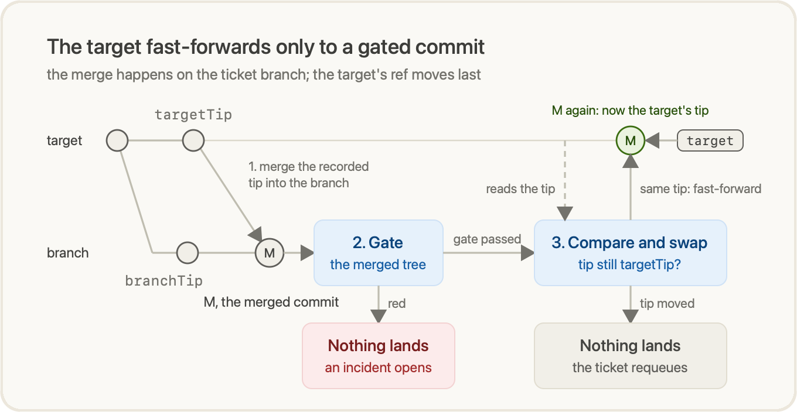

*The target receives no merge of its own: the only commit it can reach is one a [gate](../glossary.md#gate) passed.*

1. **Merge the target into the branch**, against the tip recorded at the [claim](../glossary.md#claim).
2. **Gate the merged tree**, in the [ticket](../glossary.md#ticket)'s [worktree](../glossary.md#worktree).
3. **Compare and swap:** if the target's tip is still the recorded one, fast-forward it to the merged commit.

A target that moved costs a retry: the branch returns to its claimed commit and the ticket requeues.

A conflict goes to a [resolver](../glossary.md#resolver) agent, a red gate to an [incident](../glossary.md#incident);
a merge that cannot finish is refused or [parked](../glossary.md#park) for a person, never landed.

Done means merged: one [lock hold](../glossary.md#lock-hold) moves the target and then makes the ticket
[delivered](../glossary.md#delivered), and a crash between those two writes is finished later.

A [group](../glossary.md#group) lets related tickets integrate and test against each other on their own branch, then
reach the main line together through one [release ticket](../glossary.md#release-ticket).

## One Airlock per target

A target's Airlock is free or held by exactly one live `merge` or `refresh` job, and nothing else stores that fact: the
holder is whichever such job names the target (`AirlockClaims.slotHolderOf`).

Each [Pass](../glossary.md#pass) runs `airlocks.sweep()` once, when the [board](../glossary.md#board) has a readable
[pipeline](../glossary.md#pipeline). An Airlock [sweep](../glossary.md#words-that-mean-several-things) repeats rounds
over the live targets: the main line, every group with an open ticket, and every target a job still holds.

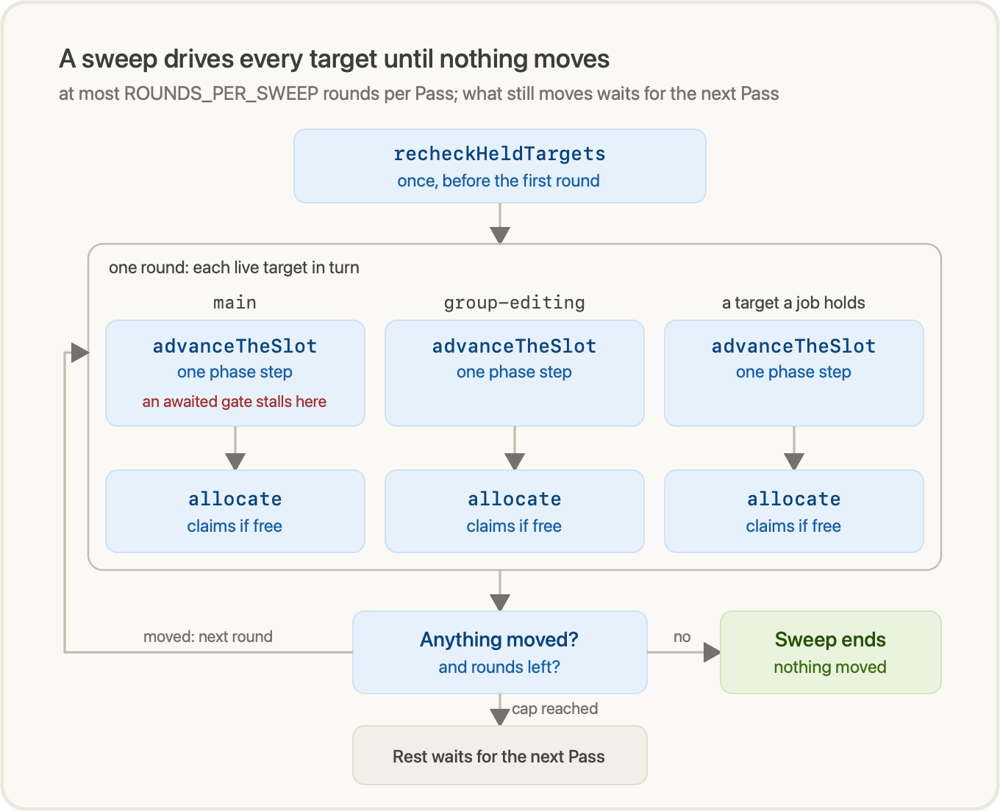

*One round moves each holder one phase, so a merge can cross several phases in one Pass. An awaited gate stalls the
whole loop: see [A merged-tree gate blocks the Pass](../reference/known-gaps.md#gap-merge-gate-blocks-pass).*

The holder carries an `airlock` record of `target`, `targetTip`, `branchTip` and `phase`. Its progress is
`airlock.phase`, written in a lock hold of its own for each phase. Agents work in child
[`merge-agent`](../glossary.md#merge-agent) jobs, never in the holder.

The Airlock never reads a merge job's state, which stays `merging` from the claim unless `agent-progress-v2 job stop`
moves it to `stopping`. That command also holds the ticket, but the Airlock reads neither, so the merge runs on to its
next exit and may land. To halt a merge use `agent-progress-v2 ticket park`, or `merge-abort` on its incident: the
Airlock reads a `parked:` hold.

> **As built.** See [`job stop` does not stop a merge](../reference/known-gaps.md#gap-job-stop-misses-merge).

Merge, refresh and merge-agent jobs take no [launch slot](../glossary.md#launch-slot). A paused board claims no free
Airlock, and a merge already holding one runs to its end.

Four things here are called holds:

| Word | What it is | Where it lives | What it stops |
| --- | --- | --- | --- |
| holder | The job that owns an Airlock | A live `merge` or `refresh` job naming the target | Any other claim on that target |
| [lock hold](../glossary.md#lock-hold) | One exclusive write of the board | The board's lock | Other writers, for its span |
| [ticket hold](../glossary.md#ticket-hold) | The ticket's `hold` field | The ticket's frontmatter | Launches on the ticket |
| held target | A target whose landings wait, see [Refusals](#refusals) | `heldTargets`, in the Overseer's memory | New Airlock claims on the target |

## The phases

The phase is the Airlock's whole state machine. Each sweep runs the function for the phase and acts on its result. The
[State explorer](../interactive/state-explorer.html#machine=airlock) walks it.

*Detours rejoin the normal path or leave through the exits below. `merge-land` is the one that skips `gating`, and it
needs a tree a gate passed.*

| Phase | Function | Results |
| --- | --- | --- |
| `merge-in` | `runMergeIn` | `merged`, `already-descends`: `gating` `conflicted`: launches a [resolver](../glossary.md#resolver), `resolving` A merge in progress, no live [Watcher](../glossary.md#watcher): requeue `orphaned` A release behind its group: refused `release-behind-group` Git failure: refused `git-failed` |
| `resolving` | `runResolving`, `settleResolver` | At `RESOLVER_API_CALL_BUDGET` (75): refused `out-of-calls` [Report](../glossary.md#report) in: see [Merge agents](#merge-agents) No agent left: requeue `orphaned` |
| `reviewing-resolution` | `runAirlockAgent`, `settleAirlockAgent` | Waits for the incident to close, then launches `resolution-review` `resolved`: `gating` `cannot-resolve` with no `reportKind`: [parked](../glossary.md#park) `merge-resolution-rejected` With a `reportKind`: refused `cannot-resolve` |
| `gating` | `runGate` | Waits while an incident names the job Gate passes, or the tree is the branch's own and last passed: `landing` Red: see [The merged-tree gate](#the-merged-tree-gate) |
| `fixing` | `runAirlockAgent`, `settleAirlockAgent` | Launches [`merge-fix`](../glossary.md#merge-fix) `resolved`: phase returns to `gating`; the child fixer job stays alive in its own job state `gating`, so a red gate can resume it |
| `landing` | `runLanding` | See [Landing](#landing) |

Every phase can also leave the Airlock. A landing is one way out, and the grid shows the others by phase.

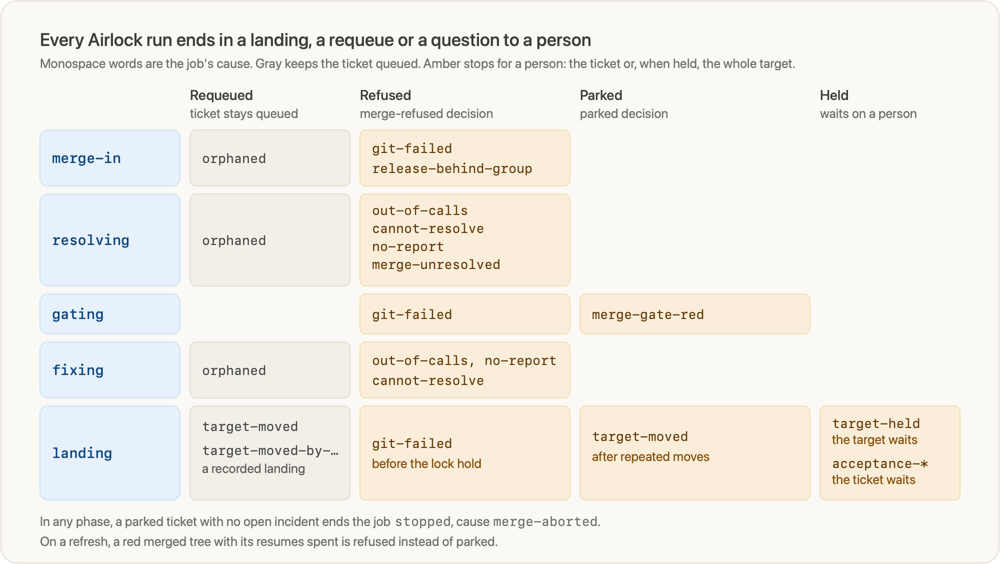

*Gray exits cost a retry: the ticket's work survives, though a resolver's merge is redone on the next claim. Amber
stops for a person: the ticket or, for a held target, the whole target.*

| Exit | Function | Job ending | Ticket afterwards |
| --- | --- | --- | --- |
| Requeue | `freeSlot` | `stopped` | Still `mergeQueued`; a later claim starts over. |
| Refused | `refuseMerge` | `failed` | Queue mark cleared, `merge-refused` [decision](../glossary.md#decision) open. |
| Parked | `abortAndPark` | `failed` | Queue mark cleared, held `parked:<cause>`, `parked` decision open. |
| Parked, `target-moved` | `settleMovedTarget` | `stopped` | Held `parked:target-moved`, `parked` decision open, queue mark kept: `agent-progress-v2 ticket unhold <id>` requeues it without a new review. |
| Held | `runLanding` | See [Refusals](#refusals) | See [Refusals](#refusals). |

Every exit but a landing runs `freeSlot`, which aborts any unfinished merge and resets the worktree to the recorded
start. So a requeue also discards a resolver's merge commit: the next claim merges afresh, and a conflict resolves
again.

> **As built.** When the pipeline sets its optional `review` key ([build-and-review.md](build-and-review.md)), a refused
> ticket is in review, unqueued and unheld, so the [Playbook](../glossary.md#playbook) launches a review on it. See
> [A refused merge relaunches a review](../reference/known-gaps.md#gap-refused-merge-relaunches-review).

## The queue is a mark and a position

The [merge queue](../glossary.md#merge-queue) is not a structure. A ticket is queued when its [row](../glossary.md#row)
has `mergeQueued`, and its place is the [log](../glossary.md#log) position of its last `merge-queued` record.
`MergeQueueMarks.queueTicketForMerge` writes both in one lock hold.

`mergeCandidatesOf` derives the candidates of a target from scratch each time, and a ticket must pass every filter.

The six filters of <code>mergeCandidatesOf</code>

| Filter | Keeps a ticket that |
| --- | --- |
| Status and hold | is `in-review` with no ticket hold |
| Target | maps to this target under `Airlocks.targetOf` |
| Mark | has `mergeQueued` on its row |
| Decisions | is named by no open [`waiver`](../glossary.md#waiver) or `landing-refused` decision |
| Jobs | has no live job |
| Bundle | is not a release ticket, or its [release bundle](../glossary.md#release-bundle) has [integrated](../glossary.md#integrated) and no refresh holds the group's Airlock |

Leaving `in-review` clears the mark. Setting the mark is refused outside `in-review`; clearing it never is, so a refused
landing can always unqueue its ticket.

## Allocation

The queue is ordered outside the lock, because that takes git work, and the claim checks it again inside. The merge
panel of [Why is my ticket not moving?](../interactive/why-not-moving.html) runs these candidate checks.

*Two lock holds with git between them: the second rechecks the tips and the queue, so a stale prediction can cost only
the order.*

`allocate` returns without a claim when the target is held, the board is paused, or the Airlock has a holder. On a
group target it tries a [refresh](#refresh) first. Otherwise `predictMerge` runs `git merge-tree --write-tree` for each
candidate, which touches no worktree, and `orderedPredictions` sorts:

| Order | Key | Detail |
| --- | --- | --- |
| 1 | Priority | `MERGE_PRIORITY_RANK`. A release ticket carries its bundle's highest priority. |
| 2 | Clean first | A failed prediction sorts as conflicting. |
| 3 | Fewest conflicts caused | How many other clean candidates this branch is predicted to conflict with, pairwise through `predictMerges`, as the figure below shows. |
| 4 | Readiness | Log position of the last `merge-queued`. |
| 5 | Ticket id | Numeric. |

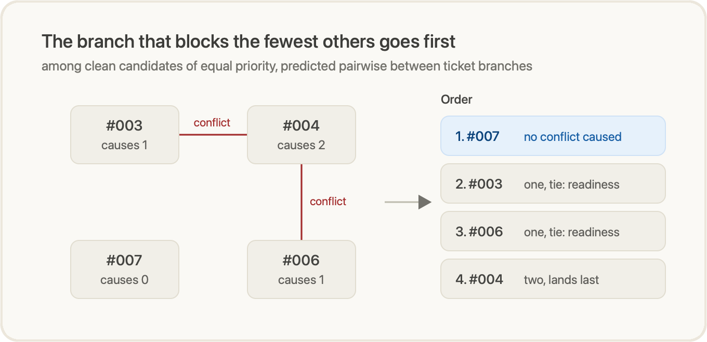

*The count compares ticket branches with each other, not with the target: it lands first the branch that blocks the
fewest others.*

Only the first candidate is tried. In a second lock hold, `allocate` compares both tips with the values it read: the
branch tip from before the prediction, the target tip from after it. A difference claims nothing. A target that moved
during prediction is not seen here, and it costs only the order the two-hold figure describes.

Then `claimAirlock` derives the candidates again, and refuses a claim that is out of date.

The refusals of <code>claimAirlock</code>

| Refusal | When |
| --- | --- |
| `airlock-held` | a job holds the target |
| `merge-candidate-not-queued` | the ticket is no longer a candidate |
| `higher-priority-queued` | a candidate of a strictly higher rank waits |

A refused claim counts as movement, so the next round derives everything again, up to `ROUNDS_PER_SWEEP`. A successful
claim launches the job, moves it to `merging`, sets phase `merge-in` and logs `merge-started`.

## Merge agents

Three [roles](../glossary.md#role) work inside an Airlock. None may ask a person: the question tool is off, and each is
bounded by its own [call budget](../glossary.md#call-budget) instead. Each role's prompt tells it to report
`cannot-resolve` when stuck. The report's optional `reportKind` says why: with `malformed-ticket` or `system-blocker`
the merge is refused and an incident also opens, with no job waiting on it.

| Role | When | Budget | Result |
| --- | --- | --- | --- |
| `resolver` | merge-in conflicted | `RESOLVER_API_CALL_BUDGET` (75) | Commits the merge, then `settleResolver` decides. |
| `resolution-review` | resolution over the threshold | `RESOLUTION_REVIEWER_API_CALL_BUDGET` (37), one launch | Told to change nothing, which nothing enforces ([gap](../reference/known-gaps.md#gap-merge-agents-skip-customs)). Reports `resolved`: phase `gating`. `cannot-resolve` with no `reportKind`: park. With a `reportKind`: refused. |
| `merge-fix` | `merge-fixer` [move](#moves-on-a-merge-jobs-incident) on a red gate | `MERGE_FIXER_API_CALL_BUDGET` (75), `MERGE_FIX_ATTEMPTS` (1) launch | Commits a fix on the merge commit. Gate again. |

`settleResolver` stops the resolver once its report is in, then decides:

1. `cannot-resolve`: refused, cause `cannot-resolve`.
2. Anything else but `resolved`: refused, cause `no-report`.
3. `MergeRun.resolutionIsSound` fails: refused, cause `merge-unresolved`. This runs [Customs](../glossary.md#customs)
   check V10 alone: no unmerged paths, no whitespace errors in the files the report lists as `resolvedFiles`, and the
   two recorded parents.
4. `MergeRun.resolutionLinesOf` counts the lines changed against git's automatic merge of the parents. Over
   `RESOLUTION_REVIEW_THRESHOLD_LINES` (150), or uncountable: phase `reviewing-resolution` and incident
   `resolution-over-threshold`, [default](#moves-on-a-merge-jobs-incident) `merge-review`.
5. Otherwise: `gating`.

> **As built.** Customs runs no other check on a merge agent's work. See
> [Merge agents skip Customs](../reference/known-gaps.md#gap-merge-agents-skip-customs). A refresh's agent names no
> ticket, so it receives [a one-line prompt](../reference/known-gaps.md#gap-refresh-resolver-one-line).

## The merged-tree gate

[The overview](../concepts/overview.md#an-airlock-gates-the-merged-tree) gives the idea in one figure; this section
gives the rules.

The gate judges the tree the target would receive, not the branch's. `runGate` skips it in one case: the merged tree
equals the tree of `branchTip`, and the newest `gate-ran` record on that tree passed
(`mergedTreeWasLastPassed`). The merge then changed nothing the gates judged.

Otherwise `gateMergedTree` reads `pipeline.json` afresh and runs the prepare steps and gates in the merge's worktree,
each gate taking a [gate slot](../glossary.md#gate-slot). What a gate outcome means lives in
[customs-and-gates.md](customs-and-gates.md), and where it runs in
[Where a gate runs](customs-and-gates.md#where-a-gate-runs). `gateMergedTree` ends in one of four outcomes.

| Outcome | With | Result |
| --- | --- | --- |
| `passed` | | Logged, any fixer ended `resolved`, phase `landing`. |
| `failed` | no fixer launched yet | Incident `merge-gate-failed`, default `merge-abort`. |
| `failed` | a fixer waiting | `resumeOrSpendTheFixer` writes a [red handoff](../glossary.md#red-handoff) and resumes it: back to `fixing`, with `RED_HANDOFF_RESUME_CALL_BUDGET` calls. |
| `failed` | a fixer's resumes spent | Past `RED_HANDOFF_RESUMES_BEFORE_PARKING` resumes the fixer ends `failed`, and the merge is parked `merge-gate-failed`. A refresh is refused instead. |
| `failed` | no fixer waiting, `MERGE_FIX_ATTEMPTS` launched | Parked `merge-gate-failed`. A refresh is refused instead. |
| `cannot-run` | | Incident `gate-cannot-run`, default `gate-retry`. |
| `setup-failed` | | Incident `setup-failed`, default `gate-retry`, no `gate-ran` logged. |

> **As built.** This gate is awaited inside `airlocks.sweep()`, so no Pass runs meanwhile. See
> [A merged-tree gate blocks the Pass](../reference/known-gaps.md#gap-merge-gate-blocks-pass).

## Moves on a merge job's incident

No move lands a tree no gate passed. `merge-land` is not allowed on `merge-gate-failed`: landing over a red gate would
[waive](../glossary.md#waiver) it.

While an incident names the holder, the phase waits. Each move needs that incident open and is recorded in a lock hold;
the Airlock carries it out on its next sweep. Each move is the control verb in the table, run as
`agent-progress-v2 merge fixer|review|land|abort <job>` ([cli.md](../cli.md)). The
[Bouncer](../glossary.md#bouncer)'s `ALLOWED_MOVES_BY_INCIDENT_KIND` decides which apply. The default is the move taken
when nobody answers.

| Move | Allowed on | Effect |
| --- | --- | --- |
| `merge-fixer` | `merge-gate-failed` | Phase `fixing`. |
| `merge-review` | `resolution-over-threshold` (default) | Closes the incident. The phase stays and the reviewer launches. |
| `merge-land` | `resolution-over-threshold` | Needs a passing `gate-ran` on the incident's `tree`, or the move itself is refused `merge-gate-not-passed` and nothing changes. Then phase `landing`. |
| `merge-abort` | both (default on `merge-gate-failed`) | Closes the incident and parks its tickets. |

Once a holder's ticket is parked and no incident is open, `advanceTheSlot` runs `abortParkedMerge`: the merge aborts,
the job ends `stopped` with cause `merge-aborted`, and the queue mark clears. A `ticket-park` on the incident ends the
same way.

An incident pauses the phase, but no Airlock waits on a person indefinitely. While no
[Assistant](../glossary.md#assistant) runs, `merge-gate-failed` and `resolution-over-threshold` take their default at
once (`incidentDefaultStepsOf`). `gate-cannot-run` and `setup-failed` wait for a fresh Assistant
[session](../glossary.md#session), unless no Assistant can come up, when they default too. The second default on a
ticket for those two parks it, and the merge then aborts. A running Assistant answers within its turn; a turn that
closes or spends its budget defaults the incident. The rest is [questions-and-incidents.md](questions-and-incidents.md).

> **As built.** On a refresh with a red gate, the default closes the incident and the next sweep gates again. See
> [A refresh's red gate reopens its incident](../reference/known-gaps.md#gap-refresh-gate-default-loops).

## Landing

Landing is one lock hold, with the git write inside it, so the target and the board move together.

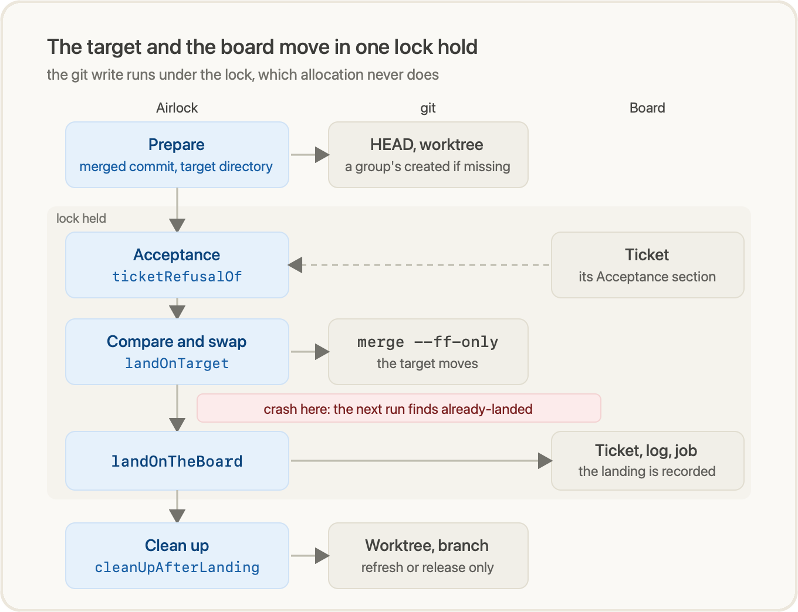

*The shaded span holds the lock across the git write, which allocation never does. The crash is the one gap it leaves,
and [failure-and-recovery.md](failure-and-recovery.md) covers it.*

If the merged commit or the target's directory cannot be prepared, the merge is refused `git-failed`. The rest happens
in the hold:

1. **[Acceptance](../glossary.md#acceptance).** When the pipeline sets its optional `review` key,
   `Landing.ticketRefusalOf` checks the Acceptance.
   Without it, a ticket lands on its gates alone.
2. **Compare and swap.** `Landing.landOnTarget` requires the directory on the target branch and the tip equal to the
   recorded `targetTip`, then runs `git merge --ff-only` with hooks off.
3. **Board.** `landOnTheBoard` records the landing. On the Overseer's path nothing else delivers a ticket.

| Target | Ticket | `merge-landed` kind | Job ending |
| --- | --- | --- | --- |
| Main line | delivered, with the bundle if it is a release | `landed` | `landed` |
| Group | moves to [`reviewed`](../glossary.md#reviewed) | `integrated` | `integrated` |
| Group, by a refresh | none | `integrated` | `refreshed` |

The main line lands in the main checkout and a group in its own worktree, never by `update-ref`. Because the merge
commit's first parent is the branch tip, `git log --first-parent` of the main line runs through ticket branches; the
`merge-landed` records keep the per-ticket view. `agent-progress-v2 ticket status <id> delivered` and
`agent-progress-v2 ticket deliver --by-hand` record a delivery with no landing ([cli.md](../cli.md)).

**`already-landed` is the crash path.** A tip that differs from `targetTip` may be this very commit, landed by a run
that died before the board wrote. `movedTargetVerdictOf` tests ancestry, not equality, since a later landing may stand
on top. The verdict is not a refusal: `landOnTheBoard` finishes the board side as usual.

> **As built.** Nothing removes a landed ticket's worktree or branch. See
> [Landed ticket worktrees and branches stay](../reference/known-gaps.md#gap-landed-worktrees-stay).

### Refusals

`LANDING_OUTCOME_OF_REFUSAL` maps each refusal to one action, and the first check that fails picks the refusal.

*`already-landed` sits behind the moved tip: only a tip that differs can hold a landing nobody recorded.*

| Refusal | Outcome | Action |
| --- | --- | --- |
| `target-moved-by-a-recorded-landing` | `requeue-from-branch-tip` | Requeue, job ending `stopped` with this cause. The tip is one a `merge-landed` names. |
| `target-moved` | `open-target-moved` | `settleMovedTarget`, below. |
| `not-on-target-branch`, `dirty-checkout`, `git-failed` | `hold-target` | The target is held, job ends `stopped`, cause `target-held`. The ticket stays queued. |
| `acceptance-unnumbered`, `acceptance-unaccounted`, `acceptance-waived` | `hold-ticket` | Job ends `failed`, cause the refusal. Queue mark cleared, ticket held `landing-refused:<reason>`, `landing-refused` decision. |
| `already-landed`, a verdict, not a refusal | `finish-board-side` | `landOnTheBoard` runs as on a landing. |

**A moved target.** A moved target with an unrecorded tip requeues the ticket silently, because no agent can have moved
it: `TARGET_REF_DENIES_HOLD` records that an agent's sandbox denies writes to the target's ref
([confinement.md](confinement.md)). After `TARGET_MOVED_MERGES_BEFORE_PARKING` (2) such merge jobs in a row the ticket
is held `parked:target-moved` with a `parked` decision, and its queue mark stays. A refresh never parks.

> **As built.** The code for a false `TARGET_REF_DENIES_HOLD` does not run. See
> [Code and states production never reaches](../reference/known-gaps.md#gap-dead-code-and-unused-states).

**A held target.** `heldTargets` is a map in the Overseer's memory, so a restart forgets it and the next landing
refusal sets it again. While a target is held, `allocate` opens no Airlock there, and the `dirty-main-checkout`
[notice](../glossary.md#notice) shows the branch and blocking files. Builds and reviews launch on.

`recheckHeldTargets` clears the hold at each sweep's start once the checkout is on its branch with no tracked changes;
untracked files are not checked.

> **As built.** A hold can release while its cause remains, so the same ticket merges and is refused again. See
> [A held target's retries are unbounded](../reference/known-gaps.md#gap-held-target-retries-unbounded).

## Groups

A group lets related tickets integrate and test against each other on their own branch, then reach the main line
together through one release ticket. It is a word on tickets, `group` in the frontmatter, and two git names built from
it: the branch `group-<name>` and the worktree `<worktrees>/group-<name>/`. The branch forks from the main line's tip at
the group's first launch, and ticket branches fork from the group's tip. Worktree creation is in
[build-and-review.md](build-and-review.md#worktrees-and-branches).

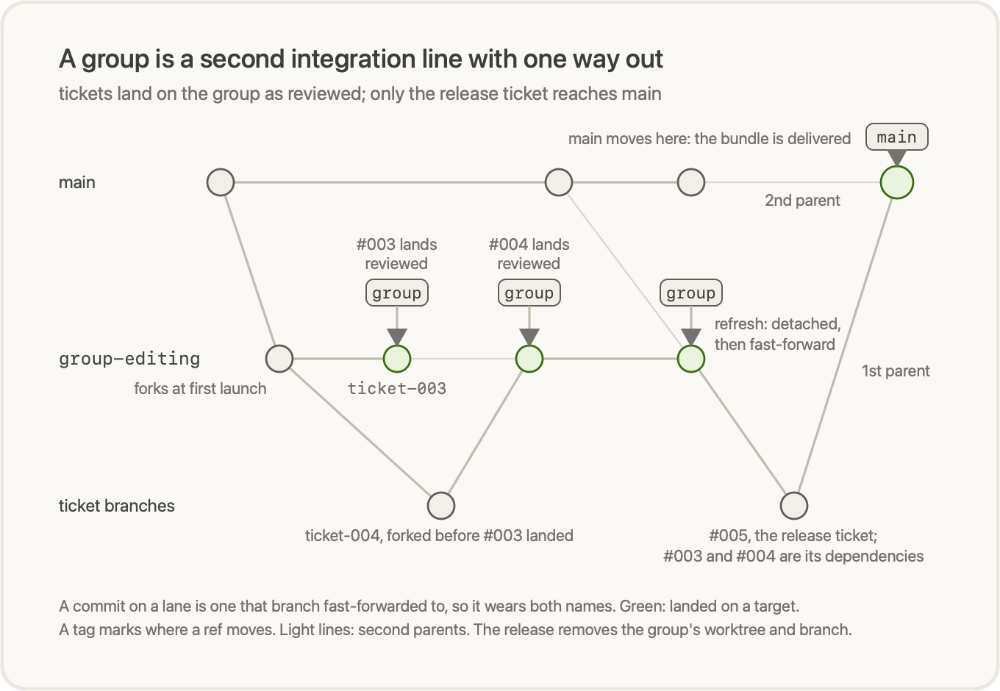

*Each landing is the same three steps; only the release ticket's landing moves main. A ticket that holds the group's tip
needs no merge at all: the group moves to the ticket's own commit.*

Two rules decide a target, and they differ on purpose, so a release ticket is built on the group and lands on main.

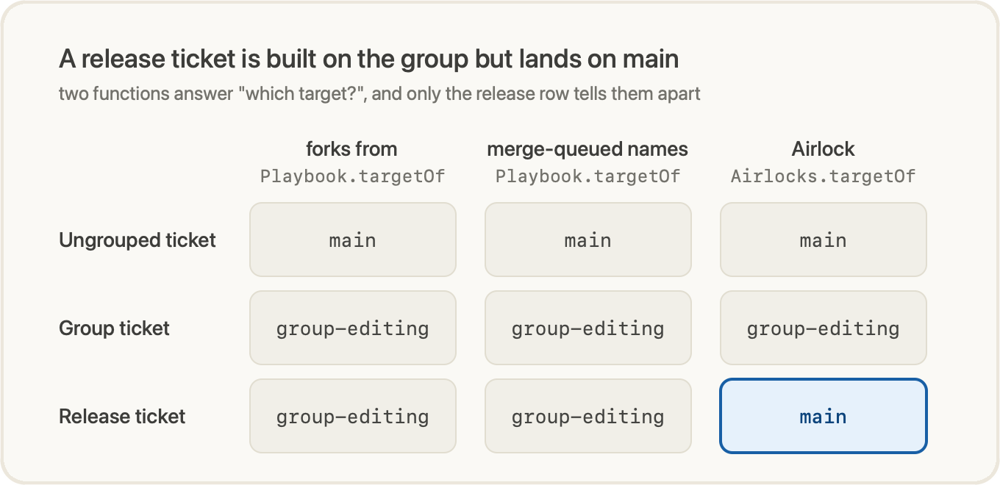

*`Playbook.targetOf` picks what a ticket forks from and its record names; `Airlocks.targetOf` picks the Airlock.*

A group ticket that lands is `reviewed`: on the group, not yet on the main line. That status settles a dependency, so
the group's next ticket may start before anything reaches main.

### The release

`agent-progress-v2 ticket release-of <id>` marks one open release ticket per group. Its bundle is the release ticket
plus what it reaches through `dependsOn` inside the group.

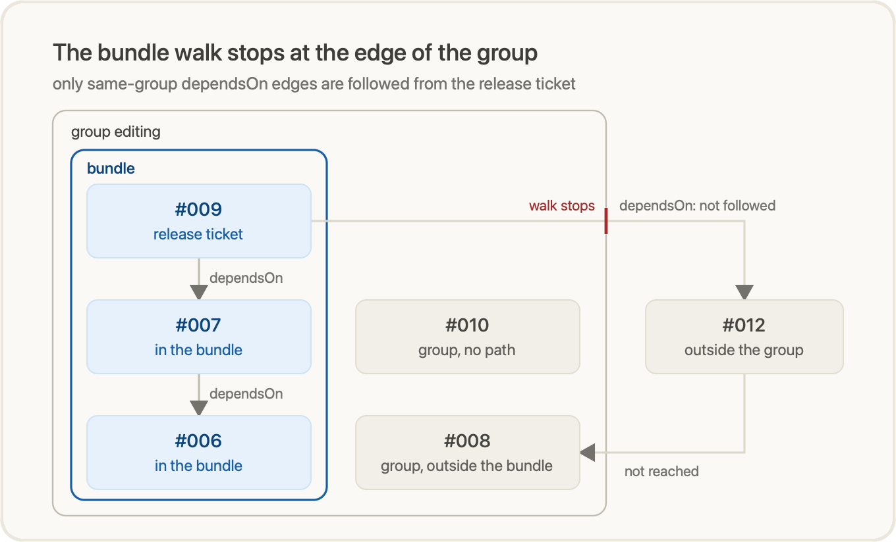

*#008 is in the group and outside the bundle: the only path to it leaves the group.*

The release ticket becomes a candidate only once every other bundle member is `reviewed` or `delivered` and no refresh
holds the group's Airlock. It then runs the ordinary phases against the main line, with one check first: `releaseGapOf`
refuses `release-behind-group` before merge-in unless its branch holds the group's tip.

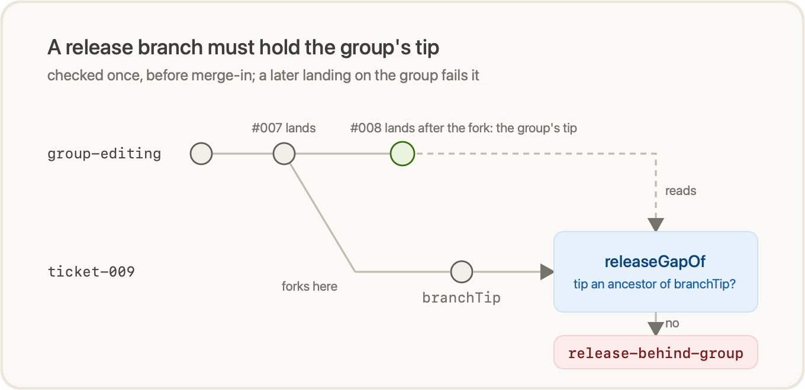

*A landing or refresh after the fork leaves the release behind. Without this check it would carry a group missing that
work to main, and report the group done.*

On landing, `releaseTickets` delivers the release ticket and every bundle member still `reviewed`. Then
`cleanUpAfterLanding` runs `GroupWorktrees.removeGroup`: `git worktree remove`, then `git branch -d`, neither forced. If
git declines, the leftover stands and the `cleanup-declined` notice shows until it is gone or the Overseer restarts,
since the list is in memory. A declined removal of a refresh's worktree raises the same notice.

> **Careful.** A release carries the group's whole tip, but delivers only the bundle. A ticket like #008 that landed on
> the group reaches main in the release's commit and stays `reviewed`.

### Refresh

A refresh keeps a group from drifting: main's tip merged into the group, through the group's Airlock. `allocate` tries
it before the queue, and it holds the group's target as any merge does.

The first row that matches decides.

| Is a refresh due? | Answer |
| --- | --- |
| Main holds no commit the group lacks | No |
| A `merge-refused` decision for this refresh is open (context starts `<target>: `) | No |
| The release ticket is queued or holds its Airlock | No |
| Main is `GROUP_REFRESH_AFTER_MAIN_COMMITS` (30) or more ahead | Yes |
| The group's tip is predicted to conflict with main, or the prediction failed | Yes |
| Otherwise | No |

`claimRefreshSlot` refuses `airlock-held` and `refresh-beside-a-queued-release`. The job has kind `refresh`, no ticket
and no role.

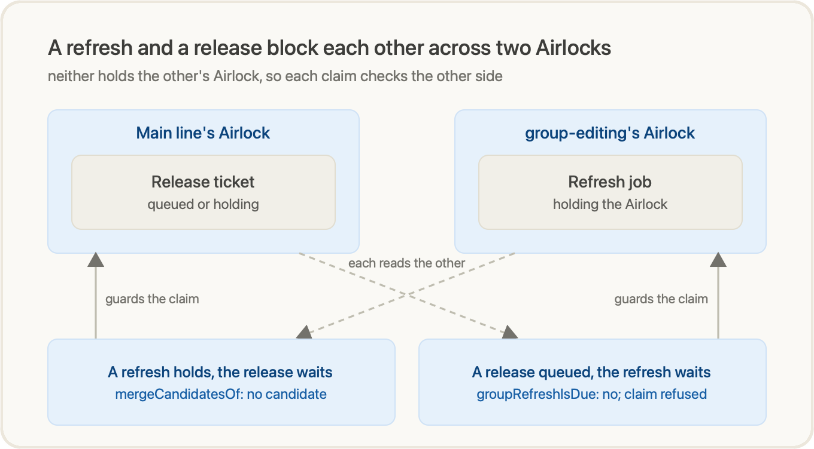

*One Airlock per target does not cover this: the two hold different Airlocks, so each side checks the other, and they
never merge main into the group's work at once.*

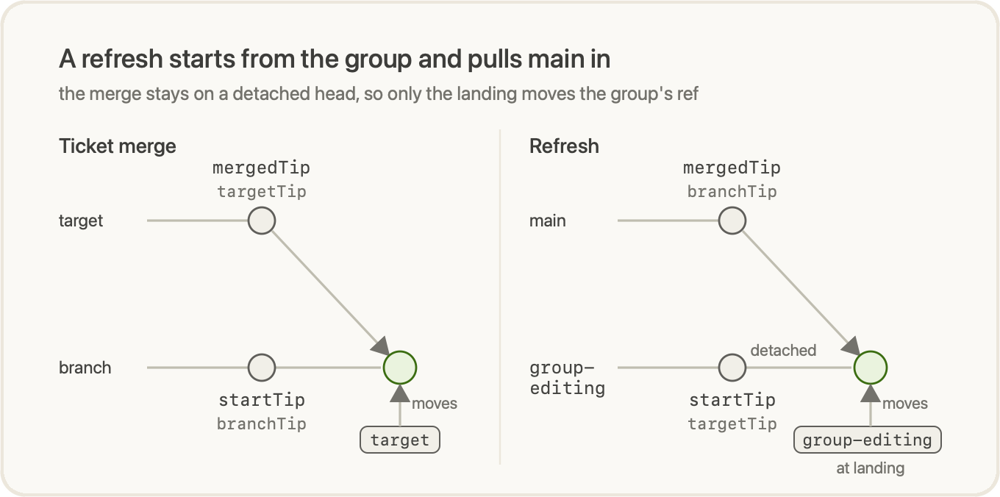

*`MergeRun.sidesOf` reverses the sides: on a refresh `targetTip` is the start and `branchTip`, main's tip, is merged
in.*

It works in a temporary detached worktree, `<worktrees>/refresh-group-<name>/`, so nothing but a landing moves the group
branch. It takes the same phases, lands by the same fast-forward, ends `refreshed` and removes the worktree.

A refused refresh names no ticket. Its `merge-refused` decision carries the target in its context, and that blocks the
next refresh until the decision closes.

## Invariants

1. A target has at most one live `merge` or `refresh` job.
2. A merge merges the recorded tip, never the moving name.
3. The target moves only by fast-forward, to a commit whose tree a gate passed or a merge left equal to one that did.
4. A landing moves the target and then the ticket in one lock hold. A crash between those two writes is finished later
   through `already-landed`.
5. Every exit from an Airlock restores the worktree to its recorded start, except a landing.
6. No merge agent asks a person, and `merge-gate-failed` or `resolution-over-threshold` takes its default when no
   Assistant runs.
7. A refresh and a release of one group never run at once.
8. No removal in a group's cleanup is forced.

## In the code

Concepts by path, symbol and spec

| Concept | Path | Symbol | Spec |
| --- | --- | --- | --- |
| Sweep, phases, allocation | `src/services/overseer/Airlocks.ts` | `createAirlocks`, `ROUNDS_PER_SWEEP` | `src/services/overseer/Airlocks.integration.spec.ts` |
| Fixer and reviewer | `src/services/overseer/Airlocks.ts` | `runAirlockAgent`, `settleAirlockAgent` | `src/services/overseer/Airlocks.airlockAgents.integration.spec.ts` |
| Candidates and claims | `src/lib/tracker-model/AirlockClaims.ts` | `mergeCandidatesOf`, `claimAirlock`, `claimRefreshSlot` | `src/lib/tracker-model/Board.airlocks.spec.ts` |
| Queue mark | `src/lib/tracker-model/MergeQueueMarks.ts` | `queueTicketForMerge` | `src/lib/tracker-model/Board.airlocks.spec.ts` |
| Refresh rule | `src/lib/tracker-model/utils/MergeQueueUtil.ts` | `groupRefreshIsDue` | `src/lib/tracker-model/utils/MergeQueueUtil.spec.ts` |
| Prediction | `src/lib/git/MergeTree.ts` | `predictMerge`, `predictMerges` | `src/lib/git/MergeTree.integration.spec.ts` |
| Merge steps | `src/services/lifecycle/MergeRun.ts` | `mergeInOnce`, `restoreBranchTip`, `resolutionIsSound` | `src/services/overseer/Airlocks.integration.spec.ts` |
| Compare and swap | `src/services/lifecycle/Landing.ts` | `landOnTarget`, `LANDING_OUTCOME_OF_REFUSAL` | `src/services/lifecycle/Landing.integration.spec.ts` |
| Incident moves | `src/services/control/AirlockControls.ts` | `AIRLOCK_CONTROLS` | `src/services/control/AirlockControls.spec.ts` |
| Bundle | `src/lib/tracker-model/GroupReleases.ts`, `src/lib/tracker-model/utils/ReleaseBundleUtil.ts` | `releaseBundleOf`, `markReleaseTicket` | `src/lib/tracker-model/Board.groupReleases.spec.ts`, `src/lib/tracker-model/utils/ReleaseBundleUtil.spec.ts` |
| Group worktrees | `src/services/overseer/GroupWorktrees.ts` | `prepareGroupWorktree`, `removeGroup` | `src/services/overseer/GroupWorktrees.integration.spec.ts` |
| Bounds | `src/shared/constants/AirlockLimits.ts` | `AIRLOCK_LIMITS` | [deciders-and-bounds.md](../reference/deciders-and-bounds.md) |

