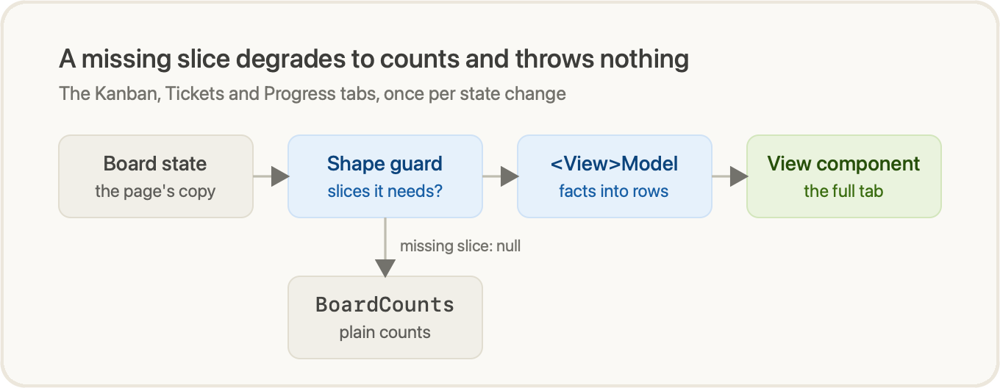

# The Bridge

> **Question:** How is the live page built, where does its state live, and how does it stay safe with agent text?
> **Time:** 20 minutes.
> **Read first:** [Overview](../concepts/overview.md), [Code map](code-map.md).
> **Next:** [Overseer API](../reference/overseer-api.md), [Running a board](../operations/running-a-board.md),
> [Hatch](control-and-hatch.md).

## In one screen

The [Bridge](../glossary.md#bridge) is the browser client of one [board](../glossary.md#board). A React page served by
the board's [Overseer](../glossary.md#overseer), it is a projection, never a store: it holds one document, replaced
whole, and every record stays on disk. The page is one app with ten tabs, each showing one view. Closing the page
loses no record: it loses only typed text and view state.

*Notice that the triggers join at the read: no trigger carries data to the page, each one causes a re-read.*

- **One document.** A `board` event, the unit of consistency, carries all of `BoardState` and replaces the page's copy.
- **One read stream, one write path.** `/api/events` in, `POST /api/commands` out, plus one stream per open transcript.
- **Rules live on the server.** Display states, waiting [tickets](../glossary.md#ticket) and ready order arrive as
  facts. The browser only picks a lane and what a card offers, so an offer can be stale. The server decides every
  command, and a [refusal](../glossary.md#refusal), printed verbatim, is the normal answer to a stale offer.
- **State has five owners:** server, URL, browser storage, the app frame around the views (shell state and refs), and
  each view's component state. A view unmounts with its tab, so typed text survives a board update and dies on a tab
  change.
- **[Agent](../glossary.md#agent) text is hostile.** Two rendered strings reach the DOM as HTML, inside a sandboxed
  frame. All other text is a React text node.

Routes, the event format and the fields of `BoardState` are in the [Overseer API](../reference/overseer-api.md). What
each tab shows and how to work it is in [Running a board](../operations/running-a-board.md).

## How the project is laid out

`bridge/` is a React project of its own, compiled for the DOM and nothing else. `bridge/tsconfig.json` sets `types` to
empty, so a module reaching for `Bun.file` or `node:fs` fails to compile. Its `include` list names the shared files the
Bridge reaches and the whole tracker model, which proves that model DOM-safe.

| Folder | Holds |
| --- | --- |
| `bridge/index.html`, `bridge/Main.tsx` | The page with its meta CSP, and the entry that sets the theme, builds the services and mounts React |
| `bridge/shell/` | The shell, the frame around every view: `BridgeApp`, hash router, header, banners, the incident line and its drawer, `CommandButton` and the `useControlCommand` sender behind it, error boundary, theme bootstrap, embedded channel, and `WaitingOnUserModel` with the Waiting on User pill and its inbox |
| `bridge/api/` | The clients of the Overseer's API: commands, picture upload, the session token both carry, event stream, identity, transcript stream |
| `bridge/views/<view>/` | One view: its component and, where it has logic of its own, a pure `<View>Model.ts` beside it |
| `bridge/design-system/` | The reusable components, which know nothing about the board, the routes, the API or the shell: buttons, state badge, pill and dot, mono ids and id links, stamp, small-capitals label, list section and empty state, segmented control, segment, fill and slot meters, pane, titled block, fact list, the `useDismissal` hook, popover, menu (items with a description line, separators, an open state its caller may hold, an Esc caught before a side panel's), tabs and count badge, banner, confirm strip, side panel, modal dialog (a native `<dialog>` shown with `showModal()`: Esc, × and a backdrop click ask the caller to dismiss it with the reason, the focus goes to the element the caller names or the first field, and back to the opener, Tab cycles inside), choice option, tag, icon, callout, keyed line list, stepper, action bar, toast (its expiry on the end of its timer bar, or on an injected timer under reduced motion), log tail, listed file, change row, activity row, typing indicator, and `utils/RovingFocusUtil.ts` and `utils/MeterUtil.ts`. The tag, the fill and slot meters, the callout, the keyed line list and the menu's description line and separator were built before the views that use them, on the owner's order, from the picked board designs. A link arrives as an `href`, an action as a callback, every word as a prop; a variant is a `data-*` attribute, never a `className` prop. `src/ImportDirection.spec.ts` holds that it imports only itself and the display-state type |
| `bridge/conversation/` | Parts several conversation views share that build ids or post commands: decision card (its options drawn as design-system choice options, as a card in a list or docked in a chat with its questions side by side), transcript log, card heads, ticket and job links, and the chat parts: the ask item (one thing that waits on User, as an inbox row or a strip under a job), the chat card and thread (system lines, agent turns, User's bubbles, decisions), the tool use fold (a turn's tool calls, a running one ticking on the Bridge clock) and the composer (recipient, status tag, Enter sends through `useControlCommand`). `ChatThreadModel.ts` reads a transcript as a chat: turns closed by `turn-end`, calls paired with their results by `toolUseId`, a subagent's entries left out; `ChatTurnWordingUtil.ts` words its stamps, system lines and tool folds the same for the Assistant and Intake chats. The chat parts and the ask item were built before the views that use them, on the owner's order, from the picked board designs. `OpenDecisionsUtil.ts` holds the open decisions in the order User answers them, which ones an Assistant escalated and from which incident |
| `bridge/chips/` | Parts that carry ticket vocabulary or link to the Epics tab: filter chips, epic chips, ticket marks |
| `bridge/preferences/` | `PreferenceStore.ts`, the one module that touches browser storage |
| `bridge/utils/` | Pure utils several views use: geometry, waves, forecast, time, wording, job states and the fresh-agent kinds (`JobStateUtil`), a job's calls against its budget and its last tool call (`JobLiveFactsUtil`), the incident trail, pills and default causes (`IncidentTrailUtil`), and the `↦ N` held count (`HeldCountUtil`) |
| `bridge/@types/` | Structural documents of exactly the fields a view reads |
| `bridge/styles/` | `tokens.css` and `board.css`, the design contract |

A view's logic sits in its `<View>Model.ts`, specced as a plain `.spec.ts`; the component is held by a `.dom.tsx` spec. See
[Guards and tests](../development/guards-and-testing.md).

`cli/overseer/routes/OverseerRoutes.ts` imports `bridge/index.html`, and the Overseer builds the page on the first
request and keeps it in memory. Changed Bridge code therefore needs an Overseer restart; see the
[Overseer API](../reference/overseer-api.md).

## The shell and its seam

The shell is what stays mounted across tabs. `BridgeApp` is mounted once and owns the one board state. It reaches the
API, storage, the current time and reload only through `BridgeServices`, ten fields that a DOM spec replaces with fakes,
and an eleventh, the picture upload client, which a shell without it leaves out, so the Intake view offers no picture.

*Notice that `BridgeApp` sees only the seam: a spec swaps every service without touching the app.*

Beyond plain DOM use inside a component, these reaches stay outside the seam:

- `HashRouter.useHashRoute` reads `window.location`.
- `ThemeBootstrap` writes the document root and reads `window.matchMedia`.
- `AgentsView` receives no `followTranscript` from `BridgeApp`, so it uses its default, `TranscriptStreamClient.follow`.
- `BridgeApp` takes the Agents tick and the header's ticks, which time the activity strip's job chips and the ages in the
  Waiting on User inbox, from `BROWSER_BRIDGE_CLOCK.everySecond` rather than from `services`.

Three rules hold across the shell:

- **Models run per state change:** every `board`, and each smaller event before it that updates one slice, a top-level
  part of `BoardState` such as `jobs`. `BridgeApp` memoises `kanbanBoardStateOf`, `ticketsBoardStateOf` and
  `progressBoardStateOf` on its state, and a view computes its model from what it receives. No model keeps state between
  events.
- **A render error is total.** `BridgeErrorBoundary` wraps the whole app, so one throwing view replaces the page with a
  banner until a reload.
- **Shape guards fail soft.** Each of those three returns `null` when a slice its view needs is absent. The tab then
  shows `BoardCounts`, a line of [job](../glossary.md#job), [decision](../glossary.md#decision) and
  [incident](../glossary.md#incident) counts. Progress still shows finished work while the `page` field of `BoardState`
  exists (see [The render service](#the-render-service)). View types are partial for the same reason.

*Notice the side exit: without its slice, the tab ends at plain counts.*

The clock decides nothing here. `services.now` feeds display only: the Progress chart reads it once per state change, so
the line marking the current time moves only with one, and the Agents tab ticks each second.

## The live data path

Every board state is a complete re-read, so none depends on the one before it. A publish is that re-read sent to the
browser.

`publishState` in `cli/overseer/OverseerForeground.ts` runs after every [Pass](../glossary.md#pass) that does not throw,
at every [sweep](../glossary.md#sweep), and once at start. A sweep always wakes a Pass; it forces one only when
something is due, and an unforced Pass with nothing new stops at the [fingerprint](../glossary.md#fingerprint). A Pass
that stopped there publishes too. `publishState` calls `readBoardState`, which takes no lock, and hands the result to
`EventBroker.publishState`. [The event stream](../reference/overseer-api.md#the-event-stream) gives the wire format.

The re-read joins the [tracker](../glossary.md#tracker) with the Overseer's in-memory facts: runtime state,
[notices](../glossary.md#notice), the count of quiet sweeps per job and the [Baton pass](../glossary.md#baton-pass)
warning. The merge queue's conflict predictions are server work too, see the
[Overseer API](../reference/overseer-api.md).

The broker sends slice events, then `board`; the order and the no-change rule are in the Overseer API.
`boardStateAfter` in `bridge/shell/BoardStateUpdate.ts` is the one reducer.

*Notice the second row: a removal other than an ended job waits for the `board`.*

A `board` replaces the state, and a slice event before the first `board` is ignored. `job`, `decision` and `incident`
add or replace their record by id; `overseer` and `usage` update their slice. Each publish closes with a `board`, so
what a viewer reads settles with it. `EventStreamClient` drops a malformed event because the next `board` repairs it.

> **As built.** Each publish carries every ticket body and the whole question history, see
> [gap-scaling-whole-log-and-bodies](../reference/known-gaps.md#gap-scaling-whole-log-and-bodies).

After a dropped connection the browser reconnects and either replays or gets a fresh `board`; the rule is in
[Reconnecting](../reference/overseer-api.md#reconnecting). Separately, the shell asks `/api/identity` again and reloads
when the [code version](../glossary.md#code-version) moved, since its bundle may no longer match the API.

Transcripts travel apart from `BoardState`. Each is a stream of its own, `/api/jobs/<J>/stream`, followed only while a
view shows it. The Overseer has already translated
[Claude Code's own session log](../development/overseer-claude-probe.md) into its own entries, so the Bridge parses no
vendor format.

Entries of one log line share a [cursor](../glossary.md#cursor), so the client keeps an entry by its `entryKey` and a
list keys its items on it; the cursor stays what a reopened stream asks after.

The Intake tab follows one stream, the selected [session](../glossary.md#session)'s: its list reads each session's last
line from the job's live facts in `BoardState`, so a board with many sessions holds no more connections. See
[Assistant and intake](assistant-and-intake.md).

The page uses five routes of the Overseer: two streams, the write route and two setup reads.

*Notice that only the first route stays open as long as the page.*

The Intake view uses two more: it posts a picture's bytes to `/api/pictures` before the command that names it, and
shows a sent picture from `/api/pictures/<id>`.

## Connection and control availability

Controls follow the stream: what a page shows may be stale, so it may not act on it. `ControlAvailabilityUtil` reduces
two booleans, stream down and [install held](../glossary.md#hold), to `enabled`, `stream-down` or `install-held`, and
stream-down wins.

*Notice that connecting counts as available: of the three stream states only `down` disables anything; an install hold
is separate, below.*

> **As built.** The reopen path re-enables controls for a moment, see
> [gap-stream-down-flicker](../reference/known-gaps.md#gap-stream-down-flicker).

When the [install version](../glossary.md#install-version) on disk stops matching the running Overseer, it holds
launches and answers control commands 423, all but its own stop and restart; see [state
machines](../data-model/state-machines.md). The Bridge learns of the hold from two places: the board state's
`overseer.state` of `held-by-install-change`, or a 423 answer.

*Notice the bottom row: a down stream turns every button off, held or not.*

> **As built.** Stop and Wind down on a job carry that mark, and the server answers them 423, see
> [gap-job-stop-while-install-held](../reference/known-gaps.md#gap-job-stop-while-install-held).

## From a click to an answer

`CommandButton` is the one control that posts, and each outcome has one display. It is disabled while availability says
so, while sending, while its form is incomplete, or when its view has nothing to send. The sending itself is
`useControlCommand` in `bridge/shell/ControlCommandSender.ts`, which `CommandButton` draws as a design-system `Button`
with the refusal beside it, so a later control that sends on a key keeps the same outcomes.

![A click on a CommandButton goes through CommandClient, which fetches a session token the first time and posts to /api/commands. The Overseer checks the bearer token first, and answerControlCommand applies through ControlService.apply. A 401 from the check clears the token and retries once inside the client. Four endings follow: 200 is applied and resets the form, 409 or any other status is refused and prints verbatim beside the button, 423 is install-held and raises the install banner, and no answer is unreachable, which shows nothing.](../figures/bridge/click-to-refusal.png)

*Notice the bottom row: `unreachable` is the one failure with no words.*

- `OverseerServer.answerCommand` checks the bearer token before the route, so a 401 never reaches
  `answerControlCommand`, which applies the command through `ControlService.apply` and wakes a Pass.
- Board data settles with the next `board`. `onApplied` is local and receives the command's result: it clears a form,
  or closes an edit form. A message the [Assistant](../glossary.md#assistant) has not taken yet shows as a queued bubble
  from the board's `job-messaged` records and its `live.messagesWaiting`, so it outlasts a reload.
- `CommandClient` maps any other status to `refused`, with the body's `refusal` or the bare status number. So a 400
  prints `malformed-body`, and a 401 after the retry prints `unauthorized`.
- A failed token fetch counts as `unreachable`.
- The one post that is no `ControlCommand` is a picture's upload. `PictureUploadClient` posts the bytes to
  `/api/pictures` with the same `SessionTokenSource` as `CommandClient`, so both carry one token. The Overseer's
  refusal (too large, a type it does not take) shows verbatim on the picture, which is then left out of the message.
- The Bridge words no refusal. `OperationRefusalWordingUtil` on the server words a 409, and the page prints it.

The session token protects writes; how it is issued and guarded is in
[Request guards](../reference/overseer-api.md#request-guards).

## Who owns which state

Five owners hold state, and an owner's lifetime is what decides whether a thing survives.

![Five owners of state against four events: a board update, a tab change, a reload and an Overseer restart on the same port. Server state survives everything, except that a restart loses the Overseer's in-memory facts. The URL is replaced by a tab change and survives the rest. Browser storage survives everything. Shell state and refs survive updates and tab changes and are lost on reload. Component state in a view survives a board update but is lost on a tab change or a reload. Both survive a restart unless new code forces a reload.](../figures/bridge/state-ownership.png)

*Notice the bottom row: typed text survives a board update and dies with its tab.*

| Owner | What it holds | Where |
| --- | --- | --- |
| Server | Tickets, jobs, decisions, the [log](../glossary.md#log), everything else in `BoardState` | The tracker read per publish, joined with the Overseer's in-memory facts |
| URL | The tab and its item | `location.hash` through `HashRouter` |
| Browser storage | Theme, chart range, folds, the Kanban's [epic](../glossary.md#epic) filter and Ready order, grouping, finished-work choice, incident defaults seen, the question panel's fold | `PreferenceStore`, keys below |
| Refs and shell state | `boardState`, `connection`, `identity`, `installRefusal`, `knownCodeVersion`, `streamWasDown`, seen decision ids, the decision the question panel points at and whether User opened it | `BridgeApp`, `useOpenQuestionAlerts`, `useQuestionPanelState` |
| Component state | Typed text, the pictures a message is about to carry, the Tickets search, chips and sort, selected [draft tickets](../glossary.md#draft-ticket), `TranscriptMemory` | Each view |

Typed text survives a board update because React keeps a keyed component mounted across a re-render. It dies on a tab
change because `BridgeApp` renders views conditionally. A view's own refs are DOM handles and one hover timer, and die
with it.

Two visible effects follow. The Kanban, the Progress chart and the Tickets table highlight a card or row whose state
moved, or that is new, since the last board state the mounted view showed, so after a tab change nothing is highlighted
against the older state. An Agents transcript restarts from its history on return to the tab.

> **Careful.** Browser storage belongs to an origin, and the origin holds the port. An Overseer bound to another port,
> because its preferred one was taken, shows default preferences. See [Watchers](watchers.md) for port derivation.

Preference keys

`STORAGE_PREFIX` is `forge` in this build. A choice equal to its default removes its key.

| Key | Holds |
| --- | --- |
| `<STORAGE_PREFIX>:theme` | Theme choice, shared by every board |
| `<STORAGE_PREFIX>:<trackerId>` | The Progress chart's range override |
| `<STORAGE_PREFIX>:<trackerId>:tab` | Last tab, read only by a later `hashchange` |
| `...:kanban-epics` | Epic rows pressed in the filter menu for the Kanban |
| `...:kanban-todo-order` | Ready lane order |
| `...:kanban-abandoned` | Abandoned lane open |
| `...:kanban-done-shown`, `...:kanban-abandoned-shown` | Cards shown in a closed lane |
| `...:ticket-grouping` | Tickets grouped by epic |
| `...:review-rows` | Review rows shown |
| `...:name-column` | Name column width |
| `...:progress-folded-epics` | Folded epic heads |
| `...:visibility` | Finished-work choice |
| `...:seen-incident-defaults` | The incident defaults marked seen, so the incident line stays hidden until a new one |
| `...:question-panel` | The decisions open when User last folded the question panel, so it stays folded until another opens |

## Hash routes

A route here is a hash fragment, so a link survives an Overseer restart and needs no server route. `BRIDGE_TABS` lists
ten tabs: the board tabs Kanban, Waves, Progress, Epics and Tickets, then Agents, Questions, Assistant, Intake and
Pipeline. `HashRouter.routeOf` reads `#<tab>` or `#<tab>/<item>`. A fragment naming no tab falls back to the stored tab,
then the first. A bare URL always opens the Kanban, whatever tab was stored. Waves shows only on a board where a ticket
depends on another and Epics only on one with epics. Pipeline shows only once the board's pipeline facts say
`readable`; a board whose facts say anything else shows Pipeline alone, and its header is in setup (`HeaderModel`'s
`setupSteps`). A route to a tab not shown opens the first tab shown. `PipelineViewModel.screenOf` picks the Pipeline
tab's screen from the facts and the route: `#pipeline/setup/<step>`, `#pipeline/edit` and
`#pipeline/edit/constitution`.

The flow screen draws `pipelineFlow` (`bridge/views/pipeline/flow/`). `PipelineFlowModel` words every node, edge label
and + menu from the facts' values and places each node in the left spine, the right column or the merge train's frame.
The nodes are DOM boxes; `PipelineFlow` measures them and `PipelineFlowLayoutUtil` (DOM-free, like the Kanban's arrow
util) turns the boxes into arrow paths. A switch or a + choice sends `pipeline-draft-edit` to the open record; on a live
board it sends `pipeline-update-start` first and the edit once the update record shows. The zoom is a board preference.

The gates area (`bridge/views/pipeline/gates/`) stands under the flow: a tab per phase with its gate count, then the
tab's rows in a `ReorderableList`, the prepare steps first and in a band of their own, so a gate never moves above one.
`GatesAreaModel` words the rows and builds the edits: a reorder sends `phase-order:<phase>` (a prepare row
`prepare-order`), Delete on a focused row sends the phase's order without the gate, or `prepare:<name>` as `null`, through
the same sender as the flow. The stopwatch chip sends `gate-profile-start` for that gate in that tab's phase. A Gates
node's Enter selects its phase's tab and scrolls to the area.

The design step (`bridge/views/pipeline/setup/DesignStep.tsx`) holds the same `FlowWorkspace` as the flow screen (the
flow, the gates area and the dialogs, with a selection hook its holder can drive) beside the pipeline agent's aside:
the agent panel, and the change list (`bridge/views/pipeline/apply/ChangeList.tsx`), which words the facts'
`changeList` and undoes a row's edit with `pipeline-draft-undo`. `DesignStepModel` counts the footer from the setup's
summary and keeps Apply disabled while `openQuestionCount` is above zero; the Overseer's refusal stays the authority. A
node whose `questionIds` name an open question shows a marker and opens on the question (`NodeQuestionDialog`) in place
of its own dialog.

Apply opens one of two dialogs in `bridge/views/pipeline/apply/`: `ApplyDialog` for the first Apply (the "Resume the
board" checkbox, whose value `pipeline-apply` carries as `resumesBoard`) and `ApplyChangesDialog` on a running board (the
change rows with a changed constitution named as committed to main on Apply, the version line, the tickets in flight,
and `pipeline-apply` with `resumesBoard: false`). Both read the setup's `applyState` and, while it is set, show
`ApplyPendingState`: the constitution commit under way, or the stored reason it holds or was refused, worded by
`ApplyPendingStateModel` (which the resume summary also uses), with Cancel apply (`pipeline-apply-cancel`) in place of
the dialog's Cancel. A dialog stays open on a refusal and shows it verbatim. Once the facts show the pipeline applied,
the record is gone, the view draws the live flow, and a `#pipeline/setup/<step>` route goes back to `#pipeline`.

A node, a gate or a + opens its dialog through `PipelineDialogs` (`bridge/views/pipeline/dialogs/`): the agent step,
review step, merge step and gate dialogs, each a design-system `Dialog`. A dialog's form is local until Save, which
sends the edits through the same sender as the flow (on a live board, `pipeline-update-start` first); the dialog closes
once they are applied and shows a refusal verbatim. Each dialog's pure model words its role, reads the draft's stored
settings over the facts' resolved pair, and builds the edits. The gate dialog's profile box starts and stops a profile
only on a press (`gate-profile-start`, `gate-profile-stop`) and reads a run's output only from the profile log it is
handed by run id, never from the board facts.

*Notice the order: the route resolves before the store exists, so the stored tab goes unread, and only a later
`hashchange` can reach one.*

| Form | Opens |
| --- | --- |
| `#<board tab>/ticket/<id>` | The detail panel's ticket form on its Overview, in place over Kanban, Waves, Progress, Epics or Tickets |
| `#<board tab>/ticket/<id>/<section>` | The ticket form on its `timeline`, `activity` or `description` section; an unknown section opens the Overview, and a second click on the open ticket closes it whatever section shows |
| `#<board tab>/task-row/<task id>` | The panel's row form for a chart row |
| `#<board tab>/ticket-row/<id>` | The panel's row form for a ticket's own row, as a ticket-table line opens it |
| `#<board tab>/draft/<draft id>` | The panel's read-only filing-draft form |
| `#epics/epic/<key>` | The Epics tab, pointing at that epic |
| `#agents/<job>` | That job's controls and transcript |
| `#questions/<decision>` | The Questions tab alone, as an Asks User strip's Answer links it; the item is ignored |
| `#intake/<job>` | That product-owner session's chat; an unknown job selects the first session |
| `#intake/new` | The new chat, whose first message starts a session; it opens too while there is no session |
| `#kanban/merge-queue` | The Merge queue view (`MERGE_QUEUE_ITEM`) |
| Any other item | The tab alone; the item is ignored |

`DetailRoute` reads and writes the detail forms, and `BridgeApp` mounts one `DetailPanelHost` on the board tabs. While
the route names a detail it shows the panel, the design system's `SidePanel`: fixed to the right edge under the tab bar,
480px wide (the whole width on a phone), with its own scroll. It slides in, cross-fades when the item changes, and
slides out when the route drops the item. Enter or Space on an opener moves the focus to its ×, a pointer leaves it on
the opener, and Esc and × close it and hand the focus back to the opener. While it is open, the Kanban lanes and the
Progress chart each gain trailing room the width the panel covers, with their lane and timeline widths frozen, and
scroll the opened card or row's bars clear of it; on close they glide back to their own end before the room goes. A card
opens the ticket form, a chart row, ticket line or wave node the row form (Task, Phases, Ticket, Log), and a filing
draft the read-only draft form. The ticket form is tabbed under its head: Overview, Timeline (the mini Gantt), Activity
(the log lines claimed for the ticket and its own row, counted on the tab) and Description. Each tab is a link to its
section's route; a section switch keeps the item, so it does not cross-fade, starts the section at the panel's top and
leaves the focus on the tab. The Overview holds a state card (the live job, its calls against budget and last tool call,
or why nothing works on the ticket), the one likely action with its effect (Watch, a link to the job's transcript on
Agents, else Ready, Accept or Unhold), Next (the steps the Overseer's `ticketForecasts` names, the current one marked,
the landing linking the tickets it lets start), Other moves with their effects (Update branch, Hold…, Park…, Set
network…, each opening its reason or domains field first) and the Facts grid. The Bridge joins the live job by its
`ticketIds`, a build, review or merge-agent job only; a board with no forecast shows no Next. Under the state card a line
names the newest open [incident](../glossary.md#incident) listing the ticket, with its kind and default. Under Watch the
live job has its own controls: a message box while the job takes one, and More, a menu of Wind down, Stop and Fresh
agent (Stop alone for a job the Overseer only watches; `Stopping.` alone once it stops). Each item opens a confirmation
in its place that names the ticket, its branch and the hold the move leaves, and only the confirm posts the command; the
hold it names is the Board's own phrase, `jobStopHoldOf` in `src/lib/tracker-model/constants/JobStopHolds.ts`, which
the Bridge imports rather than copies. The row form keeps the
Bridge's own controls in a Merge and a Controls section under the head.
A board view opens it through `useDetailRouting`, whose openers keep the tab, so
the panel opens over the view the viewer is on, and a second click on the open item closes it. A board view reads the
ticking clock through `useBridgeClock` and the filter line's finished-work window through `useFinishedWorkWindow`, both
provided by `BridgeApp`. The Progress chart draws no row that finished before that window and fits its range to the rows
it draws; the finished-work card under it lists the closed tickets the window lets through. A Kanban card opens the
ticket form, a filing draft's card the draft form; while the panel is open the Kanban gains scroll room the width of
what the panel covers. The Kanban ticks its working cards' stamps only while `BridgeApp` says the event stream is live.
`BridgeApp` also sets `data-freshness` on the root, `live` or `snapshot`, from the stream, and every live animation,
wherever it is drawn, plays only under `:root[data-freshness="live"]`. Until the first board has painted the root
carries no `data-motion="ready"`, and `tokens.css` holds every motion token at 0ms (the toast's reading time
excepted), so that board shows at once.

The filter line holds the menu every board tab shares: the finished-work window, then on the Kanban its Epic rows (with
the pressed epic's roll-up) and, on a board with dependencies, Order Ready. `BridgeApp` keeps the Kanban's choices,
through `useKanbanFilterChoices`, so the menu and the board read one value and "Reset filters" clears them with the
window. A header figure that points at a lane opens the Kanban and outlines that lane for a moment.

The header's activity strip shows one chip per job that `launchSlots` names, joined on job ids, so the Bridge counts no
slot by a rule of its own; the agents figure reads `concurrency`, which counts the same jobs, and the summary line's
building and reviewing figures come from the strip's chips. The strip's flag counts
`launchSlots.inProgressTicketIdsWithoutJob`. The concurrency limit control sits in the project row of the Agents tab's
worker card, and the theme switch in the tab bar.

The Agents tab splits the jobs by role, through `AgentsModel.groupOf`. The worker card holds builder and reviewer work,
and the roleless merge and refresh jobs; the Sessions card holds intake, Assistant and pipeline agent jobs, which never take a
launch slot. Each card is a `Pane` over one table: a project row (in the worker card, the `SlotMeter` of the jobs
`launchSlots.slotJobIds` names, its figure and the limit control; in Sessions, the session count), then a row per job.
A job the Overseer did not count carries a dashed "not counted" tag, so the Bridge copies no slot rule. A job with an
open decision leads its card, its row tinted, and an Asks User strip (`AskItem`) follows it, whose Answer links to
`#questions/<id>`. A row shows the job's calls against its budget as a `FillMeter`, warn from
`CALL_BUDGET_WARNING_FRACTION` (display only), and its subagents as small squares, filled while the parent call has no
result. The worker card's foot names the jobs the figure counts and the tickets in progress that no job works on. Show
diagnostics adds Phase, Tool calls, Silent sweeps and Watcher to both cards; it is component state, not a preference. The
selected job's card, its controls and transcript, follows the two.

## The question panel

The question panel puts one open [decision](../glossary.md#decision) beside the board on every tab, so User answers it
without leaving the view that raised it. `BridgeApp` mounts it after `<main>`, outside the routed views, as a `SidePanel`
of the `question` width (`--question-panel-w`). Its left column holds the questions and options exactly as asked, the
consequences the asking agent noted for each option (what it touches, trades off and does to the Acceptance; see
[Questions and incidents](questions-and-incidents.md)), User's own words on a decision of one question, and Answer, which
posts `decision-answer` like the inbox card. Its right column has reading tabs: Background (why the agent stopped, the
first ticket with its Wanted and Brief excerpts and its Acceptance items, the asking job's last tool calls, and the
earlier answers on that ticket), the ticket's whole body, and the asking job's conversation. The foot shows the queue in
the order User answers it and Next question.

The panel shows while an open decision exists that was not open when User last folded it, or while User opened it at a
decision: from a Kanban card's asks pill, or a Questions card's Open beside the board, both through
`QuestionPanelOpenerContext`, so neither view imports the panel. Fold to the tab and × both store the open decision ids
under `question-panel`, so a reload keeps the fold, and a decision opened later shows the panel again. The Questions tab
only opens the Questions view; its count is the tab count every tab shows.

One right-edge panel shows at a time. While a detail item is routed the question panel stays mounted but hidden, and it
comes back when the detail closes; Esc closes the detail first, and the question panel only when no inner layer took the
key. The embedded Esc forwarder counts the shown question panel as an open panel. The Kanban and the Progress chart make
room as wide as whichever panel covers them, read through `useCoveringPanelWidthProperty`.

The excerpts are the `sections` and `acceptanceItems` the page ticket serves as text and React escapes; the Bridge never
parses `bodyHtml`, which reaches the DOM only in the ticket tab's sandboxed frame. The steps follow the asking job's
transcript stream while the Background or the conversation tab shows.

## What the browser computes

The browser lays out, groups and maps a stored status to a lane; it judges no move. `GeometryUtil` turns the `page`
field of `BoardState` (see [The render service](#the-render-service)) into the Progress chart's bars and ticks, and
`DependencyGraphUtil` groups open tickets into [waves](../glossary.md#wave). `KanbanModel.laneOf` maps a stored status
and the merge queue's ids to a lane, and `actionsOf` picks what a card offers. Geometry stays in the browser so range
presets re-lay out with no `board` event. Its bounds arrive in `limits`, so the values have one definition, in `LIMITS`
on the server.

`WaitingOnUserModel` is the one aggregate of what waits on User. The header's Waiting on User pill, its inbox and the
tab counts read it, from facts already on the board: open decisions, `incident-escalated` log records for which of them
an Assistant escalated, the page's tickets and filing drafts, and the merge queue's tickets waiting for the merge
accept. It orders by the stamp strings and judges no move; each inbox row only links to the place that holds the move.

The wave forecast, `WaveForecastUtil`, is the one substantial computation, and it decides nothing: only
`WavesModel` reads the result. The clock arrives as a parameter. It plays the open tickets forward from the build
and review durations of the board's [delivered](../glossary.md#delivered) tickets, under the [concurrency
limit](../glossary.md#concurrency-limit) and the dependencies, and gives p50 and p80 finish times per ticket and wave.
From `MINIMUM_SIZED_SAMPLE_TICKETS` (8) delivered tickets with the same `size` field, a ticket of that size draws on those
alone.

*Notice the last row: #009 has a bar, and one ticket without a forecast still blanks its wave.*

Each run starts waiting tickets in one order: low priority after the rest, and within each priority tickets on the
pace path first, the dependency chain from the last wave back to the first, then by lowest id. Up to the limit run as
dependencies settle.

No ETA shows when:

- `overseerState` is not `running`, so a tracker still at `DEFAULT_OVERSEER_STATE` (`paused`) shows none.
- The board has no dependencies.
- A ticket of the wave is held or paused, or waits on a held ticket.
- The board has no delivered build history.

## Agent text

Everything an agent wrote is hostile. Two strings reach the DOM as HTML, a ticket's `bodyHtml` and an epic's
`descriptionHtml`, and they go through three layers: the renderer, the sandbox and the CSP. Every other value takes a
fourth path, React's escaping.

*Notice that the sandbox and the CSP stand behind the renderer: a renderer bug still runs nothing.*

| Layer | What it does | Where |
| --- | --- | --- |
| Renderer | Escapes raw HTML in the source; drops a link or image whose scheme is outside `ALLOWED_HREF_SCHEMES` | `src/services/render/MarkdownRenderer.ts`, `PAGE_RENDERER`, `hrefIsAllowed` |
| Sandbox | Frames carry no `allow-scripts`; `allow-same-origin` lets the parent size the frame; links open outside it | `SandboxedHtmlFrame` |
| CSP | Scripts, styles and connections only from `'self'`, images from `'self'` and `data:`, no objects | `contentSecurityPolicyOf`, `bridge/index.html` |

`eslint.config.js` bans `dangerouslySetInnerHTML` and assigning `innerHTML` or `outerHTML` throughout `bridge/`, which
holds that path.

A `srcdoc` frame inherits the parent's CSP: a script in the frame and a remote image are blocked, and a same-origin
image loads. Each frame, a ticket body's and an epic description's, links the page's own built stylesheets, which
`style-src 'self'` allows, and takes the page's `data-theme`, so the HTML reads in the page's type and theme through the
`body[data-sandboxed-body]` rules in `board.css`.

`escapeHtml` is called by hand in one Bridge spot, the fixed markup of a sandboxed frame in
`bridge/sandboxed-html/SandboxedHtmlDocument.ts`: its `<title>`, theme and stylesheet addresses, because those values
land in markup. Anywhere else a hand escape would show its entities.

## The design contract

Two stylesheets are the contract with the designer, and both are designer-owned. `bridge/styles/tokens.css` holds every
colour, state token and theme value. `bridge/styles/board.css` holds every class, and its header comment is the
catalogue of containers and marks. `bridge/StyleContract.spec.ts` holds `board.css` and the components' classes equal
both ways: an emitted class with no rule fails, a rule nothing emits fails, and a `className` the scan cannot read as a
literal fails. It does not read `tokens.css`.

## Theme and embedded mode

The theme is set before React runs, and an embedding parent can set it but never stores it.
`FirstPaint.prepare` runs in the module scope of `bridge/Main.tsx`, before the session exchange: it calls
`ThemeBootstrap.applyBeforeFirstPaint`, and `board.css` keeps the body hidden until `data-theme` is set, so no wrong
theme flashes. Embedded, it also starts to follow the parent's theme there, so a theme the parent sends while the
session exchange runs and React mounts is applied, and it outranks the viewer's stored choice. `auto` resolves at load
and on a choice; nothing listens for a system change afterwards.

agent-dashboard, a separate program described in the [Overseer API](../reference/overseer-api.md), can show the Bridge
in an iframe.

*Notice that both messages name one origin: the Bridge never posts to `*`.*

Esc closes an open panel first, so an embedded Bridge sends Esc out only while no panel is open, and never an Esc
that an inner layer such as a menu or a popover used by preventing its default. Embedded, the header
keeps one summary line of board figures over the tab bar, and while the event stream is down a notice centred over the
board says it is not updated.

## The render service

`src/services/render/` is named for rendering Markdown to HTML. It writes no page; it turns one read of the tracker into
the `page` field of `BoardState`.

*Notice the dashed branch: the command line asks the same Board and shares only three of the page's queries.*

- `boardFactsOf` in `BoardFacts.ts` asks the Board one query per fact: [row](../glossary.md#row) and ticket display
  states, [review bars](../glossary.md#review-bar), waiting tickets, epic roll-ups, ready tickets and open [filing
  drafts](../glossary.md#filing-draft). Epic roll-ups, ready tickets and open filing drafts are the same queries
  `forge status --json` prints; the rest are Board queries only the page reads. The page decides no move;
  its own are the status-to-lane mapping and which controls it offers, and the server judges every one. A row's facts
  sit at the row's index; a ticket's are joined by id.
- `assemblePagePayload` in `PagePayloadAssembly.ts` returns `{payload, tickets}`: the progress document with its log
  entries worded, the `limits`, the concurrency limit and agents in flight, the epic descriptions and the facts, plus
  each ticket with its `bodyHtml`. `generatedAt` is a parameter, so the service holds no clock.
- `createRenderState` holds the configured Markdown renderer (the Marked library) on the command context, so the service
  keeps no module state.

## What a live page does not have

The Bridge needs a live Overseer; there is no self-contained copy.

- `forge open` starts the Overseer detached when none serves the board, then opens it.
- `progress.html` under `<data>` is a stub naming the live URL or saying the Overseer is down
  (`src/adapters/progress-page/ProgressPageStubWriter.ts`); its writers are in the [on-disk
  atlas](../data-model/on-disk-atlas.md). After a crash the stub keeps naming the dead URL until the next start, `init`
  or `update`.
- A page left open shows its last board state and the banner. There is no snapshot to reopen after the tab closes.

## When things fail

Once a page holds a board, the board stays through every failure but a render error or a reload.

Each failure, what the viewer sees and where it is decided

| Failure | What the viewer sees | Decided in |
| --- | --- | --- |
| No `board` event yet | "Waiting for the Overseer's first board." | `BridgeApp` |
| Event route not ready (404) | The red banner, then a reopen each `REOPEN_DELAY_MILLISECONDS` (2000) | `eventsResponse`, `EventStreamClient` |
| Stream down | Red banner with the time of the last `board` event; controls off; board stays | `ConnectionBanners` |
| Board read throws on the server | Nothing; the old board stays and the Overseer logs a line | `publishState` |
| Install version changed | Banner; controls off but those marked `answeredWhileInstallHeld` | `ConnectionBanners`, `ControlAvailabilityUtil` |
| Incident defaults applied | One error line under the connection banners, however many defaults, naming the newest; its drawer lists the open incidents and the applied defaults, each with its trail; Mark defaults seen hides it in this browser until the next default | `IncidentNotice`, `IncidentNoticeModel` |
| A failed Baton pass, or no Assistant can come up | An error banner each, apart from the incident line | `HeaderModel`, `ConnectionBanners` |
| Code version moved, seen after a reconnect | The page reloads | `BridgeApp` |
| Page build failed | JSON 500 `page-build-failed` at `/`; the next request rebuilds | `pageFileResponse` |
| A view throws while rendering | Whole-app banner until reload: "the board itself is unaffected" | `BridgeErrorBoundary` |
| Storage blocked | Defaults; reads return nothing and writes are dropped | `createPreferenceStore` |
| Malformed event | Nothing; the next `board` repairs it | `EventStreamClient` |
| Command lost | Nothing; the button enables again | `CommandButton` |
| `/api/identity` fails at load | No per-board preferences until a later load; the board still shows | `BridgeApp` |
| Detail item not on the board | "No ticket #N on this board.", "No row N …", "No open draft DN …" | `DetailPanelModel` |

## Invariants

1. The Bridge writes only through `POST /api/commands`, and only `CommandButton` posts.
2. What the Bridge offers is a hint: the server decides every command.
3. A `board` event replaces the whole state.
4. `bodyHtml` and `descriptionHtml` are the only HTML strings, and each reaches the DOM only as a sandboxed `srcdoc`.
5. No frame carries `allow-scripts`.
6. In `bridge/`, no value is escaped by hand except the frame's title.
7. Only `bridge/preferences/PreferenceStore.ts` touches browser storage.
8. Every class a component emits is styled, and every styled class is emitted.
9. The browser's clock changes only what is shown.
10. The Bridge prints a refusal as the server worded it.

## In the code

Concepts, paths, symbols and specs

| Concept | Path | Symbol | Held by |
| --- | --- | --- | --- |
| Entry and seam | `bridge/Main.tsx`, `bridge/shell/BridgeApp.tsx` | `BridgeServices`, `BridgeApp` | `bridge/shell/BridgeApp.dom.tsx` |
| State reducer | `bridge/shell/BoardStateUpdate.ts` | `boardStateAfter` | `bridge/shell/BoardStateUpdate.spec.ts` |
| Event stream | `bridge/api/EventStreamClient.ts` | `EventStreamClient.open` | `bridge/api/EventStreamClient.spec.ts` |
| Transcript stream | `bridge/api/TranscriptStreamClient.ts` | `TranscriptStreamClient.follow` | `bridge/api/TranscriptStreamClient.spec.ts` |
| Commands | `bridge/api/CommandClient.ts`, `bridge/shell/ControlCommandSender.ts`, `bridge/shell/CommandButton.tsx` | `CommandClient.create`, `useControlCommand`, `CommandButton` | `bridge/api/CommandClient.spec.ts`, `bridge/shell/ControlCommandSender.dom.tsx`, `bridge/shell/BridgeApp.dom.tsx` |
| Picture upload | `bridge/api/PictureUploadClient.ts`, `bridge/api/SessionTokenSource.ts`, `bridge/views/intake/PictureAttachments.ts` | `PictureUploadClient.create`, `SessionTokenSource.create`, `usePictureAttachments` | `bridge/api/PictureUploadClient.spec.ts`, `bridge/api/SessionTokenSource.spec.ts`, `bridge/views/intake/PictureAttachments.dom.tsx` |
| Intake sessions and chat | `bridge/views/intake/IntakeModel.ts` | `IntakeModelUtil` | `bridge/views/intake/IntakeModel.spec.ts`, `bridge/views/intake/IntakeView.dom.tsx` |
| Question panel | `bridge/views/question-panel/QuestionPanelModel.ts`, `bridge/views/question-panel/QuestionPanelState.ts`, `bridge/shell/QuestionPanelOpener.ts`, `bridge/shell/CoveringPanel.ts` | `QuestionPanelModel`, `useQuestionPanelState`, `QuestionPanelOpenerContext`, `useCoveringPanelWidthProperty` | `bridge/views/question-panel/QuestionPanelModel.spec.ts`, `bridge/views/question-panel/QuestionPanel.dom.tsx`, `bridge/shell/BridgeApp.dom.tsx` |
| Command route | `cli/overseer/routes/CommandRoute.ts` | `answerControlCommand` | `cli/overseer/routes/CommandRoute.spec.ts` |
| Kanban lanes and offers | `bridge/views/kanban/KanbanModel.ts` | `laneOf`, `actionsOf` | `bridge/views/kanban/KanbanModel.spec.ts` |
| Board read | `cli/overseer/routes/BoardStateReader.ts` | `readBoardState` | `cli/overseer/routes/BoardStateReader.mergeForecasts.spec.ts` |
| Availability | `bridge/shell/ControlAvailability.ts` | `ControlAvailabilityUtil` | `bridge/shell/BridgeApp.dom.tsx` |
| Routes | `bridge/shell/HashRouter.ts` | `HashRouter.routeOf` | `bridge/shell/HashRouter.spec.ts` |
| Preferences | `bridge/preferences/PreferenceStore.ts` | `createPreferenceStore` | `bridge/preferences/PreferenceStore.spec.ts` |
| Forecast | `bridge/views/waves/WaveForecastUtil.ts` | `ticketFinishForecastsOf` | `bridge/views/waves/WaveForecastUtil.spec.ts` |
| Frames | `bridge/sandboxed-html/SandboxedHtmlFrame.tsx` | `SANDBOX_PERMISSIONS` | `bridge/views/detail-panel/DetailPanel.dom.tsx` |
| Style contract | `bridge/styles/board.css` | classes | `bridge/StyleContract.spec.ts` |
| Whole page in Chrome | `bridge/testing/HeadlessBridgeCheck.ts` | `readTheBridgeHeadless` | `bridge/HeadlessBridge.integration.spec.ts` |
| Embedded channel | `bridge/shell/EmbeddedChannel.ts` | `EmbeddedChannel.followParentTheme`, `EmbeddedChannel.forwardEscape` | `bridge/shell/EmbeddedChannel.dom.tsx` |
| First paint | `bridge/shell/FirstPaint.ts` | `FirstPaint.prepare` | `bridge/shell/FirstPaint.dom.tsx` |
| Facts | `src/services/render/BoardFacts.ts` | `boardFactsOf` | `src/services/render/BoardFacts.spec.ts` |
| Payload | `src/services/render/PagePayloadAssembly.ts` | `assemblePagePayload` | none |
| Markdown | `src/services/render/MarkdownRenderer.ts` | `createMarkdownRenderer` | `src/services/render/MarkdownRenderer.spec.ts` |

