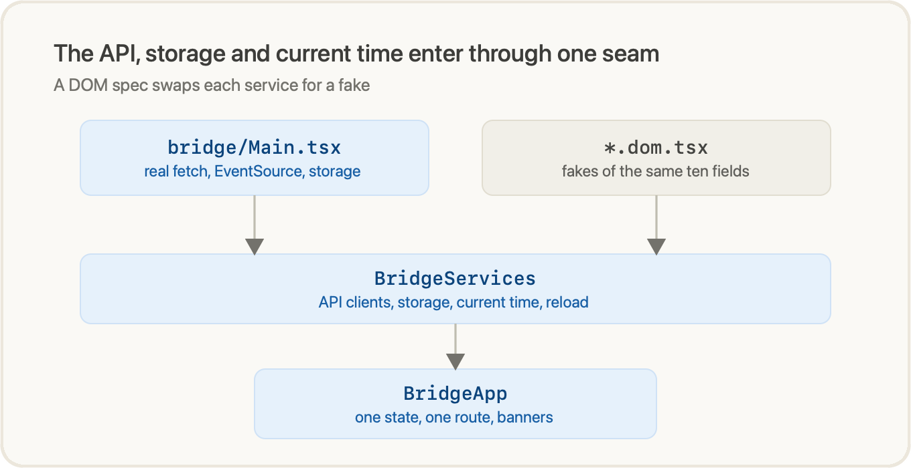
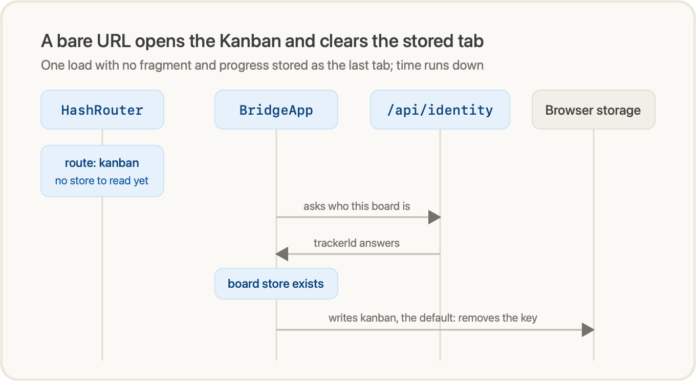

# The Bridge

> **Question:** How is the live page built, where does its state live, and how does it stay safe with agent text?
> **Time:** 20 minutes.
> **Read first:** [Overview](../concepts/overview.md), [Code map](code-map.md).
> **Next:** [Overseer API](../reference/overseer-api.md), [Running a board](../operations/running-a-board.md),
> [Hatch](control-and-hatch.md).

## In one screen

The [Bridge](../glossary.md#bridge) is the browser client of one [board](../glossary.md#board). A React page served by
the board's [Overseer](../glossary.md#overseer), it is a projection, never a store: it holds one document, replaced
whole, and every record stays on disk. The page is one app with nine tabs, each showing one view. Closing the page
loses no record: it loses only typed text and view state.

*Notice that the triggers join at the read: no trigger carries data to the page, each one causes a re-read.*

- **One document.** A `board` event, the unit of consistency, carries all of `BoardState` and replaces the page's copy.
- **One read stream, one write path.** `/api/events` in, `POST /api/commands` out, plus one stream per open transcript.
- **Rules live on the server.** Display states, waiting [tickets](../glossary.md#ticket) and ready order arrive as
  facts. The browser only picks a lane and what a card offers, so an offer can be stale. The server decides every
  command, and a [refusal](../glossary.md#refusal), printed verbatim, is the normal answer to a stale offer.
- **State has five owners:** server, URL, browser storage, the app frame around the views (shell state and refs), and
  each view's component state. A view unmounts with its tab, so typed text survives a board update and dies on a tab
  change.
- **[Agent](../glossary.md#agent) text is hostile.** Two rendered strings reach the DOM as HTML, inside a sandboxed
  frame. All other text is a React text node.

Routes, the event format and the fields of `BoardState` are in the [Overseer API](../reference/overseer-api.md). What
each tab shows and how to work it is in [Running a board](../operations/running-a-board.md).

## How the project is laid out

`bridge/` is a React project of its own, compiled for the DOM and nothing else. `bridge/tsconfig.json` sets `types` to
empty, so a module reaching for `Bun.file` or `node:fs` fails to compile. Its `include` list names the shared files the
Bridge reaches and the whole tracker model, which proves that model DOM-safe.

| Folder | Holds |
| --- | --- |
| `bridge/index.html`, `bridge/Main.tsx` | The page with its meta CSP, and the entry that sets the theme, builds the services and mounts React |
| `bridge/shell/` | The shell, the frame around every view: `BridgeApp`, hash router, header, banners, `CommandButton`, error boundary, theme bootstrap, embedded channel |
| `bridge/api/` | The clients of the Overseer's API: commands, event stream, identity, transcript stream |
| `bridge/views/<view>/` | One view: its component and a pure `<View>Model.ts` beside it, except Agents, whose pure logic is `ElapsedTimeUtil` |
| `bridge/conversation/` | Parts several conversation views share: chat box, decision card, transcript log |
| `bridge/chips/` | Filter chip parts |
| `bridge/preferences/` | `PreferenceStore.ts`, the one module that touches browser storage |
| `bridge/utils/` | Pure utils several views use: geometry, waves, forecast, time, wording |
| `bridge/@types/` | Structural documents of exactly the fields a view reads |
| `bridge/styles/` | `tokens.css` and `board.css`, the design contract |

A view's logic sits in its `<View>Model.ts`, specced as a plain `.spec.ts`; the component is held by a `.dom.tsx` spec,
except the [Merge queue](../glossary.md#merge-queue) view, which has only its model spec. See
[Guards and tests](../development/guards-and-testing.md).

`cli/overseer/routes/OverseerRoutes.ts` imports `bridge/index.html`, and the Overseer builds the page on the first
request and keeps it in memory. Changed Bridge code therefore needs an Overseer restart; see the
[Overseer API](../reference/overseer-api.md).

## The shell and its seam

The shell is what stays mounted across tabs. `BridgeApp` is mounted once and owns the one board state. It reaches the
API, storage, the current time and reload only through `BridgeServices`, ten fields that a DOM spec replaces with fakes.

*Notice that `BridgeApp` sees only the seam: a spec swaps every service without touching the app.*

Beyond plain DOM use inside a component, these reaches stay outside the seam:

- `HashRouter.useHashRoute` reads `window.location`.
- `ThemeBootstrap` writes the document root and reads `window.matchMedia`.
- `AgentsView` receives no `followTranscript` from `BridgeApp`, so it uses its default, `TranscriptStreamClient.follow`.
- `BridgeApp` takes the Agents tick and the header's activity strip tick from `BROWSER_BRIDGE_CLOCK.everySecond` rather
  than from `services`.

Three rules hold across the shell:

- **Models run per state change:** every `board`, and each smaller event before it that updates one slice, a top-level
  part of `BoardState` such as `jobs`. `BridgeApp` memoises `kanbanBoardStateOf`, `ticketsBoardStateOf` and
  `progressBoardStateOf` on its state, and a view computes its model from what it receives. No model keeps state between
  events.
- **A render error is total.** `BridgeErrorBoundary` wraps the whole app, so one throwing view replaces the page with a
  banner until a reload.
- **Shape guards fail soft.** Each of those three returns `null` when a slice its view needs is absent. The tab then
  shows `BoardCounts`, a line of [job](../glossary.md#job), [decision](../glossary.md#decision) and
  [incident](../glossary.md#incident) counts. Progress still shows finished work while the `page` field of `BoardState`
  exists (see [The render service](#the-render-service)). View types are partial for the same reason.

*Notice the side exit: without its slice, the tab ends at plain counts.*

The clock decides nothing here. `services.now` feeds display only: the Progress chart reads it once per state change, so
the line marking the current time moves only with one, and the Agents tab ticks each second.

## The live data path

Every board state is a complete re-read, so none depends on the one before it. A publish is that re-read sent to the
browser.

`publishState` in `cli/overseer/OverseerForeground.ts` runs after every [Pass](../glossary.md#pass) that does not throw,
at every [sweep](../glossary.md#sweep), and once at start. A sweep always wakes a Pass; it forces one only when
something is due, and an unforced Pass with nothing new stops at the [fingerprint](../glossary.md#fingerprint). A Pass
that stopped there publishes too. `publishState` calls `readBoardState`, which takes no lock, and hands the result to
`EventBroker.publishState`. [The event stream](../reference/overseer-api.md#the-event-stream) gives the wire format.

The re-read joins the [tracker](../glossary.md#tracker) with the Overseer's in-memory facts: runtime state,
[notices](../glossary.md#notice), the count of quiet sweeps per job and the [Baton pass](../glossary.md#baton-pass)
warning. The merge queue's conflict predictions are server work too, see the
[Overseer API](../reference/overseer-api.md).

The broker sends slice events, then `board`; the order and the no-change rule are in the Overseer API.
`boardStateAfter` in `bridge/shell/BoardStateUpdate.ts` is the one reducer.

*Notice the second row: a removal other than an ended job waits for the `board`.*

A `board` replaces the state, and a slice event before the first `board` is ignored. `job`, `decision` and `incident`
add or replace their record by id; `overseer` and `usage` update their slice. Each publish closes with a `board`, so
what a viewer reads settles with it. `EventStreamClient` drops a malformed event because the next `board` repairs it.

> **As built.** Each publish carries every ticket body and the whole question history, see
> [gap-scaling-whole-log-and-bodies](../reference/known-gaps.md#gap-scaling-whole-log-and-bodies).

After a dropped connection the browser reconnects and either replays or gets a fresh `board`; the rule is in
[Reconnecting](../reference/overseer-api.md#reconnecting). Separately, the shell asks `/api/identity` again and reloads
when the [code version](../glossary.md#code-version) moved, since its bundle may no longer match the API.

Transcripts travel apart from `BoardState`. Each is a stream of its own, `/api/jobs/<J>/stream`, followed only while a
view shows it. The Overseer has already translated
[Claude Code's own session log](../development/overseer-claude-probe.md) into its own entries, so the Bridge parses no
vendor format.

> **As built.** Entries of one log line share a [cursor](../glossary.md#cursor), so some drop while following, see
> [gap-transcript-shared-cursor](../reference/known-gaps.md#gap-transcript-shared-cursor). Each
> [session](../glossary.md#session) on the Intake tab holds a stream open, see
> [gap-intake-stream-connection-cap](../reference/known-gaps.md#gap-intake-stream-connection-cap) and [Assistant and
> intake](assistant-and-intake.md).

The page uses five routes of the Overseer: two streams, the write route and two setup reads.

*Notice that only the first route stays open as long as the page.*

## Connection and control availability

Controls follow the stream: what a page shows may be stale, so it may not act on it. `ControlAvailabilityUtil` reduces
two booleans, stream down and [install held](../glossary.md#hold), to `enabled`, `stream-down` or `install-held`, and
stream-down wins.

*Notice that connecting counts as available: of the three stream states only `down` disables anything; an install hold
is separate, below.*

> **As built.** The reopen path re-enables controls for a moment, see
> [gap-stream-down-flicker](../reference/known-gaps.md#gap-stream-down-flicker).

When the [install version](../glossary.md#install-version) on disk stops matching the running Overseer, it holds
launches and answers control commands 423, all but its own stop and restart; see [state
machines](../data-model/state-machines.md). The Bridge learns of the hold from two places: the board state's
`overseer.state` of `held-by-install-change`, or a 423 answer.

*Notice the bottom row: a down stream turns every button off, held or not.*

> **As built.** Stop and Wind down on a job carry that mark, and the server answers them 423, see
> [gap-job-stop-while-install-held](../reference/known-gaps.md#gap-job-stop-while-install-held).

## From a click to an answer

`CommandButton` is the one control that posts, and each outcome has one display. It is disabled while availability says
so, while sending, while its form is incomplete, or when its view has nothing to send.

![A click on a CommandButton goes through CommandClient, which fetches a session token the first time and posts to /api/commands. The Overseer checks the bearer token first, and answerControlCommand applies through ControlService.apply. A 401 from the check clears the token and retries once inside the client. Four endings follow: 200 is applied and resets the form, 409 or any other status is refused and prints verbatim beside the button, 423 is install-held and raises the install banner, and no answer is unreachable, which shows nothing.](../figures/bridge/click-to-refusal.png)

*Notice the bottom row: `unreachable` is the one failure with no words.*

- `OverseerServer.answerCommand` checks the bearer token before the route, so a 401 never reaches
  `answerControlCommand`, which applies the command through `ControlService.apply` and wakes a Pass.
- Board data settles with the next `board`. `onApplied` is local: it clears a form, closes an edit form, and on the
  [Assistant](../glossary.md#assistant) tab adds a queued-message note.
- `CommandClient` maps any other status to `refused`, with the body's `refusal` or the bare status number. So a 400
  prints `malformed-body`, and a 401 after the retry prints `unauthorized`.
- A failed token fetch counts as `unreachable`.
- The Bridge words no refusal. `OperationRefusalWordingUtil` on the server words a 409, and the page prints it.

The session token protects writes; how it is issued and guarded is in
[Request guards](../reference/overseer-api.md#request-guards).

## Who owns which state

Five owners hold state, and an owner's lifetime is what decides whether a thing survives.

![Five owners of state against four events: a board update, a tab change, a reload and an Overseer restart on the same port. Server state survives everything, except that a restart loses the Overseer's in-memory facts. The URL is replaced by a tab change and survives the rest. Browser storage survives everything. Shell state and refs survive updates and tab changes and are lost on reload. Component state in a view survives a board update but is lost on a tab change or a reload. Both survive a restart unless new code forces a reload.](../figures/bridge/state-ownership.png)

*Notice the bottom row: typed text survives a board update and dies with its tab.*

| Owner | What it holds | Where |
| --- | --- | --- |
| Server | Tickets, jobs, decisions, the [log](../glossary.md#log), everything else in `BoardState` | The tracker read per publish, joined with the Overseer's in-memory facts |
| URL | The tab and its item | `location.hash` through `HashRouter` |
| Browser storage | Theme, chart range, folds, [epic](../glossary.md#epic) chips of the Kanban, grouping, finished-work choice | `PreferenceStore`, keys below |
| Refs and shell state | `boardState`, `connection`, `identity`, `installRefusal`, `knownCodeVersion`, `streamWasDown`, seen decision ids | `BridgeApp`, `useOpenQuestionAlerts` |
| Component state | Typed text, the Tickets search, chips and sort, selected [draft tickets](../glossary.md#draft-ticket), `TranscriptMemory`, queued messages | Each view |

Typed text survives a board update because React keeps a keyed component mounted across a re-render. It dies on a tab
change because `BridgeApp` renders views conditionally. A view's own refs are DOM handles and one hover timer, and die
with it.

Two visible effects follow. The Kanban highlights a card whose state moved since the last board state the mounted view
showed, so after a tab change nothing is highlighted against the older state. An Agents transcript restarts from its
history on return to the tab.

> **Careful.** Browser storage belongs to an origin, and the origin holds the port. An Overseer bound to another port,
> because its preferred one was taken, shows default preferences. See [Watchers](watchers.md) for port derivation.

Preference keys

`STORAGE_PREFIX` is `agent-progress-v2` in this build. A choice equal to its default removes its key.

| Key | Holds |
| --- | --- |
| `<STORAGE_PREFIX>:theme` | Theme choice, shared by every board |
| `<STORAGE_PREFIX>:<trackerId>` | The Progress chart's range override |
| `<STORAGE_PREFIX>:<trackerId>:tab` | Last tab, read only by a later `hashchange` |
| `...:kanban-epics` | Pressed epic chips on the Kanban |
| `...:kanban-todo-order` | Ready lane order |
| `...:kanban-abandoned` | Abandoned lane open |
| `...:kanban-done-shown`, `...:kanban-abandoned-shown` | Cards shown in a closed lane |
| `...:ticket-grouping` | Tickets grouped by epic |
| `...:review-rows` | Review rows shown |
| `...:name-column` | Name column width |
| `...:progress-folded-epics` | Folded epic heads |
| `...:visibility` | Finished-work choice |

## Hash routes

A route here is a hash fragment, so a link survives an Overseer restart and needs no server route. `BRIDGE_TABS` lists
nine tabs: the static page's Kanban, Waves, Progress, Epics and Tickets in its order, then the Bridge's own Agents,
Questions, Assistant and Intake. `HashRouter.routeOf` reads `#<tab>` or `#<tab>/<item>`. A fragment naming no tab falls
back to the stored tab, then the first. A bare URL always opens the Kanban, whatever tab was stored. Waves shows only on
a board where a ticket depends on another and Epics only on one with epics; a route to either elsewhere opens the
Kanban.

*Notice the order: the route resolves before the store exists, so the stored tab goes unread, and only a later
`hashchange` can reach one.*

| Form | Opens |
| --- | --- |
| `#<board tab>/ticket/<id>` | The detail panel's ticket form, in place over Kanban, Waves, Progress, Epics or Tickets |
| `#<board tab>/task-row/<task id>` | The panel's row form for a chart row |
| `#<board tab>/ticket-row/<id>` | The panel's row form for a ticket's own row, as a ticket-table line opens it |
| `#<board tab>/draft/<draft id>` | The panel's read-only filing-draft form |
| `#epics/epic/<key>` | The Epics tab, pointing at that epic |
| `#agents/<job>` | That job's controls and transcript |
| `#kanban/merge-queue` | The Merge queue view (`MERGE_QUEUE_ITEM`) |
| Any other item | The tab alone; the item is ignored |

`DetailRoute` reads and writes the detail forms, and `BridgeApp` mounts one `DetailPanelHost` for the board tabs while
the route names a detail; Esc closes it. A board view opens it through `useDetailRouting`, whose openers keep the tab,
so the panel opens over the view the viewer is on, and a second click on the open item closes it.

> **As built.** A Kanban card opens nothing, see
> [gap-kanban-card-has-no-link](../reference/known-gaps.md#gap-kanban-card-has-no-link).

## What the browser computes

The browser lays out, groups and maps a stored status to a lane; it judges no move. `GeometryUtil` turns the `page`
field of `BoardState` (see [The render service](#the-render-service)) into the Progress chart's bars and ticks, and
`DependencyGraphUtil` groups open tickets into [waves](../glossary.md#wave). `KanbanModel.laneOf` maps a stored status
and the merge queue's ids to a lane, and `actionsOf` picks what a card offers. Geometry stays in the browser so range
presets re-lay out with no `board` event. Its bounds arrive in `limits`, so the values have one definition, in `LIMITS`
on the server.

The wave forecast, `WaveForecastUtil`, is the one substantial computation, and it decides nothing: only
`WavesModel` reads the result. The clock arrives as a parameter. It plays the open tickets forward from the build
and review durations of the board's [delivered](../glossary.md#delivered) tickets, under the [concurrency
limit](../glossary.md#concurrency-limit) and the dependencies, and gives p50 and p80 finish times per ticket and wave.
From `MINIMUM_SIZED_SAMPLES` (8) delivered tickets with the same `size` field, a ticket of that size draws on those
alone.

*Notice the last row: #009 has a bar, and one ticket without a forecast still blanks its wave.*

Each run starts waiting tickets in one order: low priority after the rest, and within each priority tickets on the
pace path first, the dependency chain from the last wave back to the first, then by lowest id. Up to the limit run as
dependencies settle.

No ETA shows when:

- `overseerState` is not `running`, so a tracker still at `DEFAULT_OVERSEER_STATE` (`paused`) shows none.
- The board has no dependencies.
- A ticket of the wave is held or paused, or waits on a held ticket.
- The board has no delivered build history.

## Agent text

Everything an agent wrote is hostile. Two strings reach the DOM as HTML, a ticket's `bodyHtml` and an epic's
`descriptionHtml`, and they go through three layers: the renderer, the sandbox and the CSP. Every other value takes a
fourth path, React's escaping.

*Notice that the sandbox and the CSP stand behind the renderer: a renderer bug still runs nothing.*

| Layer | What it does | Where |
| --- | --- | --- |
| Renderer | Escapes raw HTML in the source; drops a link or image whose scheme is outside `ALLOWED_HREF_SCHEMES` | `src/services/render/MarkdownRenderer.ts`, `PAGE_RENDERER`, `hrefIsAllowed` |
| Sandbox | Frames carry no `allow-scripts`; `allow-same-origin` lets the parent size the frame; links open outside it | `TicketBodyFrame`, `SandboxedHtml` |
| CSP | Scripts, styles and connections only from `'self'`, images from `'self'` and `data:`, no objects | `contentSecurityPolicyOf`, `bridge/index.html` |

`eslint.config.js` bans `dangerouslySetInnerHTML` and assigning `innerHTML` or `outerHTML` throughout `bridge/`, which
holds that path.

A `srcdoc` frame inherits the parent's CSP: a script in the frame and a remote image are blocked, and a same-origin
image loads. The frame loads no stylesheet, so a body shows in browser default type, white even under a dark parent.

`escapeHtml` is called by hand in one Bridge spot, the frame's `<title>` in `DetailPanelModel.bodySourceDocumentOf`,
because that value lands in markup. Anywhere else a hand escape would show its entities.

## The design contract

Two stylesheets are the contract with the designer, and both are designer-owned. `bridge/styles/tokens.css` holds every
colour, state token and theme value. `bridge/styles/board.css` holds every class, and its header comment is the
catalogue of containers and marks. `bridge/StyleContract.spec.ts` holds `board.css` and the components' classes equal
both ways: an emitted class with no rule fails, a rule nothing emits fails, and a `className` the scan cannot read as a
literal fails. It does not read `tokens.css`.

## Theme and embedded mode

The theme is set before React runs, and an embedding parent can set it but never stores it.
`ThemeBootstrap.applyBeforeFirstPaint` runs in the module scope of `bridge/Main.tsx`, and `board.css` keeps the body
hidden until `data-theme` is set, so no wrong theme flashes. `auto` resolves at load and on a choice; nothing listens
for a system change afterwards.

agent-dashboard, a separate program described in the [Overseer API](../reference/overseer-api.md), can show the Bridge
in an iframe.

*Notice that both messages name one origin: the Bridge never posts to `*`.*

> **As built.** Esc is meant to close an open panel first. With a panel open it does nothing, see
> [gap-esc-does-not-close-panel](../reference/known-gaps.md#gap-esc-does-not-close-panel).

## The render service

`src/services/render/` is named for rendering Markdown to HTML. It writes no page; it turns one read of the tracker into
the `page` field of `BoardState`.

*Notice the dashed branch: the command line asks the same Board and shares only three of the page's queries.*

- `boardFactsOf` in `BoardFacts.ts` asks the Board one query per fact: [row](../glossary.md#row) and ticket display
  states, [review bars](../glossary.md#review-bar), waiting tickets, epic roll-ups, ready tickets and open [filing
  drafts](../glossary.md#filing-draft). Epic roll-ups, ready tickets and open filing drafts are the same queries
  `agent-progress-v2 status --json` prints; the rest are Board queries only the page reads. The page decides no move;
  its own are the status-to-lane mapping and which controls it offers, and the server judges every one. A row's facts
  sit at the row's index; a ticket's are joined by id.
- `assemblePagePayload` in `PagePayloadAssembly.ts` returns `{payload, tickets}`: the progress document with its log
  entries worded, the `limits`, the concurrency limit and agents in flight, the epic descriptions and the facts, plus
  each ticket with its `bodyHtml`. `generatedAt` is a parameter, so the service holds no clock.
- `createRenderState` holds the configured Markdown renderer (the Marked library) on the command context, so the service
  keeps no module state.

## What a live page does not have

The Bridge needs a live Overseer; there is no self-contained copy.

- `agent-progress-v2 open` is refused `overseer-down` when no Overseer serves the board.
- `progress.html` under `<data>` is a stub naming the live URL or saying the Overseer is down
  (`src/adapters/progress-page/ProgressPageStubWriter.ts`); its writers are in the [on-disk
  atlas](../data-model/on-disk-atlas.md). After a crash the stub keeps naming the dead URL until the next start, `init`
  or `update`.
- A page left open shows its last board state and the banner. There is no snapshot to reopen after the tab closes.

## When things fail

Once a page holds a board, the board stays through every failure but a render error or a reload.

Each failure, what the viewer sees and where it is decided

| Failure | What the viewer sees | Decided in |
| --- | --- | --- |
| No `board` event yet | "Waiting for the Overseer's first board." | `BridgeApp` |
| Event route not ready (404) | The red banner, then a reopen each `REOPEN_DELAY_MILLISECONDS` (2000) | `eventsResponse`, `EventStreamClient` |
| Stream down | Red banner with the time of the last `board` event; controls off; board stays | `ConnectionBanners` |
| Board read throws on the server | Nothing; the old board stays and the Overseer logs a line | `publishState` |
| Install version changed | Banner; controls off but those marked `answeredWhileInstallHeld` | `ConnectionBanners`, `ControlAvailabilityUtil` |
| Code version moved, seen after a reconnect | The page reloads | `BridgeApp` |
| Page build failed | JSON 500 `page-build-failed` at `/`; the next request rebuilds | `pageFileResponse` |
| A view throws while rendering | Whole-app banner until reload: "the board itself is unaffected" | `BridgeErrorBoundary` |
| Storage blocked | Defaults; reads return nothing and writes are dropped | `createPreferenceStore` |
| Malformed event | Nothing; the next `board` repairs it | `EventStreamClient` |
| Command lost | Nothing; the button enables again | `CommandButton` |
| `/api/identity` fails at load | No per-board preferences until a later load; the board still shows | `BridgeApp` |
| Ticket id not on the board | "No ticket #N on this board." | `DetailPanel` |

## Invariants

1. The Bridge writes only through `POST /api/commands`, and only `CommandButton` posts.
2. What the Bridge offers is a hint: the server decides every command.
3. A `board` event replaces the whole state.
4. `bodyHtml` and `descriptionHtml` are the only HTML strings, and each reaches the DOM only as a sandboxed `srcdoc`.
5. No frame carries `allow-scripts`.
6. In `bridge/`, no value is escaped by hand except the frame's title.
7. Only `bridge/preferences/PreferenceStore.ts` touches browser storage.
8. Every class a component emits is styled, and every styled class is emitted.
9. The browser's clock changes only what is shown.
10. The Bridge prints a refusal as the server worded it.

## In the code

Concepts, paths, symbols and specs

| Concept | Path | Symbol | Held by |
| --- | --- | --- | --- |
| Entry and seam | `bridge/Main.tsx`, `bridge/shell/BridgeApp.tsx` | `BridgeServices`, `BridgeApp` | `bridge/shell/BridgeApp.dom.tsx` |
| State reducer | `bridge/shell/BoardStateUpdate.ts` | `boardStateAfter` | `bridge/shell/BoardStateUpdate.spec.ts` |
| Event stream | `bridge/api/EventStreamClient.ts` | `EventStreamClient.open` | `bridge/api/EventStreamClient.spec.ts` |
| Transcript stream | `bridge/api/TranscriptStreamClient.ts` | `TranscriptStreamClient.follow` | `bridge/api/TranscriptStreamClient.spec.ts` |
| Commands | `bridge/api/CommandClient.ts`, `bridge/shell/CommandButton.tsx` | `CommandClient.create`, `CommandButton` | `bridge/api/CommandClient.spec.ts`, `bridge/shell/BridgeApp.dom.tsx` |
| Command route | `cli/overseer/routes/CommandRoute.ts` | `answerControlCommand` | `cli/overseer/routes/CommandRoute.spec.ts` |
| Kanban lanes and offers | `bridge/views/kanban/KanbanModel.ts` | `laneOf`, `actionsOf` | `bridge/views/kanban/KanbanModel.spec.ts` |
| Board read | `cli/overseer/routes/BoardStateReader.ts` | `readBoardState` | `cli/overseer/routes/BoardStateReader.mergeForecasts.spec.ts` |
| Availability | `bridge/shell/ControlAvailability.ts` | `ControlAvailabilityUtil` | `bridge/shell/BridgeApp.dom.tsx` |
| Routes | `bridge/shell/HashRouter.ts` | `HashRouter.routeOf` | `bridge/shell/HashRouter.spec.ts` |
| Preferences | `bridge/preferences/PreferenceStore.ts` | `createPreferenceStore` | `bridge/preferences/PreferenceStore.spec.ts` |
| Forecast | `bridge/utils/WaveForecastUtil.ts` | `ticketFinishForecastsOf` | `bridge/utils/WaveForecastUtil.spec.ts` |
| Frames | `bridge/views/detail-panel/TicketBodyFrame.tsx`, `bridge/views/epics/SandboxedHtml.tsx` | `TICKET_BODY_SANDBOX`, `SANDBOX_PERMISSIONS` | `bridge/views/detail-panel/DetailPanel.dom.tsx` |
| Style contract | `bridge/styles/board.css` | classes | `bridge/StyleContract.spec.ts` |
| Whole page in Chrome | `bridge/testing/HeadlessBridgeCheck.ts` | `readTheBridgeHeadless` | `bridge/HeadlessBridge.integration.spec.ts` |
| Embedded channel | `bridge/shell/EmbeddedChannel.ts` | `EmbeddedChannel.open` | `bridge/shell/EmbeddedChannel.dom.tsx` |
| Facts | `src/services/render/BoardFacts.ts` | `boardFactsOf` | `src/services/render/BoardFacts.spec.ts` |
| Payload | `src/services/render/PagePayloadAssembly.ts` | `assemblePagePayload` | none |
| Markdown | `src/services/render/MarkdownRenderer.ts` | `createMarkdownRenderer` | `src/services/render/MarkdownRenderer.spec.ts` |

