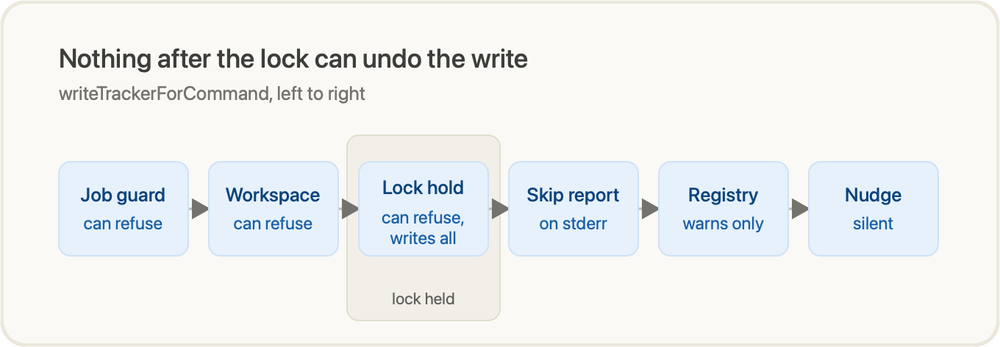
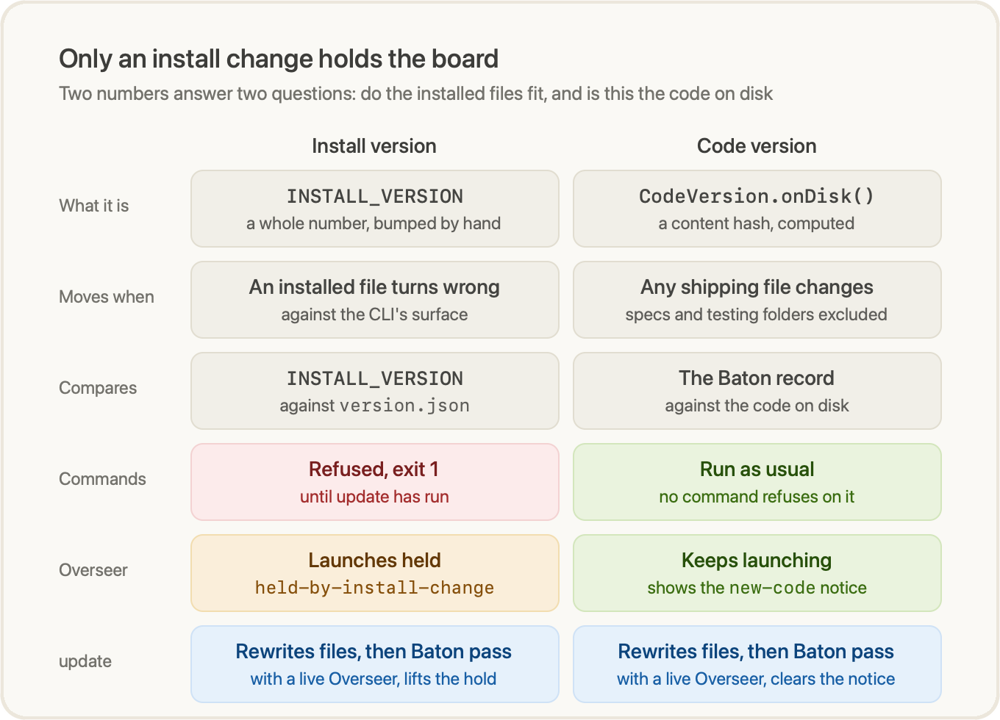

# The CLI and install

> **Question:** How does one command line run, and what does adopting a repository install?
> **Time:** 25 minutes.
> **Read first:** [Overview](../concepts/overview.md), [Code map](code-map.md).
> **Next:** [CLI reference](../cli.md), [The Baton](baton.md), [Control and the Hatch](control-and-hatch.md).

## In one screen

`agent-progress-v2` is a Bun program with one funnel. `cli/Main.ts` finds the command, decides how it may run, checks
the install, runs the handler, and turns whatever came back into 0, 1 or 2. Nothing else picks an exit code.

*Notice that the handler never picks a number: it returns, or it throws, and the catch maps what it threw.*

- A command reads its directory, clock and streams only from `CommandContext`, so a spec can run it in-process.
- Adopting a repository means running `init`: it creates a [tracker](../glossary.md#tracker) and installs nine
  instruction files, two skills, one `SessionStart` hook and `version.json`. `update` rewrites those installed files. On
  a refresh, neither touches a [ticket](../glossary.md#ticket), the [log](../glossary.md#log) or `progress.json`.
- Two numbers guard the install. A different [install version](../glossary.md#install-version) refuses commands and
  leaves launches [held by the install](../glossary.md#hold); a different
  [code version](../glossary.md#code-version) shows a [notice](../glossary.md#notice).
- `version.json` is written last, and commands refuse until a rerun when it differs from this build. One cut-short run
  goes undetected: [the marker window](../reference/known-gaps.md#gap-init-marker-window).
- `update` ends by handing a live [Overseer](../glossary.md#overseer) on other code to the code on disk. It is the one
  command that can finish its writes and still exit 1.
- `session-start` prints the instructions, silent on failure; `bash-domains` denies an unlisted domain, and on failure.

## The life of a command

One short function owns the whole path, and it returns a number instead of exiting. `agent-progress.ts` is three lines
of work: `createProcessContext()`, `runCommandLine(...)`, `process.exit(...)`. Importing it is the invocation, so no
spec imports it; `cli/BinarySmoke.integration.spec.ts` spawns it.

| Step | What the figure does not show |
| --- | --- |
| Help check | `--help` anywhere before a bare `--`, or `-h` straight after the command word, asks for the reference. A `-h` further on may be text (`log "remember" -h`), so it is refused, not guessed. |
| Table lookup | `commandLoaderFor` uses `Object.hasOwn`, so `agent-progress-v2 constructor` is unknown. An unknown command prints the help to standard error: a mistyped step never reads as one that ran. |
| Verb | `commandVerbOf` joins the subcommand for the commands in `COMMANDS_WITH_A_SUBCOMMAND`: `ticket hold`, not `ticket`. |
| Job route | `jobRouteOf` answers `direct`, `relayed` or `refused`. It matters only under a [job](../glossary.md#job). `relayed` means the verb goes through the job's [Hatch](../glossary.md#hatch) and the Overseer applies it, so the process under the job writes nothing to the tracker. [Control and the Hatch](control-and-hatch.md) has the rules. A refusal happens before the command's module loads. |
| Lazy import | Only the named command's module loads, so a typo loads no command module and `help` loads only the help text. |
| Install check | Skipped for `COMMANDS_THE_INSTALL_CHECK_SPARES`, for `COMMANDS_THAT_CHECK_THEIR_OWN_INSTALL`, and for a relayed verb, because the Overseer applies it. |

The catch is the mapping `refused` to 1 and `unrepaired` to 2, plus a fall-through to 2 for anything unexpected.
`HatchConcluded` is an `Error` used as control flow: the verb reached its Hatch, printed its outcome and has nothing
left to do. The contract for callers is in [Exit codes](../cli.md#exit-codes).

> **Why.** Returning the number keeps `process.exit` out of every command. A spec calls `runCommandLine` and reads the
> result, and `eslint.config.js` (`CONFINED_REACHES`) holds the rule.

## CommandContext

`CommandContext` is everything a command may know about its process, and it is the
[seam](code-map.md#seams) that makes commands testable.

*Notice the one dashed line: the environment is the only thing a spec cannot swap in-process.*

A handler takes `(commandArguments, context)` and nothing ambient. Working directory, clock, output streams, standard
input, the confirm prompt, platform, home directory, `PATH`, temporary folders, the render state, the program's own
start command, the stop-signal hook and the agent adapter all arrive through it.

`createProcessContext` in `cli/CommandContext.ts` is the only place these are read from the real process. It is a
function, never a constant, because a constant would read `process.cwd()` at import. `createCapturedCommandContext` in
`cli/testing/CapturedCommandContext.ts` builds the same shape for a spec, with its output captured in arrays. The
context carries no environment access: `src/shared/Environment.ts` alone reads the environment.

Three fields decide behaviour rather than carry a value:

- `job` is present only when both the job id and the Hatch folder are set; one alone runs as any other process.
- `confirm` fails closed. Anything but `y` or `yes` is a no, end of input included.
- `agentAdapter` is the one place outside `src/lib/claude-code/` that picks the vendor's adapter. Under
  `AGENT_PROGRESS_V2_FAKE_AGENT` it picks the scripted fake, so a spec-spawned binary spends no subscription.

## CommandTable

`COMMAND_TABLE` maps a word to a lazy import, and `COMMAND_NAMES` derives from it, so the list cannot drift from the
commands that run. There are 31 commands at commit 70ce56de. Each lives in a folder for its set. A command is one table
entry, one block in `cli/HelpText.ts` and one folder; `cli/CommandTable.spec.ts` and `cli/HelpText.spec.ts` hold the
table and the help both ways.

Reading and moving come in pairs: `merges` and `merge`, `decisions` and `decide`, `incidents` and `incident`, `jobs` and
`job`. The first word of each pair reads without a lock. The second holds the moves, and `job` also has the read-only
`job show` and `job attach`.

Commands by set

| Set (`cli/` folder) | Commands |
| --- | --- |
| `adoption/` | `init`, `update` |
| `tracking/` | `status`, `task`, `log`, `await`, `range`, `open`, `clear` |
| `hooks/` | `hook` |
| `measurement/` | `usage`, `review-stats` |
| `tickets/` | `ticket` |
| `epics/` | `epic` |
| `drafts/` | `draft` |
| `dispatch/concurrency/` | `concurrency` |
| `merges/` | `merges`, `merge` |
| `worktrees/` | `worktree` |
| `gates/` | `gate` |
| `decisions/` | `decisions`, `decide` |
| `incidents/` | `incidents`, `incident` |
| `jobs/` | `jobs`, `job` |
| `intake/` | `intake` |
| `onboarding/` | `advise` |
| `overseer/` | `oversee`, `version` |
| inline in the table | `help` |

Every flag and subcommand is in [the CLI reference](../cli.md).

> **As built.** The help screen's `init`, `update` and priority text is behind the code. Trust this document and [the
> CLI reference](../cli.md). See [stale help text](../reference/known-gaps.md#gap-help-text-stale).

## Writing

A command that changes the tracker does so in one [lock hold](../glossary.md#lock-hold), followed by steps that cannot
undo it. Commands call `openTrackerForWriting`, or `openTrackerForWritingThenReadNextLine` when they end with the [Next
line](../glossary.md#next-line). Both run `writeTrackerForCommand`. The one exception is a fresh `init`, which creates
the tracker through `createTracker`, under the same lock.

*Notice the band covers one box: the nudge comes after the lock is released, so the [Pass](../glossary.md#pass) it wakes
can take the lock.*

- **Job guard.** A relayed verb ended at its Hatch, so a command reaching this point under a job is a bug, refused
  `verb-not-relayable`. This is a second guard behind `jobRouteOf`.
- **Lock hold.** `writeTracker` in `src/services/tracker/TrackerPipeline.ts`. A [Board](../glossary.md#board) rule
  refuses here, before anything is written. [How a write commits](../data-model/storage.md) has the mechanics.
- **Skip report.** A ticket or epic file that would not parse is named on standard error. The store is already written,
  so this never fails the command.
- **Registry.** `registerWrittenTracker` records the tracker in
  [`<monitor>`](../glossary.md#reading-names)`/projects.json`. A registry problem warns and
  keeps the exit code. A tracker under a temporary folder stays out.
- **Nudge.** `nudgeTheOverseer` sends a body-less `POST api/nudge` to the live [Baton](../glossary.md#baton)'s URL,
  bounded by `OVERSEER_NUDGE_TIMEOUT_MILLISECONDS` (500). It is silent on failure, because the Overseer's watch of
  [`<data>`](../glossary.md#reading-names) notices the write anyway.

The Next line comes from the Board this invocation wrote, through `NextLineUtil.nextLineOf`, so
it cannot predate the move. `--json` goes through `OutputUtil.printEntity`: one document on standard output, and the
Next line never follows it. Formats are in [the CLI reference](../cli.md).

## Refusal wording

A refusal carries facts, and one file turns them into words. `OperationRefusal` in `src/shared/OperationRefusal.ts` has
a `status` and a `detail`, a discriminated union of reason codes and facts with no prose. Library code throws it and
never touches the terminal. `cli/Main.ts` calls `OperationRefusalWordingUtil.messageOf`, the only place a printed
[refusal](../glossary.md#refusal) is worded.

A refusal built from a plain string is allowed from `cli/` only, because command-line text lives there. The lookup of
every printed refusal is [Refusals](../reference/refusals.md).

## Two version numbers

The install version asks whether the installed text fits this CLI. The code version asks whether this process is the
code on disk. Only the first holds the board.

*Notice the Commands and Overseer rows: a [landing](../glossary.md#landing) that changes only code never stops
anything.*

`INSTALL_VERSION` (19) lives in `cli/constants/InstallVersion.ts`, and `<data>/version.json`, the install manifest,
records the version installed.

`CodeVersion.onDisk()` hashes `agent-progress.ts`, `watcher.ts`, `package.json`, `bun.lock` and the folders `cli`,
`src`, `bridge`, `resources` and `skills`, skipping specs, `testing` folders and `node_modules`. A spec, a timestamp or
a checkout's path never changes it.

The Overseer watches both through `createInstallChangeWatch`. It asks the on-disk binary's `version --json`, which
prints both and needs no tracker, at each [sweep](../glossary.md#sweep) and after each landing, and it reads the
manifest at every Pass. It holds only on a different install version or a manifest that no longer matches.

*Notice that the band outlives `update`'s writes and stays open on the failed side: only a process running the code on
disk ends the hold.*

While the install differs, `runtimeState` reads `held-by-install-change`: the [Playbook](../glossary.md#playbook) starts
no job, boots no [Assistant](../glossary.md#assistant) and resumes nothing, and a control command posted through the API
is answered HTTP 423. Overseer stop and restart are still accepted. The Overseer never restarts itself. [The
Pass](the-pass.md) places the install hold among the others, and [The Baton](baton.md) has the inner steps of a
[Baton pass](../glossary.md#baton-pass).

### Install verdicts

`installVersionVerdictOf` is a pure decider over the manifest reading and one presence check. "Installed files present"
means `session-instructions.md`, or `agent-brief.md` on a board last installed at install version 16, exists; only
`ENOENT` counts as absent.

| Manifest reading | Installed files present | Verdict | Reason |
| --- | --- | --- | --- |
| `absent` | yes | mismatch | `unversioned` |
| `absent` | no | current | |
| `unreadable` | either | mismatch | `unreadable` |
| `directory` | either | mismatch | `manifest-is-a-directory` |
| `readable`, equal | either | current | |
| `readable`, lower | either | mismatch | `older` |
| `readable`, higher | either | mismatch | `newer` |

`init` and `update` repair every mismatch except two. They refuse `newer`, so an older program never writes over a newer
one's files, and `manifest-is-a-directory`, which they could not replace. A manifest naming the retired `copilot-cli`
agent host is refused by a separate check until User removes that install.

### Who checks

Every verb runs `requireCurrentInstall` in `cli/Main.ts` except those that repair the install, report it, run as a hook,
or must reach an Overseer whose install changed.

The install check of each verb

| Verb | Check |
| --- | --- |
| `init`, `update` | `requireInstallManifestThisVersionCanReplace`: only the two refusals above |
| `help`, `status`, `version` | None. `status` output says nothing about a mismatch |
| `hook session-start`, `hook bash-domains` | None. A hook prints or guards whatever the install |
| `oversee status`, `oversee stop` | None, so an Overseer whose install changed can be inspected and stopped |
| `oversee` start, `restart`, `pause`, `resume` | Their own call to `requireCurrentInstall`, after any Hatch relay |
| `oversee --successor-of <n>` | None in the command. The successor checks the manifest as a Baton pass step, so a mismatch reads as that Baton pass's failure |
| A relayed verb under a job | None. The Overseer applies it |
| Everything else | `requireCurrentInstall` in `cli/Main.ts` |

With no tracker governing the directory, `requireCurrentInstall` returns and the command's own no-tracker refusal
stands.

### What bumps it

[CLAUDE.md](../../CLAUDE.md) says what bumps `INSTALL_VERSION`. `cli/FrozenInstalledSurface.json` makes the surface side
mechanical: it holds, per version, the commands, flags and `status --json` fields the installed files name. A version's
surface only grows, since a file installed at that version may name any of it. So a frozen name the CLI no longer has
fails `cli/InstalledSurface.spec.ts` until the version is bumped. Wording is not surface and trips nothing.

*Notice that key n keeps the dropped flag: repositories still installed at n may name it.*

> **Careful.** Never delete a name from a version already frozen. To retake, add names under the current version, or
> under a fresh key after a bump. The spec's header says how.

## init and update

Both run one refresh, so a fresh tracker and an adopted one never drift. `init` adds the tracker first; `update` adds
the hand-over last.

*Notice that a second `init` and a lost `createTracker` race share one line into the refresh.*

*Notice that `<data>` holds both groups: the folder is shared, the ownership is not.*

The table of what lands where is in [Adopting a repository](../cli.md#adopting-a-repository), and [the on-disk
atlas](../data-model/on-disk-atlas.md) has every path with its writer and lifetime.

Each step of init and update

| Step | `init` | `update` |
| --- | --- | --- |
| Find the root | `--root` or repository discovery; refuses a bare repository, and [`<PREFIX>`](../glossary.md#reading-names)`ROOT` naming another directory | `requireWorkspace` |
| Refuse before writing | A tracker governing from another root, `older-program-present`, a manifest it cannot replace, a `version.json` naming the retired `copilot-cli` agent host, whose worker would keep running beside Claude Code's | `older-program-present`, a manifest it cannot replace, the `copilot-cli` refusal |
| Compute every text | `installedFileTextsFor`, so an unreadable template leaves nothing behind | The same |
| Tracker | Fresh only: ignore entries, `createTracker`, stub, registry | Never |
| Refresh | `refreshTrackedRepository`, brief first on a fresh tracker | `refreshTrackedRepository` |
| Manifest | `recordInstallVersion`, last | `recordInstallVersion`, then the hand-over |

`init` at a root that already holds a tracker prints the refresh and points at `update`. `createTracker` creates
`progress.json` exclusively under the lock, so neither of two racing `init` runs replaces the store.

`update` takes no lock: it touches none of the tracker's files except the `progress.html` stub, which names the live
Baton's URL or says the Overseer is down.

### The refresh and its parts

`CLAUDE_CODE_INSTALL.parts` is one table, and report order is not write order. The report follows the table so the
output reads the same every run. `writeOrder` in `cli/adoption/TrackerRefresh.ts` writes hooks, skills, ignored folders,
then briefs, then the retired parts; a fresh `init` moves the briefs to the front.

| `writing` | Report label | Opt-out | Does |
| --- | --- | --- | --- |
| `retired-managed-block` | `CLAUDE.md` | | Removes the [managed block](../glossary.md#managed-block); says `removed; commit CLAUDE.md` |
| `retired-install` | `retired` | `--no-hooks` keeps the hook entries | Removes the [retired install data](#retired-install-data) |
| `briefs` | `brief` | | Rewrites nine files whole |
| `claude-settings-hooks` | `hooks` | `--no-hooks` | Keeps the `SessionStart` hook current |
| `skill-folders` | `skills` | | Rewrites both skills, git-ignores each folder and removes the retired skill folder |
| `ignored-folders` | `worktrees` | | Git-ignores [`<worktrees>`](../glossary.md#reading-names) |

Each file is written atomically, and `fileChangedByWriting` compares bytes before and after. An unreadable file counts
as changed. The `brief` line names the last file and reports a change in any of them, which is how a
[session](../glossary.md#session) that read its instructions at the start learns its copy went stale.

A missing generated text is `unrepaired`, a defect of the checkout. An unreadable settings file refuses that one line,
explains on standard error, and the run goes on. A `CLAUDE.md` with a start marker and no end marker refuses its line
the same way: nothing is removed and the run goes on.

*Notice that only the brief changes place between the two write orders; the report never moves.*

> **Why.** The [install marker](../glossary.md#marker) is `session-instructions.md` or the older `agent-brief.md`. A
> fresh `init` writes the briefs before the hooks, skills and worktrees entry, though still after `progress.json`, so a
> run cut short after the briefs reads as unversioned. Elsewhere the briefs go late, so a rerun after a failed write
> still sees a byte change and reports `updated`. The retired parts go last, because they delete the older marker.

*Notice the overlap: on an upgrade from install version 16, a cut-short run always leaves one of the two markers.*

### Written last

Each crash point of a fresh `init` reads differently to the next command. A cut-short `update` at an equal version
keeps a manifest that already matches, so it reads as current.

*Notice the middle zone: the one failure nothing refuses, because the install reads as current before its marker
exists.*

Rerunning `init` finishes every zone. The first starts over; the others find the tracker and take the refresh branch.

> **As built.** `session-instructions.md` is the ninth brief written, after `progress.json`, so the marker arrives after
> the tracker exists. See [the marker window](../reference/known-gaps.md#gap-init-marker-window).

### The installed briefs

The refresh's `briefs` part writes nine instruction files into `<data>`, and only one reaches User's session by itself.

*Notice that a job's text is filled a second time, by the Overseer, and that nothing delivers `reference.md`.*

`filledTemplateOf` does both fills. Each [role](../glossary.md#role)'s text is read whole at each launch or resume, so a
changed default reaches the next one. A [pipeline](../glossary.md#pipeline) can name other files for a role through its
`constitution` and `agents` arrays.

Each installed brief and who reads it

| Installed at (`<data>/`) | Template | Read by |
| --- | --- | --- |
| `reference.md` | `resources/templates/Reference.md` | Sessions on demand: the session instructions and both skills cite it |
| `briefs/defaults/constitution.md` | `resources/templates/Constitution.md` | Builder, reviewer and merger roles, first in their text |
| `briefs/defaults/builder.md` | `resources/prompts/BuildPrompt.md` | Build jobs |
| `briefs/defaults/reviewer.md` | `resources/prompts/ReviewPrompt.md` | Review jobs |
| `briefs/defaults/merger.md` | `resources/prompts/MergerBrief.md` | The `merge-fix`, `resolver` and `resolution-review` roles |
| `briefs/defaults/productOwner.md` | `resources/prompts/ProductOwnerPrompt.md` | The [product owner](../glossary.md#product-owner) |
| `briefs/defaults/onboarder.md` | `resources/templates/OnboarderBrief.md` | The [onboarder](../glossary.md#onboarder) |
| `briefs/defaults/assistant.md` | `resources/templates/AssistantBrief.md` | The [Assistant](../glossary.md#assistant) |
| `session-instructions.md` | `resources/templates/SessionInstructions.md` | Every session User opens, through `hook session-start` |

These are guidance shipped with the tool, so `update` overwrites a hand edit. A project adds its own files through the
pipeline. [Roles and launch](roles-and-launch.md) gives the launch order.

The two skills are copied into `.claude/skills/` from source folders `skills/agent-po/` and
`skills/agent-progress-orchestrate/`. `agent-po-v2` files tickets; `agent-progress-orchestrate-v2` works the board
alongside a running Overseer. A file User added is never touched, and a file a later version of a skill no longer ships
stays behind.

### update's last step

`update` is the only command that can succeed at every write and still exit 1, and the only install path that restarts a
process. Once `version.json` is written it compares the live Baton with the disk.

*Notice that the red box still has `version.json` written: what fails is the hand-over, not the install. [The
Baton](baton.md)'s failure matrix lists the rows with nobody driving.*

`not-taken` means the Overseer's API refused or did not answer. `baton-pass-failed` covers two cases: a failure before
`released` leaves the old Overseer driving, and a failure after it makes the old Overseer take the board back. The exit
1 can arrive before that take-back has finished, so `oversee status` shows the end state. If the install version moved,
launches stay held until the code on disk is the code running: a Baton pass that succeeds, or `oversee stop` followed by
`oversee`. The polling is bounded by `BATON_PASS_OUTCOME_TRIES`.

> **Careful.** Both `update` and `oversee restart` can receive `not-taken`. `update` stops and advises; `oversee
> restart` stops the Overseer and starts one on the same port.

## Hooks

Two hooks fail in opposite directions because they protect opposite things: `session-start` must never break a session,
and `bash-domains` must never let a call through. Claude Code calls each as `agent-progress-v2 hook <event>`; `init` and
`update` install the first, and the Overseer renders the second per job. Both exit 0; any other event is refused at exit
1.

| Hook | Does | Wired by | On any failure | Why |
| --- | --- | --- | --- | --- |
| `session-start` | Prints `session-instructions.md` into the session | `init` and `update`, into `.claude/settings.local.json` | Prints nothing | A failing `SessionStart` hook would reach every session; a session without the text still works |
| `bash-domains --allow <domains>` | Denies a Bash call whose `allowed_domains` asks for a domain outside `--allow`, and a WebFetch whose URL host is outside it. It never inspects the Bash command text | The Overseer, into a job's settings for a ticket with a `network` line | Any failure once the guard is running answers deny on standard output, exit 0 | A hook that errors would let the call through |

`session-start` is excluded from jobs twice. A job launches with `--setting-sources project`, which never loads the
local settings file, and `printTheSessionInstructions` returns at once when `context.job` is set. If the shared
`.claude/settings.json` already holds the hook, `refreshHookIn` keeps it current there. It adds a hook only to the local
file, so it never adds one to a file colleagues share. `--no-hooks` skips both.

When `bash-domains` allows a call it prints nothing and grants nothing: the call goes on to the session's own permission
rules. An `--allow` entry `*.example.com` admits every subdomain, never `example.com` itself.

A program that cannot start at all, such as a binary missing from `PATH`, is not covered: that failure happens before
the guard runs. [Confinement](confinement.md) places this guard among the other layers, including what stops the
command itself.

### What is not installed

- **`CLAUDE.md`.** `init` and `update` never write it; they only remove a managed block an earlier install left. A
  repository's `CLAUDE.md` holds its own conventions.
- **Worker hooks, an agent definition, or a global skill.** The Overseer renders a job's settings at launch. See
  [Confinement](confinement.md).

### A committed managed block holds launches

`update` cleans only the file in the checkout, while the Overseer reads the [target](../glossary.md#target)'s commit.

*Notice the dashed read: it lands on the commit, so the clean checkout changes nothing until User commits it.*

A [worktree](../glossary.md#worktree) comes from the target, so a job there would still see the
block. A job's role prompt is its whole brief (`cli/hooks/SessionStartHook.ts`), and the block would add older
instructions beside it. While `git show <target>:CLAUDE.md` holds the start marker,
`<!-- agent-progress-v2:managed:start -->`, the Overseer launches nothing onto that target, resumes nothing on it, and
shows the `claude-md-block-committed` notice.

### Retired install data

`cli/adoption/constants/RetiredClaudeInstall.ts` lists what `init` and `update` remove once: the hook entries for
`SubagentStop`, `PreToolUse` and `PostToolUse` from both settings files, and the files in `retiredInstalledFilePathsIn`,
`assistant-brief.md` among them. It stays out of `cli/adoption/constants/ClaudeCodeInstall.ts` on purpose, because
`cli/InstalledSurface.spec.ts` scans that file and no installed surface may name them. `hook subagent-stop`,
`hook pre-tool-use` and `hook post-tool-use` are unknown events.

The retired skill folder is the exception. `RETIRED_SKILL_FOLDERS` sits in the install table, and the `skill-folders`
part removes that folder's shipped files and its `.gitignore` entry.

## Product names and workspace discovery

This build ships beside the released `agent-progress` program ([Reading names](../glossary.md#reading-names)).
`PRODUCT_NAMES` in `src/shared/constants/ProductNames.ts` is a single assignment that points at
`SIDE_BY_SIDE_PRODUCT_NAMES`; changing that line renames everything. The table holds the program, folders, skills,
storage and environment prefixes, login label and first Overseer port.

Everything named on a machine derives from it, so the two programs read and remove none of each other's files. To ship
under other names, see [Porting](../development/porting.md).

`refuseBesideAnOlderProgram` runs before the first write of `init` and `update`. A build whose program differs from the
released name refuses `older-program-present` if the root holds the released program's data folder. The released program
itself is never refused.

`findWorkspace` resolves a directory to a tracker in this order. The first hit wins:

*Notice that a `<worktrees>` checkout sits inside the root, so the walk finds it; only a worktree elsewhere needs git.*

1. `<PREFIX>ROOT`, when set and not blank. It wins outright with no walk, and a tracker must exist there, so a
   misspelled value reads as no tracker. `init` does not choose its directory by it, and refuses one naming another
   directory.
2. A walk up from the start directory for a `progress.json` file. The nearest wins; a folder alone is not a tracker.
3. The root git reports through its common directory, which makes a sibling worktree resolve to the main checkout.

Only the prefixed variable is read. `src/shared/Environment.ts` builds the name from `ENVIRONMENT_PREFIX`, so
`cli/ProductNameIsolation.integration.spec.ts` can prove the other program's variable is ignored.

## Machine setup

The setup prepares a machine, never a repository, and runtime code never calls it. Two bootstraps start it: `setup.sh`
on macOS and Linux, `setup.ps1` on Windows. Each only finds Bun, offering Bun's installer, and then starts `setup.ts`,
which calls `runSetup` in `cli/setup/Setup.ts`. The steps are in `cli/setup/`, the same on every OS. With Bun
installed, `bun run setup` starts `setup.ts` directly.

| Mode | Does |
| --- | --- |
| `./setup.sh`, `setup.ps1` | Four steps: check Bun against `.bun-version`; `bun install` and `bun link`; remove global skill symlinks into this checkout (`RETIRED_SKILL_NAMES` in `cli/setup/RetiredSkillStep.ts`); point `core.hooksPath` at `.githooks` |
| `--instruct-only` | Changes nothing: every offer declines, and every write is reported as "would". `bun link` is skipped because it repoints the machine-wide command |
| `--login-overseer <repository> [--label <label>]` | Writes only the login item and exits: a LaunchAgent on macOS, a systemd user unit on Linux, a Run entry on Windows |

The login item is an optional way for an Overseer to return after a reboot. On macOS it runs `oversee --detach` in that
repository with absolute paths and the current `PATH`, under `RunAtLoad`. The label defaults to
`PRODUCT_NAMES.LOGIN_ITEM_LABEL`, which `cli/setup/Setup.ts` reads, and a label already serving another repository is
refused unless `--label` names another. It does not load the item; it prints the `launchctl bootstrap` line. The
Autostart port in `cli/setup/Autostart.ts` holds one adapter per OS (`DarwinAutostart.ts`, `LinuxAutostart.ts`,
`WindowsAutostart.ts`); [the login item](../cli.md#the-login-item) says what each writes.

## Invariants

1. Only `agent-progress.ts` and `watcher.ts` call `process.exit`, and only `cli/Main.ts` chooses a command's exit code.
2. A handler reaches its process only through `CommandContext`; only `src/shared/Environment.ts` reads the environment.
3. Every printed refusal is worded by `OperationRefusalWordingUtil`.
4. Every command that writes an existing tracker goes through `writeTracker`, and nothing after the lock hold can fail
   the command. `init` creates a tracker through `createTracker`, under the same lock.
5. `version.json` is the last file `init` and `update` write.
6. `init` and `update` compute every text before their first write.
7. `update`, and `init` on an existing tracker, leave `progress.json`, tickets and the log byte for byte.
8. An older install is repaired unless its manifest names the retired `copilot-cli` agent host; a newer one is never
   overwritten.
9. `hook session-start` never fails a session, and any failure once `hook bash-domains` is running answers deny.
10. A failed Baton pass leaves the installed files standing; the old Overseer keeps or takes back the board, except in
    the undriven cases in [The Baton](baton.md).

## In the code

Concept, path, symbol and the spec that holds it

| Concept | Path | Symbol | Held by |
| --- | --- | --- | --- |
| The bin | `agent-progress.ts` | top-level call | `cli/BinarySmoke.integration.spec.ts` |
| Command routing and exit codes | `cli/Main.ts` | `runCommandLine` | `cli/Main.spec.ts` |
| Process seam | `cli/CommandContext.ts` | `CommandContext`, `createProcessContext` | `src/TestFileConventions.spec.ts` |
| Command list | `cli/CommandTable.ts` | `COMMAND_TABLE`, `commandLoaderFor` | `cli/CommandTable.spec.ts`, `cli/HelpText.spec.ts` |
| Tracker write | `cli/OpenTrackerForWriting.ts` | `openTrackerForWriting` | `cli/RegisterWrittenTracker.integration.spec.ts` |
| Tracker creation | `src/services/tracker/TrackerCreation.ts` | `createTracker` | `src/services/tracker/TrackerCreation.spec.ts` |
| Next line | `cli/utils/NextLineUtil.ts` | `NextLineUtil.nextLineOf` | `cli/NextLine.spec.ts` |
| Refusal | `src/shared/OperationRefusal.ts` | `OperationRefusal` | `src/adapters/utils/OperationRefusalWordingUtil.spec.ts` |
| Refusal wording | `src/adapters/utils/OperationRefusalWordingUtil.ts` | `messageOf` | `src/adapters/utils/OperationRefusalWordingUtil.installVersion.spec.ts` |
| Install verdict | `cli/InstallVersionVerdict.ts` | `installVersionVerdictOf` | `cli/InstallVersionVerdict.spec.ts` |
| Install check | `cli/InstallVersionCheck.ts` | `requireCurrentInstall` | `cli/InstallVersionCheck.spec.ts` |
| Frozen surface | `cli/FrozenInstalledSurface.json` | per-version keys | `cli/InstalledSurface.spec.ts` |
| Code version | `src/services/overseer/CodeVersion.ts` | `CodeVersion.onDisk` | `src/services/overseer/CodeVersion.spec.ts` |
| Overseer's watch | `src/services/overseer/InstallChangeWatch.ts` | `createInstallChangeWatch` | `src/services/overseer/InstallChangeWatch.spec.ts` |
| Installed paths | `cli/InstalledFiles.ts` | `installedFilePathsIn` | `cli/InstalledFiles.spec.ts` |
| Install table | `cli/adoption/constants/ClaudeCodeInstall.ts` | `CLAUDE_CODE_INSTALL` | `cli/adoption/TrackerRefresh.claudeInstall.integration.spec.ts` |
| Refresh | `cli/adoption/TrackerRefresh.ts` | `refreshTrackedRepository`, `recordInstallVersion` | `cli/adoption/update/UpdateCommand.integration.spec.ts` |
| `init` | `cli/adoption/init/InitCommand.ts` | `initCommand` | `cli/adoption/init/InitCommand.integration.spec.ts` |
| `update` | `cli/adoption/update/UpdateCommand.ts` | `updateCommand`, `handTheLiveOverseerToTheCodeOnDisk` | `cli/adoption/update/UpdateCommand.trackerUntouched.integration.spec.ts` |
| Hooks | `cli/hooks/HookCommand.ts` | `hookCommand` | `cli/hooks/BashDomainsHook.spec.ts`, `cli/Main.spec.ts` |
| Retired install | `cli/adoption/constants/RetiredClaudeInstall.ts` | `RETIRED_HOOKS`, `retiredInstalledFilePathsIn` | `cli/adoption/update/UpdateCommand.integration.spec.ts` |
| Product names | `src/shared/constants/ProductNames.ts` | `PRODUCT_NAMES` | `src/ProductNames.spec.ts`, `cli/ProductNameIsolation.integration.spec.ts` |
| Older program | `cli/adoption/OlderProgramRefusal.ts` | `refuseBesideAnOlderProgram` | `cli/ProductNameIsolation.integration.spec.ts` |
| Workspace discovery | `src/services/tracker/Workspace.ts` | `findWorkspace` | `src/services/tracker/Workspace.integration.spec.ts` |
| Machine setup | `setup.ts`, `cli/setup/Setup.ts`; bootstraps `setup.sh`, `setup.ps1` | `runSetup` | `cli/setup/Setup.spec.ts`, `cli/SetupScript.integration.spec.ts`, `cli/setup/BootstrapScripts.spec.ts` |

