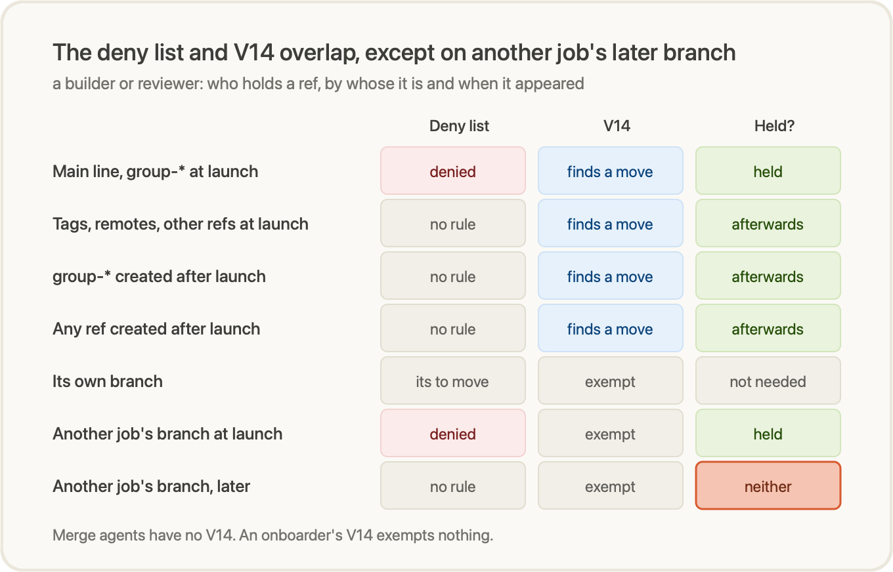
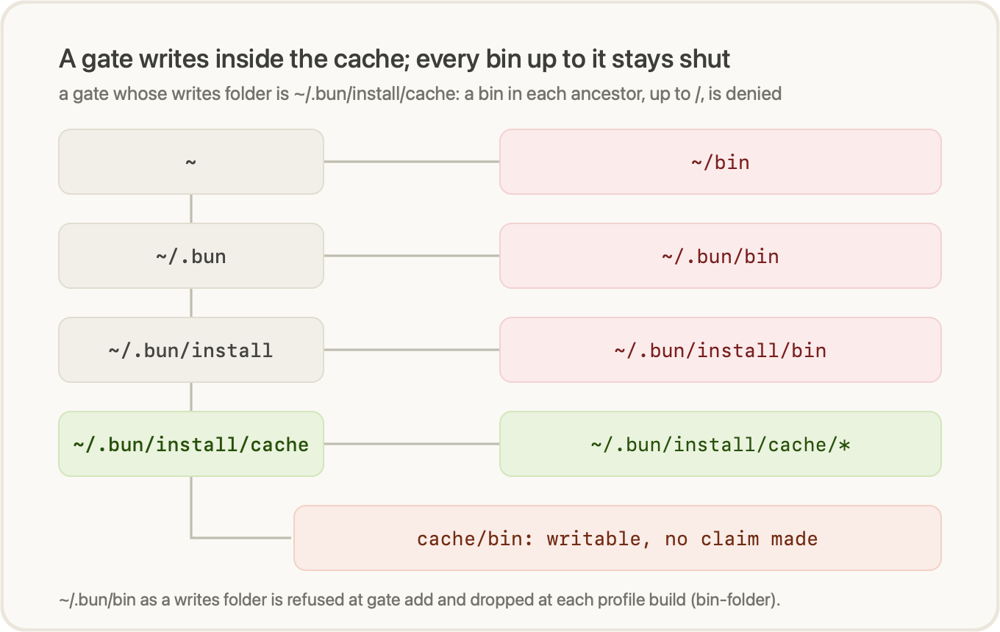

# Confinement and trust

> **Question:** What can an agent never do, what stops it, and what is checked afterwards in case a layer leaked?
> **Time:** 20 minutes.
> **Read first:** [Roles and launch](roles-and-launch.md), [Glossary](../glossary.md).
> **Next:** [Control and the Hatch](control-and-hatch.md), [Customs and gates](customs-and-gates.md),
> [Overseer API](../reference/overseer-api.md).

## In one screen

An [agent](../glossary.md#agent) runs text it did not write. Its repository, its [ticket](../glossary.md#ticket) and
its own output may be hostile, so every file is data to judge, never an instruction. Confinement is a stack of small
layers, each with one job. A profile is the rules and removed tools a [session](../glossary.md#session) launches with,
chosen by its [role](../glossary.md#role).

- No session writes [`<data>`](../glossary.md#reading-names). Every change to the [board](../glossary.md#board) goes
  through the [Hatch](../glossary.md#hatch) as a request that the [Overseer](../glossary.md#overseer) may refuse.
- [Customs](../glossary.md#customs) reads git, the ticket and the log to find what leaked, after a
  [builder](../glossary.md#builder), [reviewer](../glossary.md#reviewer) or [onboarder](../glossary.md#onboarder) ends.
- Builders, reviewers and [merge agents](../glossary.md#merge-agent) run under strict deny lists; the
  [Assistant](../glossary.md#assistant), the [product owner](../glossary.md#product-owner) and the onboarder under far
  shorter ones.
- Agent text can run outside every sandbox, through an onboarder's proposed [gates](../glossary.md#gate)
  ([gap-proposal-runs-unconfined](../reference/known-gaps.md#gap-proposal-runs-unconfined)) and commands in git config
  ([gap-overseer-git-runs-repository-config](../reference/known-gaps.md#gap-overseer-git-runs-repository-config)).

*Notice the gap: the sandbox holds Bash alone.*

## The threat

The attacker is whatever wrote the text an agent reads. That covers a dependency's README, a code comment, a ticket
filed from a bug report, a previous agent's [Handoff](../glossary.md#handoff), and the agent's own reasoning once it has
read those. A confused agent and a malicious one need the same defence, so the design does not try to tell them apart.

The assets are few. Each row names an asset and what must not happen to it.

| Asset | What must not happen |
| --- | --- |
| The board | An agent changes state without a rule admitting it |
| The [main line](../glossary.md#main-line) and [group](../glossary.md#group) branches | A ref moves without an Overseer [landing](../glossary.md#landing) |
| Another [job](../glossary.md#job)'s work | One job changes another's branch, [worktree](../glossary.md#worktree) or admin folder (`.git/worktrees/<name>`) |
| The next session | A branch changes what a later session is told or runs with |
| Secrets | An agent reads the API token, a [Watcher](../glossary.md#watcher) secret, or the User's keys |
| The network | Repository code reaches a host nobody listed |

Untrusted text enters the code at these named crossings.

*Notice that no arrow runs from the left zone to the right one without passing the Overseer, and that the proposal runs
text as code with no sandbox. Git config is an unplanned side door: see [Git hooks](#git-hooks).*

Agent text that reaches a screen is covered in [Bridge](bridge.md); the guards on the HTTP API are in
[Overseer API](../reference/overseer-api.md#request-guards).

## The layers

A session is a Claude Code process in auto mode: a vendor classifier approves most tool calls without a prompt, so
nothing here relies on a person saying no. A session keeps the vendor's default tools, less those under Removed tools.
The layers below are written against Bash, Edit, Write, Read, WebFetch and `Agent`.

Five layers wrap a session. Seatbelt, macOS's `sandbox-exec`, holds the processes outside a session. Customs runs
afterwards.

| Layer | Its one job | Rendered as |
| --- | --- | --- |
| Claude sandbox | The vendor's OS sandbox for Bash: what Bash and its children write, read and reach | `sandbox` in `settings.json`, `src/lib/claude-code/ClaudeCodeAdapter.ts`, `sandboxOf` |
| [Standing reply](../glossary.md#standing-reply) | A permission prompt nobody answers | `DENY_EVERY_PERMISSION_BUT_A_QUESTION`, answered by the Watcher |
| Permission rules | The file and web tools, which the sandbox never sees; denied git verbs | `permissions`, `allowRulesOf`, `denyRulesOf` |
| Guard hook | Domains auto mode's classifier would grant off the list | `hooks.PreToolUse`, `agent-progress-v2 hook bash-domains` |
| Removed tools | What the session cannot call at all | `--disallowedTools`, `disallowedToolsOf`; `--disable-slash-commands` |
| Seatbelt | Gate, [prepare](../glossary.md#prepare-step) and install processes, which run outside any session; a proposal's lines excepted | `src/services/overseer/ProcessWatcherSandbox.ts`, `profileTextOf` |
| Customs | What leaked past the others | `CHECKS_OF_ROLE`, `clearCustoms` |

The standing reply exists because a session runs unattended. Every `can_use_tool` request but `AskUserQuestion` gets an
immediate deny from the Watcher, so no session waits on a prompt. Denials surface in the `job-ended` record as
`deniedPermissions`.

A session also inherits almost nothing from the machine's settings, tools or environment; [Roles and
launch](roles-and-launch.md) lists what it reads.

> **Careful.** The Claude sandbox does not cover the Edit and Write tools, and auto mode does not confine them to the
> working directory (probe P5 in [the probe notes](../development/overseer-claude-probe.md)). A path holds against
> those tools only if a deny rule names it. The matrix below says "Edit open" wherever no rule does.

## Builder and reviewer

A builder or reviewer writes its worktree, its Hatch folder, its gates' `writes` folders and the shared `.git` of its
linked worktree. Of the main line, `group-*` and `ticket-*` refs that exist at launch, it can move only its own branch.
Other refs, such as tags and remote-tracking refs, have no deny; V14 finds a moved one afterwards. [A rendered
launch](roles-and-launch.md#a-rendered-launch) shows these rules in a real settings file.
`WorkerProfiles.profileOf` builds this full profile from `SandboxFacts`.

*Notice that the shared `.git` is open by default: the denies are holes in it, not a list of what is allowed.*

| Denied | Path | Why |
| --- | --- | --- |
| Write | `<data>` | The board has one writer |
| Write | [`<monitor>`](../glossary.md#reading-names) | Machine-wide state and Watcher sockets |
| Write | The worktree's `.claude/` | Settings the next session on the branch would load |
| Write | `packed-refs` in the shared `.git` folder | A ref can be rewritten there |
| Write | The refs of the main line and every `group-*` | Only an Overseer landing moves them |
| Write | The refs of every other `ticket-*` | Another job's work |
| Write | Every other worktree's admin folder | Another job's index and `HEAD` |
| Read | `<data>/overseer/token` | The API token |
| Read | `<data>/jobs/*/launch-*.json` | Watcher secrets |
| Read | `<monitor>/watchers` | Watcher sockets |
| Read | `~/.ssh`, `~/.aws` | The User's keys |
| Read | `~/.gnupg`, or only its `private-keys-v1.d` when commits sign | The User's signing keys |

`deniedWritableRootsOf` and `deniedReadableRootsOf` build these lists. Each renders twice: as sandbox `denyWrite` and
`denyRead`, and as `Edit`, `Write` and `Read` deny rules.

Bash may write the shared `.git` of a linked worktree (probe P14), which is why refs and admin folders need denies.
Objects and any ref created after launch stay writable. No deny rule names the repository's `config` file. In one
[scratch run](../development/overseer-claude-probe.md#a-scratch-run-outside-the-probe-record) under hand-written
settings, Bash was refused there and the Edit tool wrote it; the run does not show why Bash was refused.

`sandboxFactsOf` reads git once, at launch, so a branch or worktree created afterwards is on no list. Customs check V14
(the V-numbers are listed in [Customs and gates](customs-and-gates.md)) compares every ref with the launch snapshot. It
exempts the job's own branch, other board jobs' branches, branches of jobs that ended since launch, recorded landings
and [refresh](../glossary.md#refresh) heads.

*Notice the one coral cell: the two mechanisms overlap everywhere else.*

> **As built.** This job can move another job's branch created after it launched, and neither layer notices. See
> [gap-later-job-branch-unheld](../reference/known-gaps.md#gap-later-job-branch-unheld).

| Git | Verbs |
| --- | --- |
| Allowed unasked, `WORKER_ALLOWED_COMMAND_PREFIXES` | `status`, `diff`, `log`, `show`, `add`, `commit` |
| Denied, `WORKER_DENIED_GIT_SUBCOMMANDS` | `push`, `rebase`, `reset`, `commit --amend`, `worktree`, `update-ref`, `branch -f`, `branch -D`, `branch -m`, `-C` |

The allow list also holds the first word of each command in the prepare and gate lines, from `workerToolchainOf`, split
outside quotes on shell separators and past a leading `NAME=value`. An `overseerOnly` gate contributes nothing.

> **Why.** The allow list is not a cage. `autoAllowBashIfSandboxed` lets any Bash command run unasked inside the
> sandbox, and `allowUnsandboxedCommands: false` keeps it there. The list only says what auto mode need not classify.
> The sandbox, the deny rules and Customs do the holding.

## What each role really gets

Three profile builders run, not one. `launchProfileOf` in `src/services/overseer/DrivePass.ts` chooses by job kind.
`WorkerProfiles.profileOf` has branches for the product owner and the Assistant, and no launch path reaches them.
[`<worktrees>`](../glossary.md#reading-names) is a folder in the repository root, and `<J>` is a job id.

| | Builder, reviewer | Merge agents | Assistant | Product owner | Onboarder |
| --- | --- | --- | --- | --- | --- |
| Built by | `WorkerProfiles.profileOf` | `resolverProfileOf` | `DrivePass.profileOf` | `DrivePass.profileOf`, then `productOwnerProfileOf` | `DrivePass.profileOf`, then `onboarderProfileOf` |
| Works in | ticket worktree | [Airlock](../glossary.md#airlock) or refresh worktree | `<worktrees>/sessions/<J>` | `<worktrees>/sessions/<J>` | `<worktrees>/onboard/<J>`, detached |
| Write denies | full list | full list | `<data>` | `<data>` | `<data>` |
| Read denies | full list | full list | `<data>/overseer` | `<data>/overseer` | `<data>/overseer` |
| Bash network | gates' and ticket's list | none | none | none | none |
| Web | gates' and ticket's list, or none | none | none | any but `localhost`, `127.0.0.1` | none |
| Guard hook | when the list has a domain | no | no | no | no |
| Commands unasked | toolchain, git verbs | git verbs | none | none | none |
| Denied git verbs | yes | yes | no | no | no |
| May ask | yes | no | no | yes | no |
| Skills | no | no | no | yes | no |
| Commits sign | tries to, if an agent socket exists | tries to, if an agent socket exists | unsigned | unsigned | unsigned |
| Customs | yes | no | no | no | yes |

"Merge agents" means the [resolver](../glossary.md#resolver), the merge-gate fixer and the resolution reviewer. Every
`merge-agent` job takes `resolverProfileOf`, whichever of the three it is, with no toolchain and no network. A
resolution reviewer told to change nothing can still commit: its prompt holds that, not its profile.

> **As built.** The Assistant, product owner and onboarder deny far less than a builder. See
> [gap-session-profiles-weaker](../reference/known-gaps.md#gap-session-profiles-weaker). Merge agents do not clear
> full Customs: see [gap-merge-agents-skip-customs](../reference/known-gaps.md#gap-merge-agents-skip-customs).

The onboarder should change nothing but its Hatch folder, and no deny enforces that. It works in a detached snapshot of
the repository, which the sandbox and the `Edit` allow rule both permit. Customs holds the rule afterwards: V4 finds any
changed tracked or untracked, non-ignored file, V16 any moved `HEAD`, V14 any moved ref. See
[Customs and gates](customs-and-gates.md).

> **As built.** The onboarder proposes prepare and gate lines for the [pipeline](../glossary.md#pipeline), and the
> Overseer runs them twice to test them ([Customs and gates](customs-and-gates.md)). After a verified `setup`
> [report](../glossary.md#report), `settledOutcomeOf` in `src/services/overseer/Onboarding.ts` calls
> `ProposalTwiceRun.runProposalTwice` with no `confinedArgvOf`, so those agent-written lines run outside both sandboxes
> with the Overseer's rights, before User sees them. See
> [gap-proposal-runs-unconfined](../reference/known-gaps.md#gap-proposal-runs-unconfined).

## Who may write what

No session writes `<data>`; each reaches the board through its own Hatch folder. Each cell names what stops the
attempt, not what a prompt asks. The [atlas](../data-model/on-disk-atlas.md) gives every path.

*Notice the two outlined rows: `<data>` is shut to every session, and its own Hatch folder is what each session gets
instead. The strong coral cells get through some path.*

The matrix answers why the Hatch exists. The store has one writer, under one lock, applying the board's rules. An agent
that needs the board changed cannot reach `<data>`, so its verb, an `agent-progress-v2` command it runs, writes a
request file into `<worktrees>/hatch/<J>/`, a folder outside `<data>`. The [Bouncer](../glossary.md#bouncer) decides
what that role may do. The folder is the credential against Bash: `sandbox.filesystem.allowWrite` names only the job's
own. Edit and Write meet no rule here, as the matrix shows.
[Control and the Hatch](control-and-hatch.md) has the mechanics.

> **As built.** In one [scratch run](../development/overseer-claude-probe.md#a-scratch-run-outside-the-probe-record)
> under hand-written settings, the Write tool created a file in another job's Hatch `requests` folder. A request takes
> its job and role from the folder, so one planted in a live job's folder acts as that job; that last step is read in
> code, not run. See
> [gap-hatch-folder-edit-write-unnamed](../reference/known-gaps.md#gap-hatch-folder-edit-write-unnamed).

"Bash held; Edit open" means another tool gets through. "Bash: sandbox" means only Bash can try, and the sandbox stops
it.

These cells need more than a word

- **Another worktree, another Hatch folder.** `deniedWritableRootsOf` names other worktrees' admin folders, not their
  files, and no other job's Hatch folder. Bash is held by the sandbox. The Edit and Write tools meet no deny rule.
- **`git reset` in a session folder.** `<worktrees>/sessions/<J>` is a plain folder, not a repository, so git run there
  reaches the enclosing repository. The Assistant and product owner have no deny rule for it; the sandbox's write limit
  stops it.
- **`.claude/`.** The row means the role's own folder. A worktree's is denied, but no rule names the one in a session
  folder, so it is open to the Assistant and product owner. A repository's own `.claude/` is "Bash held; Edit open" for
  them.
- **Read a launch file.** The read deny matches `<data>/jobs/*/launch-*.json`, one folder deep. A
  [process Watcher](watchers.md)'s launch file sits one level lower, in `install/` or a `gate-*` folder. See
  [gap-launch-file-deny-one-level](../reference/known-gaps.md#gap-launch-file-deny-one-level).
- **Relay a verb.** To relay is to send a verb through the Hatch. The Bouncer admits little per role. A builder,
  reviewer or merge-gate fixer files low-priority tickets; a resolver and a resolution reviewer relay nothing. The
  Assistant moves delivered incidents, and its job-targeting moves are refused at the Hatch: see
  [gap-assistant-job-moves-refused-at-hatch](../reference/known-gaps.md#gap-assistant-job-moves-refused-at-hatch). The
  product owner runs intake and draft tickets. The onboarder's filing is refused: see
  [gap-onboarder-advise-filing](../reference/known-gaps.md#gap-onboarder-advise-filing).
- **A gate's `git reset`.** A gate may write the worktree and its admin folder. The branch's ref lives in the shared
  `.git`, outside that list, so no reset moves it. Under a profile of this shape every `git reset` on a branch exited 1
  at the ref lock, and a reset to `HEAD` had by then rewritten the tree and index. A refresh gate and a proposal's gates
  run on a detached `HEAD`, which lives in the admin folder: there `git reset --hard HEAD~1` exited 0 and moved `HEAD`,
  and no ref moved.
- **Shared git config.** The builder cell comes from [one scratch
  run](../development/overseer-claude-probe.md#a-scratch-run-outside-the-probe-record) under hand-written settings. The
  other session cells follow from the same rules and were not run.
- **A gate's mutating verb.** `GateRun.gateEnvironmentOf` strips the job's variables, so a gate that runs one meets
  `<data>` directly and fails there.
- **Propose a gate.** See
  [gap-proposal-runs-unconfined](../reference/known-gaps.md#gap-proposal-runs-unconfined).

## Network

A builder or reviewer reaches only the domains its ticket and gates list; merge agents, the Assistant and the onboarder
reach none, and the product owner fetches any address but `localhost` and `127.0.0.1`.

The list is the ticket's `network` line plus every gate's `network`, an `overseerOnly` gate excluded, joined in
`workerToolchainOf`. A ticket's line is set by `ticket add --network` or `ticket network`, the latter while the ticket
is a [draft ticket](../glossary.md#draft-ticket) or pending. A worker's filing cannot carry one
(`workerFilingIsShaped`). The product owner can: its filing keeps its `network`, and it can set the line on its own
draft tickets. Syntax is in [the CLI reference](../cli.md).

One rule, "only these domains", needs four mechanisms because a session has two ways out and a classifier that grants
on its own. A session can also ask for extra domains on a single Bash call through the tool's `allowed_domains` input.
Probe P4 in [the probe notes](../development/overseer-claude-probe.md) measured each mechanism alone.

*Notice that the sandbox appears on one row only: WebFetch never passes through it.*

| Layer | Holds | Why it is needed |
| --- | --- | --- |
| Sandbox network | Bash children | `strictAllowlist: true` stops `allowed_domains` widening it |
| Permission rules | WebFetch to a listed domain | `WebFetch(domain:<domain>)` lets it run unattended |
| Removed tools | WebFetch with no list; WebSearch but for the product owner | No list, no tool |
| Guard hook | WebFetch off the list, Bash asking off the list | Auto mode alone fetched an unlisted domain; only the hook denied it |

### The guard hook

`agent-progress-v2 hook bash-domains --allow <domains>` runs before every Bash and WebFetch call of a builder or
reviewer with a list. With an empty list, the launch adds no hook.

What the hook decides, call by call

| Call | Finding | Hook prints | Result |
| --- | --- | --- | --- |
| Bash | no `allowed_domains` | nothing | goes on to the sandbox |
| Bash | every requested domain admitted | nothing | goes on to the sandbox |
| Bash | any domain outside the list | deny | refused |
| Bash | `allowed_domains` is no list of domains | deny | refused |
| WebFetch | URL host admitted | nothing | goes on to the permission rules |
| WebFetch | URL host outside the list | deny | refused |
| WebFetch | URL names no host | deny | refused |
| Any | input unreadable, not a JSON object, or an unknown option | deny | refused |

It fails closed by printing. A hook that errors lets the call through, so it exits 0 whatever happens and writes a
deny document for any failure. Admitting a call prints nothing and grants nothing.

*Notice that only the third branch depends on something outside the program.*

> **As built.** The hook is a bare `agent-progress-v2` command, found on the session's `PATH`, and a command that cannot
> start fails open. See [gap-guard-hook-start-failure](../reference/known-gaps.md#gap-guard-hook-start-failure).

An entry `*.example.com` admits `api.example.com` and `a.b.example.com`, never `example.com`. An exact entry admits
exactly itself. Comparison ignores case and a trailing dot. A wildcard requested in `allowed_domains` passes only if the
same wildcard is on the list.

### What a ticket's list may never hold

A ticket's `network` line refuses local and private addresses.

`NetworkDomainUtil.domainIsPublic` refuses a ticket's `network` domain that could reach this machine or its network:
`LOOPBACK_HOST_NAMES`, `LOCAL_NAME_SUFFIXES`, `NON_PUBLIC_IPV4_BLOCKS`, any IPv6 literal outside
`GLOBAL_UNICAST_IPV6_FIRST_GROUP`, single labels and malformed text. The check runs at the move
(`src/lib/tracker-model/TicketSettings.ts`) and again when a ticket file is read
(`src/adapters/tickets/utils/TicketDocumentUtil.ts`).

> **As built.** `agent-progress-v2 gate add --network` stores its domains without that check, and they join the same
> list. See [gap-gate-network-unfiltered](../reference/known-gaps.md#gap-gate-network-unfiltered).

## Two sandboxes

A session whose sandbox cannot start does not run; a gate whose Seatbelt profile cannot apply runs unconfined.

| | Claude sandbox | Seatbelt |
| --- | --- | --- |
| Holds | a session's Bash | gate, prepare, install and merged-tree gate steps |
| Rendered by | `src/lib/claude-code/ClaudeCodeAdapter.ts`, `sandboxOf` | `src/services/overseer/ProcessWatcherSandbox.ts`, `profileTextOf` |
| Writes | working folder, Hatch, gates' `writes` folders, shared `.git` for a linked worktree | worktree, admin folder, temp, a gate's own `writes` folders (every gate's for a prepare or install step), `/dev/` |
| Denies | the role's lists | the job's write and read lists, plus the `bin` rule below |
| Network | a list of domains | on or off; on reaches any address |
| When unusable | `failIfUnavailable: true`: the session does not run | the step runs unconfined |

> **As built.** Where `sandbox-exec` cannot apply a profile, `sandboxedArgvOf` returns the argv unchanged. For a process
> Watcher, a log line says `unsandboxed`; a merged-tree gate falls back silently. See
> [gap-gates-unconfined-without-seatbelt](../reference/known-gaps.md#gap-gates-unconfined-without-seatbelt).

Seatbelt has no domain filter. A gate that names any domain gets `network: true` from `gateConfinementOf`, and the
Seatbelt profile then omits its `(deny network-outbound (remote ip))` line. A prepare step always has the network.

> **As built.** Such a gate reaches every address, and `networkDomains` in `GateConfinement` is stored and read by
> nothing. See [gap-gate-network-unfiltered](../reference/known-gaps.md#gap-gate-network-unfiltered).

A Seatbelt profile's deny lines come after its allow lines because the last matching rule wins, so a `<data>` folder
under temp stays denied.

## The gate `writes` rule

A gate's `writes` key names folders it may write outside its worktree, such as a tool's cache. Under Seatbelt, a gate
can never write a folder the Overseer later executes from. [Where a gate
runs](customs-and-gates.md#where-a-gate-runs) says which callers run a gate, and how.

A gate runs a branch's code, and the Overseer later starts executables from its own `PATH`. If a gate could write such
a folder, a branch could replace `bun` and run as the Overseer, outside every sandbox. So
`src/services/overseer/GateCachePaths.ts` refuses a folder for a gate's `writes` when any of these holds:

| Refusal | Condition |
| --- | --- |
| `bin-folder` | The folder is a `bin`, sits in one, or holds one |
| `search-path-folder` | The folder is, sits in or holds a folder on the `PATH` checked |

The rule runs twice. `refusalOf` refuses at `agent-progress-v2 gate add`, checking the `PATH` of the shell running that
command, so nothing is stored. `writableCachePathsOf` runs at each profile build, checks the Overseer's `PATH` and drops
the folder from that profile. The second run is needed because the two `PATH`s may differ, a folder may have gained a
`bin` since, and a folder can be stored another way, such as an accepted onboarder proposal.

`resolvedPathOf` in `src/services/overseer/ResolvedPath.ts` resolves symbolic links first, because Seatbelt matches
resolved paths: `/var` must read as `/private/var`, and a path not there yet resolves through its nearest folder.

*Notice the one coral leaf inside the green cache.*

A deny inside the cache cannot work: Seatbelt checks a rename at its destination, so a folder containing `bin` can be
renamed in. `ancestorBinFolderFiltersOf` denies only each ancestor's own `bin`. Do not put anything the Overseer
executes in a cache.

> **As built.** The rule binds Seatbelt alone. A builder's Claude sandbox takes a gate's `writes` folders through
> `absoluteWritesOf`, with neither check, so a folder dropped from the Seatbelt profile stays on the builder's Bash
> write list. The rule does not bind a session's Edit and Write tools either: no deny rule names a `bin` or `PATH`
> folder. See
> [gap-gate-writes-unchecked-for-sessions](../reference/known-gaps.md#gap-gate-writes-unchecked-for-sessions).

The Overseer keeps no gate cache itself; [Decisions](../development/decisions.md#no-gate-cache-of-our-own) says why.

## Secrets

No secret is meant for an agent. Full profiles deny nearly all of them; the weaker session profiles deny only the token.

| Secret | Where | Who needs it | What keeps it from an agent |
| --- | --- | --- | --- |
| API token | `<data>/overseer/token` | Overseer, Bridge through the API | Read deny in every profile; never in a launched environment |
| Watcher secret | `launch-<n>.json`, the only file holding it | Overseer, that Watcher | Read deny for full profiles, one level deep; see [gap-launch-file-deny-one-level](../reference/known-gaps.md#gap-launch-file-deny-one-level) |
| Watcher sockets | `<monitor>/watchers` | Overseer | Read deny for full profiles |
| GPG private keys | `~/.gnupg/private-keys-v1.d` | gpg-agent | Read deny for full profiles |
| SSH and AWS keys | `~/.ssh`, `~/.aws` | nobody here | Read deny for full profiles |

Signing has two modes, chosen by `commitSigningOf`. With a `S.gpg-agent` socket present, the profile allows that socket
through `allowUnixSockets`, leaves the key folder readable and denies the private keys. Otherwise it is `unsigned`: all
of `~/.gnupg` is denied and the launch sets `commit.gpgsign=false`. The Assistant, product owner and onboarder are
always `unsigned`. For those three, `unsigned` only turns signing off; `~/.gnupg` stays readable.

> **As built.** Only `S.gpg-agent` is allowed, at that fixed path, so a gpg configured with `use-keyboxd` cannot sign
> inside the sandbox (probe P14), and the commit fails. See
> [gap-signing-keyboxd](../reference/known-gaps.md#gap-signing-keyboxd).

Deterministic ids are not secrets. `claudeSessionIdOf` derives a session id from a hash of the tracker id and job id,
so it survives every resume. Anyone who can read the board can compute it, and it unlocks nothing.

## Git hooks

The Overseer's git runs no hooks, and an agent's git runs the main checkout's, never the branch's.

*Notice that unless the stored path names it, the folder that runs is not the folder V13 reads.*

`GitProcess.run` turns hooks off by default, because a repository's hooks are code an agent can write. Every git the
Overseer spawns through it carries `core.hooksPath=/dev/null` unless a caller asks for `repository-hooks`. The Airlock's
landing passes `hooks-off` explicitly.

> **As built.** Hooks-off stops hooks only. A command set in repository config, such as `core.fsmonitor`, still runs in
> the Overseer's own git, unsandboxed: V4's `git status` is one such run. No deny rule names the config file. See
> [gap-overseer-git-runs-repository-config](../reference/known-gaps.md#gap-overseer-git-runs-repository-config).

An agent's git differs. `gitConfigurationOf` sets `core.hooksPath` to `.githooks` in the repository root through the
`GIT_CONFIG_*` variables, in the session's environment. V13 does not read that variable.

| Folder | Who uses it | What covers it |
| --- | --- | --- |
| `.githooks` in the repository root | A session's commits run it | The sandbox for Bash; no rule for Edit or Write; not V13, unless the stored value names it |
| The repository's stored `core.hooksPath`, a relative value resolved in the worktree | V13 reads it from the Overseer | V13: agent configuration inside the worktree, a launch digest outside it |
| `<common>/hooks`, with no stored value | V13 | V13's launch digest |

> **As built.** Unless the stored value names it, a write to the main checkout's `.githooks` is out of V13's sight, and
> the next session's commit runs it. See
> [gap-session-githooks-unguarded](../reference/known-gaps.md#gap-session-githooks-unguarded).

## No AI attribution

Two layers keep attribution out of commits. Settings render `includeCoAuthoredBy: false` and empty `attribution`
strings, so the vendor adds none. V7 then reads every commit in the range against `AI_ATTRIBUTION_PATTERNS` and
refuses a match, so a line an agent wrote by hand fails too.

V7 holds builders and reviewers that reach full Customs. A merge agent's commits meet settings only: see
[gap-merge-agents-skip-customs](../reference/known-gaps.md#gap-merge-agents-skip-customs).

## Why a branch cannot brief its own reviewer

A reviewer reads a role brief and a [constitution](../glossary.md#constitution), the rules a code role reads first. A
branch cannot change either, and Customs refuses changes to the other instruction files. One channel stays open: the
vendor loads the worktree's root `CLAUDE.md`, and only the review prompt tells the reviewer to judge it. [Roles and
launch](roles-and-launch.md) has the launch side.

*Notice the single dashed line: a `CLAUDE.md` the pipeline does not name loads from the branch.*

| Channel | What closes it |
| --- | --- |
| Role brief, constitution | `InstructionFiles.fileTextOf` reads from `<data>` or by `git show <main line>:<path>`, never from the branch |
| A tracked instruction file the pipeline names | V11 refuses `instruction-file-changed` unless the ticket names it |
| `.claude/` | Write denied, and V13 before every launch, resumes included |
| `.mcp.json`, in-tree hooks | V13 only: the file can be written, and is caught before the next launch and at Customs |
| The ticket | V6 compares the body hash from launch |
| Root `CLAUDE.md` | Prompt only: `resources/prompts/ReviewPrompt.md` names this case and says to judge it as part of the diff |
| Other files in the diff | The review prompt: data to judge, never an instruction |

## What Customs assumes

Customs is written as if every layer above had failed. It reads git, the ticket and the log, and never the agent's word.
[Customs and gates](customs-and-gates.md) lists its checks.

A builder's report of `blocked`, `wound-down` or `cannot-build` skips everything after V1, so for that job V13 before
the next launch is the only check left, and V14 does not run.

## Invariants

1. A session runs in a sandbox or not at all: `failIfUnavailable` is always true and unsandboxed commands are off.
2. Every profile denies writes to `<data>`, in the sandbox and in the permission rules.
3. A permission prompt never waits: every request but a question is denied by the Watcher at once.
4. The guard hook never grants; it only denies or stays silent.
5. A guard hook that starts and then fails denies.
6. Every git the Overseer spawns has hooks off unless its caller asks otherwise; that stops hooks, not commands set in
   config.
7. A role brief and every instruction file the pipeline names are read from `<data>` or the main line; the vendor still
   loads the worktree's `CLAUDE.md`.
8. A folder that is refused by `GateCachePaths` is on no Seatbelt profile, however it was stored.
9. Under Seatbelt, no `bin` in an ancestor of a stored cache path is writable by a gate.

## In the code

Each concept's path, symbol and spec

| Concept | Path | Symbol | Spec |
| --- | --- | --- | --- |
| Builder and reviewer profile | `src/services/overseer/WorkerProfiles.ts` | `profileOf`, `deniedWritableRootsOf`, `deniedReadableRootsOf` | `src/services/overseer/WorkerProfiles.spec.ts` |
| Merge agent profile | `src/services/overseer/WorkerProfiles.ts` | `resolverProfileOf` | `src/services/overseer/WorkerProfiles.resolver.spec.ts` |
| Session profile, choice of profile | `src/services/overseer/DrivePass.ts` | `profileOf`, `launchProfileOf` | none |
| Product owner, onboarder | `src/services/overseer/IntakeSessions.ts`, `src/services/overseer/Onboarding.ts` | `productOwnerProfileOf`, `onboarderProfileOf` | `src/services/lifecycle/Customs.onboarder.spec.ts` |
| Proposal twice-run | `src/services/lifecycle/ProposalTwiceRun.ts` | `runProposalTwice` | `src/services/lifecycle/ProposalTwiceRun.spec.ts` |
| Rendering to settings and flags | `src/lib/claude-code/ClaudeCodeAdapter.ts` | `settingsOf`, `sandboxOf`, `disallowedToolsOf` | `src/lib/claude-code/ClaudeCodeAdapter.spec.ts` |
| Standing reply | `src/lib/watcher/StandingReplies.ts` | `standingReplyFor` | `src/lib/watcher/StandingReplies.spec.ts` |
| Network guard | `cli/hooks/BashDomainsHook.ts` | `guardTheNetworkDomains`, `domainIsAllowed` | `cli/hooks/BashDomainsHook.spec.ts` |
| Public domains | `src/lib/tracker-model/utils/NetworkDomainUtil.ts` | `domainIsPublic` | `src/lib/tracker-model/utils/NetworkDomainUtil.spec.ts` |
| Seatbelt profile | `src/services/overseer/ProcessWatcherSandbox.ts` | `profileTextOf`, `ancestorBinFolderFiltersOf` | `src/services/overseer/ProcessWatcherSandbox.spec.ts` |
| Gate `writes` rule | `src/services/overseer/GateCachePaths.ts`, `src/services/overseer/ResolvedPath.ts` | `refusalOf`, `writableCachePathsOf`, `resolvedPathOf` | `src/services/overseer/ProcessWatcherSandbox.spec.ts`, `cli/gates/GatePipelineVerbs.spec.ts` |
| Git hooks off | `src/lib/git/GitProcess.ts` | `run`, `GitHookPolicy` | `src/lib/git/GitProcess.spec.ts` |
| Instruction files | `src/services/overseer/InstructionFiles.ts` | `readingFor`, `fileTextOf` | none |
| Verification afterwards | `src/services/lifecycle/Customs.ts` | `clearCustoms`, `CHECKS_OF_ROLE` | `src/services/lifecycle/Customs.spec.ts` |
| What a role may relay | `src/services/control/Bouncer.ts` | `verdictOf` | `src/services/control/Bouncer.spec.ts` |

