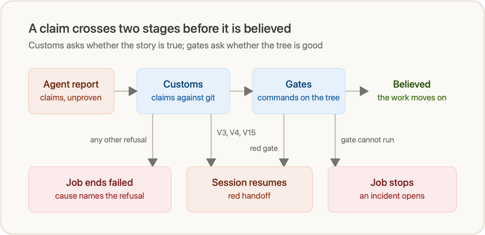
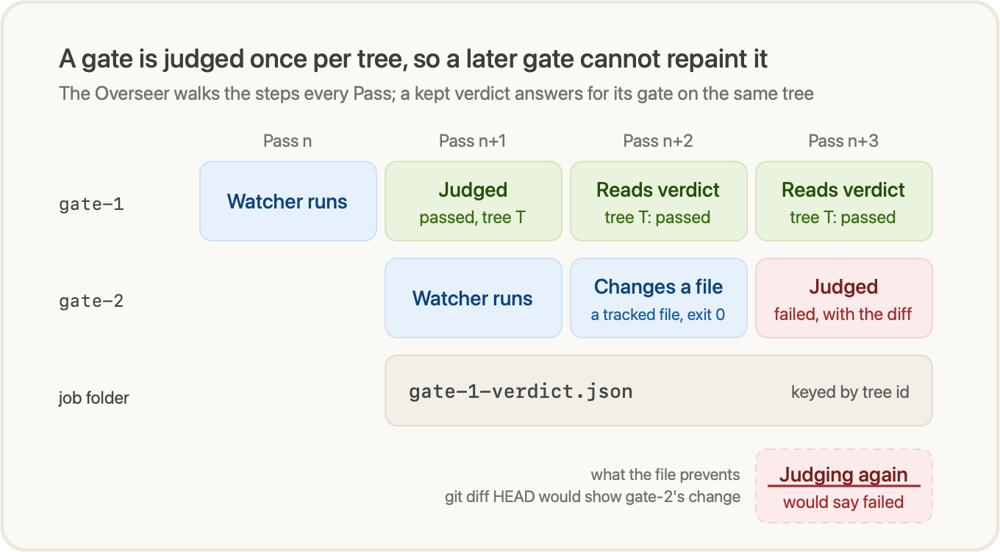

# Customs and gates

> **Question:** What exactly is checked before a claim is believed, and how do a repository's gates plug in?
> **Time:** 30 minutes.
> **Read first:** [Build and review](build-and-review.md), [Glossary](../glossary.md).
> **Next:** [Confinement](confinement.md), [Airlocks and groups](airlocks-and-groups.md), [CLI reference](../cli.md).

## In one screen

An agent ends a [session](../glossary.md#session) with a [report](../glossary.md#report). Nothing in it is taken as
true. Two stages stand between the report and any move on the [board](../glossary.md#board).

[Customs](../glossary.md#customs) compares what the agent says with what git, the [ticket](../glossary.md#ticket) and
the [log](../glossary.md#log) record. It runs code, no agent, and needs no knowledge of the repository's language.
[Gates](../glossary.md#gate) run the repository's own commands on the committed tree and read two things: the exit code
and whether a tracked file changed.

Customs catches a false story. Gates catch a bad tree. Customs runs first because it is cheap and because a tree whose
report lies is not worth gating.

A repository plugs in through one file, `pipeline.json`, its [pipeline](../glossary.md#pipeline). The `gate` verbs write
it, or User's Apply of a [setup record](../glossary.md#setup-record) designed with the
[pipeline agent](../glossary.md#pipeline-agent), the agent that reads a repository and proposes its pipeline. A gate is
an opaque shell line that runs in one or more [gate phases](../glossary.md#gate-phase): build, review and merge. Until
that file exists, no ticket work launches.

*Notice that only three Customs checks, numbered V3, V4 and V15 below, hand the work back to the agent: no commit, a
dirty worktree and an unclaimed gate, all of which it can put right in its own [worktree](../glossary.md#worktree).*

## Why two stages

The two stages answer different questions, so neither can stand in for the other.

| | Customs | Gates |
| --- | --- | --- |
| Question | Is the story true? | Is the tree good? |
| Reads | The report, git, the ticket body, the log | An exit code and `git diff HEAD` |
| Knows the stack | No | No: the repository's commands know it |
| Runs where | On the [Overseer](../glossary.md#overseer), in a [lock hold](../glossary.md#lock-hold) | In a [Watcher](../glossary.md#watcher) or the Overseer's process |
| Cost | Git commands | As long as the repository's commands take |
| Trusts the report | Tests it | Never reads it |

A builder also runs the gates itself and claims each one in its report. That claim buys nothing: check V15 only compares
the claim with HEAD, and the Overseer then runs the gates of the job's phase again. An agent's green run is never a gate result.

> **Why.** A report is written by the party being judged. Customs turns each claim into something git can answer, and
> a gate result comes from a process the agent did not start, on a tree it can no longer change.

## Customs

A [role](../glossary.md#role) owes a column: an ordered list of checks. `clearCustoms` walks the column in order and
stops at the first [refusal](../glossary.md#refusal), so the Overseer acts on one reason. A check answers passed, or a
reason code with facts and no prose; the facts are paths, commits or labels.

![Sixteen checks V1 to V16 against four roles. Builder, reviewer and pipeline agent columns run through clearCustoms in production; the pipeline agent's is V16, V4, V5, V13 and V14, at each turn end, and its refusal opens setup-snapshot-touched while the session goes on. The airlock-agent column is declared but no production path runs it; the Airlock runs V10 alone by hand through MergeRun.resolutionIsSound, and a refusal there refuses the merge. V3, V4 and V15 for a builder and V4 for a reviewer resume the same session.](../figures/customs-and-gates/customs-matrix.png)

*Notice the hatched column: `CHECKS_OF_ROLE` declares it, and no production path walks it.*

Each role's column, in run order

| Role | Column (`CHECKS_OF_ROLE`) | Reached by |
| --- | --- | --- |
| `builder` | V1, V2, V3, V4, V5, V6, V7, V8, V11, V13, V14, V15 | `clearCustoms` |
| `reviewer` | V1, V2, V4, V5, V6, V7, V8, V9, V11, V12, V13, V14 | `clearCustoms` |
| `pipeline-agent` | V16, V4, V5, V13, V14 | `clearCustoms`, at each turn end, on the snapshot |
| `airlock-agent` | V1, V2, V3, V4, V5, V6, V7, V10, V11, V13, V14 | V10 alone, by hand, on a conflict |

Every column runs in check order except the pipeline agent's, which runs V16 first. The pipeline agent owes no report,
so its column has no V1: it checks only that the snapshot stayed as it was.

What an agent says it did is checked; what it judges or chooses is not. A builder's `outcome` and a reviewer's claim
results are validated by V1 and then taken as given.

### The sixteen checks

Each check turns one claim or one rule into a git or log question. The table gives each check for a build or review
[job](../glossary.md#job); a pipeline agent's refusal is handled as [Customs at each turn
end](#customs-at-each-turn-end) says.

The range is the commits since `start`, the HEAD recorded when the job launched. V10 also leaves out what the
[target](../glossary.md#target) tip already contains. Each `failed` job on a ticket counts as a
[failed pass](../glossary.md#failed-pass) towards [parking](../glossary.md#park). `<data>` and the other folder names
are in the glossary's [Reading names](../glossary.md#reading-names).

*Notice that the commit checks do not share one window: V3 forgives a retry the commits of its failed attempts, and V13
alone adds the worktree to its commits, on a Pass from the merge base.*

| Check | Function | Refusal reason | What it stops | The refusal leads to |
| --- | --- | --- | --- | --- |
| V1 | `reportIsValidWithItsHead` | `report-invalid`, `head-not-reported` | A report that breaks its schema, or describes a commit that is not HEAD | Job `failed`; cause `no-report` for `report-invalid` |
| V2 | `headDescendsFromTheStart` | `history-rewritten` | A reset or rebase that drops the commit the job started from | Job `failed` |
| V3 | `aCommitSinceTheStart` | `no-commit-since-start` | A `built` report with no new commit; other builder outcomes owe none. A retry measures from the start of the [failed attempts](../glossary.md#attempt) it retries (`retriedFailedBuildJobIdOf`) | [Red handoff](../glossary.md#red-handoff) |
| V4 | `worktreeIsClean` | `worktree-dirty` | Uncommitted or untracked work in the worktree that the gates would never judge | Red handoff |
| V5 | `dataFolderUntouched` | `data-folder-touched` | A commit changing `<data>`, even one undone later | Job `failed` |
| V6 | `ticketBodyUnchanged` | `ticket-body-changed` | Work against a body that differs from the one hashed at launch | Job `failed` |
| V7 | `noAiAttributionInRange` | `ai-attribution-in-range` | A commit message with a `Co-Authored-By: Claude` trailer, or the words `generated with` anywhere, matched without regard to letter case | Job `failed`, cause `attribution`, and the `attribution-found` [notice](../glossary.md#notice) |
| V8 | `everyAcceptanceItemAccountedFor` | `acceptance-without-evidence` | An unwaived [Acceptance](../glossary.md#acceptance) item with no evidence or [waiver](../glossary.md#waiver) proposal (builder) or no claim (reviewer) | Job `failed` |
| V9 | `fixedFindingsNameCommitsInRange` | `fixed-finding-outside-range` | A [finding](../glossary.md#finding) reported fixed by a commit outside the range | Job `failed` |
| V10 | `mergeIsResolved` | `merge-unresolved` | Unmerged paths, whitespace errors in conflicted files, or a merge commit with the wrong parents | The [Airlock](../glossary.md#airlock) refuses the merge; see below |
| V11 | `checksDefinitionUnchanged` | `checks-definition-changed`, `instruction-file-changed` | A branch rewriting a file a gate names in `definedBy`, the gate's list of files that define what it runs, or a tracked instruction file, that its ticket body does not name. An instruction file counts only where the branch changed it itself: a change that a merge of the job's target brought in, such as a constitution commit, does not. With no `definedBy` named, a branch may rewrite what a gate runs | Job `failed` |
| V12 | `filedFindingsWereFiledByThisJob` | `finding-not-filed-by-job` | A claimed filing that is not this job's low [draft ticket](../glossary.md#draft-ticket) | Job `failed` |
| V13 | `agentConfigUntouched` | `branch-touches-agent-config` | A change to `.claude/`, `.mcp.json` or the hooks folder | Job `failed`, and the `branch-touches-agent-config` [decision](../glossary.md#decision) unless one is open or already answered for this hit |
| V14 | `onlyOwnRefsMoved` | `foreign-ref-moved` | A session moving a ref that is not its own | Job `failed` |
| V15 | `everyAgentGateClaimedOnHead` | `gate-unclaimed` | A gate not claimed on HEAD itself, a stale claim included | Red handoff |
| V16 | `headUnmoved` | `head-moved` | A pipeline agent commit; it reads and changes nothing | The `setup-snapshot-touched` incident; Apply refuses |

### Routing a refusal

`verifyAndRoute` in `src/services/overseer/JobLaunch.ts` decides what a refusal leads to, for build and review jobs.

- V1 runs alone first. Only a report that passes it is read for `outcome`, so `blocked`, `wound-down` and
  `cannot-build` route to their own endings without the rest of the column.
- `RESUMABLE_CUSTOMS_CHECKS` lists V3, V4 and V15: what a resumed session can put right in its own worktree. Those
  refusals write a red handoff. The order of attempts is the rework ladder in [Build and review](build-and-review.md).
- Any other refusal ends the job `failed`, its cause the reason, except V7, whose cause is `attribution`.
- A missing job start or ticket ends the job `failed` with cause `git-failed` before Customs runs.

Every check but one fails closed. A git command that fails refuses with `git-failed` and names what it tried, so no
broken repository reads as clean. V2 and V10 give their own reason in that case. V7 is the exception: after `rev-list`
has listed the range it reads each commit message separately and skips one it cannot read, so that message goes
unscanned. Routing is by check, not reason: `git-failed` from V3, V4 or V15 is a red handoff too.

> **As built.** `clearCustoms` runs for build, review and pipeline agent jobs only. Airlock agents never reach it; the
> Airlock takes their report's `outcome` as given. See
> [gap-merge-agents-skip-customs](../reference/known-gaps.md#gap-merge-agents-skip-customs).

For an Airlock agent that resolved a conflict the Airlock calls one check by hand: `MergeRun.resolutionIsSound` runs
V10 and nothing else, and a failure refuses the merge. V10 reads no report field itself, but `resolutionIsSound` passes
it the report's `resolvedFiles` as the conflicted files, so the whitespace check covers only what the agent listed. An
Airlock agent that fixed a red merged tree gets no check at all. What the Airlock then does is in
[Airlocks and groups](airlocks-and-groups.md).

### V13 before every launch

V13 is the one check that also runs before a session starts, because a branch that changed the agent's own settings or
hooks would take effect on the next launch, before any report exists.

*Notice that the check before a launch has no report to go on: it reads only git.*

On every [Pass](../glossary.md#pass), the Overseer runs V13 for each live build and review job
(`ticketIdsTouchingAgentConfigOf`, outside the lock). It compares the branch's commits past the merge base with its
target, plus the worktree as it stands. A hit opens the decision once.

> **As built.** V13 does not see a write to the main checkout's `.githooks`:
> [gap-session-githooks-unguarded](../reference/known-gaps.md#gap-session-githooks-unguarded).

While that decision is open the [Playbook](../glossary.md#playbook) launches and resumes nothing on the ticket, and the
job stays off `jobsNeedingAWatcher`, so no Watcher is spawned. This is an open decision, not a
[ticket hold](../glossary.md#ticket-hold).

The end-of-job V13 adds one case. A hooks folder outside the worktree cannot show in a diff, so `launchSnapshotOf`
digests it at first launch and V13 compares the digests. The decision's answers are in
[Questions and incidents](questions-and-incidents.md).

### How V14 knows which moves are allowed

V14 compares every ref and detached HEAD with the launch snapshot in `start.json`. Without a snapshot it refuses, since
nothing proves no ref moved. The allowance comes from board state and the log, never from the report.

What a build or review job may see move

| Ref | Exempt when | Source in `refMovesAllowedOf` and its caller |
| --- | --- | --- |
| The job's own branch and own detached HEAD | Always | `ownBranch` |
| Another live build or review job's branch | Always | `otherJobBranches` |
| A branch of a job that ended after this one launched | While the branch exists | `loggedJobBranches`, from `job-ended` |
| A target | Only at the commit a `landed`, `integrated` or `refreshed` ending recorded | `recordedLandings` |
| A landed ticket's branch, a released [group](../glossary.md#group)'s branch | Only once gone | `removedAfterLandings` |
| A refresh worktree's or a constitution commit worktree's detached HEAD | Always | `airlockWorktreeHeads`, from a `refresh` or `constitution-commit` job's launch |

A pipeline agent gets the same allowance with no branch of its own (`refMovesAllowedFor` in
`src/services/overseer/PipelineAgentSessions.ts`): other jobs' branches and the Overseer's own landings, refreshes and
constitution commits may move, and its snapshot's HEAD must stand still.

### How V12 proves a filing

A reviewer cannot file directly, so its report names either a ticket id or the
[Hatch](../glossary.md#hatch) request id printed with `queued` when the Hatch reply did not arrive in time (see
[Control and Hatch](control-and-hatch.md)). V12 turns either into proof from the log, never from the ticket as it
stands, because the filing's own submission, or User, may have moved it since.

*Notice the red wall: whatever lies before an earlier `hatch-applied` belongs to another request.*

`ticketIdFiledByRequest` does the walk, and `filingIsThisJobsLowFinding` reads the fields. A report that names a ticket
id skips the walk and still needs a filing record with those fields.

## Report schemas

Each role's report has one JSON Schema (draft-07) in `src/adapters/reports/ReportSchemas.ts`. The agent's command line
gets that document through `--json-schema`, and V1 checks the report against the same document with `reportVerdictOf`,
so the two cannot disagree. [What bounds it](roles-and-launch.md#what-bounds-it) says which role has which schema.

No report carries a round, a rework count, a verdict or a release. An agent states what it did; code decides what
follows. Objects are closed, so an extra key is invalid. An Acceptance item is its label, `A1`, never its text.

The three schemas

| Schema | Roles | Claims it carries |
| --- | --- | --- |
| `BUILDER_REPORT_SCHEMA` | builder | `outcome`, `headCommit`, Acceptance evidence, `alsoFixed`, gate claims, [Handoff](../glossary.md#handoff) text |
| `REVIEWER_REPORT_SCHEMA` | reviewer | `headCommit`, a claim per Acceptance item, findings fixed or filed, review text |
| `AIRLOCK_AGENT_REPORT_SCHEMA` | an Airlock agent: the ticket's [last worker](../glossary.md#last-worker) (builder, reviewer or re-reviewer), or a conflict re-reviewer past its re-review | `outcome`, `headCommit`, resolved files, semantic changes, `reportKind` |

A conflict re-reviewer reports with `REVIEWER_REPORT_SCHEMA` while it re-reviews. The pipeline agent, the
[product owner](../glossary.md#product-owner) and the [Assistant](../glossary.md#assistant) owe no report: their moves
are relayed verbs.

## Gates

A gate is a named shell line. `gateOutcomeOf` judges it, and nothing else in the product does.

*Notice the last rung: a formatter that rewrites a file and exits 0 is red, because the tree it approved is not the tree
on disk.*

### Gate phases

A gate is defined once and runs in one or more phases. `pipeline.json`'s `phases` lists each phase's gates in run
order, and each place a tree is gated runs exactly one phase, so each phase answers one question.

| Phase | What it asks | Where it runs | Red goes to |
| --- | --- | --- | --- |
| `build` | May the builder's work be reviewed? | A build job's worktree, and the [merge before review](../glossary.md#merge-before-review) | The builder |
| `review` | Does the tree stay green after the reviewer's fixes? | A review job's worktree, and the merge before User's Merge with merge approval on (`build` with no review phase) | The reviewer, or the builder with no review phase |
| `merge` | Does the tree pass once the target's tip is merged in? | The Airlock's merged tree, before the fast-forward | The ticket's [last worker](../glossary.md#last-worker) |

A stale green is gated again in its row's `greenPhase`. A phase with no gates passes at once and runs no prepare step,
and a gate in no phase makes the file malformed. Customs, V15 and a worker's sandbox read every gate, whatever phases
run it. The [CLI reference](../cli.md#concurrency-and-gates) lists every site with its phase, and the job folder files
each run keeps.

| Run | Tracked diff | `GateOutcome` | Reported output |
| --- | --- | --- | --- |
| Exit 0 | None | `passed` | None |
| Exit 0 | Yes | `failed` | The diff |
| Exit 1 to 125, or above 127 | Any | `failed` | The gate's output |
| Exit 126 or 127 | Any | `cannot-run` | The gate's output |
| Signal, or the process never started or was lost | Any | `cannot-run` | The gate's output |
| A [prepare step](../glossary.md#prepare-step) exits anything but 0 | Not read | `setup-failed` | The step's output |

126 and 127 are the shell's own answers for a command it could not execute or find, so the line never judged the tree.
The diff is `git diff HEAD`: an untracked file a gate creates does not turn it red. A `git diff` that fails reads as no
change.

In a job or an Airlock, gates run in their phase's order and the first one that is not `passed` stops the rest. For a
build or review job, the outcome decides who owns it next:

- `failed` goes to the agent, through a red handoff that names the gate's `fix` line if it has one. The Overseer never
  runs a `fix`: repairing is the agent's work, and the result must pass Customs and gates like any other commit.
- `cannot-run` and `setup-failed` are no verdict on the work, so they go to an [incident](../glossary.md#incident) and
  the job ends `stopped`. See [Questions and incidents](questions-and-incidents.md), and
  [Process Watchers under loss](failure-and-recovery.md#process-watchers-under-loss) for a gate lost to a crash.

In an Airlock a red gate resumes the ticket's own agent and an unrunnable one opens an incident with the merge job
left in place; see [Airlocks and groups](airlocks-and-groups.md).

An `overseerOnly` gate runs like any other for the Overseer. V15 demands no claim on it, and its `network` and `writes`
(see the field list in the [CLI reference](../cli.md)) never reach an agent's session (`workerToolchainOf`), so it can
use what an agent must not reach.

A review job that ends on the tree it was given runs no gate, whether it committed nothing or only commits back to that
tree: `reviewLeftTheTreeAsItWas` counts it as passed, because the build's gates judged that same tree.

### Where a gate runs

Four callers share the judge and differ in how they run and whether they take a
[gate slot](../glossary.md#gate-slot).

| Caller | Tree | How it runs | Gate slot | Red gates |
| --- | --- | --- | --- | --- |
| `JobLaunch.gateProgressOf` | A build or review HEAD, and the trees of the merge before review and the merge before User's Merge | One Watcher for the joined prepare steps, then one per gate, across many Passes | Taken by `tryAcquire`; the step waits for a later Pass | The first stops the rest |
| `GateRun.runPipeline` | The merged tree in an Airlock, and a stale green | In the Overseer's process, awaited | `acquire`, waiting in a retry loop | The first stops the rest |
| `GateLineRun.runOnce`, for a pipeline check | A fresh worktree of the [main line](../glossary.md#main-line), `<worktrees>/pipeline-checks/<S>` | In the Overseer's process, not awaited by the Pass | `tryAcquireAfterRealGates`, after every waiting real gate | All run, so one never hides the next |
| `GateLineRun.runOnce`, for a gate profile | A fresh worktree of main, `<worktrees>/gate-profiles/
` | In the Overseer's process, not awaited by the Pass | `tryAcquireAfterRealGates`, after every waiting real gate | One gate per run |

> **As built.** The merged-tree gate runs inside the Pass. See
> [gap-merge-gate-blocks-pass](../reference/known-gaps.md#gap-merge-gate-blocks-pass).

The sandbox for each step and the `writes` rule are in
[Confinement](confinement.md#the-gate-writes-rule).

Where confinement is `unavailable` a line never starts: `oversee` refuses at its start, and each gate path opens a
`sandbox-unavailable` incident. On Windows the answer is `unconfined-by-design`, and a line runs unwrapped in its job
worktree.

A gate never inherits the job's variables (`gateEnvironmentOf`), so a mutating verb a repository test runs inside a gate
runs as written instead of relaying through the Hatch to the Overseer. What keeps such a verb off the real board is the
sandbox's deny on `<data>`, not the missing variables; see [Confinement](confinement.md). A pipeline check and a gate
profile run their lines under the same confinement as the Overseer's own gate runs.

### Gate slots

A gate slot caps gate runs across every board on the machine at `GATE_RUNS_AT_ONCE` (2). A pipeline check or a gate
profile takes one only when no job or Airlock gate run of its Overseer waits for one. Gates are the expensive step, and
two boards side by side would otherwise each run theirs.

*Notice that nothing happens at the file when the Watcher ends: staleness is read by the next taker.*

A gate slot is a file `slot-<n>` in `<monitor>/gate-slots/`, created exclusively, naming its holder and the process
answering for it: the acquirer until the spawn is recorded, then the Watcher. No lock and no daemon are involved. When
two takers race for one stale gate slot, the rename lets only one remove it, and the exclusive create decides who holds
it.

A gate Watcher's holder is its Watcher folder; an in-process gate's is `process:<pid>:<label>`, and that one releases
its gate slot when the gate ends. Prepare steps take no gate slot.

### Verdict files and resumed gates

Once a step's Watcher ends, the Overseer judges it once and writes `<folder>-verdict.json` in the job folder, keyed by
tree id and by the phase and phase hash of the run's manifest, `gate-run.json`, which the run writes at its start and
reads its steps from. Later Passes read that file instead of judging again. The atlas lays out
[gate folders and verdict files](../data-model/on-disk-atlas.md#gate-folders-verdicts-and-red-handoff-files).

*Notice the crossed-out box: without the file, a later gate's mess would repaint an earlier green.*

A Watcher folder runs once, so a session resumed after a red handoff gates again from the first step, in fresh folders
suffixed with its [Watcher instance](../glossary.md#watcher-instance). A verdict on another tree is ignored. A step
that did not pass also writes its name and output to `gate.log`.

*Notice that the second row starts at the first step: another tree earns no credit from the earlier verdicts.*

### No gate cache of our own

`src/services/lifecycle/GateRun.ts` keeps no gate result: caching belongs to the repository's tooling. A verdict file
is one job's record of its own run and no other job reads it. Every `recordGateRan` call passes `cached: false`.

> **Why.** A cache keyed correctly needs to know everything a command reads, and only the repository's tooling knows
> that. A wrong hit would pass a broken tree, which is the one thing gates exist to stop. A gate's `writes` key lets a
> repository keep its tool's cache in one folder outside the worktree, and the Overseer stays ignorant of what is in it.
> [The decision record](../development/decisions.md#no-gate-cache-of-our-own) weighs the alternatives.

Across jobs only the `gate-ran` log record is read, with three readers.

The three readers of <code>gate-ran</code>

| Reader | Reads | For |
| --- | --- | --- |
| `mergedTreeWasLastPassed` | The newest run on the tree, and the row's green in the `merge` phase | An Airlock whose merged tree equals the branch's tree, green in the `merge` phase, lands without gating again, because the merge changed nothing the merge phase's gates judged |
| `landMerge` | Any passing run on the tree | The legality of `merge-land`; see [Airlocks and groups](airlocks-and-groups.md) |
| `pipelineAgentFactsOf` | The newest runs | History shown to the pipeline agent, capped by `GATE_HISTORY_RECORDS` |

## The pipeline

`pipeline.json` is the one place a repository configures the lifecycle. It lives in `<data>`, beside `progress.json`,
the board's main store, so it is never tracked and never inside a branch: a branch cannot change the pipeline. Its
fields, and the `gate` and `pipeline` verbs that write it, are in the [CLI reference](../cli.md).

*Notice the last zone: a gate with no `definedBy` leaves what it runs open to the branch it judges.*

One small file steers every role, because each stage reads the keys it needs.

*Notice that Customs reads the pipeline too: V11 protects the files the pipeline itself names.*

| Key | What it means |
| --- | --- |
| `version` | The format, `2`; a file without it is older |
| `prepare` | How to make a fresh tree runnable |
| `gates` | What must be true of a tree, each defined once |
| `phases` | Which gates run in the build, review and merge phase, in run order |
| `review` | Whether a review phase exists, and its [conditional re-review](../glossary.md#conditional-re-review) |
| `airlock` | The merge train's conditional re-review after a conflict merge |
| `constitution` | The one constitution file, `{ path }`: `CONSTITUTION.md` once applied |
| `agents` | Each role's model, effort and ordered instruction list |
| `approvals` | Whether User readies tickets and accepts merges |
| `billing` | Who pays for the sessions: the subscription, or an API key with an optional cap |

The Overseer reads the file afresh, each lock hold and each merged-tree run, so an edit reaches the next gate run
without a restart. Tickets in flight never block a pipeline change.

### No file versus an empty list

No file stops all ticket work; `gates: []` runs all work with no gates.

| `pipeline.json` | `pipelineIsSet` | Effect |
| --- | --- | --- |
| Absent | No | `checks-not-set` opens, and no ticket work launches or resumes; `pipeline setup` is the one start of a pipeline agent |
| Malformed | No | The same, and `gate list` and every `gate` write refuse it; an Apply writes over it only from a record opened with `--replace-unreadable` |
| Older (no `version`) | No | The same, and `gate list` and every `gate` write refuse it with `older-pipeline`: set the pipeline up again |
| `gates: []` | Yes | Counts as set: work runs and [landing](../glossary.md#landing) runs no gate. `gate none` sets it on purpose; a first `gate prepare` on a board with no file, or removing the last gate, also leaves it |
| `{ "version": 2, "prepare": [], "gates": [], "phases": { "build": [], "review": [], "merge": [] } }` | Yes | The minimal pipeline: valid, with no review and no gates |

`contentsOf` always writes `version`, `prepare`, `gates` and `phases`, so an empty list shows in the file.

> **Careful.** Add gates before or together with the first prepare step. A `gate prepare` on a board with no file sets
> the pipeline with no gates, `checks-not-set` stops holding work, and tickets land ungated until a gate is added.

### Strict parsing

Anything `PipelineFile.read` does not recognise makes the file malformed, and a malformed file stops ticket work. The
read answers `absent`, `readable`, `older` or `malformed` with a reason, and never throws. A file with no `version`, or
a lower one, is `older`: no release converts it. The parser accepts nothing it does not know: an unknown key at any
level, a missing required key, a step or gate without a non-blank `name` or `run`, a repeated name, a phase that names
an unknown gate or a gate no phase names, a model or effort outside the vocabularies, a repeated instruction entry, a
path outside the repository, an `overseerOnly` other than `true`, or a `writes` folder that is neither absolute nor `~/`
makes the file malformed. [The file format](../cli.md#datapipelinejson) lists every rule.

> **Why.** `progress.json` keeps unknown keys. This file decides what judges work, so a typo that silently disabled a
> gate would be the worst outcome.

### What the other keys change

The `gate` verbs write the prepare steps, the gates, their phases and the approvals. An Apply writes the whole file,
every key, from the setup record's draft. A hand edit of `<data>/pipeline.json` reaches the next read too, and a
malformed edit stops ticket work.

- With no `review` key the Playbook's `reviewIsSet` is false and no review job launches. `settleGate` queues a gated
  build to merge in the same lock hold, and the Airlock skips `Landing.ticketRefusalOf`, since only a review accounts
  for Acceptance. See `src/services/overseer/Airlocks.ts`. A board set only with the `gate` verbs has no `review`
  key.
- With `review`, `name` labels each [review bar](../glossary.md#review-bar). `review.reReview` is the conditional
  re-review after the review's fixes: a review that reworked more than its `thresholdLines` lines may grant one more
  round, run by a fresh session in the role `re-reviewer`. With no `reReview` no further round runs at any rework.
  [A review job](../cli.md#a-review-job) holds the round rules.
- `airlock.reReview` is the conditional re-review after a conflict merge. A resolution of more lines than its
  `thresholdLines`, or one git cannot measure, gets a fresh `conflict-re-reviewer` before the merged tree's gates: in
  the Airlock, and in the merge before User's Merge with merge approval on. With no `reReview` the gates run at once.
- Each role's `agents.<role>.model` and `effort` set its launch, with or without `review`. A merge agent fixing a
  conflict or a red merged tree takes its last worker's recorded pair.
- `constitution.path` names the constitution: `CONSTITUTION.md` at the repository root once an Apply committed it,
  read from the main line at each launch; with no key, `<data>/briefs/defaults/constitution.md`. A listed
  `agents.<role>.instructions` list replaces the role's default list (`DEFAULT_INSTRUCTIONS_OF_ROLE`); keep its
  `constitution` and `default-brief` entries to extend it.
- An Airlock agent reads the files of the role it stands in for: the last worker's, or the conflict re-reviewer's. By default the builder, reviewer, re-reviewer and conflict
  re-reviewer read the constitution.

Paths, defaults, how the texts are read and how they are joined are in [Roles and launch](roles-and-launch.md); V11
guards the tracked ones.

### `phaseHashOf`

The phase hash says which gates judged a row's green, and whether that green is still current.

`PipelineUtil.phaseHashOf` hashes a canonical form of the prepare steps and one phase's gates in run order, missing
options filled. A hand edit that only reorders keys or reindents keeps the hash. Reordering a phase's gates changes it,
because run order means something; agent settings, instructions, the constitution, re-review, approvals and billing
leave it as it was, so editing them never makes a green stale.

A [row](../glossary.md#row) holds the hash as `pipelineHash` beside the phase it was taken in, `greenPhase`, both set by
`recordPipelineJudgedBy` when a gate run settles. `MergeQueueMarks.greenIsCurrent` holds a green current in a phase
while the row has a `greenPhase`, its `greenTree` is the tree and its `pipelineHash` equals that phase's hash now; a row
stored before `greenPhase` existed is never current, so its ticket is gated again. `gate list --json` and the `gate`
writes print `PipelineUtil.contentHashOf` and one `phaseHashOf` per phase ([the pipeline
hashes](../cli.md#the-pipeline-hashes)).

## The pipeline agent

The pipeline agent writes nothing the board runs on. It fills a setup record, and only User's Apply turns that record
into `pipeline.json` and the repository's `CONSTITUTION.md`.

![User's pipeline setup opens the setup record and launches the pipeline agent in a snapshot of the main line. The agent relays findings, questions, the constitution and draft edits into the record, and Customs checks the snapshot at each turn end; a refusal opens setup-snapshot-touched and Apply refuses. User answers, edits, continues each step and may press a check or a profile. Apply then has the main line's Airlock commit CONSTITUTION.md in an ungated job, unless main holds the text, and in the hold of that landing pipeline.json is written and the record removed.](../figures/customs-and-gates/pipeline-agent-flow.png)

*Notice that every arrow into `pipeline.json` passes User's Apply: the agent's own moves stop at the record.*

### The setup record

`pipeline setup` opens `<data>/pipeline-setup.json`, the [setup record](../glossary.md#setup-record), and launches the
agent in the same lock hold. One record is open at a time, and every finding, question, answer, edit and step move is
stored in it as it happens. The record is the session's memory: a session replaced after a crash starts from it, and so
does one opened again after a stop.

| Step | The agent | User |
| --- | --- | --- |
| `billing` | Nothing yet | Chooses who pays: the subscription, or an API key with an optional cap per launch |
| `research` | Reads the snapshot and records findings: stack, scripts, conventions, continuous integration; it runs no script | Answers its questions, corrects findings in the chat |
| `constitution` | Drafts the whole constitution as one markdown text, with a source for a line where one exists | Edits the text |
| `design` | Proposes the whole pipeline as draft edits, each with one summary sentence | Edits the draft, undoes an edit, presses a check or a profile |
| `apply` | Nothing | Applies |

A first setup opens at `research`: the start carries the billing. Only User's Continue moves a step after that; the
agent's `pipeline ready` is a suggestion. An answer or edit at an earlier step reopens it, and every later `done` step
then needs a recheck: a Continue on it, never a redo. The record has three modes: `setup`, a first setup; `update`, the
stored pipeline as the draft and main's `CONSTITUTION.md` as the constitution, with no agent until User asks for one;
and `advise`, the same with an agent that reads the stored pipeline and its newest `gate-ran` records and proposes
edits. No mode files a ticket. The record's fields are in [the file format](../cli.md#datapipeline-setupjson), its verbs
in [Pipeline setup](../cli.md#pipeline-setup), and its step states in [State machines](../data-model/state-machines.md).

### What the session may do

The session works in a detached snapshot of the main line, `<worktrees>/pipeline-agent/<S>`, one per record and kept
across its jobs. `prepareSnapshot` checks it out at the record's `snapshotCommit` before each launch, so `pipeline
resume` after main moved only resets it to the new commit. Its profile (`pipelineAgentProfileOf`) writes only its
Hatch folder, with no network, no skill and no question tool; its profile is in [Confinement](confinement.md).

Its only moves are five verbs relayed through the [Hatch](../glossary.md#hatch), each stamped by the
[Bouncer](../glossary.md#bouncer) with its job and its record: `pipeline finding`, `pipeline ask`, `pipeline
draft-constitution`, `pipeline propose` and `pipeline ready`, and `question options`. Every ticket verb is refused for
its role. A question is a setup question in the record, never a [decision](../glossary.md#decision): two to four
options, one recommended, and User's free text in place of an "Other" option. Apply refuses while one is open.

The session is multi-turn: a turn's `result` never ends it. A stop ends it `closed`, and User's next answer, edit or
message opens it again with that move as its next line.

### Customs at each turn end

A pipeline agent owes no report. In the lock hold that reads each turn's `result`,
`PipelineAgentSessions.verifyTurnEnds` runs its column on the snapshot: V16, then V4, V5, V13 and V14. A commit, a
changed or untracked file, a write to `<data>`, a change to the agents' configuration or a moved ref is a refusal.

A refusal does not end the session. It marks the record's snapshot touched, logged `pipeline-snapshot-touched`, and
opens one `setup-snapshot-touched` [incident](../glossary.md#incident), so the Assistant or User reads it. Apply then
refuses `setup-snapshot-touched` until User starts the setup over, or resumes it once main moved. V14 lets pass the
refs other jobs move and the Overseer's own landings, refreshes and constitution commits, and gives the session no ref
of its own.

### Checks and profiles, on User's press

No proposed line runs by itself. Two runs exist, and each starts only when User presses for it: `pipeline check` or
"Ask the pipeline agent to check", and `pipeline profile` or a gate row's stopwatch. The agent may relay neither.

| | Pipeline check | Gate profile |
| --- | --- | --- |
| Runs | The draft's prepare steps and each gate the draft changes or adds, each gate on its own, `PROPOSAL_RUN_COUNT` (2) times | The phase's prepare steps and one gate in one phase, once |
| Where | A fresh detached worktree of main's tip, `<worktrees>/pipeline-checks/<S>` | A fresh detached worktree of main's tip, `<worktrees>/gate-profiles/
` |
| Result | A verdict per gate, stored in the record and sent to the agent as a message | The ending and the duration, stored in `gate-profiles.json`; the output streams as it arrives |
| Code | `PipelineChecking`, through `ProposalTwiceRun.runProposalTwice` | `GateProfiling`, through `GateLineRun` |

Both run under the confinement of the Overseer's own gate runs, with no `writes` folder granted, so a gate that needs
one ends red or `cannot-run`. Both take a [gate slot](../glossary.md#gate-slot) only when no job or Airlock gate of
this Overseer waits for one. Neither records a green or a `gate-ran` record, and Apply never waits on either. An
Overseer start records a run it finds `running` as `stopped` and removes the worktrees; nothing runs it again.

### Twice-run

A pipeline check runs each gate `PROPOSAL_RUN_COUNT` (2) times. A command that passes once proves little; two runs
catch a flaky gate and one whose result depends on what the first run left behind. Each gate runs alone. A gate that
changes a tracked file fails and that change is undone, so the next gate sees the tracked files as committed. Untracked
output stays for later gates and the second run.

*Notice the last row: only a second run on the same folder can expose a gate that leans on what the first left behind.*

| What the two runs did | `CheckedGateVerdict` |
| --- | --- |
| Passed both times | `green` |
| Failed both times | `red` |
| Any run could not run | `cannot-run` |
| Differed | `disagreeing` |

A failed prepare step records each gate of that run as `cannot-run`, with the prepare's output. Durations never change a
verdict.

### `CachingChecks`

Caching checks only suggest; the four suggestions

When a profile of the open record ends, `CachingChecks.cachingSuggestionsOf` reads `turbo.json` and the durations the
profiles recorded so far, and records each new suggestion as a finding of topic `note`. It installs nothing and edits no
tracked file. The agent's first proposal also records, the same way, what the snapshot's tree cannot hold on every OS,
read from git's index (`TreePortability.treeFindingsAt`).

| Suggestion | When |
| --- | --- |
| `no-caching-tool` | No `turbo.json` or `nx.json`, and a gate's slower run reached `SLOW_GATE_MILLISECONDS` (30000) |
| `per-worktree-cache` | The Turbo cache folder is relative, so each worktree builds it again |
| `task-inputs-unseen` | A task's `inputs` miss a `bin`, `templates`, `fixtures` or `resources` folder |
| `gate-not-through-turbo` | With `turbo.json` present, a gate does not run `turbo run` |

### Apply

Apply writes the whole pipeline in one step, after the constitution is on the main line.

The constitution is the tracked file `CONSTITUTION.md` at the repository root, and every launch reads it from the main
line. Only a commit on main changes it, so Apply has two stages ([Apply](../cli.md#apply) states each refusal and the
write order).

1. **The request.** `pipeline apply` refuses an open question, a stale revision, a step that needs a recheck, a touched
   snapshot, a `CONSTITUTION.md` on main that changed since the record opened (`constitution-moved`) and a stored
   pipeline that changed since (`pipeline-moved`). When main already holds the draft's text, stage 2 runs at once.
   Otherwise the record stores an Apply request, `committing`, and nothing else changes.
2. **The commit.** The main line's [Airlock](../glossary.md#airlock) commits the text in a `constitution-commit` job,
   before any ticket and also while the board is paused. The job has no role, no agent and no Customs, and runs no
   gate: it changes one document, and it refuses to land a commit that changes any other path. It is the one write of
   the program to the main line outside a ticket's landing. A main checkout that blocks it holds the request with the
   reason; it is never refused for that. The job and its cases are in [The constitution
   commit](../cli.md#the-constitution-commit).
3. **The finish.** In the hold that records the landing, `finishApply` writes `pipeline.json` whole: every key,
   `constitution.path` set to `CONSTITUTION.md`. It writes the agent's sources to `constitution-sources.json`, withdraws
   `checks-not-set`, resumes the board when User asked, logs `pipeline-applied` and removes the record. The same hold
   asks the record's live pipeline agent to stop, and once no pipeline agent is left the Overseer removes the snapshot.

In-flight tickets take the new phase hashes at their next gate run, and every launch after the landing reads the
committed constitution. Nothing is written under `<data>/briefs/defaults/`, which `update` replaces.

> **Why.** A constitution in the data folder would differ per checkout and reach no reviewer of the code's history.
> As a tracked file it is reviewed like code, and Customs V11 refuses a ticket branch that changes it unless its ticket
> names it.

> **Careful.** An older or malformed `pipeline.json` holds the board like no pipeline, and Apply writes over it only
> when the record was opened with `pipeline setup --replace-unreadable`.

## Why gates are opaque

Agent-progress works on any stack, so anything stack-specific stays in the repository.

- `src/services/lifecycle/GateRun.ts` takes a line, hands it to User's shell and reads an exit code, output and
  `git diff`. It names no language, build tool or test tool.
- The only stack-aware file in the gate path is `src/services/lifecycle/CachingChecks.ts`, and its results are
  suggestions shown to User.
- The pipeline agent is how a stack enters: an agent reads the repository and proposes lines, which then run as opaque
  lines. The knowledge lives in a session, never in the product.

The trade is that the Overseer cannot explain a red gate. It hands over the output and the `fix` line, and the agent
interprets them.

## Invariants

1. A build or review report moves nothing until V1 accepts it. An `outcome` of `blocked`, `wound-down` or
   `cannot-build` is then believed.
2. A build or review report reaches gates only once its role's whole column passed. The first refusal stops the column
   and is the only one acted on. A pipeline agent's refusal at a turn end keeps its record from being applied.
3. A git failure reading a check's range is a refusal, never a green check, except V7's read of a single message after
   the range is listed.
4. A gate passes only by exiting 0 with `git diff HEAD` showing no tracked change.
5. The Overseer never runs a gate's `fix`.
6. A branch cannot change `pipeline.json`. A build or review branch cannot change a `definedBy` or tracked instruction
   file its ticket does not name.
7. A verdict file is read only by its own job; across jobs only the `gate-ran` log record is read.
8. Nothing the pipeline agent proposes reaches `pipeline.json` or `CONSTITUTION.md` but through User's Apply, and no
   proposed line runs before User presses a check or a profile.
10. Each place a tree is gated runs the gates of one phase, and records that phase and its hash on the row.
9. Gate runs through Watchers and the Airlock on one machine never exceed `GATE_RUNS_AT_ONCE`.

## In the code

Concept, path, symbol and spec

| Concept | Path | Symbol | Spec |
| --- | --- | --- | --- |
| Check tables, order | `src/services/lifecycle/Customs.ts` | `CUSTOMS_CHECKS`, `CHECKS_OF_ROLE`, `clearCustoms` | `src/services/lifecycle/Customs.verification.spec.ts` |
| V12 from the log | `src/services/lifecycle/Customs.ts` | `ticketIdFiledByRequest`, `filingIsThisJobsLowFinding` | `src/services/lifecycle/Customs.verification.spec.ts` |
| V14 from the log | `src/services/lifecycle/Customs.ts` | `refMovesAllowedOf`, `launchSnapshotOf` | `src/services/lifecycle/Customs.provenance.spec.ts` |
| A retry's start for V3 | `src/services/lifecycle/Customs.ts` | `retriedFailedBuildJobIdOf` | `src/services/lifecycle/Customs.verification.spec.ts` |
| Pipeline agent's column | `src/services/lifecycle/Customs.ts` | `headUnmoved` | `src/services/lifecycle/Customs.pipelineAgent.spec.ts` |
| Routing a refusal | `src/services/overseer/JobLaunch.ts` | `verifyAndRoute`, `RESUMABLE_CUSTOMS_CHECKS` | `src/services/overseer/JobLaunch.redHandoff.spec.ts` |
| V13 before launch | `src/services/overseer/JobLaunch.ts` | `ticketIdsTouchingAgentConfigOf`, `holdAgentConfigHits` | `src/lib/tracker-model/Playbook.spec.ts` |
| An open decision keeps launches off | `src/lib/tracker-model/Playbook.ts` | `TICKET_HOLDING_DECISION_KINDS` | `src/lib/tracker-model/Playbook.spec.ts` |
| V10 in the Airlock | `src/services/lifecycle/MergeRun.ts` | `resolutionIsSound` | `src/services/lifecycle/Customs.verification.spec.ts` (V10) |
| A held job gets no Watcher | `src/services/overseer/DrivePass.ts` | `jobsNeedingAWatcher` | |
| Report schemas | `src/adapters/reports/ReportSchemas.ts` | `BUILDER_REPORT_SCHEMA` and siblings | `src/adapters/reports/ReportSchemas.spec.ts` |
| Report validation | `src/adapters/reports/ReportValidation.ts` | `reportVerdictOf` | |
| Gate judgement | `src/services/lifecycle/GateRun.ts` | `gateOutcomeOf`, `runPipeline`, `gateEnvironmentOf`, `trackedChangesOf` | `src/services/lifecycle/GateRun.integration.spec.ts` |
| Gating a job | `src/services/overseer/JobLaunch.ts` | `gateProgressOf`, `stepVerdictOf`, `settleGate`, `reviewLeftTheTreeAsItWas` | `src/services/overseer/JobLaunch.gating.spec.ts` |
| Gate slots | `src/services/overseer/GateRunSlots.ts` | `createGateRunSlots`, `gateRunHolderIsLive` | `src/services/overseer/GateRunSlots.spec.ts` |
| Gate slot cap | `src/shared/constants/OverseerLimits.ts` | `GATE_RUNS_AT_ONCE` | |
| Reuse of a passed tree | `src/services/overseer/Airlocks.ts` | `mergedTreeWasLastPassed` | `src/services/overseer/Airlocks.spec.ts` |
| What a session gets of the gates | `src/services/overseer/WorkerProfiles.ts` | `workerToolchainOf` | |
| Pipeline file | `src/adapters/pipeline/PipelineFile.ts` | `read`, `contentsOf` | `src/adapters/pipeline/PipelineFile.spec.ts` |
| Pipeline hashes | `src/lib/tracker-model/utils/PipelineUtil.ts` | `phaseHashOf`, `contentHashOf` | `src/lib/tracker-model/utils/PipelineUtil.spec.ts` |
| Row's phase hash and green phase | `src/lib/tracker-model/TrackerChanges.ts`, `src/lib/tracker-model/MergeQueueMarks.ts` | `recordPipelineJudgedBy`, `greenIsCurrent`, `greenPhaseOf` | `src/lib/tracker-model/Board.airlocks.spec.ts` |
| Instruction files | `src/services/overseer/InstructionFiles.ts` | `trackedInstructionPathsOf`, `DEFAULT_INSTRUCTIONS_OF_ROLE` (`src/lib/tracker-model/constants/PipelineDefaults.ts`) | |
| Gates of a phase | `src/lib/tracker-model/utils/PipelineUtil.ts` | `gatesOfPhase` | `src/lib/tracker-model/Board.pipelinePhases.spec.ts` |
| Pipeline agent job | `src/services/overseer/PipelineAgentSessions.ts` | `prepareSnapshot`, `pipelineAgentFactsOf`, `pipelineAgentProfileOf`, `verifyTurnEnds` | `src/services/overseer/PipelineAgentSessions.spec.ts` |
| Setup record moves | `src/lib/tracker-model/PipelineSetups.ts` | `openSetup`, `continueSetupStep`, `editDraft`, `requestApply`, `finishApply` | `src/lib/tracker-model/PipelineSetups.spec.ts`, `src/lib/tracker-model/PipelineSetups.apply.spec.ts` |
| The agent's relayed verbs | `src/services/control/Bouncer.ts`, `src/services/control/PipelineAgentControls.ts` | `pipelineAgentVerdictOf` | `src/services/control/PipelineAgentControls.spec.ts` |
| Pipeline check | `src/services/overseer/PipelineChecking.ts` | `createPipelineChecking` | `src/services/overseer/PipelineChecking.spec.ts` |
| Twice-run | `src/services/lifecycle/ProposalTwiceRun.ts` | `runProposalTwice`, `verdictOf` | `src/services/lifecycle/ProposalTwiceRun.spec.ts` |
| Gate profile | `src/services/overseer/GateProfiling.ts` | `createGateProfiling` | `src/services/overseer/GateProfiling.spec.ts` |
| Caching suggestions | `src/services/lifecycle/CachingChecks.ts` | `cachingSuggestionsOf` | `src/services/lifecycle/CachingChecks.spec.ts` |
| The constitution commit | `src/services/overseer/Airlocks.ts`, `src/services/overseer/ConstitutionCommits.ts` | `allocateConstitutionCommit` | `src/services/overseer/Airlocks.constitutionCommit.spec.ts`, `src/services/overseer/ConstitutionCommits.spec.ts` |

