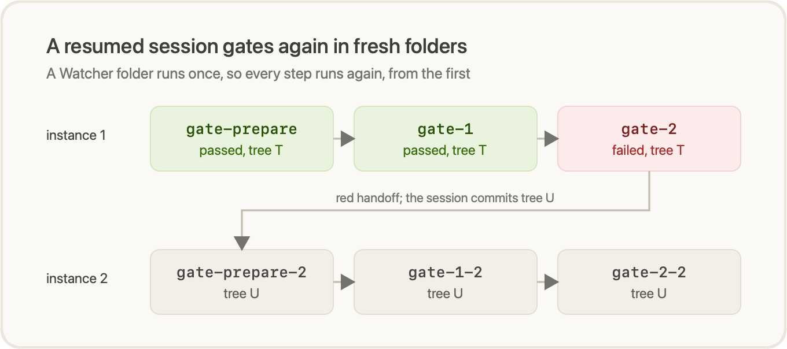
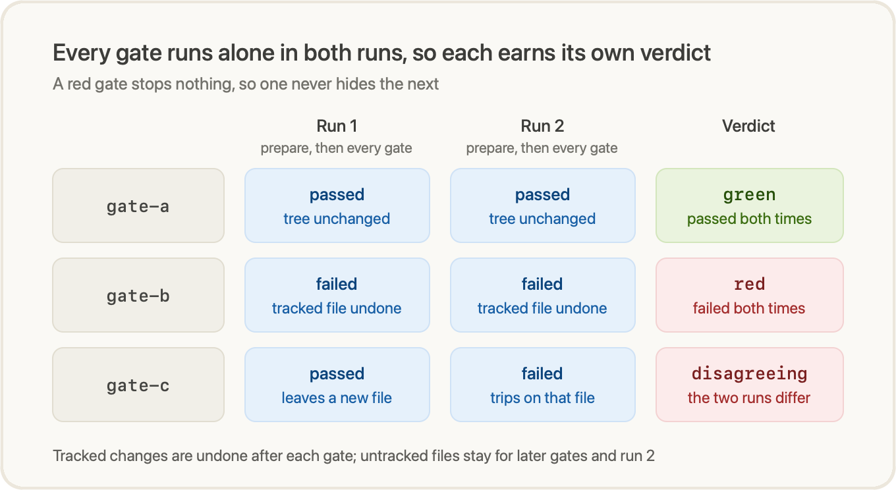

# Customs and gates

> **Question:** What exactly is checked before a claim is believed, and how do a repository's gates plug in?
> **Time:** 30 minutes.
> **Read first:** [Build and review](build-and-review.md), [Glossary](../glossary.md).
> **Next:** [Confinement](confinement.md), [Airlocks and groups](airlocks-and-groups.md), [CLI reference](../cli.md).

## In one screen

An agent ends a [session](../glossary.md#session) with a [report](../glossary.md#report). Nothing in it is taken as
true. Two stages stand between the report and any move on the [board](../glossary.md#board).

[Customs](../glossary.md#customs) compares what the agent says with what git, the [ticket](../glossary.md#ticket) and
the [log](../glossary.md#log) record. It runs code, no agent, and needs no knowledge of the repository's language.
[Gates](../glossary.md#gate) run the repository's own commands on the committed tree and read two things: the exit code
and whether a tracked file changed.

Customs catches a false story. Gates catch a bad tree. Customs runs first because it is cheap and because a tree whose
report lies is not worth gating.

A repository plugs in through one file, `pipeline.json`, its [pipeline](../glossary.md#pipeline). The `gate` verbs write
it, or an accepted proposal from the [onboarder](../glossary.md#onboarder), the agent that fits a repository with a
pipeline. A gate is an opaque shell line. Until that file exists, no ticket work launches.

*Notice that only three Customs checks, numbered V3, V4 and V15 below, hand the work back to the agent: no commit, a
dirty worktree and an unclaimed gate, all of which it can put right in its own [worktree](../glossary.md#worktree).*

## Why two stages

The two stages answer different questions, so neither can stand in for the other.

| | Customs | Gates |
| --- | --- | --- |
| Question | Is the story true? | Is the tree good? |
| Reads | The report, git, the ticket body, the log | An exit code and `git diff HEAD` |
| Knows the stack | No | No: the repository's commands know it |
| Runs where | On the [Overseer](../glossary.md#overseer), in a [lock hold](../glossary.md#lock-hold) (an onboarder's outside one) | In a [Watcher](../glossary.md#watcher) or the Overseer's process |
| Cost | Git commands | As long as the repository's commands take |
| Trusts the report | Tests it | Never reads it |

A builder also runs the gates itself and claims each one in its report. That claim buys nothing: check V15 only compares
the claim with HEAD, and the Overseer then runs every gate again. An agent's green run is never a gate result.

> **Why.** A report is written by the party being judged. Customs turns each claim into something git can answer, and
> a gate result comes from a process the agent did not start, on a tree it can no longer change.

## Customs

A [role](../glossary.md#role) owes a column: an ordered list of checks. `clearCustoms` walks the column in order and
stops at the first [refusal](../glossary.md#refusal), so the Overseer acts on one reason. A check answers passed, or a
reason code with facts and no prose; the facts are paths, commits or labels.

*Notice the hatched column: `CHECKS_OF_ROLE` declares it, and no production path walks it.*

Each role's column, in run order

| Role | Column (`CHECKS_OF_ROLE`) | Reached by |
| --- | --- | --- |
| `builder` | V1, V2, V3, V4, V5, V6, V7, V8, V11, V13, V14, V15 | `clearCustoms` |
| `reviewer` | V1, V2, V4, V5, V6, V7, V8, V9, V11, V12, V13, V14 | `clearCustoms` |
| `onboarder` | V1, V16, V4, V5, V12, V13, V14 | `clearCustoms` |
| `airlock-agent` | V1, V2, V3, V4, V5, V6, V7, V10, V11, V13, V14 | V10 alone, by hand, on a conflict |

Every column runs in check order except the onboarder's, which runs V16 second.

What an agent says it did is checked; what it judges or chooses is not. A builder's `outcome`, a reviewer's claim
results and an onboarder's `mode` are validated by V1 and then taken as given.

### The sixteen checks

Each check turns one claim or one rule into a git or log question. The table gives each check for a build or review
[job](../glossary.md#job); an onboarder refusal always ends its job `failed`.

The range is the commits since `start`, the HEAD recorded when the job launched. V10 also leaves out what the
[target](../glossary.md#target) tip already contains. Each `failed` job on a ticket counts as a
[failed pass](../glossary.md#failed-pass) towards [parking](../glossary.md#park). `<data>` and the other folder names
are in the glossary's [Reading names](../glossary.md#reading-names).

*Notice that the commit checks do not share one window: V3 forgives a retry the commits of its failed attempts, and V13
alone adds the worktree to its commits, on a Pass from the merge base.*

| Check | Function | Refusal reason | What it stops | The refusal leads to |
| --- | --- | --- | --- | --- |
| V1 | `reportIsValidWithItsHead` | `report-invalid`, `head-not-reported` | A report that breaks its schema, or describes a commit that is not HEAD | Job `failed`; cause `no-report` for `report-invalid` |
| V2 | `headDescendsFromTheStart` | `history-rewritten` | A reset or rebase that drops the commit the job started from | Job `failed` |
| V3 | `aCommitSinceTheStart` | `no-commit-since-start` | A `built` report with no new commit; other builder outcomes owe none. A retry measures from the start of the [failed attempts](../glossary.md#attempt) it retries (`retriedFailedBuildJobIdOf`) | [Red handoff](../glossary.md#red-handoff) |
| V4 | `worktreeIsClean` | `worktree-dirty` | Uncommitted or untracked work in the worktree that the gates would never judge | Red handoff |
| V5 | `dataFolderUntouched` | `data-folder-touched` | A commit changing `<data>`, even one undone later | Job `failed` |
| V6 | `ticketBodyUnchanged` | `ticket-body-changed` | Work against a body that differs from the one hashed at launch | Job `failed` |
| V7 | `noAiAttributionInRange` | `ai-attribution-in-range` | A commit message with a `Co-Authored-By: Claude` trailer, or the words `generated with` anywhere, matched without regard to letter case | Job `failed`, cause `attribution`, and the `attribution-found` [notice](../glossary.md#notice) |
| V8 | `everyAcceptanceItemAccountedFor` | `acceptance-without-evidence` | An unwaived [Acceptance](../glossary.md#acceptance) item with no evidence or [waiver](../glossary.md#waiver) proposal (builder) or no claim (reviewer) | Job `failed` |
| V9 | `fixedFindingsNameCommitsInRange` | `fixed-finding-outside-range` | A [finding](../glossary.md#finding) reported fixed by a commit outside the range | Job `failed` |
| V10 | `mergeIsResolved` | `merge-unresolved` | Unmerged paths, whitespace errors in conflicted files, or a merge commit with the wrong parents | The [Airlock](../glossary.md#airlock) refuses the merge; see below |
| V11 | `checksDefinitionUnchanged` | `checks-definition-changed`, `instruction-file-changed` | A branch rewriting a file a gate names in `definedBy`, the gate's list of files that define what it runs, or a tracked instruction file, that its ticket body does not name. With no `definedBy` named, a branch may rewrite what a gate runs | Job `failed` |
| V12 | `filedFindingsWereFiledByThisJob` | `finding-not-filed-by-job` | A claimed filing that is not this job's low [draft ticket](../glossary.md#draft-ticket) | Job `failed` |
| V13 | `agentConfigUntouched` | `branch-touches-agent-config` | A change to `.claude/`, `.mcp.json` or the hooks folder | Job `failed`, and the `branch-touches-agent-config` [decision](../glossary.md#decision) unless one is open or already answered for this hit |
| V14 | `onlyOwnRefsMoved` | `foreign-ref-moved` | A session moving a ref that is not its own | Job `failed` |
| V15 | `everyAgentGateClaimedOnHead` | `gate-unclaimed` | A gate not claimed on HEAD itself, a stale claim included | Red handoff |
| V16 | `headUnmoved` | `head-moved` | An onboarder commit; it reads and changes nothing | Job `failed` |

### Routing a refusal

`verifyAndRoute` in `src/services/overseer/JobLaunch.ts` decides what a refusal leads to, for build and review jobs.

- V1 runs alone first. Only a report that passes it is read for `outcome`, so `blocked`, `wound-down` and
  `cannot-build` route to their own endings without the rest of the column.
- `RESUMABLE_CUSTOMS_CHECKS` lists V3, V4 and V15: what a resumed session can put right in its own worktree. Those
  refusals write a red handoff. The order of attempts is the rework ladder in [Build and review](build-and-review.md).
- Any other refusal ends the job `failed`, its cause the reason, except V7, whose cause is `attribution`.
- A missing job start or ticket ends the job `failed` with cause `git-failed` before Customs runs.

Every check but one fails closed. A git command that fails refuses with `git-failed` and names what it tried, so no
broken repository reads as clean. V2 and V10 give their own reason in that case. V7 is the exception: after `rev-list`
has listed the range it reads each commit message separately and skips one it cannot read, so that message goes
unscanned. Routing is by check, not reason: `git-failed` from V3, V4 or V15 is a red handoff too.

> **As built.** `clearCustoms` runs for build, review and onboarder jobs only. Airlock agents never reach it; the
> Airlock takes their report's `outcome` as given. See
> [gap-merge-agents-skip-customs](../reference/known-gaps.md#gap-merge-agents-skip-customs).

For an Airlock agent that resolved a conflict the Airlock calls one check by hand: `MergeRun.resolutionIsSound` runs
V10 and nothing else, and a failure refuses the merge. V10 reads no report field itself, but `resolutionIsSound` passes
it the report's `resolvedFiles` as the conflicted files, so the whitespace check covers only what the agent listed. An
Airlock agent that fixed a red merged tree gets no check at all. What the Airlock then does is in
[Airlocks and groups](airlocks-and-groups.md).

### V13 before every launch

V13 is the one check that also runs before a session starts, because a branch that changed the agent's own settings or
hooks would take effect on the next launch, before any report exists.

*Notice that the check before a launch has no report to go on: it reads only git.*

On every [Pass](../glossary.md#pass), the Overseer runs V13 for each live build and review job
(`ticketIdsTouchingAgentConfigOf`, outside the lock). It compares the branch's commits past the merge base with its
target, plus the worktree as it stands. A hit opens the decision once.

> **As built.** V13 does not see a write to the main checkout's `.githooks`:
> [gap-session-githooks-unguarded](../reference/known-gaps.md#gap-session-githooks-unguarded).

While that decision is open the [Playbook](../glossary.md#playbook) launches and resumes nothing on the ticket, and the
job stays off `jobsNeedingAWatcher`, so no Watcher is spawned. This is an open decision, not a
[ticket hold](../glossary.md#ticket-hold).

The end-of-job V13 adds one case. A hooks folder outside the worktree cannot show in a diff, so `launchSnapshotOf`
digests it at first launch and V13 compares the digests. The decision's answers are in
[Questions and incidents](questions-and-incidents.md).

### How V14 knows which moves are allowed

V14 compares every ref and detached HEAD with the launch snapshot in `start.json`. Without a snapshot it refuses, since
nothing proves no ref moved. The allowance comes from board state and the log, never from the report.

What a build or review job may see move

| Ref | Exempt when | Source in `refMovesAllowedOf` and its caller |
| --- | --- | --- |
| The job's own branch and own detached HEAD | Always | `ownBranch` |
| Another live build or review job's branch | Always | `otherJobBranches` |
| A branch of a job that ended after this one launched | While the branch exists | `loggedJobBranches`, from `job-ended` |
| A target | Only at the commit a `landed`, `integrated` or `refreshed` ending recorded | `recordedLandings` |
| A landed ticket's branch, a released [group](../glossary.md#group)'s branch | Only once gone | `removedAfterLandings` |
| A refresh worktree's detached HEAD | Always | `refreshWorktreeHeads`, from a `refresh` job's launch |

An onboarder gets an empty allowance, because `src/services/overseer/Onboarding.ts` passes every list empty. Its
snapshot's own HEAD is the only exempt ref, and every other ref in the repository must stand still for the length of
its session.

### How V12 proves a filing

A reviewer or onboarder cannot file directly, so its report names either a ticket id or the
[Hatch](../glossary.md#hatch) request id printed with `queued` when the Hatch reply did not arrive in time (see
[Control and Hatch](control-and-hatch.md)). V12 turns either into proof from the log, never from the ticket as it
stands, because the filing's own submission, or User, may have moved it since.

*Notice the red wall: whatever lies before an earlier `hatch-applied` belongs to another request.*

`ticketIdFiledByRequest` does the walk, and `filingIsThisJobsLowFinding` reads the fields. A report that names a ticket
id skips the walk and still needs a filing record with those fields.

## Report schemas

Each role's report has one JSON Schema (draft-07) in `src/adapters/reports/ReportSchemas.ts`. The agent's command line
gets that document through `--json-schema`, and V1 checks the report against the same document with `reportVerdictOf`,
so the two cannot disagree. [What bounds it](roles-and-launch.md#what-bounds-it) says which role has which schema.

No report carries a round, a rework count, a verdict or a release. An agent states what it did; code decides what
follows. Objects are closed, so an extra key is invalid. An Acceptance item is its label, `A1`, never its text.

The four schemas

| Schema | Roles | Claims it carries |
| --- | --- | --- |
| `BUILDER_REPORT_SCHEMA` | builder | `outcome`, `headCommit`, Acceptance evidence, `alsoFixed`, gate claims, [Handoff](../glossary.md#handoff) text |
| `REVIEWER_REPORT_SCHEMA` | reviewer | `headCommit`, a claim per Acceptance item, findings fixed or filed, review text |
| `AIRLOCK_AGENT_REPORT_SCHEMA` | a builder or reviewer in the Airlock | `outcome`, `headCommit`, resolved files, semantic changes, `reportKind` |
| `ONBOARDER_REPORT_SCHEMA` | onboarder | `mode`, `headCommit`, a whole proposed pipeline, `optimisations`, notes |

## Gates

A gate is a named shell line. `gateOutcomeOf` judges it, and nothing else in the product does.

*Notice the last rung: a formatter that rewrites a file and exits 0 is red, because the tree it approved is not the tree
on disk.*

| Run | Tracked diff | `GateOutcome` | Reported output |
| --- | --- | --- | --- |
| Exit 0 | None | `passed` | None |
| Exit 0 | Yes | `failed` | The diff |
| Exit 1 to 125, or above 127 | Any | `failed` | The gate's output |
| Exit 126 or 127 | Any | `cannot-run` | The gate's output |
| Signal, or the process never started or was lost | Any | `cannot-run` | The gate's output |
| A [prepare step](../glossary.md#prepare-step) exits anything but 0 | Not read | `setup-failed` | The step's output |

126 and 127 are the shell's own answers for a command it could not execute or find, so the line never judged the tree.
The diff is `git diff HEAD`: an untracked file a gate creates does not turn it red. A `git diff` that fails reads as no
change.

In a job or an Airlock, gates run in list order and the first one that is not `passed` stops the rest. For a build or
review job, the outcome decides who owns it next:

- `failed` goes to the agent, through a red handoff that names the gate's `fix` line if it has one. The Overseer never
  runs a `fix`: repairing is the agent's work, and the result must pass Customs and gates like any other commit.
- `cannot-run` and `setup-failed` are no verdict on the work, so they go to an [incident](../glossary.md#incident) and
  the job ends `stopped`. See [Questions and incidents](questions-and-incidents.md), and
  [Process Watchers under loss](failure-and-recovery.md#process-watchers-under-loss) for a gate lost to a crash.

In an Airlock a red gate resumes the ticket's own agent and an unrunnable one opens an incident with the merge job
left in place; see [Airlocks and groups](airlocks-and-groups.md).

An `overseerOnly` gate runs like any other for the Overseer. V15 demands no claim on it, and its `network` and `writes`
(see the field list in the [CLI reference](../cli.md)) never reach an agent's session (`workerToolchainOf`), so it can
use what an agent must not reach.

A review job that ends on the tree it was given runs no gate, whether it committed nothing or only commits back to that
tree: `reviewLeftTheTreeAsItWas` counts it as passed, because the build's gates judged that same tree.

### Where a gate runs

Three callers share the judge and differ in how they run and whether they take a
[gate slot](../glossary.md#gate-slot).

| Caller | Tree | How it runs | Gate slot | Red gates |
| --- | --- | --- | --- | --- |
| `JobLaunch.gateProgressOf` | A build or review HEAD | One Watcher for the joined prepare steps, then one per gate, across many Passes | Taken by `tryAcquire`; the step waits for a later Pass | The first stops the rest |
| `GateRun.runPipeline` | The merged tree in an Airlock | In the Overseer's process, awaited | `acquire`, waiting in a retry loop | The first stops the rest |
| `ProposalTwiceRun.runOnce` | A [main line](../glossary.md#main-line) snapshot | In the Overseer's process, awaited | None | All run, so one never hides the next |

> **As built.** The merged-tree gate runs inside the Pass. See
> [gap-merge-gate-blocks-pass](../reference/known-gaps.md#gap-merge-gate-blocks-pass).

The sandbox for each step and the `writes` rule are in
[Confinement](confinement.md#the-gate-writes-rule).

Where confinement is `unavailable` a line never starts: `oversee` refuses at its start, and each gate path opens a
`sandbox-unavailable` incident. On Windows the answer is `unconfined-by-design`, and a line runs unwrapped in its job
worktree.

A gate never inherits the job's variables (`gateEnvironmentOf`), so a mutating verb a repository test runs inside a gate
runs as written instead of relaying through the Hatch to the Overseer. What keeps such a verb off the real board is the
sandbox's deny on `<data>`, not the missing variables; see [Confinement](confinement.md). A proposed line in a
[twice-run](#twice-run) has no such deny.

### Gate slots

A gate slot caps job and Airlock gate runs across every board on the machine at `GATE_RUNS_AT_ONCE` (2); onboarder
twice-runs take none. Gates are the expensive step, and two boards side by side would otherwise each run theirs.

*Notice that nothing happens at the file when the Watcher ends: staleness is read by the next taker.*

A gate slot is a file `slot-<n>` in `<monitor>/gate-slots/`, created exclusively, naming its holder and the process
answering for it: the acquirer until the spawn is recorded, then the Watcher. No lock and no daemon are involved. When
two takers race for one stale gate slot, the rename lets only one remove it, and the exclusive create decides who holds
it.

A gate Watcher's holder is its Watcher folder; an in-process gate's is `process:<pid>:<label>`, and that one releases
its gate slot when the gate ends. Prepare steps take no gate slot.

### Verdict files and resumed gates

Once a step's Watcher ends, the Overseer judges it once and writes `<folder>-verdict.json` in the job folder, keyed by
tree id. Later Passes read that file instead of judging again. The atlas lays out
[gate folders and verdict files](../data-model/on-disk-atlas.md#gate-folders-verdicts-and-red-handoff-files).

*Notice the crossed-out box: without the file, a later gate's mess would repaint an earlier green.*

A Watcher folder runs once, so a session resumed after a red handoff gates again from the first step, in fresh folders
suffixed with its [Watcher instance](../glossary.md#watcher-instance). A verdict on another tree is ignored. A step
that did not pass also writes its name and output to `gate.log`.

*Notice that the second row starts at the first step: another tree earns no credit from the earlier verdicts.*

### No gate cache of our own

`src/services/lifecycle/GateRun.ts` keeps no gate result: caching belongs to the repository's tooling. A verdict file
is one job's record of its own run and no other job reads it. Every `recordGateRan` call passes `cached: false`.

> **Why.** A cache keyed correctly needs to know everything a command reads, and only the repository's tooling knows
> that. A wrong hit would pass a broken tree, which is the one thing gates exist to stop. A gate's `writes` key lets a
> repository keep its tool's cache in one folder outside the worktree, and the Overseer stays ignorant of what is in it.
> [The decision record](../development/decisions.md#no-gate-cache-of-our-own) weighs the alternatives.

Across jobs only the `gate-ran` log record is read, with three readers.

The three readers of <code>gate-ran</code>

| Reader | Reads | For |
| --- | --- | --- |
| `mergedTreeWasLastPassed` | The newest run on the tree | An Airlock whose merged tree equals the branch's tree lands without gating again, because the merge changed nothing the gates judged |
| `landMerge` | Any passing run on the tree | The legality of `merge-land`; see [Airlocks and groups](airlocks-and-groups.md) |
| `onboardingFactsOf` | The newest runs | History shown to the onboarder, capped by `GATE_HISTORY_RECORDS` |

## The pipeline

`pipeline.json` is the one place a repository configures the lifecycle. It lives in `<data>`, beside `progress.json`,
the board's main store, so it is never tracked and never inside a branch: a branch cannot change the pipeline. Its
fields, and the `gate` verbs that write it, are in the [CLI reference](../cli.md).

*Notice the last zone: a gate with no `definedBy` leaves what it runs open to the branch it judges.*

One small file steers every role, because each stage reads the keys it needs.

*Notice that Customs reads the pipeline too: V11 protects the files the pipeline itself names.*

| Key | What it means |
| --- | --- |
| `prepare` | How to make a fresh tree runnable |
| `gates` | What must be true of a tree, in run order |
| `review` | Whether a review phase exists, and how its agent runs |
| `constitution` | Files every code-touching agent reads first |
| `agents` | Each role's own files, replacing its default |

The Overseer reads the file afresh, each lock hold and each merged-tree run, so an edit reaches the next gate run
without a restart. Tickets in flight never block a pipeline change.

### No file versus an empty list

No file stops all ticket work; `gates: []` runs all work with no gates.

| `pipeline.json` | `pipelineIsSet` | Effect |
| --- | --- | --- |
| Absent | No | `checks-not-set` opens, an onboarder starts, and no ticket work launches or resumes |
| Malformed | No | The same, and `gate list` and every `gate` write refuse it; an accepted proposal does not refuse and writes over it |
| `gates: []` | Yes | Counts as set: work runs and [landing](../glossary.md#landing) runs no gate. `gate none` sets it on purpose; a first `gate prepare` on a board with no file, or removing the last gate, also leaves it |
| `{}` | Yes | Valid: both lists default to empty |

`contentsOf` always writes `prepare` and `gates`, so an empty list shows in the file.

> **Careful.** Add gates before or together with the first prepare step. A `gate prepare` on a board with no file sets
> the pipeline with no gates, `checks-not-set` stops holding work, and tickets land ungated until a gate is added.

### Strict parsing

Anything `PipelineFile.read` does not recognise makes the file malformed, and a malformed file stops ticket work. The
read answers `absent`, `readable` or `malformed` with a reason, and never throws. The parser accepts nothing it does not
know: an unknown key at any level, a step or gate without a non-blank `name` or `run`, a repeated name, an
`overseerOnly` other than `true`, or a `writes` folder that is neither absolute nor `~/` makes the file malformed.

> **Why.** `progress.json` keeps unknown keys. This file decides what judges work, so a typo that silently disabled a
> gate would be the worst outcome.

### What `review`, `constitution` and `agents` change

No verb and no accepted proposal writes these three keys: to set one, edit `<data>/pipeline.json` by hand. The next read
picks it up, and a malformed edit stops ticket work.

- With no `review` key the Playbook's `reviewIsSet` is false and no review job launches. `settleGate` queues a gated
  build to merge in the same lock hold, and the Airlock skips `Landing.ticketRefusalOf`, since only a review accounts
  for Acceptance. See `src/services/overseer/Airlocks.ts`. This is the default of a fitted board; see
  [what acceptance writes](#the-decision-and-what-acceptance-writes).
- With `review`, `name` labels each [review bar](../glossary.md#review-bar), and `model` and `effort` set the reviewer's
  launch. An `effort` outside the vocabulary keeps the default.
- A listed `constitution` or `agents.<role>` array replaces its default. List the default too to extend it.
- `merger` names no job now: an Airlock agent reads its builder or reviewer files. Only builder, reviewer and merger
  get the constitution (`ROLES_GIVEN_THE_CONSTITUTION`).

Paths, defaults, how the texts are read and how they are joined are in [Roles and launch](roles-and-launch.md); V11
guards the tracked ones.

### `pipelineHashOf`

The hash is a record of what judged a row; no decision reads it.

`PipelineUtil.pipelineHashOf` hashes a canonical form: every key in a fixed order, missing options filled, `agents`
sorted by role. A hand edit that only reorders keys or reindents keeps the hash. Reordering gates changes it, because
run order means something.

The hash appears in `gate list --json` and in a [row's](../glossary.md#row) `pipelineHash`, set by
`recordPipelineJudgedBy` when a build or review job settles its gates. Nothing compares the two.

## The onboarder

The onboarder's output is never trusted into `pipeline.json`: every line it proposes is run first, and User reads what
happened.

*Notice that accepting writes less than was proposed: `review`, `constitution` and `agents` have no verb, so they stay
shown, and a board with no `review` has no review phase.*

The mode is `setup` when no pipeline is stored and `advise` when one is. `setup` proposes a whole pipeline to run twice
and offer to User. `advise` looks at a stored pipeline and its gate history and reports optimisations, each meant as a
low draft ticket; no proposal follows.

The Playbook starts one onboarder per opening of `checks-not-set`; the `advise` verb starts one on demand. Its first
message states the mode it was launched in and the newest `gate-ran` records (`onboardingFactsOf`).

Routing follows the mode the report states, and nothing compares it with the mode the session was launched in. A
`setup` session reporting `advise` ends `closed` with no proposal, and `onboarderAnsweredChecksNotSet` then starts no
other onboarder for that opening. An `advise` session reporting `setup` gets a proposal too, and accepting it merges
into the stored pipeline: replacing by name, or clearing the gates when it proposes none.

### The snapshot

`Onboarding.prepareSnapshot` adds a detached worktree at the main line's tip, `<worktrees>/onboard/J<n>`, and writes
`onboarder-start.json` with the start commit and launch snapshot. The Overseer removes it when the job settles.
[Regrouping](../glossary.md#regrouping) does not count the `onboard` folder as leftover, so a snapshot of a job that
ended any other way stays until removed by hand.

Its profile is in [Confinement](confinement.md). V4, V16 and V14 prove that it changed nothing: a changed file, a commit
or a moved ref fails the job.

### Twice-run

A verified `setup` report goes to `ProposalTwiceRun.runProposalTwice`, `PROPOSAL_RUN_COUNT` (2) times. A command that
passes once proves little; two runs catch a flaky gate and one whose result depends on what the first run left behind.
Each gate runs alone. A gate that changes a tracked file fails and that change is undone, so the next gate sees the
tracked files as committed. Untracked output stays for later gates and the second run.

Proposed lines run confined as a merge gate does, or not at all: a refused line opens `sandbox-unavailable`. They take no
gate slot, and the Overseer awaits them from the Pass, outside the lock hold.

*Notice the last row: only a second run on the same folder can expose a gate that leans on what the first left behind.*

| What the two runs did | `ProposedGateVerdict` |
| --- | --- |
| Passed both times | `green` |
| Failed both times | `red` |
| Any run could not run | `cannot-run` |
| Differed | `disagreeing` |

A failed prepare step records each gate of that run as `cannot-run`, with the prepare's output. Durations never change a
verdict; `CachingChecks` reads them only to suggest a caching tool.

### `CachingChecks`

Caching checks only suggest; the four suggestions

`CachingChecks.cachingSuggestionsOf` reads `turbo.json` and the measured times. It installs nothing and edits no tracked
file.

| Suggestion | When |
| --- | --- |
| `no-caching-tool` | No `turbo.json` or `nx.json`, and a gate's slower run reached `SLOW_GATE_MILLISECONDS` (30000) |
| `per-worktree-cache` | The Turbo cache folder is relative, so each worktree builds it again |
| `task-inputs-unseen` | A task's `inputs` miss a `bin`, `templates`, `fixtures` or `resources` folder |
| `gate-not-through-turbo` | With `turbo.json` present, a gate does not run `turbo run` |

### The decision and what acceptance writes

Accepting writes only the prepare steps and gates; declining changes nothing.

The outcome goes to `onboarding-outcome.json` in the job folder. The next lock hold ends the job, removes the snapshot
and, for a proposal, opens `pipeline-proposal`. The `OnboardingOutcome` type has no proposal without its twice-run
record, so none can be shown without what it did.

On acceptance, `acceptProposal` writes through the same Board moves as `gate prepare`, `gate add` and `gate none`, in
the answering lock hold. Nothing filters on verdict: a `red` gate is written if User accepts it. The report's gate shape
has no `fix`, `in` or `overseerOnly` (see the field list in the [CLI reference](../cli.md)), so a proposal cannot set
them.

> **Careful.** A board fitted by the `gate` verbs or an accepted proposal has no `review` key, so it has no review
> phase: gated builds land on their gates alone, whatever the proposal showed. Only a hand edit of `pipeline.json` adds
> one.

> **Careful.** The Board moves carry none of the verbs' checks. A proposed name or `writes` folder is written
> unvalidated, and one the strict parser refuses makes the file malformed.

> **As built.** `advise` asks for each optimisation to be filed through the Hatch, and the
> [Bouncer](../glossary.md#bouncer) refuses every command from the onboarder role. An `advise` report with an
> optimisation then fails V12, and one without ends `closed` with nothing shown. See
> [gap-onboarder-advise-filing](../reference/known-gaps.md#gap-onboarder-advise-filing).

## Why gates are opaque

Agent-progress works on any stack, so anything stack-specific stays in the repository.

- `src/services/lifecycle/GateRun.ts` takes a line, hands it to User's shell and reads an exit code, output and
  `git diff`. It names no language, build tool or test tool.
- The only stack-aware file in the gate path is `src/services/lifecycle/CachingChecks.ts`, and its results are
  suggestions shown to User.
- The onboarder is how a stack enters: an agent reads the repository and proposes lines, which then run as opaque
  lines. The knowledge lives in a session, never in the product.

The trade is that the Overseer cannot explain a red gate. It hands over the output and the `fix` line, and the agent
interprets them.

## Invariants

1. A build, review or onboarder report moves nothing until V1 accepts it. An `outcome` of `blocked`, `wound-down` or
   `cannot-build` is then believed.
2. A build, review or onboarder report reaches gates, a twice-run or a `closed` advise ending only once its role's whole
   column passed. The first refusal stops the column and is the only one acted on.
3. A git failure reading a check's range is a refusal, never a green check, except V7's read of a single message after
   the range is listed.
4. A gate passes only by exiting 0 with `git diff HEAD` showing no tracked change.
5. The Overseer never runs a gate's `fix`.
6. A branch cannot change `pipeline.json`. A build or review branch cannot change a `definedBy` or tracked instruction
   file its ticket does not name.
7. A verdict file is read only by its own job; across jobs only the `gate-ran` log record is read.
8. A pipeline proposal reaches User only with its twice-run record.
9. Gate runs through Watchers and the Airlock on one machine never exceed `GATE_RUNS_AT_ONCE`.

## In the code

Concept, path, symbol and spec

| Concept | Path | Symbol | Spec |
| --- | --- | --- | --- |
| Check tables, order | `src/services/lifecycle/Customs.ts` | `CUSTOMS_CHECKS`, `CHECKS_OF_ROLE`, `clearCustoms` | `src/services/lifecycle/Customs.verification.spec.ts` |
| V12 from the log | `src/services/lifecycle/Customs.ts` | `ticketIdFiledByRequest`, `filingIsThisJobsLowFinding` | `src/services/lifecycle/Customs.verification.spec.ts` |
| V14 from the log | `src/services/lifecycle/Customs.ts` | `refMovesAllowedOf`, `launchSnapshotOf` | `src/services/lifecycle/Customs.provenance.spec.ts` |
| A retry's start for V3 | `src/services/lifecycle/Customs.ts` | `retriedFailedBuildJobIdOf` | `src/services/lifecycle/Customs.verification.spec.ts` |
| Onboarder's column | `src/services/lifecycle/Customs.ts` | `headUnmoved` | `src/services/lifecycle/Customs.onboarder.spec.ts` |
| Routing a refusal | `src/services/overseer/JobLaunch.ts` | `verifyAndRoute`, `RESUMABLE_CUSTOMS_CHECKS` | `src/services/overseer/JobLaunch.redHandoff.spec.ts` |
| V13 before launch | `src/services/overseer/JobLaunch.ts` | `ticketIdsTouchingAgentConfigOf`, `holdAgentConfigHits` | `src/lib/tracker-model/Playbook.spec.ts` |
| An open decision keeps launches off | `src/lib/tracker-model/Playbook.ts` | `TICKET_HOLDING_DECISION_KINDS`, `onboarderAnsweredChecksNotSet` | `src/lib/tracker-model/Playbook.spec.ts` |
| V10 in the Airlock | `src/services/lifecycle/MergeRun.ts` | `resolutionIsSound` | `src/services/lifecycle/Customs.verification.spec.ts` (V10) |
| A held job gets no Watcher | `src/services/overseer/DrivePass.ts` | `jobsNeedingAWatcher` | |
| Report schemas | `src/adapters/reports/ReportSchemas.ts` | `BUILDER_REPORT_SCHEMA` and siblings | `src/adapters/reports/ReportSchemas.spec.ts` |
| Report validation | `src/adapters/reports/ReportValidation.ts` | `reportVerdictOf` | |
| Gate judgement | `src/services/lifecycle/GateRun.ts` | `gateOutcomeOf`, `runPipeline`, `gateEnvironmentOf`, `trackedChangesOf` | `src/services/lifecycle/GateRun.integration.spec.ts` |
| Gating a job | `src/services/overseer/JobLaunch.ts` | `gateProgressOf`, `stepVerdictOf`, `settleGate`, `reviewLeftTheTreeAsItWas` | `src/services/overseer/JobLaunch.gating.spec.ts` |
| Gate slots | `src/services/overseer/GateRunSlots.ts` | `createGateRunSlots`, `gateRunHolderIsLive` | `src/services/overseer/GateRunSlots.spec.ts` |
| Gate slot cap | `src/shared/constants/OverseerLimits.ts` | `GATE_RUNS_AT_ONCE` | |
| Reuse of a passed tree | `src/services/overseer/Airlocks.ts` | `mergedTreeWasLastPassed` | `src/services/overseer/Airlocks.spec.ts` |
| What a session gets of the gates | `src/services/overseer/WorkerProfiles.ts` | `workerToolchainOf` | |
| Pipeline file | `src/adapters/pipeline/PipelineFile.ts` | `read`, `contentsOf` | `src/adapters/pipeline/PipelineFile.spec.ts` |
| Pipeline hash | `src/lib/tracker-model/utils/PipelineUtil.ts` | `pipelineHashOf` | |
| Row's pipeline hash | `src/lib/tracker-model/TrackerChanges.ts` | `recordPipelineJudgedBy` | |
| Instruction files | `src/services/overseer/InstructionFiles.ts` | `trackedInstructionPathsOf`, `ROLES_GIVEN_THE_CONSTITUTION` | |
| Onboarder job | `src/services/overseer/Onboarding.ts` | `prepareSnapshot`, `onboardingFactsOf`, `onboarderProfileOf`, `settleEndedOnboarders` | |
| Twice-run | `src/services/lifecycle/ProposalTwiceRun.ts` | `runProposalTwice`, `verdictOf` | `src/services/lifecycle/ProposalTwiceRun.spec.ts` |
| Caching suggestions | `src/services/lifecycle/CachingChecks.ts` | `cachingSuggestionsOf` | `src/services/lifecycle/CachingChecks.spec.ts` |
| Acceptance | `src/services/lifecycle/OnboardingProposal.ts` | `acceptProposal` | |

