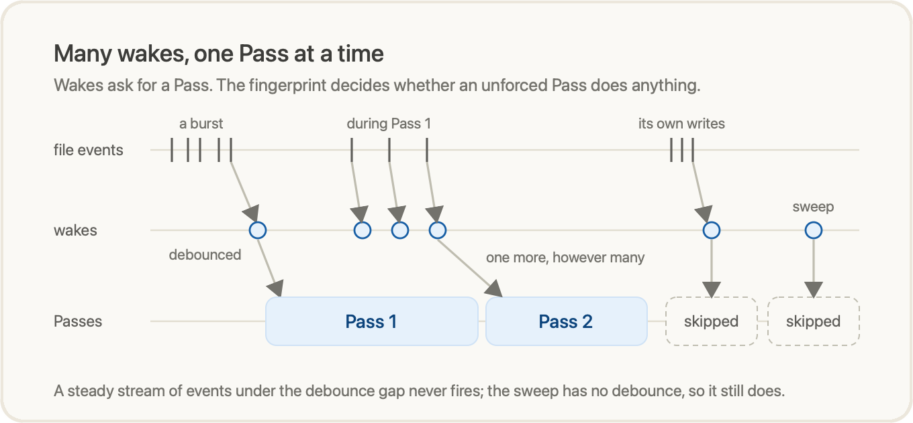
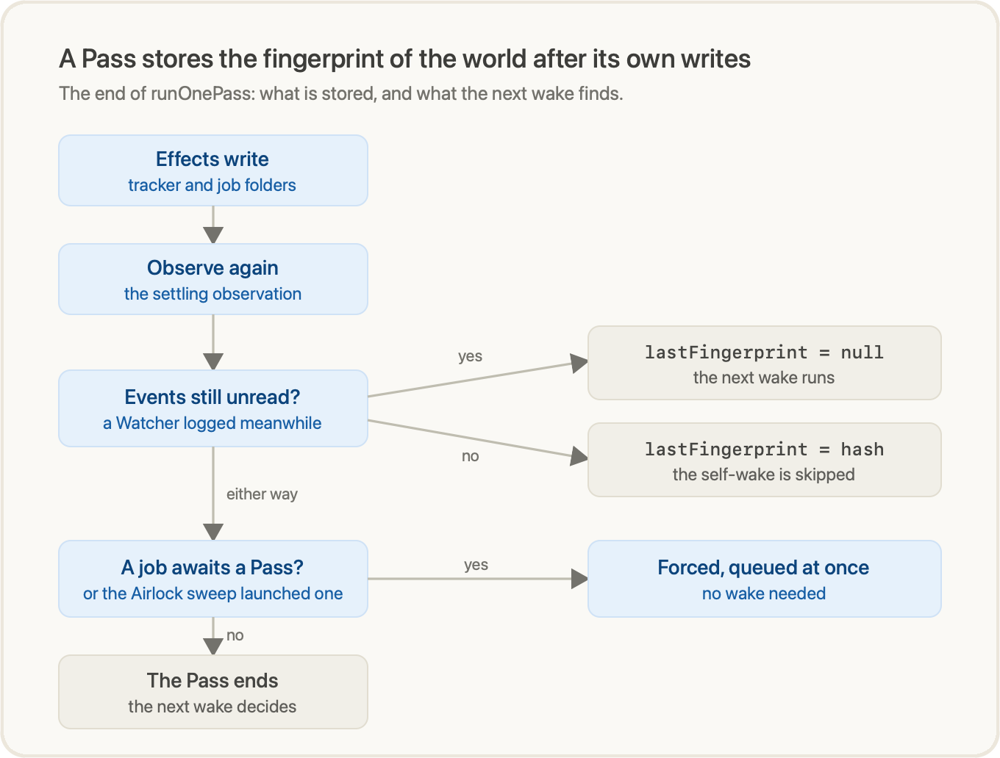
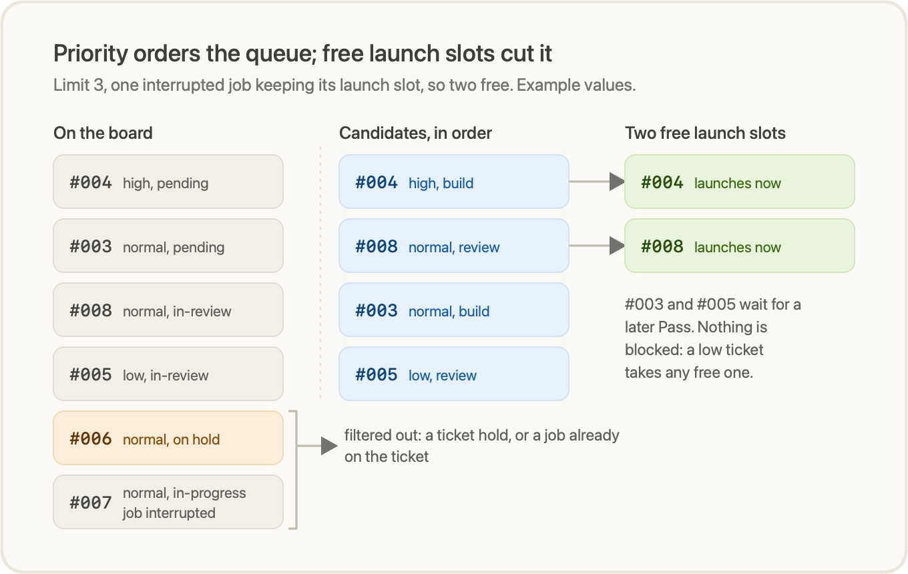

# The Pass and the Playbook

> **Question:** What does the Overseer do on each Pass, and why does a lost effect not matter?
> **Time:** 20 minutes.
> **Read first:** [Overview](../concepts/overview.md), [How a write commits](../data-model/storage.md).
> **Next:** [Build and review](build-and-review.md), [Failure and recovery](failure-and-recovery.md).

## In one screen

The [Overseer](../glossary.md#overseer) drives [jobs](../glossary.md#job) for one [board](../glossary.md#board). It is
one serial loop; a turn is a [Pass](../glossary.md#pass). Observe without the [tracker](../glossary.md#tracker)'s lock,
change it in one main [lock hold](../glossary.md#lock-hold), then do effects (spawning a
[Watcher](../glossary.md#watcher), messaging a [session](../glossary.md#session), creating a
[worktree](../glossary.md#worktree)); a lost effect is derived again.

*Notice the band beneath: no frame (one message on a Watcher's socket; see [Watchers](watchers.md)) reaches a session
and no Watcher is spawned during the main hold; git and [Customs](../glossary.md#customs) do run inside it.*

- A Pass asks "what is true now?", never "what happened since?". Its facts are stored: the board, the
  [log](../glossary.md#log), job and [Hatch](../glossary.md#hatch) folders, the
  [usage marker](../glossary.md#usage-marker) and git. Memory keeps bookkeeping: [sweep](../glossary.md#sweep) counts,
  spawned Watcher instances and requests queued for the next hold. Losing it costs a wait or a repeat.
- The [Playbook](../glossary.md#playbook) decides inside the hold: a pure function from facts to steps.
- Effects run after the hold commits. A dead Overseer's lost effects come back from the board plus
  [markers](../glossary.md#marker); [three do not](#effects-come-after-the-commit).
- Pausing alone does not stop resumes: a paused board launches no builds, reviews or onboarder, queues no merge, and
  still resumes interrupted jobs.
- Priority orders who gets a free [launch slot](../glossary.md#launch-slot). It blocks nothing.

## What wakes a Pass

A wake only asks for a Pass. An unforced Pass stops at the [fingerprint](../glossary.md#fingerprint) if nothing
observed changed; a forced Pass runs regardless, for the triggers in the table where nothing on disk moved: a job gone
quiet, a reset reached, a restart. No clock reading enters the fingerprint.

| Source | Forced | Where |
| --- | --- | --- |
| A file changes under [`<data>`](../glossary.md#reading-names) or `<worktrees>/hatch`, recursive, debounced | no | `src/services/overseer/DataFolderWatch.ts`, `startWatching` |
| The sweep, every `OVERSEER_SWEEP_SECONDS` | no | `src/services/overseer/DataFolderWatch.ts`, `sweepOnce` |
| A sweep finding a quiet job (one whose event log stood still for `QUIET_JOB_SWEEPS` sweeps), a quiet [Assistant](../glossary.md#assistant), or a board with no Assistant | yes | `src/services/overseer/DrivePass.ts`, `sweep` |
| The `POST /api/nudge` a verb (one `forge` command) sends after its write | no | `cli/OpenTrackerForWriting.ts`, `nudgeTheOverseer` |
| A control command (a move sent to `POST /api/commands`) applied through the API | no | `cli/overseer/routes/CommandRoute.ts`, `answerControlCommand` |
| The usage limit's reset time | yes | `src/services/overseer/DrivePass.ts`, `scheduleThePassAtTheReset` |
| [Regrouping](../glossary.md#regrouping) finished at start | yes | `src/services/overseer/DrivePass.ts`, `regroup` |
| A failed [Baton pass](../glossary.md#baton-pass), after which the old Overseer keeps driving | yes | `cli/overseer/OverseerForeground.ts`, the `kept-driving` branch, `serving.drivePass.wake(true)` |
| A Pass that settled an [onboarder](../glossary.md#onboarder), or left a job awaiting another Pass | yes | `src/services/overseer/DrivePass.ts`, `runOnePass` |

*Notice that the Overseer's own writes wake it, and the fingerprint makes that wake cost one observation, with no lock
taken.*

- **Debounce has no maximum wait.** Every event restarts the `OVERSEER_WATCH_DEBOUNCE_MILLISECONDS` timer. Events
  arriving closer together than that postpone the wake for as long as they keep coming. The sweep has no debounce and
  is the backstop, also for events the platform dropped.
- **Wakes coalesce.** `wake` starts `drain` when nothing runs. During a Pass it sets `wokenAgain`, so any number of
  wakes buys exactly one more Pass. A forced wake is remembered in `forcedNext` until that Pass.
- **`drain` runs one Pass at a time.** It loops while `wokenAgain` is set and the Overseer has not stopped.
- **A failed Pass waits.** `drain` catches what `runOnePass` throws, logs one line and runs nothing extra. The next wake
  that sees a changed observation, or any forced wake, tries again.

| The throw | What stands | What is lost |
| --- | --- | --- |
| Inside the hold | No tracker file is written | The requests the hold took from memory: `leftover-worktree` [decisions](../glossary.md#decision) wait for the next Overseer start, and a quiet job waits for its sweeps again |
| During effects | The hold, committed | The remaining effects of this Pass |

> **Careful.** A forced wake spent on a failed Pass is not repeated.

## Observe, then skip or go on

`observe` reads the world with no lock held, events before Hatch folders, and `runOnePass` compares the result with the
last settled fingerprint.

*Notice that only the two reads swap: a `result` in hand always has its request on disk.*

A session writes its request before its turn's closing `result`. That `result` moves a job to `in-customs` in the hold
that reads it, so a request found only in a later Pass applies after its job moved on. Reading events first puts both
in one Pass, and the hold applies requests first. An Assistant's closing `result` must not be seen before the move it
queued either, so `AssistantSession.readingsOf` also runs before the folders.

| Reads | Why outside the lock |
| --- | --- |
| The board's jobs (`progress.json`) and the pipeline (`pipeline.json`) | Read as stored; every file is written atomically, so no lock is needed, and the hold reads the Board again |
| Each job's Watcher liveness and [event log](../glossary.md#event-log) past its stored [cursor](../glossary.md#cursor) | Files that one Watcher appends to; no lock protects them |
| Each live Assistant's turn progress (results, calls since the last result, context tokens) | Parsed from event logs, which no lock protects |
| Pending Hatch requests, unanswered and of a format this Overseer reads | Agents write these with no lock |
| The tip of each [target](../glossary.md#target), and whether it contains the [managed block](../glossary.md#managed-block) | One git spawn each |
| [Build job](../glossary.md#build-job) observations and [tickets](../glossary.md#ticket) touching agent configuration (`.claude/`, `.mcp.json` or the hooks folder) | Git and folder reads per job |
| The usage marker | A machine-wide file under [`<monitor>`](../glossary.md#reading-names) |

> **Careful.** Observe also acts, before the fingerprint skip and before any [Baton](../glossary.md#baton) check. For a
> lost Watcher, `Regrouping.settleLostWatcher` kills its surviving child group and stores the cause in a file, so an
> Overseer that dies after the kill reads the same cause instead of judging it afresh. A finished
> [gate](../glossary.md#gate) step's verdict is kept in a file in the same way.

*Notice the bracket: a write inside it reaches the Board, and the observation may not have it.*

An observation can be stale by the time the hold opens, so the hold trusts the Board it reads. The events of a job
whose `watcherInstance` moved are dropped, and a request already logged as applied is skipped.

**The fingerprint is identity, never time.** `fingerprintOf` hashes the left column below. An unforced Pass whose hash
matches the last settled one returns before the lock.

| In the hash | Not in the hash |
| --- | --- |
| The text of `progress.json` and `log.jsonl` | Ticket files |
| The usage marker | [`pipeline.json`](../glossary.md#pipeline) |
| Pending request ids | [Epics](../glossary.md#epic) |
| Each build job's setup, calls and gate progress | [Filing drafts](../glossary.md#filing-draft) |
| Each Watcher's instance, verdict and last unread sequence | The [install version](../glossary.md#install-version) |
| The target tips, and the tickets touching agent configuration | The current time |

> **As built.** A change on the right alone starts no work. The next forced Pass, or the next change on the left, picks
> it up; see [gap-fingerprint-omits-files](../reference/known-gaps.md#gap-fingerprint-omits-files).

A verb that writes the log changes the hash. A body-only `forge ticket edit` on a pending ticket does not.
That is safe: no Pass reads a pending ticket's body before its launch.

## Inside the hold

Every board change a Pass decides before its effects happens in one `writeTracker` hold, so that batch commits or
vanishes as one; only the Airlock sweep, later, takes short holds of its own. The hold also runs git and Customs, so a
slow git command makes every other writer wait; [How a write commits](../data-model/storage.md) has the write order
and the lock, and lists [what runs inside a lock hold](../data-model/storage.md#what-runs-inside-a-lock-hold).

A module named in this table or in the effects table is `src/services/overseer/<Module>.ts`; `Board` is
`src/lib/tracker-model/Board.ts`; an unqualified function is in `src/services/overseer/DrivePass.ts`.

| Order | What | Code |
| --- | --- | --- |
| 1 | One `leftover-worktree` decision per folder Regrouping named | `openLeftoverWorktreeDecisions` |
| 2 | Hatch requests through the [Bouncer](../glossary.md#bouncer) and control commands, each logged `hatch-applied` | `HatchInbox.applyPendingRequests` |
| 3 | Watcher events: start, question, usage refusal, closing `result`, and what a gone Watcher means. The cursor moves here | `applyWatcherEvents` |
| 4 | Closed [intakes](assistant-and-intake.md) (a product owner's filing conversations) and settled onboarders | `IntakeSessions.endClosedIntakes`, `Onboarding.applySettledOnboarders` |
| 5 | Quiet-job [incidents](../glossary.md#incident) and down Assistants | `IncidentRouter.openQuietJobIncidents`, `AssistantSession.endDownAssistants` |
| 6 | Build observations: launching to preparing, Customs, gates | `JobLaunch.applyBuildJobObservations` |
| 7 | Agent-configuration hits | `JobLaunch.holdAgentConfigHits` |
| 8 | [The Playbook](#the-playbook) | `Board.followPlaybook` |
| 9 | Deliveries decided: incidents assigned to an Assistant's boot or next chat | `AssistantBoot.deliverOpenIncidentsAtBoot`, `AssistantSession.deliverIncidentsWhenIdle` |
| 10 | [Token crediting](roles-and-launch.md) for every job the log ended uncredited | `EndedJobTokens.creditJobsTheLogEndedUncredited` |

Moving the cursor in the same hold as what it applied is the exactly-once rule for events: the application and the
new cursor commit together, so a crash re-reads them or finds both done. Step 6 runs before step 8 so that a ticket
finished in this hold gets its review job in this hold.

> **As built.** Delivery to a running Assistant's next chat is decided only while no usage reset is known; delivery at
> boot is not gated. See [the stale usage marker](../reference/known-gaps.md#gap-stale-usage-marker-stops-delivery).

Every mutating verb and API command takes the same lock through `writeTracker`. Verbs record facts and return; they
never drive. [How a write commits](../data-model/storage.md) says why readers take no lock, and
[CLI and install](cli-and-install.md) covers the nudge.

## The Baton check

Before any effect, `Baton.requireNewestGeneration` runs. If a newer Overseer took the Baton, this one is overtaken: it
stops `baton-taken` and runs no effect at all. The main hold does not check the Baton inside `mutate`, so an overtaken
Overseer can commit one more hold; each Airlock hold does check. What it skipped is a lost effect: the newer Overseer's
Passes derive it again, except the three marked **Not derived** in [the effects table](#effects-come-after-the-commit)
([gap-pass-memory-effects-lost](../reference/known-gaps.md#gap-pass-memory-effects-lost)).

## Effects come after the commit

Nothing records "spawn pending". An effect is the answer to a question about state, so the next Pass asks the same
question and gets the same answer.

*Notice that nothing records the loss: the same query that launches a job finds the lost one.*

`jobsNeedingAWatcher` asks which jobs are `running`, or `launching` for a job kind that uses no ticket worktree
(anything but `build` and `review`), and have an `unclaimed` instance. The in-memory `spawnedInstances` set stops a
double spawn within one Overseer's life; if it is empty, the exclusive claim in the Watcher record settles who runs.

> **As built.** The set also stops a retry: a Watcher that dies before claiming is not spawned again until the next
> Overseer; see [a spawn is never retried](../reference/known-gaps.md#gap-spawn-never-retried).

Effects run in this order. Most read the board the hold wrote, so the next Pass repeats them until a marker says done.

| Order | Effect | Derived from | After a crash |
| --- | --- | --- | --- |
| 1 | Hatch replies, `HatchInbox.writeReplies` | Nothing: only the Pass's memory | **Not derived.** The request is logged applied, so it is never replied to. The verb prints `queued <requestId>` after `HATCH_REPLY_TRIES`; the command itself stands |
| 2 | Usage marker and stop frames, `stopLimitedJobs` | Nothing: only the Pass's memory | **Not derived.** The job stays `interrupted` and the next Overseer resumes it with no usage block; its next usage refusal marks the limit |
| 3 | Reset timer, `scheduleThePassAtTheReset` | The usage marker | Scheduled again at every Pass |
| 4 | Worktree, the Watcher running the install line, wind-down, close-input and stop frames, next gate step, `JobLaunch.runBuildJobEffects` | Job state, the worktree on disk, one marker per frame and instance, step verdict files | Repeated |
| 5 | Onboarder settling, which awaits the twice-run of the proposal's gates, `Onboarding.settleEndedOnboarders` | Job state, stored outcome file | Repeated until the outcome is stored |
| 6 | Stop frames to Assistants ended down, in `runOnePass` | Nothing: only the Pass's memory | **Not derived.** The job is off the board, and neither Regrouping nor a later Pass looks at it |
| 7 | First messages, `JobResumption.deliverFirstMessages` | Stored first-message file, marker | Repeated |
| 8 | Assistant chats, `AssistantSession.deliverChats` | Chat file written before sending, marker per chat | Repeated |
| 9 | Job controls, `JobControlDelivery.deliverJobControls` | `job-messaged` records and stop requests, marker per frame | Repeated, in order |
| 10 | Watcher spawns, `launchWatcher` | Job state, `unclaimed` liveness, exclusive claim | Repeated by the next Overseer |
| 11 | Resume lines, `JobResumption.deliverResumeMessages` | Job state, marker | Repeated |
| 12 | Answers, `AnswerDelivery.deliverAnswers` | `answeredRequestIds`, the log, marker per request | Repeated |
| 13 | [Airlock](../glossary.md#airlock) sweep, `Airlocks.sweep`, only with a pipeline; [its rounds](airlocks-and-groups.md#one-airlock-per-target) | Airlock phase stored on the merge job; the sweep takes short holds of its own | Picks up at the stored phase |
| 14 | Reap, `WatcherFleet.reapEndedWatchers` | The job folders | Repeated |

A frame with a marker is sent first and marked after, by `WatcherFleet.sendFramesOnce` or the same two lines in
`JobResumption` and `AnswerDelivery`, so an Overseer crash between the two repeats the frame;
[Watchers](watchers.md) draws the order. What may repeat and what may not is the at-most-once table in
[Failure and recovery](failure-and-recovery.md).

> **As built.** Two effects run long inside the Pass, and no other Pass runs meanwhile. Onboarder settling awaits its
> twice-run, so the delivery, spawns and answers of that Pass wait for it
> ([gap-onboarder-settling-blocks-pass](../reference/known-gaps.md#gap-onboarder-settling-blocks-pass)). The Airlock
> sweep awaits its merge gates; see
> [a merge gate blocks the Pass](../reference/known-gaps.md#gap-merge-gate-blocks-pass).

> **As built.** One misshapen [Hatch](../glossary.md#hatch) request fails every Pass that meets it:
> [gap-misshapen-request-stops-the-pass](../reference/known-gaps.md#gap-misshapen-request-stops-the-pass).

## Settling

A Pass ends by storing the fingerprint of the world after its own writes, so the wake those writes cause is skipped.

*Notice that unapplied work is never a settled state.*

A job awaits a Pass when `JobLaunch.someBuildJobAwaitsAPass` returns true, or when the Airlock sweep launched a job this
Pass never saw. That is how a job moves through `launching` and `preparing` without waiting for a sweep.

*Notice that no Pass does it all: a hold decides, an effect acts, and a later Pass reads what the effect left.*

With no install line, setup reads `installed` as soon as the worktree exists, so the step to Pass N is forced too.

Before the settling observation the Pass rebuilds its `state` document and, through `noticesOf`, its
[notices](../glossary.md#notice). Neither is stored.

## The Playbook

The Playbook is one pure function, `nextStepsOf(facts, limits)`. `Board.followPlaybook` builds the facts, and
`applyPlaybookStep` turns each step into Board changes in order. Facts are the board, the log as stored plus this hold's
records, and observations passed in as values. Nothing else reaches it. The one time it compares is the usage reset,
which the vendor gives as a time, against the `now` passed in `limits`.

*Notice which rows have no amber dot: trouble is always settled, even when nothing new may start.*

The five columns are the board-wide blocks; two derived flags carry them.

- `resumesAreHeld` is a usage limit, a changed install version, no pipeline, or an outage. An outage is a run of crashes
  across different tickets (`outageIsDue`, bound `CONSECUTIVE_DEAD_AGENTS_BEFORE_STOPPING`), or an `outage` decision
  still open; see [Failure and recovery](failure-and-recovery.md).
- `newWorkIsHeld` is `resumesAreHeld` or a `paused` board.

**Pausing alone does not stop a resume.** `paused` is in `newWorkIsHeld` only, because a resume continues work User
already started, in the launch slot the job already occupies. On the same reasoning `Airlocks.sweep` opens no new
Airlock on a paused board and finishes the one already open. An outage pauses the board and also blocks resumes, through
its open `outage` decision, until User answers it. The Overseer's runtime state (`serving`, `held-by-install-change`) is
separate from the stored `paused` state: see [State machines](../data-model/state-machines.md).

Narrower blocks decide per job and per ticket.

- `jobResumeIsHeld`: the job's target still contains the managed block, or its ticket touches agent configuration.
- `jobAwaitsAnAnswer`: a decision or a question-like incident names the job, so the resume
  can carry the answer.
- `ticketIsHeld`: a [ticket hold](../glossary.md#ticket-hold) of
  [any reason](../data-model/state-machines.md#hold-an-overlay-on-any-status), `mergeQueued`, an agent-configuration
  hit, an open [`waiver`](../glossary.md#waiver) or `branch-touches-agent-config` decision, a question whose job ended,
  an open incident naming the ticket, or a target containing the
  [managed block](cli-and-install.md#a-committed-managed-block-holds-launches). `mergeQueued` is here because a queued
  ticket waits for its Airlock, never for another review.

Steps do not change the facts they were computed from, so a ticket parked or given a `job-lost` incident is listed in
`ticketIdsSettledThisPass` to keep it from launching in the same Pass. How park and replace bounds count is in
[Build and review](build-and-review.md); their values are in
[Deciders and bounds](../reference/deciders-and-bounds.md).

What each step kind does when `applyPlaybookStep` applies it, in the figure's order:

| Step kind | What `applyPlaybookStep` does |
| --- | --- |
| `pause-overseer` | On an outage, sets the stored state `paused` |
| `open-decision` | Opens the decision the step carries |
| `launch-onboarder` | Starts the one onboarder |
| `resume-job` | Moves the job to `running`, next Watcher instance |
| `replace-job` | Ends the job `replaced` |
| `await-answer` | Moves a [product owner](../glossary.md#product-owner) to `awaiting-answer` |
| `refresh-intake` | Gives a product owner's [intake](assistant-and-intake.md) to a fresh session |
| `boot-assistant` | Launches an Assistant job |
| `park` | [Parks](../glossary.md#park) a ticket: ends the named job `failed` if any, sets a ticket hold, opens a `parked` decision |
| `open-incident` | Opens an incident |
| `queue-merge` | Queues a ticket left in review when the pipeline sets no review |
| `launch-review`, `launch-build` | Launch a job at `launching` |
| `default-incident` | Takes the incident's default move |

The Bridge shows what lies ahead of a ticket from `BoardState.ticketForecasts`, which `Board.ticketForecastsOf` reads from
the same facts and the Playbook's own attempt and round counts; it decides nothing, and
`src/lib/tracker-model/Playbook.forecast.spec.ts` holds its first step to the step the Playbook takes.

## Launch choice

A ticket reaches a launch step through a filter, an order and a cut.

*Notice that #005, low priority, is in the queue, not excluded from it.*

**Filter.** `launchStepsOf` drops tickets settled this Pass, tickets with a job, and tickets `ticketIsHeld` blocks.
`candidateOf` then keeps what has work to start. The lab
[Why is my ticket not moving?](../interactive/why-not-moving.html) runs this choice on a board set by hand.

| Ticket | Phase | Step |
| --- | --- | --- |
| `in-review`, the pipeline sets a review | `review` | `launch-review`, next [review round](../glossary.md#review-round) |
| `in-review`, the pipeline sets no review | none | Handled by `queue-merge` |
| `in-progress`, on [attempt](../glossary.md#attempt) 2 or later, or resuming the same attempt after a [red handoff](../glossary.md#red-handoff) or a return from review | `rebuild` | `launch-build` |
| `pending`, every dependency settled | `build` | `launch-build`, next attempt |
| Anything else | none | None |

**Order.** `candidateOrder` sorts by priority, then phase (`review`, `rebuild`, `build`; phase here is the kind of
work), then readiness, then numeric id. Readiness is the log position of the newest `ticket-readied` or
`ticket-reopened` record, from `DispatchQueries.readinessPositionByTicketId`. A ticket with no recorded position ranks
first. A review goes before a rebuild within a priority because it contains finished work.

**Cut.** `freeSlotsOf` is the [concurrency limit](../glossary.md#concurrency-limit) minus every `build` and `review`
job on the board, floored at zero.

- A job in any state keeps its launch slot: waiting for an answer, interrupted, gating. It is the same job, so a resume
  needs no free launch slot.
- Merge, [refresh](../glossary.md#refresh) and [merge agent](../glossary.md#merge-agent) jobs take no launch slot, so a
  merge never waits behind builds. Assistants and product owners take none either.
- Priority sorts. It never excludes: with a free launch slot, a low ticket launches.

> **As built.** `cli/HelpText.ts` words priority differently; see
> [stale help text](../reference/known-gaps.md#gap-help-text-stale). `freeSlotsOf` counts jobs while
> `forge status` counts rows; see
> [two definitions of a slot](../reference/known-gaps.md#gap-slot-has-two-definitions). The ready list
> `forge status` prints is not the Playbook's candidate list; see
> [group tickets missing from the ready ids](../reference/known-gaps.md#gap-group-tickets-missing-from-ready-ids).

## Invariants

1. The Overseer runs at most one Pass at a time.
2. A Pass changes the board in one main hold, before its Baton check; only the Airlock sweep opens further holds,
   several in every sweep.
3. The Playbook runs only inside a hold, on a snapshot of the facts, and reads no file, process or git.
4. Every count the Playbook acts on is read from stored state (the log, or a job on the board), never kept in memory.
5. A job's cursor moves in the hold that applies its events.
6. A Hatch request is applied at most once, whatever its verdict, and a replay finds it in the log.
7. The fingerprint reads no clock, and a wake is only a request.
8. No effect runs for an Overseer the Baton check found overtaken.
9. The Playbook launches no build or review for a ticket that has a job on the board.
10. No launch step exceeds the concurrency limit, counted over `build` and `review` jobs.
11. Paused by itself blocks no resume: a paused board launches no builds, reviews or onboarder, queues no merge and
    opens no new Airlock, and a resume stops only for another block.
12. Replacing, parking and incident defaults are stopped by none of the five board-wide blocks.

## In the code

| Concept | Path | Symbol | Spec that holds it |
| --- | --- | --- | --- |
| One Pass | `src/services/overseer/DrivePass.ts` | `runOnePass` | `cli/overseer/OverseerDrivePass.spec.ts` |
| Wakes, coalescing | `src/services/overseer/DrivePass.ts` | `wake`, `drain` | `cli/overseer/OverseerDrivePass.spec.ts` |
| Debounce and sweep | `src/services/overseer/DataFolderWatch.ts` | `startWatching` | `src/services/overseer/DataFolderWatch.spec.ts` |
| Fingerprint | `src/services/overseer/DrivePass.ts` | `fingerprintOf` | `cli/overseer/OverseerDrivePass.spec.ts` |
| Read order | `src/services/overseer/DrivePass.ts` | `observe` | `cli/overseer/OverseerDrivePass.spec.ts` |
| Hold phases | `src/services/overseer/DrivePass.ts` | `afterHoldPhase` | `cli/overseer/OverseerDrivePass.spec.ts` |
| The one lock hold | `src/services/tracker/TrackerPipeline.ts` | `writeTracker` | `src/services/tracker/TrackerPipeline.spec.ts` |
| Lost effects | `src/services/overseer/DrivePass.ts`, `src/services/overseer/Regrouping.ts` | `jobsNeedingAWatcher`, `regroup` | `src/services/overseer/CrashMatrix.spec.ts` |
| A job advancing Pass by Pass | `src/services/overseer/JobLaunch.ts` | `someBuildJobAwaitsAPass` | `cli/overseer/OverseerBuildJob.spec.ts` |
| Send, then mark | `src/services/overseer/WatcherFleet.ts` | `sendFramesOnce` | `src/services/overseer/JobControlDelivery.integration.spec.ts` |
| Baton check | `src/services/overseer/Baton.ts` | `requireNewestGeneration` | `src/services/overseer/Baton.spec.ts` |
| Lost Watcher settled while observing | `src/services/overseer/Regrouping.ts` | `settleLostWatcher` | `src/services/overseer/Regrouping.integration.spec.ts` |
| Airlock sweep and its holds | `src/services/overseer/Airlocks.ts` | `sweep` | `src/services/overseer/Airlocks.spec.ts` |
| Next steps | `src/lib/tracker-model/Playbook.ts` | `nextStepsOf` | `src/lib/tracker-model/Playbook.spec.ts` |
| Whole lifecycle under random order | `src/lib/tracker-model/testing/LifecycleWorld.ts` | `LifecycleWorld` | `src/lib/tracker-model/Playbook.interleavings.spec.ts` |
| Step vocabulary | `src/lib/tracker-model/@types/PlaybookStep.ts` | `PlaybookStep` | `src/lib/tracker-model/Playbook.spec.ts` |
| Applying steps | `src/lib/tracker-model/Board.ts` | `followPlaybook`, which reaches the private `applyPlaybookStep` | `src/lib/tracker-model/Board.lifecycle.spec.ts` |
| Launch choice | `src/lib/tracker-model/Playbook.ts` | `candidateOf`, `candidateOrder`, `freeSlotsOf` | `src/lib/tracker-model/Playbook.spec.ts` |
| Ticket forecast | `src/lib/tracker-model/TicketForecasts.ts` | `TicketForecasts`, `Playbook.nextLaunchNumbersOf` | `src/lib/tracker-model/Playbook.forecast.spec.ts` |
| Readiness | `src/lib/tracker-model/DispatchQueries.ts` | `readinessPositionByTicketId` | `src/lib/tracker-model/Board.queries.spec.ts` |
