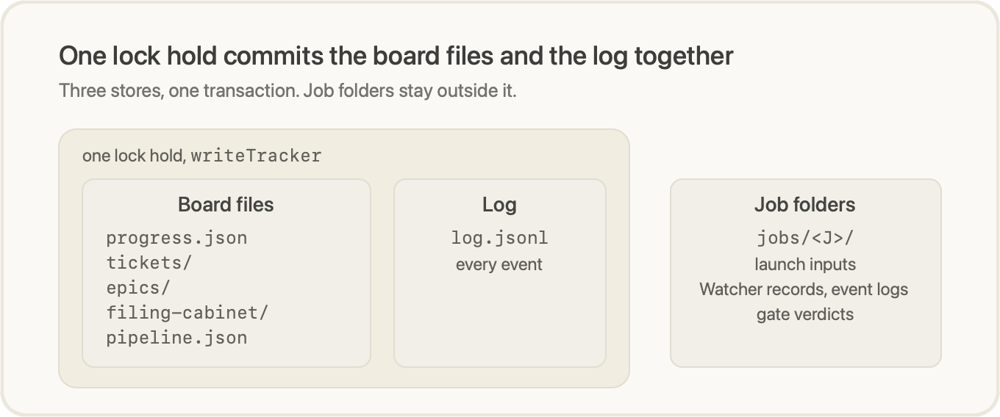
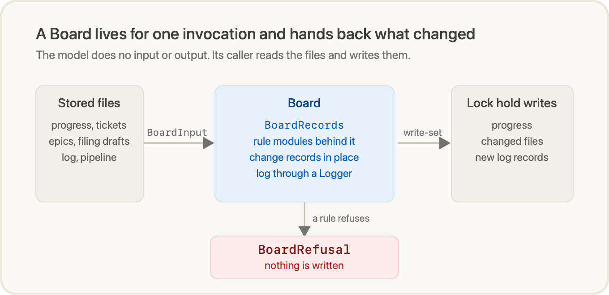
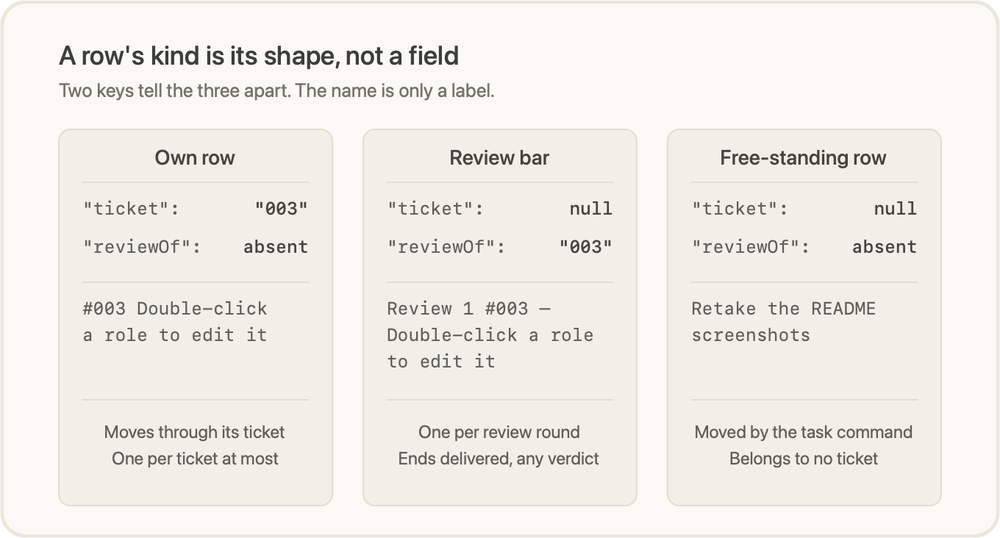
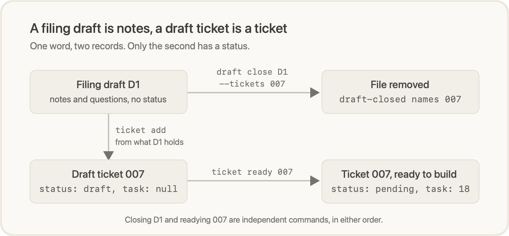
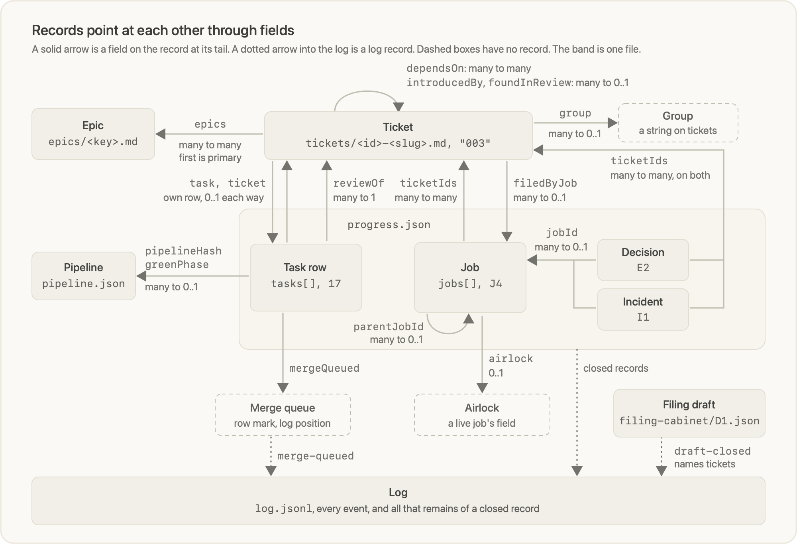
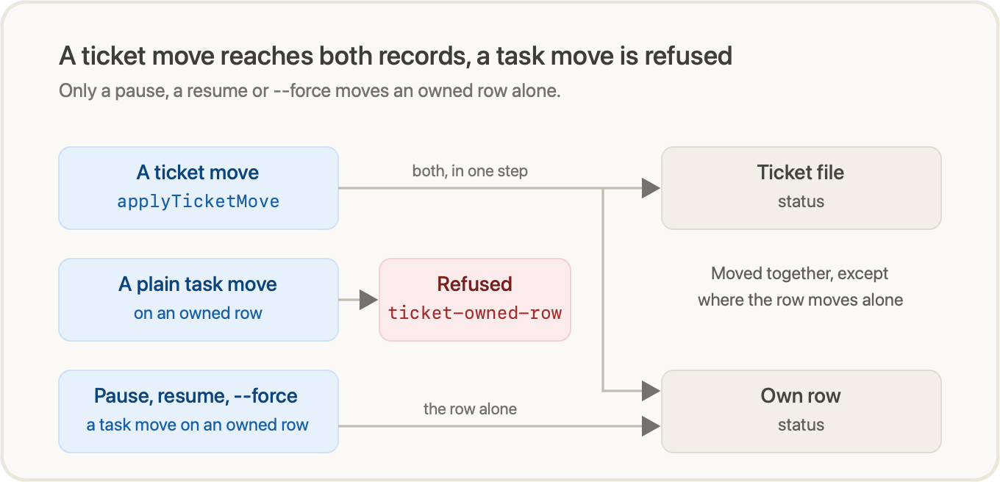
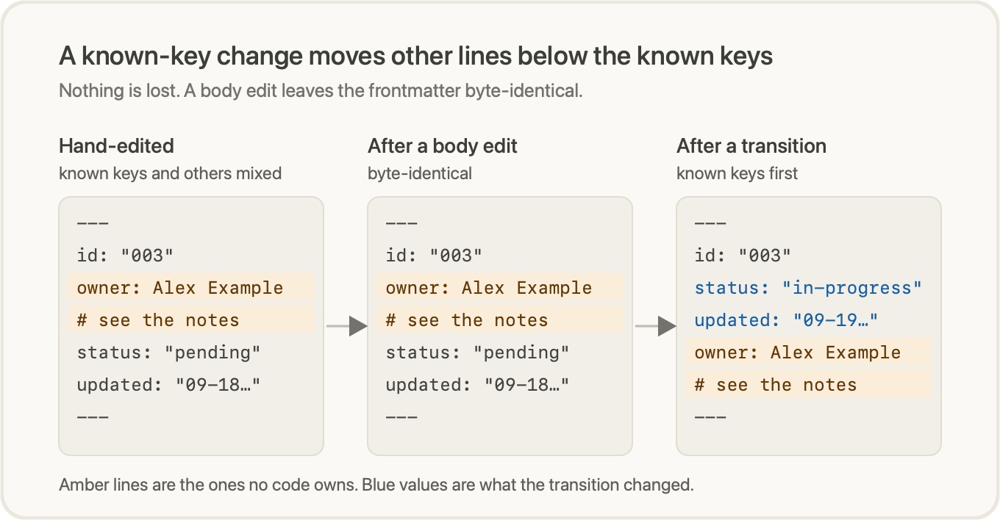

# Data model: entities and identity

> **Question:** What things exist, how do they relate, how are they identified, and where does each one live?
> **Time:** 15 minutes.
> **Read first:** [Overview](../concepts/overview.md), [Glossary](../glossary.md).
> **Next:** [State machines](state-machines.md), [Storage](storage.md), [On-disk atlas](on-disk-atlas.md).

## In one screen

*The band is the transaction: what sits inside it commits together.*

**Three stores.** The [board](../glossary.md#board) files hold the current state: `progress.json`, the
[ticket](../glossary.md#ticket) files, the [epic](../glossary.md#epic) files, the
[filing drafts](../glossary.md#filing-draft) and `pipeline.json`, which holds the [pipeline](../glossary.md#pipeline).
The [log](../glossary.md#log) is `log.jsonl`. A job folder holds what one [job](../glossary.md#job) needs for itself.

**One transaction.** `writeTracker` commits the board files and the log together in one
[lock hold](../glossary.md#lock-hold). Job folders sit outside it. [Storage](storage.md) gives the mechanics.

**`progress.json` holds only open jobs, decisions and incidents.** A job, a [decision](../glossary.md#decision) and an
[incident](../glossary.md#incident) each leave in the lock hold that closes them. Tickets and
[rows](../glossary.md#row), the chart's bars, stay after they finish.

**The log is an input.** Closed jobs, decisions and incidents live on only as log records, and code reads those records
back to decide what happens next. [The log as an input](storage.md#the-log-as-an-input) lists every fact derived from
them.

**Identity.** A ticket is its frontmatter `id`. Jobs, decisions and incidents take `J<n>`, `E<n>` and `I<n>` from stored
counters, so a low id that is gone means closed. [Relations](#relations) maps what points at what.

## The aggregate

`Board` is the one domain object. It lives for one invocation, does no input or output, and is DOM-safe.

*The Board never touches a file: its caller supplies the records and writes what the Board marked as changed.*

- **`BoardInput`** carries `progress`, `tickets`, `epics`, `drafts`, `logger`, `storedLogRecords` and `pipeline`.
- **`BoardRecords`** holds those records plus the write-set: `changedTicketRecords`, `changedEpicRecords`,
  `removedEpicRecords`, `changedDraftRecords`, `removedDraftRecords`, `loggedRecords` and `pipelineChanged`.
  `progress.json` is not in the list because `plannedHoldOf` writes it on every lock hold.
- **Rule modules** sit beside `Board.ts`, one per rule family, for example `TicketMoves`, `Jobs` and `Decisions`.
  [Code map](../architecture/code-map.md) places them.
- **`readingBoardOf`** builds a Board for a caller that only reads. What it logs goes nowhere and nothing is written.

> **Why.** The [Bridge](../glossary.md#bridge)'s TypeScript project compiles this model under DOM-only options and
> imports its types and a few constants. It runs no rule itself; it reads the results from the
> [Overseer](../glossary.md#overseer). The DOM-only compile is why `src/lib/tracker-model/` imports nothing outside its
> own folder and no Node builtin.

## Entity catalogue

Field-by-field formats live in [cli.md](../cli.md). This section gives what each record means, where it lives and what
stays true of it. Paths start at [`<data>`](../glossary.md#reading-names); [On-disk atlas](on-disk-atlas.md) gives their
lifetimes. Bare verbs below are `forge` commands.

| Entity | Type | Lives in | Meaning | Invariants |
| --- | --- | --- | --- | --- |
| TrackerProgress | `TrackerProgress` | `<data>/progress.json` | One board's root: its identity, view, counters and open records. | One per board. `tasks` and `nextTaskId` are always present; every other list and counter appears only once first used. |
| [Task row](../glossary.md#row) | `Task` | `<data>/progress.json`, `tasks` | One bar on the board's chart. | Its kind is its shape, see below. `tokens: null` means nobody reported a figure; `0` is an answer. |
| Ticket | `Ticket` | `<data>/tickets/<id>-<slug>.md` | What was asked for: one piece of requested work, as a Markdown file. | Known by its frontmatter `id`. Launches stop while the `hold` key is present, even with empty text. |
| Epic | `Epic` | `<data>/epics/<key>.md` | A named set of tickets. | No lifecycle: its progress is `EpicRollup`, derived from the tickets naming it. It never touches launching or release. |
| Filing draft | `Draft` | `<data>/filing-cabinet/D<n>.json` | Working notes a filing session builds tickets from. | Never a ticket: no status, no row, no move. |
| Job | `Job` | `<data>/progress.json`, `jobs` | One thing the Overseer launches and tracks to act on tickets, usually one agent session. | On the board until it ends. Holds no process id: [Watcher](../glossary.md#watcher) facts live in its job folder. |
| Decision | `Decision` | `<data>/progress.json`, `decisions` | A question for User. | On the board while open. The first answer wins. |
| Incident | `Incident` | `<data>/progress.json`, `incidents` | Operational trouble for the [Assistant](../glossary.md#assistant). | On the board while open. Never addressed to User. |
| Pipeline | `Pipeline` | `<data>/pipeline.json` | The board's gates, prepare steps and agent instruction lists. | At most one. Absent until a `gate` verb or an accepted `pipeline-proposal` decision writes it. An empty `gates` list means no gates on purpose. |
| Log record | `LogRecord` | `<data>/log.jsonl` | One event, as ids and values with no wording. | Each has a `kind`, its subject's ids, `fields` and `at`. The vocabulary is `LOG_RECORD_SCHEMA`. |

**TrackerProgress keys that carry meaning.** `trackerId` namespaces browser storage. `view` is the chart range.
[`concurrencyLimit`](../glossary.md#concurrency-limit), absent, reads as `DEFAULT_CONCURRENCY_LIMIT_AGENTS`.
`overseerState`, absent, reads as `paused`, so the Overseer launches no build, review, merge or onboarder work until
User's go. The Assistant still boots and interrupted jobs still resume; [The Pass](../architecture/the-pass.md) gives
the rule. `overseerFirstStartedAt` records the Overseer's first start on the board, so first-run handling
(`submitFirstRunLeftovers`) happens once. [`forge clear`](../cli.md) throws away every row and the log and
keeps this key; `clear --all` also deletes the tickets and epics.

**Job.** `kind` is its [job kind](../glossary.md#job-kind) and `role` is the [role](../glossary.md#role) of the agent
doing it. `role` is `null` for `merge` and `refresh`, which run no agent of their own. `target` is the
[target](../glossary.md#target): the [main line](../glossary.md#main-line) or `group-<name>`, and `null` for a
[session](../glossary.md#session). The job's state lives here and is never logged.
[Roles](../architecture/roles-and-launch.md) and [State machines](state-machines.md) give the vocabularies. A job's
Watcher facts live in its folder, see [Watchers](../architecture/watchers.md).

### Three kinds of row

A row has no kind field. Two keys decide what it is.

*Read `ticket` and `reviewOf`, never the name: a `Review 1` name alone does not make a review bar.*

An own row is a ticket's bar, a review bar is one review round's bar, and a free-standing row is tracked work with no
ticket.

- A [review bar](../glossary.md#review-bar) is filed per [review round](../glossary.md#review-round). `reviewBarRound`
  counts from 1 and is fixed at filing.
- `ticket link` or `task add --ticket --force` gives a ticket another row, so a row's kind can change. The row a ticket
  leaves becomes free-standing.
- `ticket link` onto a review bar, or `task add --ticket --review-of`, leaves a row with both keys. It counts as an own
  row, is not listed as a review bar, and still closes and blocks a claim while in progress (`inProgressReviewBarsOf`).
- `reviewRound` is a different counter, on an own row, moved by transitions. [State machines](state-machines.md) keeps
  the two apart.

### Closed records live in the log

Once a record closes, the log is the only place left to find it, and it keeps less than the board did. A filing draft
follows the same pattern from its own file: closing it deletes the file and leaves only log records.

*The refusals compare the id with its stored counter and read no log record; only the dashed reopening does.*

| Record | What the log keeps | What is gone |
| --- | --- | --- |
| Job | `job-launched` (kind, role, tickets, attempt, target, parent), interruptions, resumes, `job-ended` (outcome, cause, commit, denied permissions) | State, cursor, `airlock` |
| Decision | `decision-opened` (kind, tickets), then `decision-answered` (answer keyed by question text, request id) or `decision-withdrawn` (reason) | The context, the unchosen options, `askedBy`, and the question text of a withdrawn decision |
| Incident | `incident-opened` (kind, tickets), any `incident-noted` notes while open, then the closing record: `incident-handled` or `incident-defaulted` (the move), `incident-answered` (the answer keyed by question text) or `incident-escalated` (the decision) | `facts`, and `defaultMove` unless the incident defaulted |
| Filing draft | `draft-opened` (title, owner), note and question ids, every answer, then `draft-closed` (ticket ids) or `draft-abandoned` (reason) | Note text, question text, options |

One exception: messaging a `closed` [product owner](../glossary.md#product-owner) rebuilds its job from `job-launched`
under the same id (`Jobs.reopenEndedJob`), logged `job-reopened`.

`Job.outcome` is never stored in `progress.json`: `endJob` sets it on the returned object after the job leaves the list.
The stored outcome is the `job-ended` record, which `Jobs.endedJobOutcomeOf` reads.

### Two things called draft

*The filing draft holds the thinking and the draft ticket holds the work; neither turns into the other.*

A [draft ticket](../glossary.md#draft-ticket) is a ticket in status `draft`. `draft close` names tickets that already
exist and refuses a reference it cannot find. It converts nothing. After it, the `draft-closed` record is the only link
between D1 and 007.

## Concepts with no record

Four words sound like records and are not.

| Concept | What it is | Where it is read | Home |
| --- | --- | --- | --- |
| [Group](../glossary.md#group) | The string in a ticket's `group`. A branch `group-<name>` is its Airlock target. | `Board` queries over tickets | [Airlocks and groups](../architecture/airlocks-and-groups.md) |
| [Release bundle](../glossary.md#release-bundle) | A graph walk: the open [release ticket](../glossary.md#release-ticket) plus what it depends on inside the group. | `GroupReleases.releaseBundleOf`, `ReleaseBundleUtil` | [Airlocks and groups](../architecture/airlocks-and-groups.md) |
| [Merge queue](../glossary.md#merge-queue) | A `mergeQueued` mark on an own row, plus the `merge-queued` log record, whose place in the log says how long the ticket has waited; `MergeQueueUtil.orderOf` uses it in ordering. Any status but `in-review` deletes the mark. | `MergeQueueMarks`, `MergeQueueUtil.orderOf` | [Airlocks and groups](../architecture/airlocks-and-groups.md) |
| [Airlock](../glossary.md#airlock) | The `airlock` field on a `merge` or `refresh` job on the board. One target has one such job at a time. | `AirlockClaims.slotHolderOf` | [Airlocks and groups](../architecture/airlocks-and-groups.md) |

## Relations

*Each solid arrow is a field on the record at its tail. The dashed boxes are not records, and the dotted arrows into the
log are log records.*

Every relation but one is a field on one side; a filing draft reaches its tickets only through a log record. Only the
ticket and its own row point at each other.

| From | To | Cardinality | Field | Note |
| --- | --- | --- | --- | --- |
| Ticket | Own row | 0..1 to 0..1 | `frontmatter.task`, `task.ticket` | Both sides stored. |
| Review bar | Ticket | many to 1 | `reviewOf` | Its `ticket` is `null`. |
| Ticket | Ticket | many to many | `dependsOn` | Loops refused. A missing id never settles a dependency, so the dependent waits. |
| Bug ticket | Delivered ticket | many to 0..1 | `introducedBy` | Only on a bug; the cause must be delivered. |
| Ticket | Ticket | many to 0..1 | `foundInReview` | Set only at filing. |
| Ticket | Epic | many to many | `epics` | The first is the primary epic. An epic has no back-pointer. |
| Ticket | Group | many to 0..1 | `group` | A string. `releasesGroup` marks the one release ticket. |
| Ticket | Job | many to 0..1 | `filedByJob` | The Overseer sets it from the job whose [Hatch](../glossary.md#hatch) folder carried the filing. |
| Job | Ticket | many to many | `ticketIds` | Empty for a `refresh` job, its merge agents and every session. |
| Job | Job | many to 0..1 | `parentJobId` | A [merge agent](../glossary.md#merge-agent)'s job names the `merge` or `refresh` job that launched it, and a fresh product owner names the one it took over from. `null` otherwise. |
| Decision, Incident | Ticket | many to many | `ticketIds` | |
| Decision, Incident | Job | many to 0..1 | `jobId` | `null` when no job is behind it. A build or review job ending `replaced` or `stopped` hands its open `agent-question` decisions to the ticket: `jobId` becomes `null` and the answer goes to `## Questions`. |
| Row | Pipeline | many to 0..1 | `pipelineHash` | A content hash, not a pointer: the pipeline the ticket was last gated by. |
| Filing draft | Ticket | 1 to many | `draft-closed` log record | Stored in the log only. |

## Identity

Every allocated id is handed out once, with one exception for tickets. An epic key is chosen by the caller, so it may
return. Gaps stay. *Not reused after* names the events the number outlives; the record itself may be gone.

| Thing | Form | Allocator | Not reused after |
| --- | --- | --- | --- |
| Ticket | Padded string `"003"`, `TICKET_ID_DIGITS` (3), growing a digit past 999 | No stored counter. `nextTicketId` takes one past the highest of file names, parsed ids and `ticket` on rows | Every command but `clear --all` |
| Task row | Number | Stored `nextTaskId`, or one past the highest row | `task remove`, `clear`, `clear --all` |
| Job | `J<n>` | Stored `nextJobId` | The job ending |
| Decision | `E<n>` | Stored `nextDecisionId` | Its answer or withdrawal |
| Incident | `I<n>` | Stored `nextIncidentId` | Its closing |
| Filing draft | `D<n>`, also its file name | Stored `nextDraftId` | Its closing |
| Filing draft note, question | `N<n>`, `Q<n>` | `nextNoteNumber`, `nextQuestionNumber` on the filing draft | Being dropped |
| Epic | `key`, matching `EPIC_KEY_PATTERN`, also its file name | Chosen by the caller | Nothing: a key may be reused after its file is removed |
| Board | `trackerId` | Supplied by the caller at `init` | Kept by `clear` |

*Each id below its counter was handed out once, so one missing from the board is closed, not unknown.*

- **A ticket is its frontmatter `id`, never its file name.** `<id>-<slug>.md` is a label. `listTickets` lists a file
  whose name carries another number as malformed, and every file sharing an id too, because which one is the ticket
  cannot be judged.
- **References.** `3`, `#3`, `003` and `#003` all resolve through `TicketIdUtil.parseTicketReference`. `0` is refused.
- **A stored counter wins unless a hand edit left it behind.** `NumberedIdUtil.allocatedNumberOf` then takes one past
  the highest live id.
- **An id below the counter that is missing from the board means closed.** `NumberedIdUtil.wasClosed` answers this for
  decisions and incidents, and `Jobs.requireLiveJob` applies the same rule. Tickets have no stored counter, so the rule
  does not reach them.
- **Gaps are never filled.** Allocators look only upward.

> **As built.** Tickets have no stored counter, so `clear --all` starts them again from `FIRST_TICKET_NUMBER`; see
> [ticket ids after a full clear](../reference/known-gaps.md#gap-clear-all-reuses-ticket-ids).

## Ticket and row

A ticket and its own row are two records that move together. The ticket is what was asked for. The row is how it ran.
[State machines](state-machines.md) lists the statuses each side has.

*Only the bottom arrow moves an owned row without its ticket.*

`BoardRecords.ensureTaskForTicket` returns an existing row untouched and files one only when none exists. This table is
what else each side adds.

| Only the ticket holds | Only the row holds |
| --- | --- |
| Title, type, body, priority, size, `model`, `effort`, `network` | Bar span `start` and `end`, `owner`, `note` |
| `filed`, `updated`, `started`, `finished`, `delivered`, `abandonedAt` | `tokens`, `history`, `reviewed`, `reviewRound` |
| `hold`, `group`, `branch`, `commit`, `reason`, `dependsOn`, `epics` | `mergeQueued`, `pipelineHash`, `agent` |

> **As built.** No command sets a row's `agent` key; see
> [dead code and unused states](../reference/known-gaps.md#gap-dead-code-and-unused-states).

**Which tickets have no row.** `TicketChartUtil.ticketStaysOffTheChart` decides, and a row already given is kept.

![Three states have no row: draft, abandoned and never started, and low pending and never started, where never started means started is null; ticket abandon moves a draft ticket to abandoned. ticket ready, ticket reopen above low priority, a raised priority, a start, ticket link or task add --ticket gives a ticket a row. task remove takes a row away: a ticket in one of those three states returns to it, and any other ticket waits for its next move or a raised priority, unless that move lands it in one of those states.](../figures/entities/ticket-row-presence.png)
*The left panel is all that stays off the chart; the box at the bottom right waits for a move.*

| Ticket | Row | How it arises | Gets one when |
| --- | --- | --- | --- |
| `draft`, at any priority | None | Filing, or `task remove` on a draft ticket | `ticket ready`, at any priority |
| `abandoned`, never started | None | A rowless ticket abandoned, or `task remove` on an abandoned ticket | `ticket reopen`, unless it is low priority, which leads to the next table row |
| `low`, `pending`, never started | None | A rowless low ticket reopened, such as a draft ticket abandoned and reopened; `ticket priority low` on a rowless pending ticket; or `task remove` on a low pending ticket | Its priority is raised or it starts |
| Any other ticket | None | `task remove` | Its next move or a raised priority, unless that move leaves it in one of the three states above (an abandon of a never-started ticket, or a reopen of a low ticket) |

Never started means `started` is null, and a reopen clears it, so a reopened ticket counts even if it was worked on.
`ticket link` or `task add --ticket` gives any rowless ticket a row, and it is kept.

`clear` files each surviving ticket a fresh row from its own dates with `TicketChartUtil.seededFilingOf`, unless it had
no row and `ticketStaysOffTheChart` holds: the first three table rows stay rowless. A draft ticket with a linked row
takes a `pending` row.

## Inside a ticket file

A ticket file has three authors: code, the filer (the person or agent who filed it), and anyone editing it by hand. A
hand edit between runs is kept: the code rewrites only the lines it owns.

*A transition rewrites the blue frontmatter block and leaves the body alone.*

| Part | Written by | Read by code for |
| --- | --- | --- |
| Known frontmatter keys, listed in [cli.md](../cli.md) | Code | The Board's rules |
| Other frontmatter lines | Anyone, by hand | Nothing; kept |
| `# <id> — <title>` | Code, from `resources/templates/TicketBody.md`; `ticket edit --title` rewrites it while it still matches the generated form | Nothing |
| `## Report`, `## Wanted` | The filer, from `resources/templates/TicketBody.md` | Nothing; agents read them |
| [`## Acceptance`](../glossary.md#acceptance) | The filer. Code writes `A<n>. Waived:` from an approved [waiver](../glossary.md#waiver) (`bodyWithWaivedItems`) | Readiness (`acceptance-unnumbered`), [Customs](../glossary.md#customs) (`everyAcceptanceItemAccountedFor`), [landing](../glossary.md#landing) (`TicketAcceptanceUtil`) |
| [`## Brief`](../glossary.md#brief) | The filer | Readiness (`brief-missing`) |
| [`## Handoff`](../glossary.md#handoff) | Code, from a verified [report](../glossary.md#report) (`bodyWithHandoffOf`), replacing the template's guidance | Nothing; the [reviewer](../glossary.md#reviewer) reads it |
| `## Review <n>` | Code, appended from the review report (`ReviewOutcome.reviewSectionOf`) | Landing reads the latest for `A<n> holds`, `does not hold`, `waived`; a resumed builder is sent the newest section (`JobResumption`); `TicketBodyUtil` counts bare `## Review` headings for a hand-started bar's round |
| `## Questions` | Code, appended when an answer outlived its job (`AgentQuestions.afterAnswer`) and for a `malformed-ticket` incident or an answer no job waits on (`AgentQuestions.answerIncident`) | Nothing; the next agent reads it |

> **As built.** The hand-started bar's count misses every code-written section; see [review round
> counts](../reference/known-gaps.md#gap-review-round-counts-bare-headings).

Code writes change only the section or heading named above, through `Board.editTicket`; every other body byte stays.
`claimedBodyHash` records the body at the last move to `in-progress`, so whether a
[builder](../glossary.md#builder) saw the latest body is a hash comparison, never a clock.

## Preservation and strictness

Four stored formats keep content they do not know: `progress.json`, tickets, epics and filing drafts. Two refuse it:
`pipeline.json` and `log.jsonl`. [What breaks](storage.md#what-breaks-and-what-still-works) gives what each failure
does.

| File | Unknown content | Reader | Version check |
| --- | --- | --- | --- |
| `progress.json` | Kept in stored order: top level, rows, and nested job, decision and incident objects, except a top-level `log` or `RETIRED_PIPELINE_KEYS` key and a row's `checkCommand`, which are refused | Validated JSON, then mapped | `CURRENT_PROGRESS_FILE_VERSION` (2), by equality |
| Ticket | Kept: unknown keys, `#` comments and blank lines, moved below the known keys once a known key other than `title` or a stored `claimedBodyHash` changes. CRLF kept | One line-by-line read, deliberately not YAML | None |
| Epic | Kept, after its three keys | The same frontmatter subset | None |
| Filing draft | Kept, after its own keys | Validated JSON | `CURRENT_DRAFT_FILE_VERSION` (1), by equality |
| `pipeline.json` | **Refused**: an unknown key makes the file malformed | `PipelineFile.read`, field by field | None |
| `log.jsonl` | **Refused**: an unknown kind makes the line a problem | Each line validated; one bad line makes the log unreadable | None |

*A rename or a stored `claimedBodyHash` change rewrites only its own line, so it keeps the order too.*

An optional key is written only once set, and a read adds nothing, so an untouched file stays byte-identical. The ticket
parser reads the file once because a second walk would risk the lines it does not own.

## Invariants

1. A ticket's identity is its frontmatter `id`.
2. Row, job, decision, incident and filing draft ids never repeat on a board.
3. `progress.json` holds a job until it ends, and a decision or incident while open.
4. A review bar is a row with `reviewOf` and `ticket: null`, and its name plays no part.
5. A ticket in status `draft` has no row unless `ticket link` or `task add --ticket` gave it one; `ticket ready` files
   its row as it leaves `draft`.
6. A ticket-owned row moves with its ticket, unless the move is a pause, a resume or forced.
7. An epic never gains a stored progress: its roll-up is computed from the tickets.
8. No process identity is stored on the board.
9. No group, release bundle, merge queue or Airlock has a stored record.
10. `tracker-model` code does no input or output.

## In the code

| Concept | Path | Symbol | Spec |
| --- | --- | --- | --- |
| Aggregate | `src/lib/tracker-model/Board.ts` | `Board`, `BoardInput` | `src/lib/tracker-model/Board.spec.ts` |
| Write-set and row filing | `src/lib/tracker-model/BoardRecords.ts` | `BoardRecords`, `ensureTaskForTicket` | `src/lib/tracker-model/Board.tasks.spec.ts` |
| Model isolation | `src/lib/tracker-model/@types/Task.ts` | package header | `src/ImportDirection.spec.ts` |
| Off-chart rule, seeding | `src/lib/tracker-model/utils/TicketChartUtil.ts` | `ticketStaysOffTheChart`, `seededFilingOf` | `src/lib/tracker-model/utils/TicketChartUtil.spec.ts` |
| Ticket and row moving together | `src/lib/tracker-model/TicketMoves.ts` | `applyTicketMove` | `src/lib/tracker-model/Board.ticketMoves.spec.ts` |
| Row moves | `src/lib/tracker-model/utils/TaskRecordUtil.ts` | `transitionedTaskOf` | `src/lib/tracker-model/utils/TaskRecordUtil.spec.ts` |
| Review bars | `src/lib/tracker-model/ReviewBars.ts` | `startReviewBar`, `closeInProgressReviewBars` | `src/lib/tracker-model/Board.reviewBars.spec.ts` |
| Numbered ids | `src/lib/tracker-model/utils/NumberedIdUtil.ts` | `allocatedNumberOf`, `wasClosed` | `src/lib/tracker-model/utils/NumberedIdUtil.spec.ts` |
| Ended job brought back | `src/lib/tracker-model/Jobs.ts` | `reopenEndedJob`, `endedJobOutcomeOf` | `src/services/control/JobControls.spec.ts` |
| Ticket ids and references | `src/lib/tracker-model/utils/TicketIdUtil.ts`, `src/services/tracker/TicketStore.ts` | `parseTicketReference`, `nextTicketId` | `src/lib/tracker-model/utils/TicketIdUtil.spec.ts`, `src/services/tracker/TicketStore.spec.ts` |
| Ticket parse and write | `src/adapters/tickets/utils/TicketDocumentUtil.ts` | `parsedTicketDocumentOf`, `ticketDocumentTextOf` | `src/adapters/tickets/utils/TicketDocumentUtil.spec.ts` |
| Acceptance and Review reading | `src/adapters/tickets/utils/TicketAcceptanceUtil.ts` | `AcceptanceVerdict` | `src/adapters/tickets/utils/TicketAcceptanceUtil.spec.ts` |
| Preserving progress keys | `src/adapters/progress/utils/ProgressFileMappingUtil.ts` | `UNKNOWN_STORED_KEYS` | `src/adapters/progress/utils/ProgressFileMappingUtil.spec.ts` |
| Strict pipeline | `src/adapters/pipeline/PipelineFile.ts` | `PipelineFile.read` | `src/adapters/pipeline/PipelineFile.spec.ts` |
| Filing drafts | `src/lib/tracker-model/Drafts.ts` | `closeDraft` | `cli/drafts/DraftCommand.spec.ts` |
| Log vocabulary | `src/lib/tracker-model/constants/LogRecordSchema.ts` | `LOG_RECORD_SCHEMA` | `src/lib/tracker-model/Board.logRecords.spec.ts` |
| Merge-queue mark | `src/lib/tracker-model/MergeQueueMarks.ts` | `queueTicketForMerge` | `src/lib/tracker-model/Board.airlocks.spec.ts` |
| Release bundle | `src/lib/tracker-model/GroupReleases.ts` | `releaseBundleOf` | `src/lib/tracker-model/Board.groupReleases.spec.ts` |
| Airlock on a job | `src/lib/tracker-model/AirlockClaims.ts` | `slotHolderOf` | `src/lib/tracker-model/Board.airlocks.spec.ts` |
