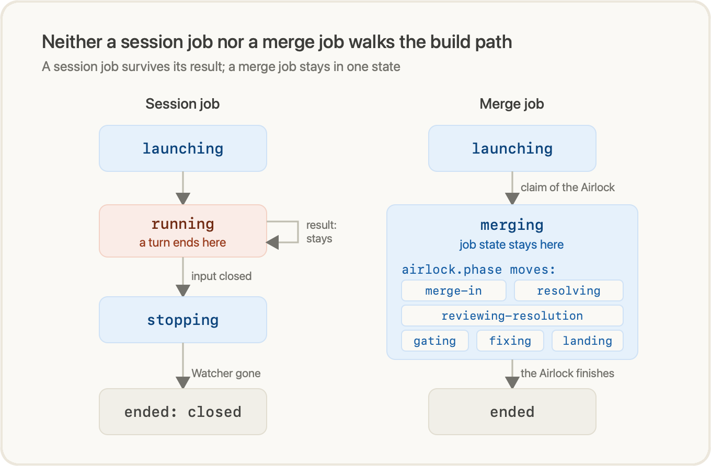

# State machines

> **Question:** What states can each thing be in, what may come next, and what moves it?
> **Time:** 35 minutes.
> **Read first:** [Entities](entities.md).
> **Next:** [Storage](storage.md), [Build and review](../architecture/build-and-review.md),
> [State explorer](../interactive/state-explorer.html).

## In one screen

Six machines and one overlay live here.

| Machine | What it is | What its state says |
| --- | --- | --- |
| [Ticket](../glossary.md#ticket) | one piece of work | how far the work is |
| [Row](../glossary.md#row) | the ticket's bar on the chart | the same status, plus two a ticket does not have |
| [Job](../glossary.md#job) | one unit of agent work, or one merge | what it is doing now; it leaves the [board](../glossary.md#board) when it ends |
| [Overseer](../glossary.md#overseer) | the process that drives the board | one state says what the process is doing, a stored one says whether the board takes new work |
| [Filing draft](../glossary.md#filing-draft) | a ticket still being written | whether it waits on an answer, is being worked on, or can be picked up; it has no timeout |
| [Decision](../glossary.md#decision) | a question waiting on User | it is open or gone |

- A [hold](../glossary.md#hold) is an overlay, never a status. It stops the next launch; the ticket keeps its status.
- No status says "merging". A queued ticket stays `in-review`; the [merge queue](../glossary.md#merge-queue) is a row
  mark and a position in the [log](../glossary.md#log), and the [Airlock](../glossary.md#airlock) holder is a live job.
- `interrupted` is not ended. An interrupted job stays on the board and normally resumes in the next [Watcher
  instance](../glossary.md#watcher-instance); only the bounds under [Job](#job) replace it.

*Follow the straight spine first: from `pending` on, code moves every forward edge; User readies a draft ticket. A
review that finds a false claim loops back, and the amber rails are the by-hand exits.*

## Every machine and its home

Seven entries are defined here; the rest link their home.

| Machine | Stored in | States | Home |
| --- | --- | --- | --- |
| Ticket | ticket file, `status` | 7 | [below](#ticket) |
| Hold | ticket file, `hold` | present or absent | [below](#hold-an-overlay-on-any-status) |
| Row | `progress.json`, `tasks` | 8 stored, 2 [display](../glossary.md#display-state) | [below](#row) |
| Job | `progress.json`, `jobs` | 11 plus `ended` | [below](#job) |
| Overseer | process, and `overseerState` | 4 runtime, 2 stored | [below](#overseer) |
| Filing draft | derived from the filing draft's file | 3 | [below](#filing-draft) |
| Decision | `progress.json`, `decisions` | open or gone | [below](#decision) |
| Airlock phase | `job.airlock.phase` | 6 | [Airlocks and groups](../architecture/airlocks-and-groups.md) |
| [Watcher](../glossary.md#watcher) | the job's Watcher record | see home | [Watchers](../architecture/watchers.md) |
| [Baton pass](../glossary.md#baton-pass) | the Baton pass file | see home | [Baton](../architecture/baton.md) |
| [Incident](../glossary.md#incident) | `progress.json`, `incidents` | see home | [Questions and incidents](../architecture/questions-and-incidents.md) |

## Ticket

A ticket has seven statuses and one legality table. The named verbs and the Overseer's own moves keep the table;
`ticket status` skips it on purpose. Commands in this document omit the `agent-progress-v2` prefix. What each move does
to the row, stamps and log line is in [Ticket moves and their rows](../cli.md#ticket-moves-and-their-rows).

From `src/lib/tracker-model/constants/TicketMoveLegality.ts`, `LEGAL_SOURCE_STATUSES_FOR_TICKET_STATUS`. Read a line as
"to reach the target, the ticket has to be in one of these":

| Target | Means | Legal sources |
| --- | --- | --- |
| `draft` | filed and not ready; nothing launches it | none |
| `pending` | ready, waiting for a launch | `draft`, `in-progress`, `in-review`, `reviewed`, `delivered`, `abandoned` |
| `in-progress` | a [builder](../glossary.md#builder) has the work, or has it next | `pending`, `in-review` |
| `in-review` | the build's [gate](../glossary.md#gate) passed; review and the merge queue both happen here | `in-progress` |
| `reviewed` | landed on a group branch, not yet on the main line | `in-progress`, `in-review` |
| `delivered` | on the main line | `reviewed` |
| `abandoned` | given up, with a reason | `draft`, `pending`, `in-progress`, `in-review`, `reviewed` |

No status lists itself as a legal source, so a move to the current status is never legal.

> **Careful.** `reviewed` does not mean the review passed. A released ticket stays `in-review` until it lands, and a
> ticket landing on the main line passes through `reviewed` in one move on its way to `delivered`.

### Who moves each edge

From `pending` on, the Overseer moves the forward path. User runs the verbs that ready a [draft
ticket](../glossary.md#draft-ticket) and the exits. Agents get one of them, because the
[Bouncer](../glossary.md#bouncer) lets a job's move through only for a [product owner](../glossary.md#product-owner)
abandoning its own draft ticket. Filing is the only way into `draft`; a worker's
[finding](../glossary.md#finding) is submitted in the hold that files it.

| Edge | Moved by | Function |
| --- | --- | --- |
| into `draft` | `ticket add`, or a job's filing | `fileTicket` |
| `draft` to `pending` | `ticket ready`, a `ready-drafts` answer, or a worker's complete finding with ticket review off | `readyDraftTickets`, `submitDraftTickets` |
| `pending` to `in-progress` | a build job leaves `launching` | `applyObservation` in `src/services/overseer/JobLaunch.ts` |
| `in-progress` to `in-review` | the build's gate passed | `settleGate` |
| `in-review` to `in-progress` | a [reviewer](../glossary.md#reviewer)'s claim proves false | `settleReviewPass`, review move `fixer`, which sends the ticket back to a builder |
| `in-review` to `reviewed` | a merge landed on a [group](../glossary.md#group) branch | `landOnTheBoard` |
| `in-review` to `reviewed` to `delivered` | a merge landed on the main line | `landOnTheBoard`, `releaseTickets` |
| `reviewed` to `delivered` | the [release bundle](../glossary.md#release-bundle)'s [release ticket](../glossary.md#release-ticket) landed | `releaseTickets` |
| any open status to `abandoned` | `ticket abandon`, reason required | `moveTicket` through `abandonTicket` |
| any status but `draft` or `pending`, to `pending` | `ticket reopen` | `moveTicket` |

`releaseTickets` calls `applyTicketMove`, which checks nothing: its caller refuses first through `ticketIsReleasable`.

### The checks of `moveTicket`, in order

`moveTicket` runs these in this order, and a refusal writes nothing.

1. `ticket-already-in-status`: the target is the current status.
2. `move-to-draft`: the target is `draft`.
3. `move-of-a-draft`: the ticket is `draft` and the target is not `abandoned`.
4. `illegal-ticket-move`: the table refuses, only when `checksLegality` is true.
5. `abandon-without-reason`: the target is `abandoned` and the reason is blank.
6. `reopen-beside-an-open-release-ticket`: from `refuseReopeningBesideAnOpenReleaseTicket`.
7. `tokens-without-a-row`: `--tokens` on a ticket with no row, judged after the move, in the same refused write.

*Read column 4: it is the only check an override removes, and three routes never reach `moveTicket` at all.*

`ticket status <id> <status>` passes `checksLegality: false`. So it never moves a ticket into `draft`, never moves a
`draft` ticket anywhere but `abandoned`, and still needs a reason to abandon. Moving to `in-progress` this way warns on
standard error when the ticket is held or waits on a dependency, and moves it anyway.

`ticket deliver --by-hand` is the same override toward `delivered`. It is refused while a [Baton](../glossary.md#baton)
is live (`overseer-owns-the-lifecycle`) or a job of the ticket is live (`ticket-has-live-job`).

Two legal table entries are never taken by `moveTicket`:

- `draft` to `pending`: `moveTicket` refuses it (check 3). Only `readyDraftTickets` takes this edge; it tests for
  `draft` itself and requires a complete ticket body.
- `in-progress` to `reviewed`: no Overseer step makes this move. `ticketIsReleasable` asks the table about it, to decide
  whether a release may include the ticket, and `ticket status` can make it.

A move has two side effects beyond its stamps. Every move other than one into `in-review` closes the ticket's
in-progress [review bars](../glossary.md#review-bar). A move into `in-progress` stores `claimedBodyHash`, which
`bodyChangedSinceClaimOf` compares with the body to tell whether it changed since.

### Stamps

A stamp is a time the ticket records. Corrections keep the first value, and a move to `pending` clears all of them.
`stampsAfterMoveOf` in `src/lib/tracker-model/utils/TicketMoveUtil.ts` keeps `started`, `finished` and `delivered` once
set, so a correction does not rewrite history. `abandonedAt` is always written, because it records the latest abandon. A
`--reason` on any move is stored. Only a transition stamps `updated`, and `rereviewTicket` counts as one.

Stamps by target status

| Target | `started` | `finished` | `delivered` | `abandonedAt` | `reason` |
| --- | --- | --- | --- | --- | --- |
| `pending` | cleared | cleared | cleared | cleared | dropped, unless the move gives one |
| `in-progress` | set if null | kept | kept | kept | kept |
| `in-review`, `reviewed` | kept | set if null | kept | kept | kept |
| `delivered` | kept | kept | set if null | kept | kept |
| `abandoned` | kept | kept | kept | always set | given |

### `rereviewTicket`

`rereviewTicket` is the one move that keeps the status. It is legal only from `in-review` (else
`rereview-outside-review`): `updated` moves, the row goes to `re-review`, and `ticket-rereviewed` logs the round. Only
`ticket rereview` calls it. The Overseer counts its [review rounds](../glossary.md#review-round) on review bars.

## Hold: an overlay on any status

A hold is the presence of the `hold` key on a ticket, and its text is only the reason. An empty text still holds. No
status move reads or changes it, so one hold can sit on a ticket through a reopen.

*Shading shows where each hold starts. A status move carries the hold with it, so read the grid as origin, not limit.*

| Text | Written by | Lifted by |
| --- | --- | --- |
| any text, or empty | `ticket hold [--reason]` | `ticket unhold` |
| `parked:failed-passes`, `parked:red-resumes-spent` | the [Playbook](../glossary.md#playbook)'s `park` step | `ticket unhold` |
| `parked:<incident kind>`, `parked:user` | `ticket park`, `merge abort`, or an incident default, through `parkUnder` | `ticket unhold` |
| `parked:merge-gate-failed`, `parked:merge-resolution-rejected` | `abortAndPark` in the Airlock; `parked:merge-gate-failed` also arrives through `parkUnder` | `ticket unhold` |
| `parked:target-moved` | `settleMovedTarget` in the Airlock | `ticket unhold` |
| `landing-refused:<reason>` | a [landing](../glossary.md#landing) refused on [Acceptance](../glossary.md#acceptance) | `ticket unhold` |
| `awaiting answer (E<n>)` | a job ended `replaced` or `stopped` with its question open, only when the ticket has no hold yet | answering `E<n>`, or `ticket unhold` |
| `stopped by User (J<n>)`, `wound down by User (J<n>)` | `job stop`, `job wind-down` | `ticket unhold` |

> **As built.** Answering a `parked` decision lifts nothing. See
> [gap-answering-parked-does-not-unhold](../reference/known-gaps.md#gap-answering-parked-does-not-unhold). The runbook's
> [A parked ticket](../operations/runbook.md#a-parked-ticket) gives the ways back.

Only `parkUnder` replaces an existing hold ([`ticket park`](../glossary.md#park), an incident default, `merge abort`).
The Playbook's `park` step, `abortAndPark` and every other writer go through `holdTicket`, which refuses
`ticket-already-held`; a stop leaves an existing hold in place.

A hold stops the next launch and the next Airlock claim, and it leaves a running agent alone. One exception: a `parked:`
hold also stops a merge already in the Airlock.

| Action | Stopped by a hold |
| --- | --- |
| a launch or a `queue-merge` step, through `ticketIsHeld` in the Playbook | yes |
| an Airlock claim, through `mergeCandidatesOf` | yes |
| a merge already in the Airlock | only a `parked:` text, once no incident is open on the merge job, in `advanceTheSlot` |
| a running agent | no |
| a resume of an interrupted job | no |
| a status move by hand | no |

A `ticket-unheld` record also resets the failed-pass count and starts a fresh [attempt](../glossary.md#attempt); see
[Build and review](../architecture/build-and-review.md). `ticketIsHeld` also stops a launch for reasons other than a
`hold` key; [The Pass](../architecture/the-pass.md) lists them.

## Row

A row carries the ticket's status for the chart, and adds two statuses no ticket has. Code calls a row a
[task](../glossary.md#task). Rows have no legality table. Moving a row a ticket owns is refused (`ticket-owned-row`)
unless `--force` is given or the move is a pause or its resume. `task update --status` (`correctTask`) meets the same
refusal; with `--force` it changes the status without touching stamps or adding to `history`.

*Lines join the words the Board keeps equal. The dashed chips are the two display states, shown and not stored on a
row. The [Bridge](../glossary.md#bridge)'s "Awaiting merge" for `reviewed` means awaiting the merge to the main line.*

From `src/lib/tracker-model/constants/Statuses.ts`, `TASK_STATUSES`, as `transitionedTaskOf` in
`src/lib/tracker-model/utils/TaskRecordUtil.ts` applies them:

| To | `start` | `end` | Other |
| --- | --- | --- | --- |
| `in-progress`, `paused` | set if null | cleared | `in-progress` deletes `agent`, unless the row was `in-progress` or `paused` |
| `in-review`, `reviewed`, `delivered` | set if null | set if null | `reviewed` sets `reviewed` if null |
| `re-review` | set if null | set if null | `reviewRound` starts at `FIRST_REPEAT_REVIEW_ROUND` (2), then grows by one |
| `abandoned` | kept | set if null, only if started | |
| `pending` | cleared | cleared | deletes `reviewed` and `reviewRound` |

Two rules cross every line. Every status but `in-review` deletes `mergeQueued`; an abort, a parked merge, a refused
merge, a refused landing and a waiver remove it directly while the row stays `in-review`. `history` grows only when the
status moved, or on `re-review`, which grows it every time.

Four words need care:

- **`paused`** is written by `task pause` or `task update --status paused`. The Overseer never writes it and the
  Playbook does not read it, so a launch still goes ahead on that ticket. `task start` resumes it by hand.
- **`re-review`** comes from `ticket rereview`, `task rereview`, or a correction through `task update --status`, which
  does not raise `reviewRound`. The Overseer never writes it.
- **`reviewing`** is a display state, never stored. `displayStateFor` gives it to a row and ticket both `in-review`
  while one of the ticket's review bars is `in-progress`. It stays on after the reviewer ended, through the merge queue,
  until the next review's start, a ticket move out of `in-review`, or the release closes the bar.
- **`draft`** is the display state of a `draft` ticket, which never has a row. `ticketStaysOffTheChart` also keeps a low
  never-started `pending` ticket and an unstarted `abandoned` ticket off the chart, but those display their own status.

### When ticket and row differ

A ticket move writes the ticket's status on its row. Without `--force`, the two then differ only in these cases:

- After `task pause`: the row reads `paused`.
- After `task pause`, then `task start`: the row reads `in-progress`, whatever the ticket is.
- After `ticket rereview`: the row reads `re-review`.

A row linked by hand keeps its status until the next move, and a ticket off the chart has no row.

*Amber spans are the only drift. Each ends at the next ticket move, which writes the ticket's status over the row.*

### Review bars

*The two counters look alike and count different things.*

`reviewBarRound` sits on a review bar and is fixed at filing. It counts from `FIRST_REVIEW_BAR_ROUND` (1) and rises with
each granted [review round](../glossary.md#review-round) since the build last finished. `reviewRound` sits on a ticket's
row, starts at `FIRST_REPEAT_REVIEW_ROUND` (2) and moves only with `re-review`. `ticket rereview --start-review` also
files a bar, with its round counted from the ticket's `## Review` sections.

A review bar ends `delivered` whatever the verdict. `closeInProgressReviewBars` moves it `in-review`, then `delivered`,
at the next review's start, at a ticket move out of `in-review`, or at release. A reviewer ending closes nothing, and
the bar says nothing about the result. The verdict is in the `review-recorded` log record.

## Job

A job moves through one legality table and leaves the board when it ends. Only `build` and `review` use the full path;
the other [job kinds](../glossary.md#job-kind) use part of it. `merge` is the Airlock's own job for one landing,
[`refresh`](../glossary.md#refresh) its job for a group branch, and neither runs an agent: `role` is `null`.
`merge-agent` is a [merge agent](../glossary.md#merge-agent), launched inside a merge, in a
[role](../glossary.md#role) such as [`merge-fix`](../glossary.md#merge-fix).
`SESSION_JOB_KINDS` are `assistant` and `product-owner`; their `result` ends a turn, never the job. An
[onboarder](../glossary.md#onboarder) proposes the [pipeline](../glossary.md#pipeline).

No record of a live job says what process runs it; that lives in the job's folder
([Watchers](../architecture/watchers.md)).

*Amber states have no agent working. Only `interrupted` resumes; `waiting-for-answer` keeps its process, and
`awaiting-answer` leaves only by ending or stopping.*

The states come from `JOB_STATES` in `src/lib/tracker-model/constants/JobStates.ts`. Their meanings follow a build or
review job:

Every state and what it means

| State | Means |
| --- | --- |
| `launching` | recorded on the board; its session has not started |
| `preparing` | the job's [worktree](../glossary.md#worktree) and install step are set up |
| `running` | an agent [session](../glossary.md#session) works |
| `waiting-for-answer` | the agent asked a question, and its process stays alive |
| `interrupted` | the process is gone and the job stays on the board, to resume or be replaced |
| `awaiting-answer` | no process; the job waits on an answer |
| `in-customs` | the agent closed its turn, and [Customs](../glossary.md#customs) checks its [report](../glossary.md#report) |
| `gating` | the gates run on the worktree |
| `merging` | a merge or refresh job holds an Airlock slot, and `airlock.phase` says how far it is |
| `landing` | nothing: [no production path](#unused-in-production) reaches it |
| `stopping` | asked to stop, waiting for the Watcher to finish |
| `ended` | off the board, its outcome in the log |

From `src/lib/tracker-model/constants/JobMoveLegality.ts`, `LEGAL_SOURCE_STATES_FOR_JOB_MOVE`:

Every move, with what reaches it

| Target | Legal sources | Reached by |
| --- | --- | --- |
| `launching` | none | `launchJob` only |
| `preparing` | `launching` | `applyObservation` |
| `running` | `launching`, `preparing`, `waiting-for-answer`, `interrupted`, `awaiting-answer` | from `launching` or `preparing`: the `started` event; from `preparing`: install done; from `waiting-for-answer`: an answer; from `interrupted`: the `resume-job` step; from `awaiting-answer`: [no production path](#unused-in-production) |
| `waiting-for-answer` | `running` | `QuestionRouting.openQuestion` |
| `interrupted` | `preparing`, `running`, `waiting-for-answer`, `stopping`, `in-customs`, `gating` | `interruptJob`, with a cause |
| `awaiting-answer` | `interrupted`, `gating` | from `interrupted`: the `await-answer` step; from `gating`: a [waiver](../glossary.md#waiver) move |
| `in-customs` | `running` | a closing `result` event, `applyWatcherEvents` |
| `gating` | `in-customs`, `merging` | from `in-customs`: Customs verified, or a merge-fix agent's `resolved` report; from `merging`: [no production path](#unused-in-production) |
| `merging` | `launching` | `holdSlot` in `AirlockClaims` |
| `landing` | `gating` | [no production path](#unused-in-production) |
| `stopping` | every state but itself | a stop request, a spent [call budget](../glossary.md#call-budget), a product owner closing its intake, an idle Assistant past `ASSISTANT_CONTEXT_TOKENS_BEFORE_FRESH` |
| `ended` | every state | `endJob` |

The answer to a job's last open question returns it to `running` in the same instance. `interrupted` and
`awaiting-answer` are `PROCESSLESS_JOB_STATES`. Why a job was interrupted is an `InterruptionCause`; the causes are in
[Failure and recovery](../architecture/failure-and-recovery.md).

### Resumes and their bounds

A resume is `watcherInstance` + 1. `moveJob` counts a move into `running` from a processless state as a resume. Only
`interrupted` gets there. The move raises `watcherInstance`, logs `job-resumed`, and adds to `crashResumes` only for a
cause in `CRASH_INTERRUPTION_CAUSES`. The next Watcher takes the same session;
[Watchers](../architecture/watchers.md) separates instance, session and attempt.

Bounds replace a resume. Past `JOB_RESUMES_BEFORE_FRESH` crash resumes, the `replace-job` step ends the job `replaced`
and a fresh attempt follows. A [red handoff](../glossary.md#red-handoff) past `RED_HANDOFF_RESUMES_BEFORE_PARKING`
resumes ends the job and parks the ticket. Session kinds differ; see
[Which kinds use which states](#which-kinds-use-which-states).

### What the log keeps

The log keeps only some moves. `job-launched`, `job-interrupted`, `job-resumed`, `job-ended`, `job-reopened`,
`job-stop-requested` and `job-messaged` reach it. Every other move lives in `progress.json` alone, so the log cannot
replay a job's states.

### Stopping a job

A stop has two speeds. `requestJobStop` records the request, and the job's state decides the rest. A job with no session
has nothing to wait for, so it ends in the same [lock hold](../glossary.md#lock-hold). A build or review with a live
session needs its Watcher to finish first. `job fresh` asks for a replacement agent, so it writes no hold and needs a
ticket. A [wind-down](../glossary.md#wind-down) asks the agent to finish and report, and changes no state.

![Three rows, stop, fresh and wind-down, against no session, build or review in any other state, and session job. A stop or fresh ends a job with no session at once, and fresh needs a ticket. A build or review otherwise goes to stopping and ends. A product owner, or an Assistant in any other state, goes to stopping on a stop, ends closed, and refuses fresh. wind-down changes no state. stop and wind-down write a hold where the job has a ticket. A merge or refresh carries on from stopping; a merge-agent or onboarder stays stopping.](../figures/state-machines/stop-modes.png)

*Only `stop` and `wind-down` write the ticket hold; `fresh` never does. The last two lines under the grid are the kinds
the grid's columns do not cover.*

How the other kinds read <code>stopping</code>

- An Assistant ends `closed` once its Watcher is gone.
- A `merge` or `refresh` job moves to `stopping` and a merge's ticket takes the hold, but the Airlock does not read that
  state, so the merge carries on ([gap-job-stop-misses-merge](../reference/known-gaps.md#gap-job-stop-misses-merge)).
- An onboarder receives no stop frame, and nothing ends it from `stopping`. It stays on the board, and a new onboarder
  does not launch beside it.
- A merge agent receives no stop frame and stays `stopping`. Its merge stalls with it, until the merge gives up its
  Airlock slot, which ends the agent `stopped`
  ([gap-stop-of-merge-agent-sends-no-frame](../reference/known-gaps.md#gap-stop-of-merge-agent-sends-no-frame)).

### Reopening

An ended job comes back in one case. `reopenEndedJob` rebuilds a job from its log records, `running` in the last
instance + 1. Only a product owner that ended `closed` reaches it, through `messageJob`.

### Which kinds use which states

*Read a column to see who reaches a state: `merging` belongs to two kinds, and `preparing` to the two worktree kinds.*

*These two shapes sit furthest from the build path. For a merge job, read `airlock.phase` for progress: the job state
says nothing more than `merging`.*

An interrupted `assistant` ends in the next lock hold, `replaced` or `failed`. An interrupted `product-owner` past its
crash bound waits in `awaiting-answer` if a question is open, and otherwise a fresh session takes its intake over.

### Unused in production

These entries are in the code and no production path reaches them.

Every unused state and move

| Entry | Note |
| --- | --- |
| state `landing` | `landing` occurs only as an Airlock phase |
| `gating` to `landing`, `landing` to `stopping`, `landing` to `ended` | follow from the state |
| `merging` to `gating` | a merge job stays `merging` |
| `preparing` to `interrupted` | a setup failure ends the job `stopped` |
| `preparing` to `stopping` | a stop ends a `preparing` job in the same lock hold |
| `awaiting-answer` to `running` | a product owner leaves through `refresh-intake`, not a resume |

> **As built.** A review in `awaiting-answer` for a waiver has no way forward from an answer. See
> [gap-waiver-answer-has-no-effect](../reference/known-gaps.md#gap-waiver-answer-has-no-effect). The list above is also
> in [gap-dead-code-and-unused-states](../reference/known-gaps.md#gap-dead-code-and-unused-states).

### Outcomes

An ended job leaves the board, so its outcome lives in the `job-ended` log record, one of `JOB_OUTCOMES`.
`endedJobOutcomeOf` reads it from there; `Job.outcome` exists only on the record `endJob` returns.

Every outcome, one line each

| Outcome | Means |
| --- | --- |
| `built` | a build's gate passed; the ticket went `in-review` |
| `reviewed` | a review released the ticket into the merge queue |
| `round-granted` | another review round was granted; the ticket stays `in-review` |
| `does-not-hold` | a review claim proved false; the ticket went `in-progress` |
| `resolved` | a merge agent finished its work |
| `cannot-resolve` | a report word, never written as an outcome |
| `landed` | a merge reached the main line |
| `integrated` | a merge reached a group branch ([integrated](../glossary.md#integrated)) |
| `refreshed` | a refresh finished |
| `wound-down` | a builder reported it wound down |
| `failed` | the attempt failed; a failed Airlock merge too; `cause` says why |
| `blocked` | a builder reported it is blocked |
| `replaced` | a fresh session or attempt takes over |
| `stopped` | ended by User, a setup failure, the call budget, a gate that cannot run, a requeue, an abort or a park; `cause` says why |
| `closed` | a session or onboarder ended normally |

## Overseer

Two independent facts are both called state. The runtime state says what the process is doing. The stored
`overseerState` says whether the board takes new work. `paused` stops only new work.

![Runtime state across, stored state down. Serving with running launches, resumes, opens an Airlock slot and takes commands. Serving with paused stops only new work and new Airlock slots. Held refuses control commands and stops new work and resumes, whatever is stored, and the stored value decides only the Airlock slot. passing-baton is a label over serving or held-by-install-change, so all stays as before the Baton pass until the Overseer lets go, except that the 423 guard stops applying. Down has no Pass and no API, whatever is stored, and CLI verbs still write.](../figures/state-machines/overseer-states.png)

*Across a row the process decides. Down a column the stored value decides launches and Airlock slots; under
`held-by-install-change` it decides only whether an Airlock slot opens, and under `down` it decides nothing.*

From `OverseerRuntimeState` in `src/services/overseer/BoardState.ts`:

| Runtime state | Set by | Means |
| --- | --- | --- |
| `serving` | the [Pass](../glossary.md#pass), each time | the normal case |
| `held-by-install-change` | the Pass, from `installVersionChanged` | the installed version differs from this process |
| `passing-baton` | `handingOver` in `cli/overseer/OverseerForeground.ts` | a Baton pass was requested; a label over `serving` or `held-by-install-change` |
| `down` | `oversee status` and `jobs`, finding no live Baton | no process |

`passing-baton` is no third runtime state: `overseerState` overrides only the label. An install change keeps stopping
launches and resumes during the Baton pass, while the
[423 guard](../reference/overseer-api.md#commands) stops applying.

No running Overseer publishes `down`, so `BoardState` never carries it. `oversee status` can also print `starting`, for
a live Baton whose process does not answer yet; that word is outside the type.

Stored `overseerState`, from `OVERSEER_STATES` in `src/lib/tracker-model/constants/OverseerStates.ts`, is `running` or
`paused`. An absent value reads as `DEFAULT_OVERSEER_STATE`, `paused`, so a first start waits for User's go.
`oversee pause` and `oversee resume` set it, `job stop --all` pauses, and the `pause-overseer` step pauses on an outage.

`paused` stops launches and `queue-merge` (`newWorkIsHeld`) and the onboarder (`onboarderIsHeld`), and opens no Airlock
slot (`dispatchIsStopped`). It does not stop a running job, a resume, an incident default, `boot-assistant`, or a merge
already holding an Airlock slot.

Compared with `paused`, `held-by-install-change` also stops resumes but does not stop the Airlock:

- **Resumes.** `resumesAreHeld` includes it, along with a usage limit, an unset pipeline and an outage, none of which is
  a runtime state. A `replace-job` step past `JOB_RESUMES_BEFORE_FRESH` still runs: it ends the job, and it needs no
  process to do so. `boot-assistant` is stopped too.
- **Airlock.** `dispatchIsStopped` reads only the stored value, so an Airlock slot still opens while `overseerState` is
  `running`.
- **Commands.** `CommandRoute` answers 423 (HTTP Locked) to every control command but `overseer-stop` and
  `overseer-restart`.

> **As built.** The Bridge offers `job-stop` while held and it gets 423. See
> [gap-job-stop-while-install-held](../reference/known-gaps.md#gap-job-stop-while-install-held). A stop sent during a
> Baton pass is answered and dropped. See
> [gap-stop-dropped-during-baton-pass](../reference/known-gaps.md#gap-stop-dropped-during-baton-pass).

With the Overseer down, CLI verbs still write the board through a lock hold, so a stop or an answer is recorded and
takes effect at the next start. Watchers outlive the Overseer; [Baton](../architecture/baton.md) has the rest.

## Filing draft

A filing draft is not a `draft` ticket: it is the working file of a ticket still being written, and it becomes a ticket
when closed. A session claims a filing draft under an owner name. It has no stored state: `draftStateOf` derives one of
three from the file and reads no clock.

*`waiting` overrides the claim, and it is the one state that cannot close.*

| State | When, first match wins |
| --- | --- |
| `waiting` | a question is open |
| `researching` | no open question, and someone holds the claim |
| `resumable` | no open question, and no claim |

A claim never expires: only `claimDraft` with `forces` takes a filing draft from another claim holder, else
`draft-claimed-by-another-owner`. Closing or abandoning deletes the file, and the log keeps what the filing draft
became.

## Decision

A decision is open or gone. It stays in `progress.json` while open. `answerDecision` or `withdrawDecision` removes it in
the same lock hold, and the log keeps the rest.

- The first answer wins. A later one is refused `decision-already-answered`.
- The only withdrawal in production is `requestJobStop` stopping a product owner.
- A question whose `build` or `review` job ended `replaced` or `stopped` stays open with `jobId: null`, and its ticket
  takes the `awaiting answer (E<n>)` [hold](#hold-an-overlay-on-any-status) under that form's rule. So after `job stop`
  the ticket keeps `stopped by User (J<n>)`, and the answer lifts nothing.
- An incident can escalate into a decision. A decision never becomes an incident.

Kinds, and what an answer does, are in [Questions and incidents](../architecture/questions-and-incidents.md).

## Invariants

1. A ticket's status changes only through `applyTicketMove`, `readyDraftTickets` or filing.
2. A ticket leaves `draft` only through `readyDraftTickets` or by moving to `abandoned`, and no override opens another
   way.
3. Moving a ticket never adds, changes or removes its `hold`.
4. `holdTicket` and `unholdTicket` refuse a settled ticket (`hold-of-a-settled-ticket`), so a hold on a `delivered` or
   `abandoned` ticket stays until a reopen.
5. A ticket move writes the ticket's status on its linked row, when it has one.
6. A review bar's final status is `delivered`.
7. A job on the board has not ended, and a job that ended is not on the board, except a reopened product owner.
8. `watcherInstance` only grows on a job, and only a resume raises it on a live job.
9. A filing draft's state and a job's legality read no clock.

## In the code

| Concept | Path | Symbol | Spec |
| --- | --- | --- | --- |
| Ticket legality | `src/lib/tracker-model/constants/TicketMoveLegality.ts` | `LEGAL_SOURCE_STATUSES_FOR_TICKET_STATUS` | `src/lib/tracker-model/constants/TicketMoveLegality.spec.ts` |
| Ticket moves | `src/lib/tracker-model/TicketMoves.ts` | `moveTicket`, `rereviewTicket`, `releaseTickets` | `src/lib/tracker-model/Board.ticketMoves.spec.ts` |
| Override verbs | `cli/tickets/TicketMoveSubcommands.ts` | `setTicketStatus`, `deliverByHand`, `rereviewOneTicket` | `cli/tickets/TicketCommand.spec.ts` |
| Overseer moves | `src/services/overseer/JobLaunch.ts`, `src/services/overseer/Airlocks.ts`, `src/services/lifecycle/ReviewOutcome.ts` | `applyObservation`, `settleGate`; `landOnTheBoard`, `abortAndPark`, `settleMovedTarget`, `advanceTheSlot`; `settleReviewPass` | `src/services/overseer/JobLaunch.integration.spec.ts`, `src/services/overseer/Airlocks.integration.spec.ts`, `src/services/lifecycle/ReviewOutcome.spec.ts` |
| Stamps | `src/lib/tracker-model/utils/TicketMoveUtil.ts` | `stampsAfterMoveOf` | `src/lib/tracker-model/utils/TicketMoveUtil.stamps.spec.ts` |
| Hold | `src/lib/tracker-model/TicketSettings.ts` | `holdTicket`, `unholdTicket` | `src/lib/tracker-model/Board.ticketSettings.spec.ts` |
| Park | `src/lib/tracker-model/IncidentMoves.ts` | `parkUnder` | `src/lib/tracker-model/IncidentMoves.spec.ts` |
| Holds from questions | `src/lib/tracker-model/AgentQuestions.ts` | `rebindQuestionsOfEndedJob` | `src/lib/tracker-model/AgentQuestions.spec.ts` |
| Row moves | `src/lib/tracker-model/utils/TaskRecordUtil.ts`, `src/lib/tracker-model/TaskRows.ts` | `transitionedTaskOf`, `moveTask`, `correctTask` | `src/lib/tracker-model/utils/TaskRecordUtil.spec.ts`, `src/lib/tracker-model/Board.tasks.spec.ts` |
| Merge-queue mark | `src/lib/tracker-model/MergeQueueMarks.ts` | `setTicketMergeQueued`, `queueTicketForMerge` | `src/services/overseer/BoardState.mergeQueue.spec.ts` |
| Display state | `src/lib/tracker-model/DisplayQueries.ts` | `displayStateFor`, `ticketDisplayStateOf` | `src/lib/tracker-model/Board.displayQueries.spec.ts` |
| Review bars | `src/lib/tracker-model/ReviewBars.ts`, `cli/tickets/ReviewBarRequest.ts` | `startReviewBar`, `closeInProgressReviewBars`, `reviewBarStartedFor` | `src/lib/tracker-model/Board.reviewBars.spec.ts` |
| Job legality | `src/lib/tracker-model/constants/JobMoveLegality.ts` | `LEGAL_SOURCE_STATES_FOR_JOB_MOVE` | `src/lib/tracker-model/constants/JobStates.spec.ts` |
| Job moves | `src/lib/tracker-model/Jobs.ts` | `moveJob`, `interruptJob`, `endJob` | `src/lib/tracker-model/Board.jobs.spec.ts` |
| Job controls | `src/lib/tracker-model/JobControls.ts`, `src/services/overseer/JobControlDelivery.ts` | `requestJobStop`, `messageJob`; `deliverJobControls` | `src/lib/tracker-model/Board.jobs.spec.ts`, `src/services/overseer/JobControlDelivery.integration.spec.ts` |
| Ending a stopped job | `src/services/overseer/JobLaunch.ts`, `src/services/overseer/DrivePass.ts`, `src/services/overseer/IntakeSessions.ts` | `userStopEndingOf`, `applyWatcherEvents` | `src/services/overseer/JobLaunch.integration.spec.ts` |
| Pause and hold queries | `src/lib/tracker-model/Playbook.ts`, `src/services/overseer/DrivePass.ts`, `src/services/overseer/InstallChangeWatch.ts` | `newWorkIsHeld`, `resumesAreHeld`, `onboarderIsHeld` in `nextStepsOf`; `dispatchIsStopped`; `installVersionChanged` | `src/lib/tracker-model/Playbook.spec.ts`, `src/services/overseer/InstallChangeWatch.spec.ts` |
| Runtime state | `src/services/overseer/BoardState.ts` | `OverseerRuntimeState` | `src/services/overseer/BoardState.spec.ts` |
| Stored state | `src/lib/tracker-model/constants/OverseerStates.ts` | `OVERSEER_STATES` | `src/lib/tracker-model/constants/OverseerStates.spec.ts` |
| Command refusal when held | `cli/overseer/routes/CommandRoute.ts` | `answerControlCommand` | `cli/overseer/routes/CommandRoute.spec.ts` |
| Filing draft | `src/lib/tracker-model/Drafts.ts` | `draftStateOf`, `closeDraft`, `abandonDraft` | `cli/drafts/DraftCommand.content.spec.ts` |
| Decision | `src/lib/tracker-model/Decisions.ts` | `answerDecision`, `withdrawDecision` | `src/lib/tracker-model/Board.decisions.spec.ts` |
