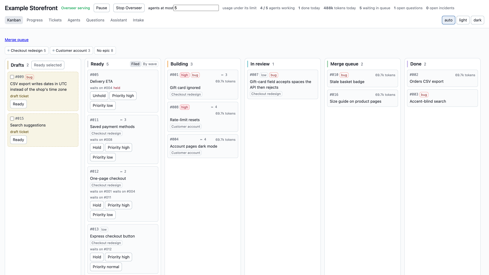
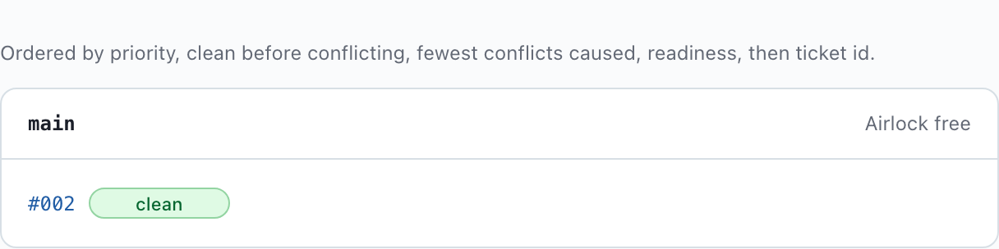
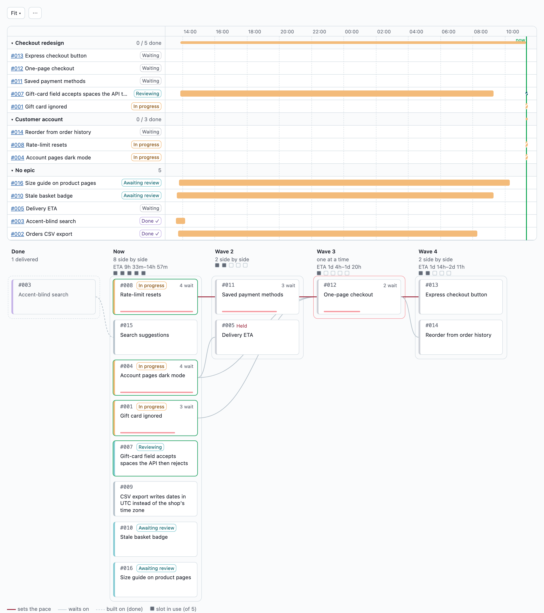
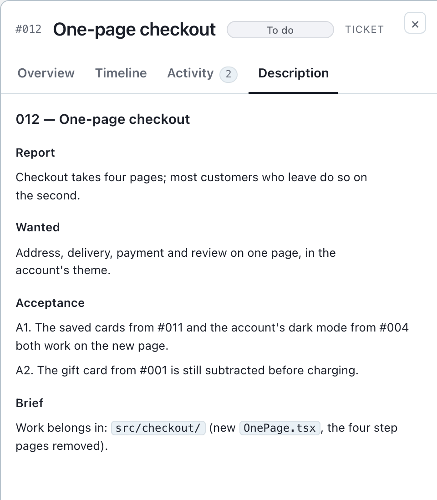
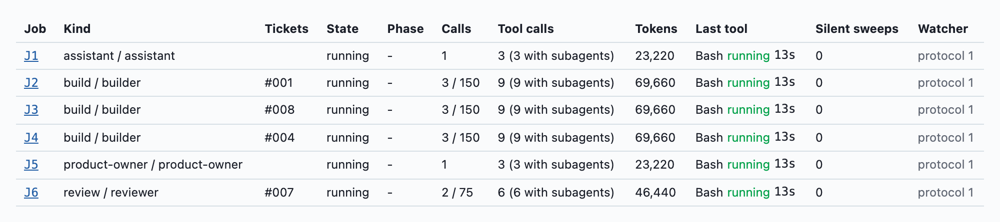
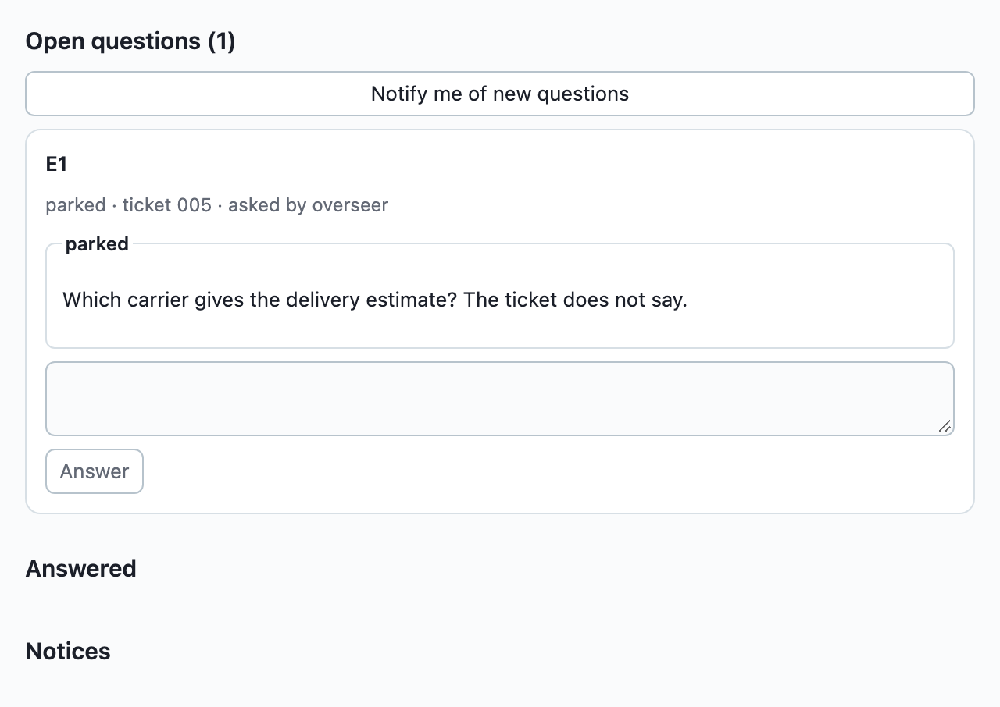
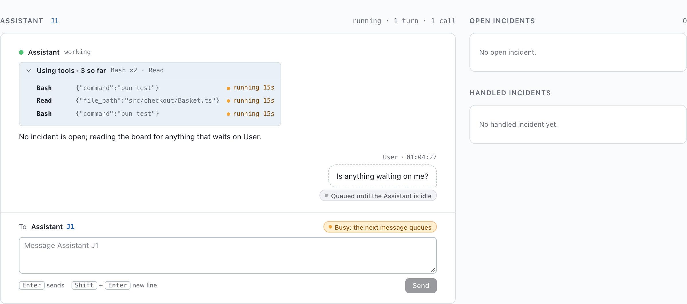
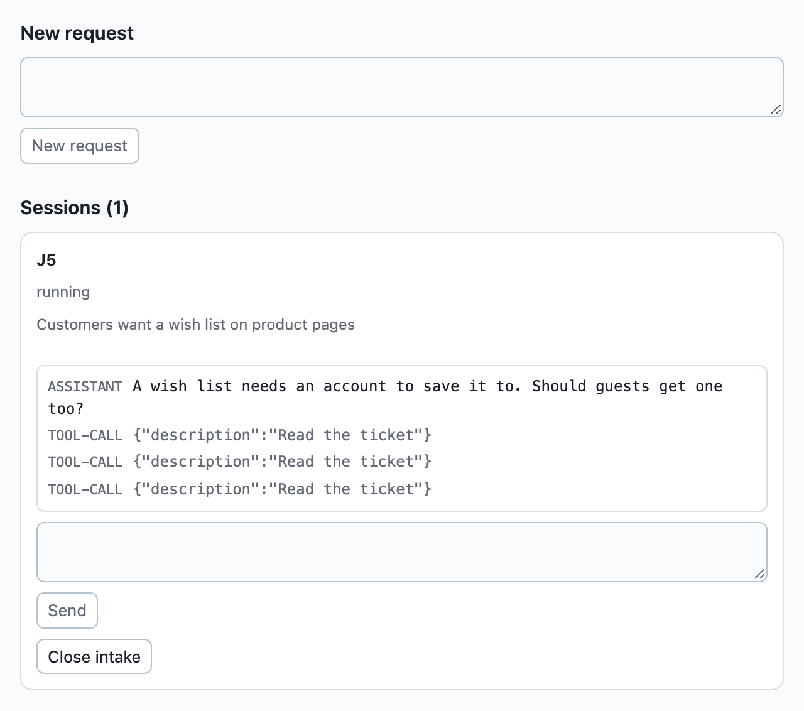
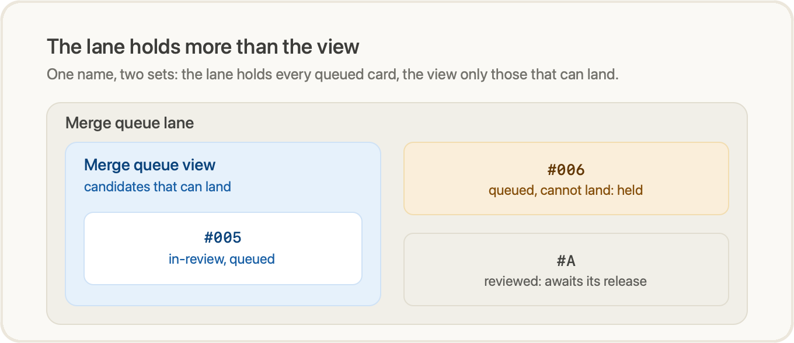

# Running a board from the Bridge

> **Question:** What am I looking at, and what do I do here day to day?
> **Time:** 25 minutes.
> **Read first:** [Getting started](getting-started.md), [Glossary](../glossary.md).
> **Next:** [Runbook](runbook.md), [Questions and incidents](../architecture/questions-and-incidents.md),
> [The Bridge](../architecture/bridge.md).

## In one screen

The [Bridge](../glossary.md#bridge) is the one page of a [board](../glossary.md#board): a live page the
[Overseer](../glossary.md#overseer) serves on 127.0.0.1. `forge open` opens it, and is refused
`overseer-down` when no Overseer runs. Close the page and the board carries on: the page stores no work, and you lose
only half-typed text and view filters.

You do four things here. You file work on Intake, ready it on Kanban, answer [decisions](../glossary.md#decision) on
Questions, and watch the header. The Overseer does the rest: it launches AI [agent](../glossary.md#agent)
[sessions](../glossary.md#session) that build and review each [ticket](../glossary.md#ticket), then merges the result,
without being asked.

*Notice the blue middle: once a ticket is Ready, you act only if a question appears.*

Nearly every control records a request, and the Overseer acts on it or refuses it. The screenshots here come from the
demo board Example Storefront, and the detail panel shows demo ticket #012.

## The tabs

The Bridge has up to nine tabs: Kanban, Waves, Progress, Epics and Tickets, then Agents, Questions, Assistant and
Intake. Waves shows only when a ticket depends on another, and Epics only on a board
with epics. Each has its own URL, so you can link to it, and the link survives an Overseer restart. A fragment that
names no tab opens the tab you last chose, or else Kanban. Until the first board update arrives the panel says it is
waiting for the Overseer.

The detail panel opens in place over Kanban, Waves, Progress, Epics and Tickets, so opening a ticket never changes tab.
Esc, Close or a second click on the open item closes it. The filter line at the right of the tab row, `Hiding closed >
1 day`, sets which finished work those tabs show.

> **As built.** A Kanban card links to nothing. See
> [gap-kanban-card-has-no-link](../reference/known-gaps.md#gap-kanban-card-has-no-link).

### Kanban

*Each card's controls depend on its lane: Ready on a draft ticket, Hold and Priority on a Ready card, none elsewhere.*

Kanban shows every ticket in one of seven lanes: Drafts, Ready, Building, In review,
[Merge queue](../glossary.md#merge-queue), Done and Abandoned. [Reading lanes and pills](#reading-lanes-and-pills)
says how a ticket gets its lane.

| You see | It means |
| --- | --- |
| `↦ N` | N open tickets wait on this one, directly or further down the chain |
| `waits on #N` | an unsettled dependency |
| `held` | the ticket carries a [ticket hold](../glossary.md#ticket-hold); hover for its reason |
| arrows and `needed first`, on hover | arrows come from the cards the hovered card directly depends on, and those cards read `needed first` |
| a marked card | it is new, or its state moved, on the latest board update |
| a dashed card | a [draft ticket](../glossary.md#draft-ticket) or a [filing draft](../glossary.md#filing-draft), which its label names |

| You can | How |
| --- | --- |
| Ready a draft ticket | Ready on the card, or tick several and press Ready selected |
| Hold or lift a hold | Hold or Unhold on a Ready card |
| Change a priority | Priority high, normal or low on a Ready card |
| Filter by [epic](../glossary.md#epic) | press its chip; chips are kept in the browser |
| See the Ready order by [wave](../glossary.md#wave) | Filed or By wave, offered once any ticket has a dependency |
| Page the closed lanes | Show more on Done and Abandoned; Abandoned starts folded |

Ready starts with the Board's ready list: unblocked tickets by priority, then readiness, then id, held ones included.
Tickets waiting on a dependency follow. Merge queue lists queued tickets by id, and the merge queue view gives the order
they land in. Done and Abandoned run newest first.

> **As built.** The ready list can omit a group ticket the Overseer launches. See
> [gap-group-tickets-missing-from-ready-ids](../reference/known-gaps.md#gap-group-tickets-missing-from-ready-ids).

**The merge queue view.** The Merge queue link above the lanes opens `#kanban/merge-queue`. It answers what lands next
on each [target](../glossary.md#target), and why a [landing](../glossary.md#landing) waits. It has no controls: a
merge move belongs to the [incident](../glossary.md#incident) or decision it answers. The Kanban tab stays highlighted;
press it to go back.

*#002 holds the Airlock, so it has a job and no line; its card stays in the lane.*

*Read the candidates from the top: that is the order they land in, which the Kanban lane does not show.*

The queue holds the tickets cleared to land, and an [Airlock](../glossary.md#airlock) lets one of them land on a target
at a time. The view lists only candidates that can land. A queued ticket that is held, waits on a `waiver` or
`landing-refused` decision, has a job on it, or is a release ticket whose bundle has not landed stays in the lane
without a line. So a target can show an empty list. With nothing queued the view shows the order rule and
`Nothing is queued to merge.`

### Progress

*The chart answers what happened and when; the Waves tab answers what must finish before what. The demo's queued
tickets were seeded without a review, so they read Awaiting review.*

Progress answers how the work went.

| Part | Shows | You can |
| --- | --- | --- |
| The chart | one [row](../glossary.md#row) per readied ticket (a low-priority ticket's once it starts), a bar per phase, a now line, rows grouped under epics | press a ticket label to open its row, fold an epic, pick a range, use Row options |
| The finished list | the delivered and abandoned tickets the filter line's span lets through | open a ticket |

The filter line at the right of the tab row says how many finished tickets and epics are hidden. Its menu chooses 1h,
1d, 3d, all or a since date; the default is 1d.

The **Waves** tab shows a Done column, then one column per wave, once any ticket has a dependency. Point at a ticket to
light everything it depends on and everything waiting on it; click it to open it in place. The **Epics** tab shows one
card per shown epic with its roll-up, facts and tickets.

Each wave's head shows a forecast while the board is not paused. Your browser computes it, and nothing decides on it.

Reading the wave board

*Look at the red box first: a wave of one ticket holds everything behind it.*

The red path walks back from the last wave, taking the ticket with the most waiting at each step.

The chart's range and row lookups

| Lookup | Values |
| --- | --- |
| Range button | the presets Fit, 1h, 4h, 12h, 24h and 7d, and Custom |
| Custom | timestamps, or `start`, `now` and `-2h` |
| Fit's default | stored by `forge range` |
| Row options | "Review passes as rows" and "Wide titles" |
| A chart pill reading `Waiting` | a `pending` row with an unsettled dependency |
| A ✓ on a Done pill | the row was reviewed |

### Tickets

*The panel opens above the table, and Close returns to the table.*

Tickets is the one place to read a whole ticket. The table has a search box, Type, Epic and Status chips, and columns
that sort. Chips are OR inside a group and AND across groups and the search. A query of digits, with or without `#`,
looks for an id alone. On a board with epics, Group by epic groups the rows.

A table line opens the **detail panel**, `#tickets/ticket-row/<id>`: head, controls, facts, a Timeline of the phases its row
recorded, the Description, and the Log lines claimed for it. A stamp from today shows only its clock, an older one gains
its date, and hover gives it in full.

Status names below are stored values: `draft` shows in the Drafts lane and `pending` in Ready. See
[Reading lanes and pills](#reading-lanes-and-pills).

| Control | Offered while | What it does |
| --- | --- | --- |
| Ready | `draft` | moves it to Ready, if it passes the [readiness check](#file-work) |
| Hold, with an optional Reason | `draft` or `pending`, unheld | keeps the ticket from its next launch |
| Unhold | any open ticket with a hold | lifts the hold |
| Park, with the same Reason box | any open ticket | holds it and opens a `parked` decision |
| Set network | `draft` or `pending` | sets the public domains this ticket's agents may reach |

Use Hold to keep a ticket from its next launch. Use [Park](../glossary.md#park) when you want the question on your
Questions list: it holds the ticket and opens a `parked` decision. A reason typed for one ticket never carries to the
next. [A parked ticket](runbook.md#a-parked-ticket) says what each way back starts.

### Agents

*Press a job id to open its controls and transcript below the table. The header's 4 / 5, seen in the Kanban screenshot,
counts in-progress rows, so the Assistant and product-owner jobs add nothing to it.*

Agents lists every [job](../glossary.md#job) on the board, ticking each second, with a line per subagent under it.
Silent sweeps counts the [sweeps](../glossary.md#sweep) a job's [event log](../glossary.md#event-log) stood still, and
the last tool's elapsed time turns to its warning colour only while that count is above zero. A long tool call alone is
no sign of trouble.

`#agents/<job>` adds that job's transcript and these controls. Each is offered in the states the job allows.

| Control | What it records |
| --- | --- |
| Send message | a chat turn for the session |
| Send answer | an answer to the job's open question, shown only with one open |
| Wind down | a stop that asks the session to wrap up first; the ticket is held `wound down by User (J<n>)` |
| Stop | a stop; the ticket is held `stopped by User (J<n>)` |
| Fresh agent | a stop, so the next [attempt](../glossary.md#attempt) starts on the same [worktree](../glossary.md#worktree); `build` and `review` only |

A job on an older [Watcher](../glossary.md#watcher) protocol is watch-only and takes Stop alone. A job that ended leaves
the table, and its `#agents/<job>` link then shows no panel; use `forge job show <J>`.

> **As built.** A tool call can vanish from a followed transcript until a reload. See
> [gap-transcript-shared-cursor](../reference/known-gaps.md#gap-transcript-shared-cursor).

### Questions

*Three sections; only Open questions needs you.*

Questions holds what waits on you. Agent questions come first, then the decisions the Overseer opened. An escalated one
says so.

- **Open questions.** Pick options, or type free text on a one-question decision, then press Answer.
- **Answered.** Settled decisions, read back from the [log](../glossary.md#log).
- **Notices.** Open [notices](../glossary.md#notice), listed by kind with no explanation. They take no answer. The
  header words most of them: warnings and notices under the tabs, `new-code` beside the controls. `instructions-missing`
  shows there as its bare kind; see the [notice table](../architecture/questions-and-incidents.md).

*One press settles it: the first answer wins, whoever sends it.*

> **As built.** Some answers only close the card. Answering a `parked` decision leaves the ticket held, so Unhold it as
> well. See [gap-answering-parked-does-not-unhold](../reference/known-gaps.md#gap-answering-parked-does-not-unhold). A
> `waiver` answer changes nothing. See
> [gap-waiver-answer-has-no-effect](../reference/known-gaps.md#gap-waiver-answer-has-no-effect).

Notify me of new questions asks for browser notifications from your click, never on load. The open-question count leads
the browser tab's title on every tab of the Bridge.

### Assistant

*You read this tab more than you use it: the Assistant settles incidents without you. The transcript is synthetic demo
data. A real session shows its agent's turns and tool names as text, and the
[client frames as raw JSON](../reference/known-gaps.md#gap-transcript-shows-raw-frames).*

Assistant shows the live [Assistant](../glossary.md#assistant) session's transcript and a chat box, its open incidents,
and the handled ones with the moves made under them. An incident nobody settled ends with its default move and appears
in the warning state; read the move it took in its log line. While no session is up the tab says a fresh one is booting;
the Assistant has no off switch. A message waits as "Queued until the Assistant is idle" until the transcript carries
it.

What an Assistant may do is in [Assistant and intake](../architecture/assistant-and-intake.md).

### Intake

*Each request gets its own session, and several may run at once. The transcript is synthetic demo data. A real session
shows its agent's turns and tool names as text, and the
[client frames as raw JSON](../reference/known-gaps.md#gap-transcript-shows-raw-frames).*

New request starts a [product owner](../glossary.md#product-owner) session on what you typed. Each session shows its
transcript, its questions inline, the draft tickets it filed, a chat box and Close intake. Once the session ends, and if
it filed draft tickets, Close intake opens the `ready-drafts` decision. A closed session keeps its transcript, and a
message resumes it. [Product-owner intake](../architecture/assistant-and-intake.md#product-owner-intake) has the rules.

> **As built.** Every session on this tab holds a stream open, closed ones included. See
> [gap-intake-stream-connection-cap](../reference/known-gaps.md#gap-intake-stream-connection-cap).

## The header

A missing control does not apply in the Overseer's current state. A greyed control cannot be sent at this moment, for
one of the [four causes](#what-a-disabled-control-means). A live control sends a request the Overseer may still refuse.

*Dashed items come and go. Read a missing control as a statement about the Overseer's state.*

| Figure | Item | Reads or does |
| --- | --- | --- |
| 1 | Banners | see [Banners, warnings and notices](#banners-warnings-and-notices) |
| 2 | State | `Overseer serving`, `held for an install change`, `handing over`, with `, paused` when the stored state is paused |
| 3 | Pause, Resume | stores the pause; [Pause safely](#pause-safely) says what it stops |
| 4 | Restart | a [Baton pass](../glossary.md#baton-pass) to the code on disk; offered only with the `new-code` line |
| 5 | Stop Overseer | after a confirmation, stops the Overseer; see [Stop for the day](#stop-for-the-day) |
| 6 | `new code: run ...` | the `new-code` notice, shown beside the controls; see [Banners, warnings and notices](#banners-warnings-and-notices). Press Restart, or run `forge update`, whose last step makes the same hand-over |
| 7 | agents at most | the [concurrency limit](../glossary.md#concurrency-limit); Set appears once the number differs |
| 8 | Usage | `usage under its limit`, or the window and reset time after a limit was hit |
| 9 | agents working | agents in flight against the limit |
| 9 | done today, tokens today | tickets delivered today, and tokens of rows running or ended today, by your browser's date |
| 9 | waiting in queue | every `pending` ticket, held and blocked ones included |
| 9 | open questions | open decisions, the same count as the browser tab's title |
| 9 | open incidents | incidents the Assistant has not settled |
| 10 | Tabs, theme | the tabs; auto, light or dark, kept in the browser |
| 11 | Warnings and notices | see [Banners, warnings and notices](#banners-warnings-and-notices) |

The concurrency control takes a whole number up to `CONCURRENCY_LIMIT_CEILING_AGENTS` (10), and a higher one is refused.

> **As built.** "agents working" counts in-progress rows, so a queued ticket's open review bar counts as an agent, while
> launches count jobs. See [gap-slot-has-two-definitions](../reference/known-gaps.md#gap-slot-has-two-definitions).

### Banners, warnings and notices

Banners sit above the header. A red one says the Overseer is unreachable and how old the board is. Another says the
[install version](../glossary.md#install-version) changed: the installed files no longer match the program, so the
Overseer holds launches until `update` runs. The `new-code` line is the milder case: the code changed, the installed
files still match, nothing is held. It cannot appear while launches are held for an install change.

Warnings and notices sit below the tabs. Warnings cover an incident that ended with its default move, a failed Baton
pass, and an Assistant that cannot come up.

### What a disabled control means

A greyed control has one of four causes.

| Cause | What you see | What to do |
| --- | --- | --- |
| Event stream down | red banner; every control disabled, the board stays | wait, or start the Overseer; the page reconnects |
| Launches held for an [install change](#banners-warnings-and-notices) | banner; every control disabled but Stop Overseer and the job controls Stop and Wind down; no Restart is offered | run `forge update`: its last step hands the Overseer to the code on disk, which lifts the hold. If it reports otherwise, follow Updating in the [Runbook](runbook.md) |
| A send in flight | that one control | wait |
| A form not complete | that one control | finish the choice or the text |

A command that cannot reach the Overseer shows nothing, and the button comes back. Check the banner.

> **As built.** The job controls Stop and Wind down on the Agents tab stay enabled while launches are held for an
> install change, and a click only raises the banner again. See
> [gap-job-stop-while-install-held](../reference/known-gaps.md#gap-job-stop-while-install-held). Controls can flicker on
> between reconnects. See [gap-stream-down-flicker](../reference/known-gaps.md#gap-stream-down-flicker).

### A refusal is an answer

Rules live in the Overseer, so a button can offer what the Overseer then declines.

*Notice the two returns: a refusal comes straight back, and success arrives later, as a board update.*

The refusal appears beside the control, word for word, for example `Ticket #003 is already held. Nothing was written.`
It is normal, it changed nothing, and it clears on your next send. [Refusals](../reference/refusals.md) lists them all.

## Reading lanes and pills

A pill is the coloured status word on a chart row, a Tickets table line and the detail panel. A lane is the Kanban
column. Both are computed each time from stored facts, nothing stores which lane a ticket is in, and the two can differ
on purpose.

*Follow the fifth row: the mark moves the card to Merge queue while its stored status stays `in-review`.*

The merge-queue mark is the `mergeQueued` flag on the ticket's row, set when a review passes, or when the gates settle
on a board with no review phase. A repeat review's pill reads `Reviewing (round N)`. Wave cards use their own chips:
Ready, Held, or the state while a ticket is built or reviewed.

Three readings trip people up.

- **A queued ticket still reads as in review.** A passing review queues the ticket and leaves its status `in-review`,
  with its [review bar](../glossary.md#review-bar) open until it lands. So Kanban says Merge queue while Tickets and
  Progress say Reviewing, or Awaiting review on a board with no review phase. The demo board's queued tickets were
  seeded without a review, so they read Awaiting review.
- **The Merge queue lane holds more than its view.** `reviewed` means landed on a [group](../glossary.md#group) branch
  and waiting for its release. Those cards are in the lane but not in the merge queue view, because no Airlock is
  waiting for them, and neither is a queued card that [cannot land](#kanban).
- **A ticket merged to a group branch is not Done.** Done means merged to the [main line](../glossary.md#main-line). The
  word table is in the [Glossary](../glossary.md#status-words).

*One name, two sets: a card missing from the view can still sit in the lane.*

A Kanban card carries no pill: its colour comes from the same state. Paused, Waiting and a hold change no lane. A held
ticket stays where its status puts it, and only the `held` mark and the fact in its panel show it.

## Daily routines

A normal day is a loop: file and ready work, answer Questions, glance at notices. The other routines are occasional.

### File work

Three doors lead to the same draft ticket, and nothing builds until you ready it.

*The gate is the check, not the button: Ready can come back refused.*

| Door | Use it when |
| --- | --- |
| Intake tab, or `forge intake -- <text>` | you want a product owner to shape the request |
| A Claude Code session, asked to file a ticket | you are at a terminal; the `forge-po` skill runs the filing |
| `forge ticket add "<title>" --type ticket` | you already know what to write |

Press Ready on Kanban: a ticket without what [`ticket ready`](../cli.md#tickets) requires is refused, and the refusal
beside the button says what is missing. A `ready-drafts` decision offers only complete draft tickets and names the rest
as not readiable.

### Answer questions

Keep an eye on the count in the browser tab, or allow notifications. An agent waiting on your answer keeps its
[launch slot](../glossary.md#launch-slot), so a late answer also slows the tickets behind it.

### Watch notices

Check the warnings and notices under the tabs. Some notices stop landings or launches until you act, such as
`dirty-main-checkout`. The [notice table](../architecture/questions-and-incidents.md) gives each one's action, and the
[Runbook](runbook.md) has the recipes.

### Adjust concurrency

Type a number at "agents at most" and press Set, or run `forge concurrency <n>`. A limit below the agents
running stops nothing: it only leaves no free launch slot until some end.

### Hold or reprioritise

*Start at the top and take the first branch that covers it: each one to the right stops more.*

[Hold](../glossary.md#ticket-hold) a ticket you want left alone; it stops the ticket's next launch, never a running
agent. Use the Reason box in the detail panel when others read it. Change priority on a Ready card, or use
`forge ticket priority` once a card has left Ready. Lowering to low is refused once a ticket has left Ready;
raising works at any status. Priority orders the candidates; it never bars a ticket from starting.

> **As built.** Help text says otherwise for low tickets. See
> [gap-help-text-stale](../reference/known-gaps.md#gap-help-text-stale).

### Pause safely

Pause stops new build and review launches, new merge queuing and new Airlock slots. Running agents and a merge in
progress carry on, and so do the Assistant, intakes and resumes of interrupted jobs;
[State machines](../data-model/state-machines.md) has the detail. The pause is stored, so it survives a stop and a
start. A fresh board starts paused, which is why no ticket starts until the first Resume.

To clear the deck, run `forge job stop --all --wind-down`. It pauses, then winds down every build, review
and product-owner job. Each stopped job's ticket is held `wound down by User (J<n>)` and stays held after Resume; Unhold
each ticket to continue it.

### Stop for the day

To end a day, Pause, then Stop Overseer: agents finish their work and no ticket starts at the next start until you
Resume. An unpaused board launches on the next Overseer's first Pass. To have no ticket agent running overnight, run
`forge job stop --all --wind-down` and wait until Agents shows them gone before Stop Overseer. The
Assistant session stays up.

| You run | Launches | Running agents | Bridge |
| --- | --- | --- | --- |
| Pause, or `forge oversee pause` | no new ticket work | keep running | up |
| `forge job stop --all --wind-down` | no new ticket work | wrap up and end; tickets held | up |
| Stop Overseer, or `forge oversee stop` | none, no [Pass](../glossary.md#pass) runs | keep running under their Watchers | gone |
| `forge oversee stop --now` | none, no Pass runs | keep running; install and [gate](../glossary.md#gate) processes are stopped | gone |

Use `--now` when a running install or gate process must end too, such as one that hangs. The Bridge has no `--now`.

*The fork at the bottom is the choice you make the evening before.*

Start the Overseer again with `forge oversee --detach`. It settles jobs that ended while it was down; see
[Failure and recovery](../architecture/failure-and-recovery.md).

## Groups and release tickets

A group lands tickets on a shared branch and reaches the main line in one release. Only the release ticket and the group
tickets it depends on move to Done; any other ticket that landed on the group stays in Merge queue even though the
release carried its code.

File group tickets with `--group <name>`, mark one with `forge ticket release-of <id>`, and give that ticket
a dependency on every group ticket it must deliver (`forge ticket depends`). The [release
bundle](../glossary.md#release-bundle) is the [release ticket](../glossary.md#release-ticket) and the group tickets it
reaches through dependencies.

*Watch the last frame: one landing delivers the whole release bundle, and only that.*

A group ticket that has landed is stored `reviewed`, reads Awaiting merge, and lets tickets that depend on it start. The
release ticket's target in the merge queue view is the main line, while the others show `group-<name>`. It becomes a
candidate once the rest of its bundle has landed on the group. The detail panel names a ticket's group, and the Tickets
search covers it. A release carries the group's whole tip, which is how a ticket outside the bundle reaches the main
line.

A `cleanup-declined` notice means git kept the group's worktree or branch after the release; the [notice
table](../architecture/questions-and-incidents.md) gives the action. Mechanics are in [Airlocks and
groups](../architecture/airlocks-and-groups.md).

## The same from a terminal

Most views have a verb. Each is `forge <verb>`, and [the CLI reference](../cli.md) has the flags. Reads and
recorded moves also work with the Overseer down; a recorded move takes effect at the next start.

| In the Bridge | In a terminal |
| --- | --- |
| Header and Kanban | `status`, `oversee status`, `oversee pause`, `oversee resume`, `concurrency <n>` |
| Progress | `status` for the open rows, `range` for the chart's default span |
| Tickets | `ticket list`, `ticket show <id>` |
| Card and detail panel controls | `ticket ready <id>`, `ticket hold <id>`, `ticket unhold <id>`, `ticket park <id> -- <reason>`, `ticket priority <id> <level>`, `ticket network <id> <domain>` |
| Agents | `jobs`, `job show <J>`, `job attach <J>` to replay and follow a transcript |
| Job controls | `job message <J> -- <text>`, `job wind-down <J>`, `job stop <J>`, `job fresh <J>` |
| Questions | `decisions`, `decide <decision> <letters>`, `decide <decision> -- <text>` |
| Assistant | `incidents`, `incident note <I> -- <text>`, `incident escalate <I>` |
| Intake | `intake -- <text>` |
| Merge queue | `merges` |
| Waiting for a question | `await`, which returns when a decision opens or an incident is escalated |

`<J>` is a job id such as J5, `<I>` an incident id. Incidents are the Assistant's, so reading them is routine and moving
one is rare.

### The optional wrapper session

Run a Claude Code session with the `forge-orchestrate` skill when you prefer talking to clicking. It reads
the board's state, starts the Overseer on your go, turns what you say into verbs, files through `forge-po`, and puts
each open question to you. It never drives a ticket, moves an incident or writes code. Close it any time: the board does
not depend on it.

## What is lost on a tab change

A view unmounts when you leave its tab, so what you typed goes with it. Board updates alone leave it in place, unless
the job or decision it belongs to leaves the board. A changed limit also resets a number typed at agents at most.

| Kept across tabs and reloads, in the browser | Lost on a tab change |
| --- | --- |
| Last tab, theme | Tickets search, chips and sort |
| Kanban epic chips, Ready order, closed-lane pages, Abandoned fold | Cards ticked for Ready selected |
| Chart range, folds, row options, finished-work span | Half-picked answers, half-typed messages and reasons |
| Tickets grouping | "Queued until the Assistant is idle" notes |
| | Agents' open transcripts, replayed from history when reopened |

A page reload loses everything in the Lost column too, and the Bridge reloads itself after a reconnect to an Overseer on
other code. Send a long answer before you wander off.

## Several repositories

Each repository has its own [tracker](../glossary.md#tracker), Overseer, port and Bridge tab, and preferences are kept
per board. Three things are shared across the machine.

*So one busy board can make another's gates wait, and one usage limit stops launches on all of them.*

All boards on a machine share one gate limit: `GATE_RUNS_AT_ONCE` (2) gate runs at a time, each holding a
[gate slot](../glossary.md#gate-slot) recorded in the shared [`<monitor>`](../glossary.md#reading-names) folder. Its
[usage marker](../glossary.md#usage-marker) allows no launch or resume on any board before its reset.

A monitor is a separate tool, such as agent-dashboard, that shows several boards together. It finds them in
`projects.json`, the monitor registry, and frames a Bridge with `?embedded=dashboard`, which hides the header.

## Invariants

1. The Bridge stores no board state. Closing or reloading it loses only what
   [What is lost on a tab change](#what-is-lost-on-a-tab-change) lists.
2. Every Bridge control that changes the board posts a control command, and the Overseer alone applies or refuses it;
   Stop Overseer and Restart go to the running Overseer and record nothing.
3. A refusal is shown word for word, and nothing was written.
4. A ticket's lane is computed from its stored status and merge-queue mark on every board update.
5. The detail panel renders only on the Tickets tab.
6. Stopping an Overseer never stops an agent session.

## In the code

| Concept | Path | Symbol | Held by |
| --- | --- | --- | --- |
| Header offers | `bridge/shell/HeaderModel.ts` | `headerModelOf` | `bridge/shell/HeaderModel.spec.ts` |
| Control availability | `bridge/shell/ControlAvailability.ts` | `availabilityOf`, `controlIsEnabled` | `bridge/shell/BridgeApp.dom.tsx` |
| The posting control | `bridge/shell/CommandButton.tsx` | `CommandButton` | `bridge/shell/Header.dom.tsx` |
| Routes | `bridge/shell/HashRouter.ts` | `BRIDGE_TABS`, `routeOf` | `bridge/shell/HashRouter.spec.ts` |
| Lanes | `bridge/views/kanban/KanbanModel.ts` | `laneOf`, `KANBAN_LANES` | `bridge/views/kanban/KanbanModel.spec.ts` |
| Merge queue view | `bridge/views/merge-queue/MergeQueueModel.ts` | `mergeQueueModelOf`, `FIVE_KEY_ORDER_TEXT` | `bridge/views/merge-queue/MergeQueueModel.spec.ts` |
| Waves | `bridge/views/waves/WavesModel.ts` | `wavesModelOf` | `bridge/views/waves/WavesModel.spec.ts` |
| Pill words | `bridge/utils/DisplayStateWordingUtil.ts` | `stateLabelOf` | `bridge/utils/DisplayStateWordingUtil.spec.ts` |
| Display state | `src/lib/tracker-model/DisplayQueries.ts` | `ticketDisplayStateOf` | `src/lib/tracker-model/Board.displayQueries.spec.ts` |
| Detail controls | `bridge/views/detail-panel/DetailPanelModel.ts` | `controlsOf` | `bridge/views/detail-panel/DetailPanelModel.spec.ts` |
| Decision card | `bridge/conversation/DecisionCard.tsx` | `DecisionCard` | `bridge/views/questions/QuestionsView.dom.tsx` |
| Job controls | `bridge/views/agents/JobControls.tsx` | `JobControls` | `bridge/views/agents/AgentsView.dom.tsx` |
| Command route | `cli/overseer/routes/CommandRoute.ts` | `answerControlCommand` | `cli/overseer/OverseerApi.integration.spec.ts` |
| Stop with agents running | `cli/overseer/OverseerForeground.ts` | `WatcherFleet.stopLiveProcessWatchers` | `cli/overseer/OverseerCommand.integration.spec.ts` |
| Terminal views | `cli/jobs/JobsCommand.ts`, `cli/jobs/JobCommand.ts` | `jobsCommand` | `cli/jobs/JobCommand.spec.ts` |
