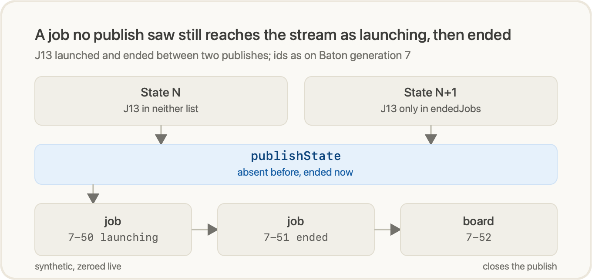

# The Overseer API

> **Question:** What does the Overseer serve, to whom, and how does a client stay in step?
> **Time:** 15 minutes, or look one route up.
> **Read first:** [Overview](../concepts/overview.md), [Glossary](../glossary.md).
> **Next:** [The Bridge](../architecture/bridge.md), [Control](../architecture/control-and-hatch.md),
> [Watchers](../architecture/watchers.md).

## In one screen

Each [board](../glossary.md#board) has one [Overseer](../glossary.md#overseer), and it serves one HTTP API on
`127.0.0.1`. Its clients are the [Bridge](../glossary.md#bridge), the CLI and agent-dashboard, a separate program that
lists boards and frames the Bridge. The port is derived from the [tracker](../glossary.md#tracker) id, see
[Watchers](../architecture/watchers.md).


*Notice the dashed lines: every read path takes no lock.*

The API has one write route, `POST /api/commands`, behind a bearer token; most CLI verbs write the tracker themselves
and only nudge. A page's one source of board truth is `GET /api/events`, whose `board` event carries the whole
`BoardState` document. A client that receives every `board` has everything; the other event kinds are slices of it.

A reconnect either replays what it missed or starts from a fresh `board`, so a client never applies events on top of
an older generation's state. The [generation](../glossary.md#generation) in an event id decides that. The
[code version](../glossary.md#code-version) decides, separately, whether the page reloads.

Request guards stop a browser page of another origin. They are not what holds an agent
[session](../glossary.md#session): that is [confinement](../architecture/confinement.md).

## Routes

Every route passes the shared [request guards](#request-guards), so every route can also answer 403
`{refusal: 'forbidden'}`. **Own guard** is what a route asks beyond them, and **Other statuses** lists only what the
route adds. An answer is JSON unless the row says otherwise. A refusal is `{refusal: <text>}`, a fixed word except on
409 and 423, where it is a sentence. A bare verb such as `oversee status` is `forge oversee status`.

| Route | Own guard | Answer | Other statuses | Called by |
| --- | --- | --- | --- | --- |
| `GET /api/identity` | none | `OverseerIdentity`: `application`, `trackerId`, `project`, `codeVersion`, `installVersion`, `watcherProtocolVersion`, `processId` | 503 `starting` until the folder watch has started | Bridge, `oversee --detach`, `oversee status` |
| `POST /api/session-codes` | bearer token | `{code}`: a fresh one-time [session code](#browser-sessions) | 401 `unauthorized` | `open` |
| `POST /api/session` | the code in the JSON body `{code}`, never the URL | `{outcome: 'done'}` and `Set-Cookie: forge-session-<port>=<secret>; Path=/; HttpOnly; SameSite=Strict` | 401 `unauthorized` for a code never issued, already spent, or not in the body | Bridge |
| `GET /api/session-token` | session cookie or bearer token | `{token}` | 401 `unauthorized`, also before a token exists | Bridge |
| `GET /api/state` | session cookie or bearer token | `BoardState`, read fresh for this request | 401 `unauthorized`; 500 when the read throws | `oversee status`; never the Bridge |
| `GET /api/summary` | none | `BoardSummary` | 500 when the read throws | agent-dashboard; never the Bridge |
| `GET /api/events` | session cookie or bearer token | Server-sent events, see [The event stream](#the-event-stream) | 401 `unauthorized`; 404 `not-ready` until the [event broker](#the-event-stream) exists | Bridge, `cli/testing/CutoverSmoke.ts` |
| `POST /api/commands` | bearer token | `{outcome, result}`, see [Commands](#commands) | 400, 401, 409, 423, 500 | Bridge, `oversee stop`, `oversee restart`, `update` |
| `POST /api/nudge` | none | `{outcome: 'done'}`; schedules a [Pass](../glossary.md#pass), any body ignored | none | every CLI verb that wrote the tracker |
| `GET /api/jobs/<J>/stream` | session cookie or bearer token | Server-sent events, see [The transcript stream](#the-transcript-stream) | 401 `unauthorized`; 404 `not-found` | Bridge |
| `GET /api/jobs/<J>/files/<name>` | session cookie or bearer token; `<name>` in `SERVED_JOB_FILE_NAMES` | The file as `text/plain; charset=utf-8` under `Content-Security-Policy: sandbox` | 401 `unauthorized`; 404 `not-found` | no caller in this repository |
| Any other `GET` outside `/api/` | none | A built Bridge file, `/` being the page | 404 `not-found`, 500 `page-build-failed` | browsers |
| Anything else | none | 404 `not-found` | | |

`SERVED_JOB_FILE_NAMES` is exactly `report.json` and `gate.log`, so `launch-<n>.json`, which says what a
[Watcher](../glossary.md#watcher) runs, is never served. The file route answers 404 for any other name before it
looks at the job.

A [job](../glossary.md#job) route needs a job id matching `/^J\d+$/` and an existing job folder. A path segment holding
a percent escape matches no route and gets 404, because neither job ids nor served names need decoding.

> **Careful.** A route that throws has no handler above it, so Bun answers a plain-text 500 `Something went wrong!`,
> with no JSON body and no CSP. `GET /api/state` and `GET /api/summary` do this on a malformed `progress.json`, and
> `POST /api/commands` on any throw other than `OperationRefusal` or `TypeError`. The event stream behaves differently,
> see [BoardState](#boardstate).

## Request guards

Three guards run before routing, in this order: Host, Origin and no preflight. The first failure answers 403
`{refusal: 'forbidden'}`. Two more sit inside their routes: the reader check and the bearer token. Two CSPs mark the
answers, and the bind is set at the socket. No route trusts a request header a local program can forge, such as
`Sec-Fetch-Site`, as proof of who is asking.

![A request reaches the socket bound to 127.0.0.1, then the Host, Origin and not-OPTIONS checks, each failing with 403. The data routes (session-token, state, events, a job's stream and its files) then require the session cookie or the bearer token or answer 401, the session-code and commands routes require the bearer token or answer 401, the session route requires a one-time code or answers 401, and identity, summary, nudge and the page ask for no token. Every returned answer carries a content security policy, the 403s included. A session is held by its confinement instead.](../figures/overseer-api/request-guards.png)

*Notice the last box: a browser's headers can be trusted and a process's cannot, so a session is held another way.*

| Guard | Where | Rule | Failure | Attack it stops |
| --- | --- | --- | --- | --- |
| Bind | Socket | `Bun.serve` on `127.0.0.1`, `reusePort: false` | No connection | A request from another machine; a second process sharing the port |
| Host | Before routing | Exactly `127.0.0.1:<port>` or `localhost:<port>` | 403 `forbidden` | DNS rebinding: a foreign name resolved to loopback carries its own name as Host |
| Origin | Before routing | Absent, or `http://127.0.0.1:<port>`, or `http://localhost:<port>`. The text `null` is refused. | 403 `forbidden` | A page elsewhere reading or writing the API, agent-dashboard's page included |
| No preflight | Before routing | `OPTIONS` is always refused | 403 `forbidden` | A cross-origin write that needs permission. No answer anywhere carries a CORS header, so permission cannot be given. |
| Reader | In the five data routes: session token, state, events, job stream, job files | The session cookie names a live [browser session](#browser-sessions), or the bearer token matches | 401 `unauthorized` | Another user of the machine, or an unconfined process, reading the board or the token over the shared loopback port |
| Bearer token | In `/api/commands` and `/api/session-codes` | Compared with `timingSafeEqual`, lengths first | 401 `unauthorized` | A write with no token, and guessing a token by timing |
| Page CSP | On the answer | Every answer that sets no CSP of its own, a guard's 403 included | None, it is a header | Injected script reaching out; a foreign page framing the Bridge's controls |
| File CSP | On the answer | `sandbox` on a served job file | None, it is a header | Agent text opened in a browser running as the API's origin |


*Notice the gray cell: a foreign no-cors `GET` is answered, and the browser keeps the answer from the page.*

The loopback port is shared by every user of the machine, so the data routes ask who reads: the Bridge shows its
session cookie, and a CLI reader such as `oversee status` the bearer token from the file the Baton names.
`GET /api/identity`, `GET /api/summary` and `POST /api/nudge` stay open: identity and the summary carry no ticket text,
agent-dashboard's server reads the summary with no token, and a nudge carries no data and only schedules a Pass.

The token never reaches another origin's page: the only route that hands it out needs a session cookie, which only a
one-time code buys, and no answer is readable across origins. Every Overseer start writes a fresh token to the file the
[Baton](../glossary.md#baton) names.

### Browser sessions

`open` asks the live Overseer for a one-time code with the token (`POST /api/session-codes`) and opens, and prints, the
Overseer's URL with `#session=<code>` as its fragment. A browser never sends a fragment to a server, so the code
reaches no request line, query string or log. The browser opener gets only the path of an owner-only HTML file in the
token's folder that redirects to that URL, since any local user can read a process's arguments; `open` stays until the
code's 30-second life ends, or a stop signal comes, and then removes the file. Before anything else loads, the Bridge
clears the fragment from the address bar and its history, then posts the code in a JSON body to `POST /api/session`.
The Overseer spends the code and answers a session cookie: `HttpOnly`, so no script reads it, and `SameSite=Strict`, so
no other site's page sends it. Its name carries the port, because a cookie on `127.0.0.1` reaches every port. A second
exchange of the same code answers 401.

Codes and sessions live in the Overseer's memory, as digests. An Overseer start, a Baton pass included, forgets them,
so a Bridge open across a restart reads 401 until `open` is run again. A Bridge opened from the stub `progress.html`,
or by its plain URL, holds no cookie and reads nothing; `open` prints the URL with its code for a browser opened by
hand.


*Notice that a stale token costs the Bridge one 401 and nothing else.*

> **Careful.** A process of the same user can read the token file, and so can ask for a code. A session cannot, because
> its profile denies the file and limits its network: see [Confinement](../architecture/confinement.md). The figures
> above still show the older `Sec-Fetch-Site` guard on `/api/session-token` and token-free read routes.

## Serving the page

`GET /` is built on the first page request, not at start. `pageFilesOf` calls `Bun.build` on the Bridge's HTML import
once and remembers the promise, so later requests share one build. A failed build answers 500 and clears the memory, so
the next request tries again. The outputs stay in memory as blobs keyed by path, `index.html` at `/` and each chunk at
its own name.

> **Why.** Bun's own HTML route takes no headers. Every file of the page must carry `frame-ancestors`, which no meta tag
> can state, so the server builds the bundle itself and answers through `fetch`.

The page CSP is one policy with a dynamic end:

```text
default-src 'self'; script-src 'self'; style-src 'self'; connect-src 'self'; img-src 'self' data:; object-src 'none';
base-uri 'none'; form-action 'none'; frame-ancestors <origins, or 'none'>
```

`dashboardFrameOriginsOf` reads agent-dashboard's server record for every response, taking the origins of its `url` and
`boardOrigin`. An unreadable record, or one with neither, gives `'none'`. `bridge/index.html` repeats the policy as a
meta tag, without `frame-ancestors`.

Changed Bridge code reaches the browser only through an Overseer on that code, since the memory lives as long as the
server.

> **As built.** A [Baton pass](../glossary.md#baton-pass) does not build the page, so a broken Bridge passes it and
> fails only on the next `GET /`, see [gap-baton-pass-builds-no-bridge](known-gaps.md#gap-baton-pass-builds-no-bridge).

## Commands

`POST /api/commands` takes one `ControlCommand` as JSON, `{kind, ...}`. `CONTROL_COMMAND_KINDS` holds 47 kinds at commit
029f32c9. What each does is in [Control](../architecture/control-and-hatch.md).


*Notice that a runtime command answers 200 before anything has happened.*

| Status | Body | Meaning |
| --- | --- | --- |
| 200 | `{outcome, result}` | Applied in a [lock hold](../glossary.md#lock-hold) of its own, and a Pass was woken. `result` is what the control function returned. |
| 400 | `{refusal: 'malformed-body'}` | Not JSON, not an object, an unknown `kind`, a `now` that is not a boolean, or a control function reading a field the body lacks. Nothing was written. |
| 401 | `{refusal: 'unauthorized'}` | No token, a wrong one, or no token written yet. |
| 409 | `{refusal: <sentence>}` | The write was refused. The sentence is worded by `OperationRefusalWordingUtil`, and the Bridge shows it verbatim. [Refusals](refusals.md) lists each sentence. |
| 423 | `{refusal: <sentence>}` | The install hold: the [install version](../glossary.md#install-version) changed, so every command but `overseer-stop` and `overseer-restart` is refused, a job stop included. A Baton pass lifts the 423 while it runs, see [Baton](../architecture/baton.md). |
| 500 | Plain text | Any other throw, as under [Routes](#routes). |

`outcome` is `done`, or `nothing-to-do` when the control function reports `changed: false`, as for an edit to the same
text. It is never a failure: a refusal has its own status.

`overseer-stop` and `overseer-restart` are the two runtime commands, `{kind, now}`. `now` is the `--now` flag of
`oversee stop` and `oversee restart`; its effect is in [Baton](../architecture/baton.md). They write nothing to the
board and go to the running Overseer, so they are taken during the install hold, and they answer 200
`{outcome: 'done', result: {kind}}` before the work happens. A 200 here means received. `oversee stop` and
`oversee restart` then wait on the Baton files for the result.

> **As built.** The `now` of a restart goes nowhere, and a stop arriving during a Baton pass is answered and dropped,
> see [gap-restart-now-dropped](known-gaps.md#gap-restart-now-dropped) and
> [gap-stop-dropped-during-baton-pass](known-gaps.md#gap-stop-dropped-during-baton-pass). The install hold refuses a job
> stop too, see [gap-job-stop-while-install-held](known-gaps.md#gap-job-stop-while-install-held).

`CommandClient` in `bridge/api/` is the reference client. It posts once, on a 401 clears its token, fetches another and
posts once more, because an Overseer start rotates the token.

## The event stream

Each state change becomes an ordered run of events, and `board` closes it. A client that replaces its state on each
`board` and ignores every other event is complete.


*Notice the middle row: a decision that left the board has no event of its own.*

The event broker, `EventBroker`, is created once the Overseer holds the Baton and lives as long as that generation,
so one process that takes the Baton back after a failed Baton pass gets a new broker. A publish happens after every
Pass, at every [sweep](../glossary.md#sweep), and once at start. Each reads the board without a lock into a
`BoardState` and hands it to `EventBroker.publishState`, which compares it with the last one.

| Event | `data` | Sent when |
| --- | --- | --- |
| `job` | A `BoardState` job, or an `endedJobs` entry with `state: 'ended'` | That job's JSON changed |
| `decision` | The open [decision](../glossary.md#decision) | It appeared or changed |
| `incident` | The open [incident](../glossary.md#incident) | It appeared or changed |
| `overseer` | `BoardState.overseer` | It changed |
| `usage` | `BoardState.usage` | It changed |
| `board` | The whole `BoardState` | Anything changed; always last |

The rules of one publish:

- An event id is `<generation>-<n>`, `n` counting from 1 within one broker.
- Slices go in the table's order: jobs, ended jobs, decisions, incidents, `overseer`, `usage`, then `board`.
- The first state of a broker sends only `board`, so a job already past `launching` in it gets no `launching` event.
- A state differing only in `page.payload.generatedAtEpochMilliseconds` sends nothing and spends no id.
- A record that left a list sends no slice event. Only the `board` of that publish removes it.
- After a broker's first state, a job a publish first shows past `launching` is sent as `launching` first, by a
  synthetic event. A client that connects fresh gets a `board` with each job as it stands.
- `endedJobs` lets a job launched and ended between two publishes reach the stream. `launchingJobOf` makes its
  `launching` event. A job that ended outside the `ENDED_JOBS_SHOWN` window of both states gets no event.



*Notice that the first event is synthetic: its `live` counts are zero whatever the job did.*

The stream also carries `: ping` every `SSE_HEARTBEAT_SECONDS` (5), and Bun's idle timeout is switched off for both
streaming routes. On stop the server closes every open stream, then stops gracefully, so the answer to an
`overseer-stop` still arrives.

> **As built.** Each `board` carries every [ticket](../glossary.md#ticket) body and the whole question history, see
> [gap-scaling-whole-log-and-bodies](known-gaps.md#gap-scaling-whole-log-and-bodies).

## Reconnecting

Two signals travel apart: the generation settles which events a client gets, the code version whether its page reloads.


*Notice that a Baton pass on the same code gives a fresh board and no reload.*

The server side is `EventBroker.replayAfter`. The replay buffer holds the last `REPLAY_BUFFER_EVENTS` (256) events and
lives as long as the broker, so a restart empties it. An answer is one of:

| `Last-Event-ID` | Answer |
| --- | --- |
| Absent | Fresh: the newest state as `board`, carrying the newest id. Before the broker's first state a connect stays open and silent, and the first `board` arrives on the subscription. |
| Another generation | Fresh |
| This generation, scrolled out of the buffer | Fresh |
| This generation, buffered | Every event after it; nothing if it was the newest |

Replay or snapshot and the subscription happen in one synchronous step, so no event falls between them.

The client side is `EventStreamClient`. The browser's own reconnect sends `Last-Event-ID`. When the browser gives up, as
on a non-200 answer such as `not-ready`, the client opens a fresh `EventSource` after `REOPEN_DELAY_MILLISECONDS`
(2000). That one has no id, so it starts from a fresh `board`. A malformed event is dropped, since the next `board`
repairs it. The port survives a Baton pass, so the URL stays valid.

The code signal is `BridgeApp`'s: when the connection goes `down` and comes back `live`, it fetches `/api/identity` and
reloads when `codeVersion` differs from the one it first read. The page's bundle may no longer match the API.

> **Careful.** That check runs once per return. If `/api/identity` fails at that moment, or failed at page load, the
> page keeps its code without another try. Only a 503 `starting` is asked again, up to ten times half a second apart,
> so a page opened while the Overseer starts still reads its identity.

> **As built.** The connection state flickers on the client's reopen path, see
> [gap-stream-down-flicker](known-gaps.md#gap-stream-down-flicker).

## BoardState

`BoardState` is the `status --json --full` document with the live parts laid over it, all from one reading of the board.
`GET /api/state` and the `board` event carry the same shape, and they read it on two roads.


*Notice that the same malformed file gives a 500 on one road and a skipped publish on the other.*

`boardStateOf` in `src/services/overseer/BoardState.ts` assembles the document and `readBoardState` in
`cli/overseer/routes/BoardStateReader.ts` feeds it.


*Notice how much one reading mixes: that mix is the cost of a state read.*

| Key | Produced by | Holds |
| --- | --- | --- |
| Status keys | `fullDocumentOf` | Stored progress fields, `tasks`, the worded `log`, `tickets`, `epics`, `drafts`, `concurrency`, `readyTickets`, `reviewWaitingTickets`, `pausedBuilds`, `ticketRows`, `tokensByOwner`, `ticketCountByStatus`. Their meaning is in the [CLI reference](../cli.md). |
| `concurrency` | `ConcurrencyUtil.concurrencyOf`, a status key | `{limit, agentsInFlight, freeSlots}`. `agentsInFlight` counts the live build and review jobs (`LaunchSlotUtil`), the count the Overseer's launch gate reads; the Bridge header shows it against `limit`. |
| `page` | `assemblePagePayload` | `{payload, tickets}`: the rendered ticket bodies and the `boardFacts` the views read |
| `jobs` | `Board.jobs`, `JobLiveFactsReader` | Every stored job plus `live`. Replaces the status document's `jobs`. |
| `decisions`, `incidents` | The Board | The open ones. Replaces the status document's. |
| `notices` | The Pass's own state | The current [notices](../glossary.md#notice), held in memory |
| `mergeQueue` | `mergeQueueOf` | `queuedTicketIds`, `slots`, `targets`, below |
| `overseer` | `OverseerForeground`, the Board | `state`, `url`, `generation`, `codeVersion`, `installVersion`, `batonPassWarning`, and `paused` from the Board. States are in [State machines](../data-model/state-machines.md). |
| `usage` | The [usage marker](../glossary.md#usage-marker) | `{resetsAt, window}`, both `null` when no limit was hit |
| `questionHistory` | `questionHistoryOf` | Every log record naming a decision or incident, every record of an [Assistant](../glossary.md#assistant) or [product owner](../glossary.md#product-owner) job. Unbounded. |
| `endedJobs` | `endedJobsOf` | The newest `ENDED_JOBS_SHOWN` (32) that left, oldest first. A reopened job keeps only its latest ending. |
| `ticketForecasts` | `Board.ticketForecastsOf` | One per `pending`, `in-progress` or `in-review` ticket, none while no pipeline is set: its `steps` to the landing, its `currentStepIndex` and its `dependents`, below. Not in `status --json`. |

`questionHistory` exists because a settled record leaves the board, and the views still show it.

<details>
<summary><code>page.tickets[]</code> field by field</summary>

Each entry is the ticket's frontmatter plus the fields below. Only `bodyHtml` is HTML. The excerpts are source text, which
a view shows escaped, so a quoted Wanted or Brief never reaches the page as markup.

| Field | Holds |
| --- | --- |
| `filePath` | The ticket file |
| `bodyHtml` | The whole body rendered by Marked, shown in a sandboxed frame |
| `sections[]` | Every `##` section in written order: `heading` (the text after `## `) and `markdown` (its source lines, blank lines around them dropped). A heading inside a code fence is a line, not a section. |
| `acceptanceItems[]` | The numbered items of the first `## Acceptance`: `label` (`A1`), `text` (continuation lines joined by a space) and `waived` (the Acceptance marks it `Waived:`). Empty when there is none. |

</details>

<details>
<summary><code>mergeQueue</code> field by field</summary>

The order and what it means are in [Airlocks and groups](../architecture/airlocks-and-groups.md).

| Field | Holds |
| --- | --- |
| `queuedTicketIds` | In-review tickets queued for a merge, in board order |
| `slots[]` | One per job holding an [Airlock](../glossary.md#airlock) slot: `jobId`, `target`, `phase` |
| `targets[]` | Every [target](../glossary.md#target) with an Airlock slot holder or a queued ticket, sorted. Empty when the reading has no forecasting. |
| `targets[].target` | The branch |
| `targets[].holder` | `{jobId, ticketIds, phase}`, or `null` |
| `targets[].order[]` | Waiting candidates in merge order: `ticketId`, `priority`, `againstTarget`, `conflictedFiles`, `conflictsCaused` |
| `order[].againstTarget` | `clean`, `conflicting` or `prediction-failed` |
| `order[].conflictedFiles` | Empty when clean, the files git named when conflicting, `null` when the prediction failed |
| `targets[].pairwiseConflicts` | Pairs, each holding at least one candidate clean against the target, whose mutual merge is not predicted clean: a conflict or a failed prediction |
| `targets[].targetMovedDecisionIds` | Open `target-moved` decisions of this target's tickets; always empty as built |

Forecasts are git work done during a read. `createMergeForecastCache` keeps a target's forecasts while its tip and every
candidate's tip stay put, and never keeps a failed prediction.

> **As built.** No `target-moved` decision opens, and one that did would name no ticket, so `targetMovedDecisionIds`
> matches nothing, see [gap-dead-code-and-unused-states](known-gaps.md#gap-dead-code-and-unused-states).

</details>

<details>
<summary><code>ticketForecasts</code> field by field</summary>

A forecast reads the facts the [Playbook](../glossary.md#playbook) reads and takes its attempt and round from it; it
decides nothing. `src/lib/tracker-model/Playbook.forecast.spec.ts` holds its first step to the step the Playbook takes.

| Field | Holds |
| --- | --- |
| `ticketId` | The ticket |
| `steps[]` | From the step under way, or the next one, to the landing, each with a `kind` below |
| `currentStepIndex` | `0` while a live build, review or merge job works on the ticket; `null` while nothing runs on it |
| `dependents[]` | Each `pending`, `in-progress` or `in-review` ticket whose unsettled dependencies name this one: `ticketId`, and `stillWaitingOnTicketIds`, its other unsettled dependencies |

| Step `kind` | Fields | When |
| --- | --- | --- |
| `build` | `attempt`, `jobId` | A build, its attempt as the Playbook's `launch-build` carries it; `jobId` `null` until a builder takes it |
| `customs-and-gates` | `gateNames`, `jobId` | Customs checks the handoff and runs the pipeline's gates; `jobId` names the build job while it is `in-customs` or `gating` |
| `review` | `round`, `jobId` | Only with a review phase set; skipped for a ticket queued to land |
| `merge-approval` | `target` | Only with merge approval on, until User accepted the ticket |
| `land` | `target` | A ticket of no group, or a group's release ticket, onto the main line |
| `integrate` | `target`, `group` | Any other ticket of a group, onto its group's branch |

Every `target` is `null` when the reading carries no merge forecasting.

</details>

## Job live facts

`jobs[].live` says what a running job has done so far, read fresh on every state read. Its
[event logs](../glossary.md#event-log) are read through the agent adapter's mapper; the one exception is
`src/services/overseer/ClaudeTranscripts.ts`, which parses Claude Code's transcript format directly to rebuild a lost
subagent. A malformed log adds nothing and does not fail the state.

| Field | Meaning | Read from |
| --- | --- | --- |
| `jobId` | The job | The job |
| `calls` | Distinct `messageId`s of the job's own assistant turns, across every [Watcher instance](../glossary.md#watcher-instance). Cumulative, and shown only. | Event logs |
| `callBudget` | The [role](../glossary.md#role)'s [call budget](../glossary.md#call-budget) from `JobLaunch.callBudgetOf`; `null` unless the job kind is `build` or `review` | The job |
| `tokens` | Input, output and both cache figures, counted once per `messageId`, the job's own and its subagents' | Event logs, transcripts |
| `toolCalls` | The job's own `tool-call` events | Event logs |
| `lastToolCall` | `{toolName, startedAt, running}` of the job's newest call; `running` holds until a result names its id | Event logs |
| `subagents[]` | `{parentToolUseId, toolCalls, lastToolCall, tokens}`, one per parent call | Event logs, transcripts |
| `toolCallsWithSubagents` | `toolCalls` plus every subagent's | Both |
| `watcherProtocol` | The protocol the newest instance's Watcher record names; `null` before it wrote one | Watcher record |
| `watchOnly` | True for a Watcher below the [supported window](../architecture/watchers.md), watched through its files alone | Watcher record |
| `silentSweeps` | Quiet sweeps counted by the running Pass, 0 while none runs | Pass memory |


*Notice that a rebuilt subagent reaches the totals and never `calls`.*

The count the Overseer compares with a budget is not `live.calls`. It comes from `JobLaunch.sessionReadingOf` and
restarts after a [red handoff](../glossary.md#red-handoff), when the session has `RED_HANDOFF_RESUME_CALL_BUDGET`. So
during a red-handoff resume neither `live.calls` nor `live.callBudget` is the pair compared.

Subagents are grouped by `parentToolUseId`. An event log can lose one after a crash or reboot, so
`ClaudeTranscripts.ts` rebuilds it from Claude Code's own transcripts, see
[The Claude probe](../development/overseer-claude-probe.md). A subagent whose `.meta.json` names a parent call the log
already tallied is skipped unread.

The stamps, `startedAt` and the transcript entry stamp `at`, are only recorded and shown: no Overseer decision reads
them.

> **As built.** A subagent with no `.meta.json` cannot be matched, so if the log also holds it, it counts twice in
> `tokens`, `subagents` and `toolCallsWithSubagents`, see
> [gap-unmatched-subagent-counted-twice](known-gaps.md#gap-unmatched-subagent-counted-twice).

> **As built.** A worker profile's `subagents` field is a separate thing, always empty, see
> [gap-subagents-always-empty](known-gaps.md#gap-subagents-always-empty).

## The transcript stream

`GET /api/jobs/<J>/stream` follows one job as entries read from `events-<instance>.ndjson`. Entries are vendor-neutral:
the adapter reads each line, the lines written to the session among them. It reads a finished job and a job whose
Watcher is gone the same way. A client gets one `history` event holding a list of every entry after its
[cursor](../glossary.md#cursor), then a `message` event per later entry, each with the cursor as its id.


*Notice that the history event crosses from one log into the next.*

- A cursor is `<instance>.<sequence>`, because each Watcher instance numbers its log from 1.
- `Last-Event-ID` beats `?after=`. Neither, or empty text, starts at the beginning.
- A cursor of any other form is 404, even when `?after=` is valid and the header is not.
- Later entries are read on every broker event and every heartbeat, so the delay is at most `SSE_HEARTBEAT_SECONDS`.
- Each read looks for the newest `events-<instance>.ndjson`, so a resumed job's next instance is followed. A malformed
  log is skipped.
- One log line can give several entries, which share its cursor. `entryKey`, `<instance>.<sequence>.<part>`, tells them
  apart: the Bridge drops an entry whose key it already holds, and keys its list items on it.

<details>
<summary><code>TranscriptEntry</code> fields and roles</summary>

| `TranscriptEntry` field | Holds |
| --- | --- |
| `cursor` | The log line's `<instance>.<sequence>` |
| `entryKey` | `<cursor>.<part>`, `part` the entry's index within its log line, from 0 |
| `role` | See below |
| `text` | The role's text |
| `at` | The log entry's stamp, the Watcher's UTC time; `null` when the entry has none |
| `toolName` | On `tool-call` |
| `toolUseId` | On `tool-call` and `tool-result`: pairs a call with its result |
| `parentToolUseId` | Set inside a subagent |
| `model`, `tokens` | On `assistant`; `tokens` is the output figure only |
| `clientAct` | On a client line: `chat`, `answer`, `interrupt`, `close-input` or `stop` |
| `sentBy` | On a client line: `user`, `overseer`, or `assistant` for an answer the Assistant gave under an incident |
| `chatSequence`, `incidentIds` | On the Assistant's chats from the Overseer: the chat's number, from 1, and the incidents a delivery carried. Chat 1, the first message, carries no `incidentIds`. |

| Role | Comes from | `text` |
| --- | --- | --- |
| `assistant` | An `assistant-turn` event | The turn's text |
| `tool-call` | A `tool-call` event | The input summary |
| `tool-result` | A `tool-result` event | `error`, or empty |
| `turn-end` | A `result` event: the session's turn is over | `error`, or empty |
| `user` | A client line User sent: a `job message` chat, or an answer to an `agent-question` decision | The chat's text, or the answers joined by line breaks |
| `overseer` | Every other client line: a first message, a wind-down, a resume line, an answer sent as a chat, an incident delivery, the Assistant's answer under an incident, an interrupt, a closed input, a stop | The chat's text, the answers joined, or empty |
| `watcher` | A log line of origin `watcher` | The line |

Every other agent event is dropped, and so is a client line the adapter does not read back.

Who sent a client line is derived from records the board already keeps, never stored on the line. For the Assistant,
its k-th chat is chat k, and its `assistant-chats.json` says whether chat k carried User's message or delivered
incidents. For every other job, a chat equal to the job's next unmatched `job-messaged` or `job-reopened` text is User's,
since those are sent verbatim and in log order; any other chat is the Overseer's. An answer is the Assistant's when its
request was answered by `incident-answered`, and User's otherwise. A follower that starts after a cursor counts the client
lines before it first.

</details>

> **As built.** Each open transcript holds one browser connection, see
> [gap-intake-stream-connection-cap](known-gaps.md#gap-intake-stream-connection-cap).

## The agent-dashboard contract

agent-dashboard is a separate program outside this repository that lists boards and frames the Bridge. Four things bind
it to this API. [Porting](../development/porting.md#the-agent-dashboard-contract) says what a port keeps of each.


*Notice that the page gets 403 from the API and may still frame the Bridge.*

**Finding a board.** The Overseer adds `overseer: {url, processId, startedAt}` to its entry in
[`<monitor>`](../glossary.md#reading-names)`/projects.json` at start and removes that key at stop. The file's format is
in the [CLI reference](../cli.md).

**Reading.** `GET /api/summary` answers the JSON in the table below, with `summaryVersion` the literal 1 that versions
the shape. The dashboard's server calls it, since its page gets 403 like any other Origin.

<details>
<summary><code>BoardSummary</code> keys</summary>

| Key | Holds |
| --- | --- |
| `summaryVersion` | 1 |
| `project` | The project name |
| `overseer` | `{state, paused, url}` |
| `ticketCountByStatus` | Every status counted |
| `readyTicketIds` | The ready tickets' ids |
| `jobs[]` | `{id, kind, ticketIds, state, role, tokens}` |
| `openDecisions`, `openIncidents` | Counts |
| `usage` | `{resetsAt, window}` |

</details>

**Framing.** The CSP's `frame-ancestors` names the dashboard's origins, read from
`~/.agent-progress-monitor/agent-dashboard/server.json`, keys `url` and `boardOrigin`. Only the literal parameter
`?embedded=dashboard` marks the document embedded, which sets `data-embedded` on the root.

> **Careful.** That path is the dashboard's own, a literal in `DASHBOARD_SERVER_RECORD`, so it is not `<monitor>`.

**Talking across the frame.** `EmbeddedChannel` speaks agent-dashboard's own two message shapes over `postMessage`.
`{kind: 'theme', themeChoice}` with `auto`, `light` or `dark` comes in, accepted only from the framing parent at its own
origin; `auto` resolves through the system's scheme. `{kind: 'leave-board'}` goes out on an Esc that no panel and no
inner layer used, posted to that origin and never to `*`. agent-dashboard posts the theme to, and listens on, the frame
that shows the board, so a Bridge it frames directly answers in the shapes its board bridge already uses.

## Invariants

1. Every answer from a route that returns carries a CSP.
2. No answer carries a CORS header, and no preflight is answered.
3. Only `/api/session-token` hands out the token, and only to a live session cookie or the token itself; no route trusts
   `Sec-Fetch-Site`.
4. Within a publish, `board` is the last event, and every publish that sends anything sends one.
5. A record that left a list has no slice event.
6. A client replays or starts from a whole `board`, never from a partial state of another generation.
7. Within one broker, after its first state, a job a publish first shows past `launching` is sent as `launching` first.
8. A served job file is only a name in `SERVED_JOB_FILE_NAMES`.
9. A read route takes no lock.

## In the code

| Concept | Path | Symbol | Spec |
| --- | --- | --- | --- |
| Guards, routes, CSP, page build | `src/services/overseer/OverseerServer.ts` | `OverseerServer.start`, `routeOf`, `contentSecurityPolicyOf`, `pageFilesOf` | `src/services/overseer/OverseerServer.integration.spec.ts` |
| Route wiring, frame origins | `cli/overseer/routes/OverseerRoutes.ts` | `overseerRoutesOf`, `dashboardFrameOriginsOf` | `cli/overseer/OverseerApi.integration.spec.ts` |
| Commands | `cli/overseer/routes/CommandRoute.ts` | `answerControlCommand` | `cli/overseer/routes/CommandRoute.spec.ts` |
| Events and replay | `src/services/overseer/EventBroker.ts` | `EventBroker.createEventBroker`, `REPLAY_BUFFER_EVENTS` | `src/services/overseer/EventBroker.spec.ts` |
| Board state | `src/services/overseer/BoardState.ts` | `BoardStateAssembly` | `src/services/overseer/BoardState.spec.ts`, `src/services/overseer/BoardState.mergeQueue.spec.ts` |
| Ticket forecast | `src/lib/tracker-model/TicketForecasts.ts` | `TicketForecasts`, `Board.ticketForecastsOf` | `src/lib/tracker-model/TicketForecasts.spec.ts`, `src/lib/tracker-model/Playbook.forecast.spec.ts` |
| Reading the board | `cli/overseer/routes/BoardStateReader.ts` | `readBoardState`, `createMergeForecastCache` | `cli/overseer/routes/BoardStateReader.mergeForecasts.spec.ts` |
| Publishing | `cli/overseer/OverseerForeground.ts` | `publishState` inside `startServing` | `cli/overseer/OverseerApi.integration.spec.ts` |
| Live facts | `src/services/overseer/JobLiveFactsReader.ts` | `JobLiveFactsReader` | `src/services/overseer/JobLiveFactsReader.spec.ts` |
| The count against a budget | `src/services/overseer/JobLaunch.ts` | `sessionReadingOf` | |
| Lost subagents | `src/services/overseer/ClaudeTranscripts.ts` | `ClaudeTranscripts.subagentFactsOf` | `src/services/overseer/ClaudeTranscripts.spec.ts` |
| Transcript | `src/services/overseer/JobTranscript.ts` | `JobTranscript` | `src/services/overseer/OverseerServer.integration.spec.ts` |
| Transcript entry | `src/shared/@types/TranscriptEntry.ts` | `TranscriptEntry`, `TranscriptRole` | |
| Clients | `bridge/api/` | `CommandClient`, `EventStreamClient`, `IdentityClient`, `TranscriptStreamClient` | the `.spec.ts` beside each |
| Reconnect reload | `bridge/shell/BridgeApp.tsx` | `BridgeApp` | `bridge/shell/BridgeApp.dom.tsx` |
| Frame channel | `bridge/shell/EmbeddedChannel.ts`, `bridge/shell/ThemeBootstrap.ts` | `EmbeddedChannel`, `isEmbeddedInDashboard` | `bridge/shell/EmbeddedChannel.dom.tsx` |
| Registry key | `src/services/tracker/MonitorRegistration.ts` | `OVERSEER_KEY` | `cli/RegisterWrittenTracker.integration.spec.ts` |
